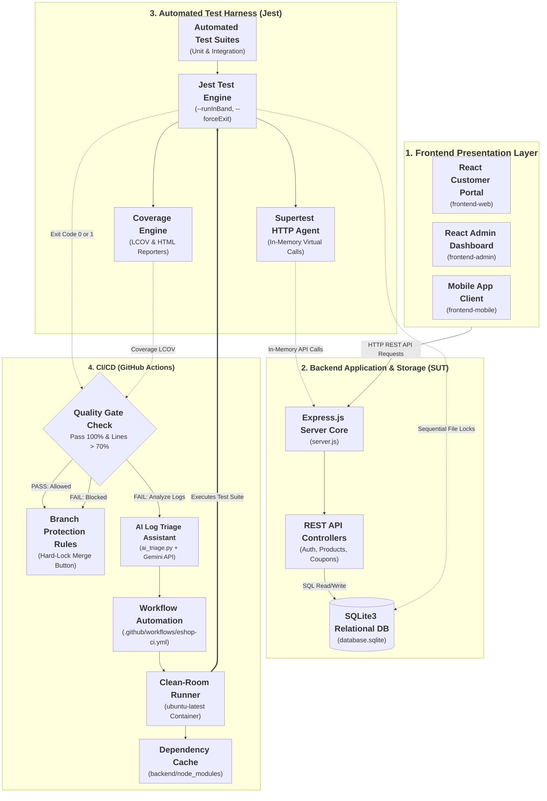

# EShop SUT — Comprehensive CI/CD Test Harness & Failure Modes Guide
**Course:** CSC13003 — Software Testing | Class: Testing-CQ2023-3-LQVu  
**Topic:** T07 — CI/CD & Automated Test-Harness Engineering  
**System Under Test (SUT):** EShop Monorepo (Node.js/Express, SQLite3, Jest, React, GitHub Actions)  
**Repository:** [SoftwareTesting-Group13/eshop-sut-seminar](https://github.com/SoftwareTesting-Group13/eshop-sut-seminar)  
**Contributors (Group 13):**
- Nguyen Ngoc Minh Tuan (23120102)
- Duong Nhat Cuong (23120223) 
- Tran Gia Cuong (23120225) 
- Nguyen Gia Huy (23120273)
**Supervising Faculty:** Dr. Lam Quang Vu, Dr. Tran Duy Hoang, M.Sc. Truong Phuoc Loc, M.Sc. Ho Tuan Thanh  

---

## Table of Contents

- [1. Introduction & SUT Architecture Overview](#1-introduction--sut-architecture-overview)
  - [1.1 Purpose of This Guide](#11-purpose-of-this-guide)
  - [1.2 CI/CD as an Automated Test Harness](#12-cicd-as-an-automated-test-harness)
  - [1.3 SUT System Architecture & Monorepo Structure](#13-sut-system-architecture--monorepo-structure)
    - [1.3.1 Architectural Diagram: Monorepo & CI/CD Test Harness](#131-architectural-diagram-monorepo--cicd-test-harness)
    - [1.3.2 Monorepo Directory Layout & Component Roles](#132-monorepo-directory-layout--component-roles)
- [2. Installation, Prerequisites & Environment Setup](#2-installation-prerequisites--environment-setup)
  - [2.1 Hardware and Software Requirements](#21-hardware-and-software-requirements)
  - [2.2 Repository Cloning](#22-repository-cloning)
  - [2.3 Installing Dependencies](#23-installing-dependencies)
  - [2.4 SQLite Database Initialization](#24-sqlite-database-initialization)
  - [2.5 Environment Variables & GitHub Secrets](#25-environment-variables--github-secrets)
- [3. Quickstart & First Test Suite Execution](#3-quickstart--first-test-suite-execution)
  - [3.1 Running Unit Tests Locally](#31-running-unit-tests-locally)
  - [3.2 Understanding the Jest Test Engine](#32-understanding-the-jest-test-engine)
  - [3.3 The `--runInBand` Execution Flag](#33-the---runinband-execution-flag)
  - [3.4 Interpreting Test Outputs & Code Coverage](#34-interpreting-test-outputs--code-coverage)
- [4. CI/CD Pipeline Architecture & GitHub Actions Engineering](#4-cicd-pipeline-architecture--github-actions-engineering)
  - [4.1 Pipeline Design Principles](#41-pipeline-design-principles)
  - [4.2 Dependency Caching Strategy (`actions/cache`)](#42-dependency-caching-strategy-actionscache)
  - [4.3 Quality Gates & Fail-Fast Mechanism](#43-quality-gates--fail-fast-mechanism)
    - [4.3.1 Conceptual Foundation: Fail-Fast in CI/CD Test Harnesses](#431-conceptual-foundation-fail-fast-in-cicd-test-harnesses)
    - [4.3.2 Architectural Diagram: CI/CD Pipeline & Quality Gate Fail-Fast Flow](#432-architectural-diagram-cicd-pipeline--quality-gate-fail-fast-flow)
    - [4.3.3 Execution Lifecycle Step-by-Step Breakdown](#433-execution-lifecycle-step-by-step-breakdown)
  - [4.4 Pull Request Branch Protection Rules](#44-pull-request-branch-protection-rules)
- [5. Advanced Pipeline Features](#5-advanced-pipeline-features)
  - [5.1 Code Coverage Enforcement (LCOV Reporting)](#51-code-coverage-enforcement-lcov-reporting)
  - [5.2 Runtime Compatibility (Current Scope)](#52-runtime-compatibility-current-scope)
  - [5.3 Specialized Assistant: AI-Powered Log Triage](#53-specialized-assistant-ai-powered-log-triage)
- [6. Deep-Dive Analysis of 3 Mandatory Failure Modes](#6-deep-dive-analysis-of-3-mandatory-failure-modes)
  - [6.1 Failure Mode 1: SQLite File Lock Concurrency (`SQLITE_BUSY`)](#61-failure-mode-1-sqlite-file-lock-concurrency-sqlite_busy)
    - [6.1.1 Overview & Failure Context](#611-overview--failure-context)
    - [6.1.2 Root Cause Analysis & Diagram](#612-root-cause-analysis)
    - [6.1.3 Reproducing Code Snippet & Command](#613-reproducing-code-snippet--command)
    - [6.1.4 Failure Symptoms & Error Logs](#614-failure-symptoms--error-logs)
    - [6.1.5 Step-by-Step Fix & Mitigation](#615-step-by-step-fix--mitigation)
    - [6.1.6 Verification & Regression Testing](#616-verification--regression-testing)
  - [6.2 Failure Mode 2: Coupon Percent Formula Bug](#62-failure-mode-2-coupon-percent-formula-bug)
  - [6.3 Failure Mode 3: Flaky Test Induced by Async Delays](#63-failure-mode-3-flaky-test-induced-by-async-delays)
- [7. Step-by-Step Local Reproduction & Verification Guide](#7-step-by-step-local-reproduction--verification-guide)
  - [7.1 Overview & Reproduction Workflow Matrix](#71-overview--reproduction-workflow-matrix)
  - [7.2 Step A: System Prerequisites & Environment Inspection](#72-step-a-system-prerequisites--environment-inspection)
  - [7.3 Step B: Installing Monorepo Dependencies & Database Initialization](#73-step-b-installing-monorepo-dependencies--database-initialization)
  - [7.4 Step C: Baseline Automated Test Suite Execution](#74-step-c-baseline-automated-test-suite-execution)
  - [7.5 Step D: Reproducing Failure Mode 1 (SQLite Lock Concurrency Collision)](#75-step-d-reproducing-failure-mode-1-sqlite-lock-concurrency-collision)
  - [7.6 Step E: Reproducing Failure Mode 2 (Coupon Formula Defect & Quality Gate Fail-Fast)](#76-step-e-reproducing-failure-mode-2-coupon-formula-defect--quality-gate-fail-fast)
  - [7.7 Step F: Reproducing Failure Mode 3 (Flaky Test Timing Race)](#77-step-f-reproducing-failure-mode-3-flaky-test-timing-race)
  - [7.8 Step G: GitHub Actions CI & Pull Request Verification](#78-step-g-github-actions-ci--pull-request-verification)
- [8. References & AI Disclosure Statement](#8-references--ai-disclosure-statement)
  - [8.1 Academic & Technical References](#81-academic--technical-references)
  - [8.2 Course AI Disclosure Statement](#82-course-ai-disclosure-statement)

---

## 1. Introduction & SUT Architecture Overview

### 1.1 Purpose of This Guide
This document serves as the canonical technical guide for **Seminar Topic T07: CI/CD & Automated Test-Harness Engineering**, within the CSC13003 Software Testing curriculum. The primary objective is to present an end-to-end automated testing infrastructure built around an active, full-stack application (**EShop System**). Rather than treating Continuous Integration / Continuous Deployment (CI/CD) as a generic DevOps delivery pipeline, this guide investigates CI/CD from the perspective of **Software Testing** — specifically as an **Automated Test Harness** and a **Quality Gate Enforcement Mechanism**.

### 1.2 CI/CD as an Automated Test Harness
In modern software engineering, automated unit and integration tests only deliver their full defensive value when executed deterministically and unavoidably on every code change:

```
┌─────────────────────────────────────────────────────────────────────────────────┐
│                     TEST HARNESS & QUALITY GATE ARCHITECTURE                    │
├─────────────────────┬───────────────────────────┬───────────────────────────────┤
│ Pull Request (PR)   │ CI Automated Test Harness │ Branch Protection Gate        │
│ Developer submits   │ • Restore package cache   │ • Quality Gate check (> 70%)  │
│ incremental commit  │ • Run Jest Test Suites    │ • PASS  → Unlock PR Merge     │
│ to topic branch     │ • Generate LCOV report    │ • FAIL  → HARD BLOCK Merge    │
└─────────────────────┴───────────────────────────┴───────────────────────────────┘
```

1. **Deterministic Test Harness:** The CI runner acts as a clean-room test harness. It spins up a pristine Ubuntu virtual environment, downloads dependencies, initializes a temporary test database, and runs unit tests in isolation from local developer machine quirks.
2. **Quality Gate via Branch Protection:** Pull Requests cannot be merged into the `main` branch unless the CI test job reports a 100% pass rate, line coverage is greater than 70%, and the LCOV report is present. If a regression is introduced, the Quality Gate triggers a **Fail-Fast** shutdown, locking the GitHub merge button.

### 1.3 SUT System Architecture & Monorepo Structure
The target System Under Test is **EShop**, an e-commerce platform organized as a modular repository with a Node.js/Express backend, SQLite relational persistence, Jest test runner, and multiple client interfaces.

#### 1.3.1 Architectural Diagram: Monorepo & CI/CD Test Harness
The following architectural diagram illustrates the structural organization of the EShop Monorepo and its interaction with the Automated Test Harness and GitHub Actions CI/CD infrastructure:




#### 1.3.2 Monorepo Directory Layout & Component Roles
```
eshop-sut-seminar/
├── .github/
│   ├── scripts/
│   │   ├── ai_triage.py                 # Specialized AI Log Triage script (Google Gemini API)
│   │   ├── configure-branch-protection.sh # Automation script for GitHub Branch Protection Rules
│   │   ├── quality-gate.js              # Single Source of Truth for Quality Gate evaluation
│   │   └── README.md                    # Technical documentation for CI scripts
│   └── workflows/
│       └── eshop-ci.yml                 # GitHub Actions CI/CD workflow pipeline
├── backend/
│   ├── coupon-discount.js               # Pure domain business logic (coupon calculations & validation)
│   ├── database.js                      # SQLite database connection & schema seeding logic
│   ├── database.sqlite                  # SQLite persistent database file
│   ├── jest.config.js                   # Unified Jest test runner & coverage configuration
│   ├── jest.demo.config.js              # Dedicated Jest config for coupon unit tests & CI demo
│   ├── server.js                        # Express REST API application entrypoint & routing
│   ├── package.json                     # Backend npm scripts, dependencies & test commands
│   ├── package-lock.json                # Pinned dependency checksums for CI caching
│   ├── tests/                           # Jest automated unit & integration test suites
│   │   ├── health.test.js               # Smoke & server availability tests
│   │   ├── auth.test.js                 # Authentication & user registration integration tests
│   │   ├── coupon-discount.unit.test.js # 21 Data-Driven unit tests for coupon business logic
│   │   ├── coupon.test.js               # Coupon REST API integration tests (Failure Mode 2 demo)
│   │   └── shop-flows.test.js           # End-to-end shopping cart & checkout flow tests
│   └── demos/                           # Standalone failure reproduction test fixtures
│       ├── flaky-delay.demo.js          # Async delay & sleep-based flaky test demonstration
│       └── jest.flaky.config.cjs        # Dedicated Jest configuration for flaky test suite
├── frontend-web/                        # Customer web storefront (React + Vite)
├── frontend-admin/                      # Administrative management portal (React + Vite)
├── frontend-mobile/                     # Mobile customer client
├── Proposal/                            # Academic seminar proposal & survey documentation
├── Plan/                                # Seminar development milestones & checklists
└── Weekly_Reports/                      # Weekly audit logs, meeting minutes & commit tracking
```

---

## 2. Installation, Prerequisites & Environment Setup

### 2.1 Hardware and Software Requirements
To replicate the local test harness and execute all test suites, the following toolchains are required:
- **Operating System:** Linux (Ubuntu 22.04 LTS / 24.04 LTS recommended), macOS (13+), or Windows 10/11 with PowerShell 7+.
- **Node.js Runtime:** Version `20.x` or `22.x LTS` (GitHub Actions CI runner uses Node.js 22 LTS; minimum supported: `18.16.0`).
- **Package Manager:** `npm` version `9.x` or `10.x`.
- **Git Version Control:** Git `2.40+`.
- **Python (optional, for AI Triage Assistant):** Python `3.10+`. The repository script uses only the Python standard library; a local Gemini API key is required to call the external service.

### 2.2 Repository Cloning
Clone the official team repository from the GitHub Organization:

```bash
git clone https://github.com/SoftwareTesting-Group13/eshop-sut-seminar.git
cd eshop-sut-seminar
```

### 2.3 Installing Dependencies
Navigate to the backend directory and install all production and development dependencies:

```bash
cd backend
npm install
```

The core testing and application dependencies installed in `backend/package.json` include:
- `jest` (`^30.x`): Primary test runner, assertion library, and coverage analysis engine.
- `supertest` (`^7.x`): HTTP assertion library for exercising Express endpoints via in-memory synthetic calls.
- `express` (`^5.x`): Backend HTTP application framework.
- `sqlite3` (`^6.x`): Embedded relational database driver.

Key test execution scripts available in `backend/package.json`:
- `npm test`: Runs the test suite sequentially with code coverage collection.
- `npm run test:coverage`: Executes Jest with `--runInBand` and outputs HTML & LCOV reports.
- `npm run test:ci`: Executes full test suite in CI mode with JSON and LCOV output (`coverage/jest-results.json`).
- `npm run test:ci:demo`: Runs the isolated coupon business logic unit test suite for fast Quality Gate verification.
- `npm run test:flaky`: Executes the async delay demonstration suite under configurable timing profiles (`FLAKY_PROFILE`).
- `npm run quality-gate`: Evaluates coverage and test outcomes against the mandatory Quality Gate policy.

### 2.4 SQLite Database Initialization
EShop utilizes an embedded SQLite3 database. The backend automatically initializes table schemas upon first launch. To create or reset the local development database:

```bash
# Initialize and seed the SQLite database with default schemas and mock records
node database.js
```

*Note: `backend/database.js` inspects `process.env.NODE_ENV`. In test mode (`NODE_ENV=test`), it automatically instantiates an isolated in-memory database (`:memory:`) to prevent mutating persistent developer records in `database.sqlite`.*

### 2.5 Environment Variables & GitHub Secrets
The application supports configuration via environment variables. For local testing, copy the example template:

The current repository does not include an `.env.example` file and the normal test commands do not require a local `.env` file. The relevant CI variables are:

| Variable Name | Default Value | Purpose |
| :--- | :--- | :--- |
| `PORT` | `3000` | Port for Express HTTP listener (bypassed during in-memory Supertest execution) |
| `NODE_ENV` | Set by Jest | Jest test runs use `:memory:` SQLite; development runs use `backend/database.sqlite` |
| `COVERAGE_THRESHOLD` | `70` | Enforced minimum line coverage percentage evaluated by `quality-gate.js` |
| `GEMINI_API_KEY` | *(Secret)* | Required for GitHub Actions step running `ai_triage.py` on test failure |
| `GEMINI_MODEL` | `gemini-3.5-flash-lite` | Google Gemini model identifier used for automated failure triage |
| `GITHUB_TOKEN` | *(GitHub Actions token)* | Used by GitHub Actions integrations; branch-protection configuration may require a separately authorized token |

---

## 3. Quickstart & First Test Suite Execution

### 3.1 Running Unit Tests Locally
Once dependencies are installed, execute the entire automated test suite using the standard npm test command:

```bash
npm test
```

### 3.2 Understanding the Jest Test Engine
Jest discovers and executes all test files matching the pattern `tests/**/*.test.js`. In EShop, tests are partitioned into distinct suites:
1. **Smoke & Health Tests (`health.test.js`):** Validates that base endpoints (`/api/products`, `/api/categories`) respond with HTTP 200 OK and valid JSON payloads.
2. **Authentication Tests (`auth.test.js`):** Exercises user registration, password hashing with bcrypt, and JWT token issuance.
3. **Domain Business Unit Tests (`coupon-discount.unit.test.js`):** 21 Data-Driven unit tests covering `calculateDiscount`, `validateCoupon`, and `buildCouponResult` without HTTP overhead.
4. **Coupon REST API Integration Tests (`coupon.test.js`):** Exercises the `/api/apply-coupon` endpoint against boundary conditions and demonstrates Failure Mode 2.
5. **Order Tests (`orders.test.js`):** Covers order creation and related API behavior.
6. **Coupon API Tests (`coupons.test.js`):** Covers coupon usage and API-level coupon behavior.
7. **End-to-End Shop Flow Tests (`shop-flows.test.js`):** Validates full user purchase lifecycles: adding products to cart, applying discounts, checking out, and verifying order records.

The synthetic flakiness demo (`demos/flaky-delay.demo.js`) is a separate demonstration suite and is not included in the default `npm test` run.

### 3.3 The `--runInBand` Execution Flag
When executing tests that write to the shared SQLite database file, Jest must be instructed to run sequentially on a single thread using the `--runInBand` (or `-i`) flag:

```json
"scripts": {
  "start": "node server.js",
  "test": "jest --runInBand --detectOpenHandles --forceExit --coverage",
  "test:flaky": "jest --config demos/jest.flaky.config.cjs --runInBand",
  "test:coverage": "jest --runInBand --detectOpenHandles --forceExit --coverage",
  "test:ci": "jest --runInBand --detectOpenHandles --forceExit --coverage --json --outputFile=coverage/jest-results.json --ci",
  "test:ci:demo": "jest --config jest.demo.config.js --runInBand --coverage --verbose --json --outputFile=coverage/jest-results.json --ci",
  "quality-gate": "node ../.github/scripts/quality-gate.js"
}
```

*Note: Without `--runInBand`, Jest spawns parallel worker processes that concurrently attempt to acquire write locks on `database.sqlite`, triggering `SQLITE_BUSY` errors. See Section 6.1 for detailed analysis.*

### 3.4 Interpreting Test Outputs & Code Coverage
Running `npm run test:coverage` compiles an execution summary and an LCOV coverage report:

```text
 PASS  tests/health.test.js
 PASS  tests/auth.test.js
 PASS  tests/coupon-discount.unit.test.js
 PASS  tests/coupon.test.js
PASS  tests/orders.test.js
PASS  tests/coupons.test.js
PASS  tests/shop-flows.test.js

--------------------|---------|----------|---------|---------|-------------------
File                | % Stmts | % Branch | % Funcs | % Lines | Uncovered Line #s 
--------------------|---------|----------|---------|---------|-------------------
All files           |   74.52 |    57.44 |   77.92 |   78.81 |                   
 coupon-discount.js |  100.00 |   100.00 |  100.00 |  100.00 |                   
 database.js        |   97.77 |    50.00 |  100.00 |   97.77 | 10                
 server.js          |   68.65 |    50.42 |   76.05 |   73.56 |                   
--------------------|---------|----------|---------|---------|-------------------

Test Suites: 7 passed, 7 total
Tests:       61 passed, 61 total
Snapshots:   0 total
Time:        4.128 s
Ran all test suites.
```

---

## 4. CI/CD Pipeline Architecture & GitHub Actions Engineering

### 4.1 Pipeline Design Principles
The automated CI pipeline in EShop is codified in `.github/workflows/eshop-ci.yml`. It runs security scanning, a focused unit-test job, a quality gate, and frontend/backend build packaging. The current workflow creates downloadable build artifacts; it does not deploy the application to a hosting or production environment.

1. **Clean-Room Ephemeral Runners:** Every pipeline execution provisions a pristine, isolated virtual container (`ubuntu-latest`) running Node.js 22 LTS. This eliminates "works on my machine" environmental discrepancies, zombie background processes, and residual database artifacts.
2. **Event-Driven Triggers & Concurrency Throttling:**
   - **Triggers:** Active on all branch pushes (`push: branches: ['**']`), Pull Requests targeting core branches (`pull_request: branches: [main, master]`), and manual triggers (`workflow_dispatch`).
   - **Auto-Cancellation:** Uses `concurrency: cancel-in-progress: true` keyed by branch ref. If a developer pushes incremental commits rapidly, obsolete in-flight test runs are immediately canceled to conserve cloud runner quota.
3. **Defense-in-Depth Phased Execution:**
   - **Stage 1 (Secret Scanning):** Gitleaks performs static analysis on full Git history (`fetch-depth: 0`) to detect leaked tokens or keys before running any application code.
   - **Stage 2 (Automated Test Harness):** Runs the focused `coupon-discount.unit.test.js` Jest suite with LCOV coverage collection and console output capture.
   - **Stage 3 (Quality Gate Enforcement):** Executes `quality-gate.js` to evaluate test outcomes and coverage thresholds.
   - **Stage 4 (Artifact Packaging):** Builds frontend bundles and packages backend archives only after the quality gate and security scan succeed. This is packaging, not deployment.
   - **Stage 5 (Observable Audit Trail):** Generates `ci-audit.json` capturing execution status across all jobs for audit compliance.

### 4.2 Dependency Caching Strategy (`actions/cache`)
To prevent network bottlenecks and accelerate developer feedback loops, the CI pipeline integrates aggressive dependency caching:

- **Targeted Directory:** Caches `backend/node_modules` directly to avoid re-running package linking on subsequent runs.
- **Cache Key Cryptography:** The cache key is bound to the runner OS, Node runtime, and the cryptographic SHA-256 hash of `backend/package-lock.json`:
  ```yaml
  - name: Cache backend/node_modules
    id: cache-node-modules
    uses: actions/cache@v5
    with:
      path: backend/node_modules
      key: ${{ runner.os }}-node22-${{ hashFiles('backend/package-lock.json') }}
      restore-keys: |
        ${{ runner.os }}-node22-
  ```
- **Conditional Bypass (`npm ci`):** When `steps.cache-node-modules.outputs.cache-hit == 'true'`, the pipeline skips `npm ci` completely.
- **Empirical Performance Delta:**
  - *Cold Run (Cache Miss):* Full package download and dependency tree resolution requires ~40–50 seconds.
  - *Warm Run (Cache Hit):* Cache decompression completes in ~6–8 seconds (an ~82% reduction in job duration).
- **Audit Logging:** The cache evaluation status (`hit` vs `miss`) and dependency count are automatically formatted into markdown and appended to GitHub Actions `$GITHUB_STEP_SUMMARY`.

### 4.3 Quality Gates & Fail-Fast Mechanism

#### 4.3.1 Conceptual Foundation: Fail-Fast in CI/CD Test Harnesses
In continuous testing, a **Quality Gate** is an automated milestone within the delivery pipeline that enforces strict non-negotiable criteria before code can progress or merge into protected branches. The **Fail-Fast** engineering principle dictates that whenever a critical assertion or baseline requirement is violated, the pipeline terminates execution immediately without wasting computational time or cloud runner quota on subsequent stages.

In the EShop CI/CD Test Harness, the Quality Gate script (`.github/scripts/quality-gate.js`) acts as the Single Source of Truth, evaluating 3 non-negotiable criteria:
1. **Test Criterion (Test Gate):** 100% of the test suites and test cases executed by the CI demo job must terminate with `Exit Code 0`. The local `npm test` command runs the broader backend suite; the workflow currently gates the focused coupon unit-test suite.
2. **Minimum Coverage Threshold Criterion (Coverage Gate):** Line coverage must be greater than the mandatory threshold (`> 70%`, configured through `COVERAGE_THRESHOLD`). Statements, branches, and functions are tracked and reported in the audit table.
3. **Traceability & LCOV Generation (LCOV Gate):** The standardized coverage tracefile (`coverage/lcov.info`) must be generated and verified.

---

#### 4.3.2 Architectural Diagram: CI/CD Pipeline & Quality Gate Fail-Fast Flow
The following sequence illustrates the complete execution lifecycle from developer commit to branch protection gating and automated failure recovery:


---

#### 4.3.3 Execution Lifecycle Step-by-Step Breakdown

| Stage | Action / Component | Operational Mechanism & Verification |
| :--- | :--- | :--- |
| **1. Trigger** | `pull_request` / `push` | Triggered whenever code is proposed against `main`. Initializes a clean-room ephemeral container (`ubuntu-latest`) to eliminate environmental flakiness. |
| **2. Caching** | `actions/cache@v5` | Evaluates the lockfile-based cache key. On a cache hit, dependency restoration is faster than a fresh install. |
| **3. Test Harness** | `npm run test:ci:demo` | Executes the focused coupon unit-test suite with coverage and JSON results. The local `npm test` command runs the broader 7-suite backend test set. |
| **4. Quality Gate** | Triple Validation Engine (`quality-gate.js`) | Verifies zero test failures, line coverage `> 70%`, and LCOV trace file presence. If any criterion fails, the Quality Gate job fails and the dependent build job is skipped. |
| **5A. Merge Pass** | Branch Protection | When all required status checks turn green, GitHub's Branch Protection Rules allow the *"Merge pull request"* button to unlock. |
| **5B. Fail Triage** | Specialized AI Assistant | If the gate fails, GitHub Actions invokes `.github/scripts/ai_triage.py` using `GEMINI_API_KEY`, parsing the raw failure stack trace and annotating the Pull Request with an actionable fix. |

### 4.4 Pull Request Branch Protection Rules
To enforce software quality defensively, GitHub's Branch Protection Rules should be configured on the primary integration branch (`main`). The rules described below are the intended repository policy; their active status must be verified in GitHub repository settings.

#### 4.4.1 Protected Branch Policies & Configuration
The protection rules are automated via the script `.github/scripts/configure-branch-protection.sh`, which interfaces with the GitHub REST API (`PUT /repos/:owner/:repo/branches/main/protection`):

1. **Required Status Checks (`strict: true`):**
   A Pull Request cannot be merged until all of the following specific checks report green:
   - `Quality Gate (Tests & Coverage > 70%)` (verifies 100% tests pass and minimum coverage)
   - `Gitleaks Secret Scan` (verifies zero committed credentials or tokens)
   - `Build (web, admin, backend package)` (verifies frontend production bundles and backend archive packaging)
2. **Up-to-Date Branch Enforcement:** The `strict: true` flag requires that the topic branch be fully up to date with the latest commit on `main` before merging, preventing race conditions and silent integration breaks.
3. **Admin Enforcement (`enforce_admins: true`):** Administrators are strictly bound by the same branch protection rules to eliminate privileged human error.
4. **Mandatory Peer Reviews:** Requires at least 1 approving code review (`required_approving_review_count: 1`) from team members.

#### 4.4.2 CLI Automation Script Usage
Repository maintainers can inspect and apply these protections using the shell script:

```bash
# Preview API payload without mutating GitHub repository settings
bash .github/scripts/configure-branch-protection.sh --dry-run

# Apply branch protection rules using a Personal Access Token with repo admin scope
export GITHUB_TOKEN="ghp_your_token_here"
bash .github/scripts/configure-branch-protection.sh

# Audit and display currently active protection rules on main
bash .github/scripts/configure-branch-protection.sh --show
```

---

## 5. Advanced Pipeline Features

### 5.1 Code Coverage Enforcement (LCOV Reporting)
Code coverage provides quantitative visibility into which lines, statements, functions, and branches are actively exercised by the test harness.

1. **Dual-Tier Coverage Configuration (`jest.config.js` vs `jest.demo.config.js`):**
   - In development and comprehensive CI runs, Jest gathers coverage across all SUT modules (`server.js`, `database.js`, `coupon-discount.js`), excluding test fixtures and demo scripts.
   - For focused CI demonstration runs, `jest.demo.config.js` targets the domain business logic (`coupon-discount.js`) to provide sub-second Quality Gate feedback.
2. **Multi-Format Coverage Artifacts:**
   Jest produces standardized reports in `backend/coverage/`:
   - `lcov.info`: Machine-readable tracefile used by SonarQube, Coveralls, and the Quality Gate engine.
   - `coverage-summary.json`: Granular JSON metrics for statements, branches, functions, and lines.
   - `index.html`: Interactive browser-based visualization highlighting executed versus uncovered source lines.
3. **CI Artifact Retention & PR Commenting:**
   - Every CI run uploads `backend/coverage` as a workflow artifact (`eshop-coverage`) with 14-day retention via `actions/upload-artifact@v6`.
   - The Quality Gate script generates a formatted Markdown audit table (`quality-gate-report.md`) and automatically posts or updates it as a comment on the corresponding Pull Request.

### 5.2 Runtime Compatibility (Current Scope)
The current workflow runs on Node.js 22 only. A multi-version matrix is a possible extension, but it is not configured in `.github/workflows/eshop-ci.yml` and should not be presented as an executed CI capability.

1. **Target Runtime Environment:**
   The CI runner uses Node.js 22 LTS on `ubuntu-latest`. Local development may use Node.js 20 or 22 LTS.
2. **Possible future matrix strategy:**
   If cross-version compatibility becomes a requirement, add a matrix explicitly to the workflow. The following is an example design, not the current configuration:
   ```yaml
   strategy:
     matrix:
       node-version: [18.x, 20.x, 22.x]
   steps:
     - uses: actions/setup-node@v7
       with:
         node-version: ${{ matrix.node-version }}
         cache: 'npm'
   ```
3. **Scope limitation:**
   Because the matrix is not currently enabled, this guide makes no claim that Node.js 18, 20, and 22 have been verified by GitHub Actions.

### 5.3 Specialized Assistant: AI-Powered Log Triage
When tests fail in cloud CI environments, developers often spend substantial time sifting through voluminous console logs to decipher obscure stack traces. EShop integrates an automated AI Triage Assistant (`.github/scripts/ai_triage.py`) powered by Google's Gemini LLM.

#### 5.3.1 Operational Workflow & Trigger Conditions
The AI Triage Assistant operates under tightly scoped, cost-effective conditions in `.github/workflows/eshop-ci.yml`:
- **Conditional Trigger:** Executes **only** when `github.event_name == 'pull_request'` AND `needs.backend-test.result == 'failure'`. Push events to feature branches and successful test runs do not invoke the AI service.
- **Input Artifacts:** Reads the raw test console output (`backend/coverage/jest-console.log`), the relevant source file (`backend/coupon-discount.js`), and the exact reproduction command.
- **Model Configuration:** Connects to `gemini-3.5-flash-lite` (or `gemini-1.5-flash`) using the secure repository secret `GEMINI_API_KEY`.

#### 5.3.2 Structured Diagnosis Output (Hypothesis Tree)
The AI assistant analyzes the failure log and synthesizes an actionable Markdown diagnosis report (`ai-triage.md`) featuring:
1. **Executive Summary:** A concise 2-sentence summary identifying the failing test suite and assertion error.
2. **Hypothesis Tree:** A structured hierarchy of 2–3 ranked potential root causes, complete with confidence percentages and technical rationales.
3. **Actionable Code Diff:** A precise `unified diff` proposing the exact code modification required to resolve the defect.
4. **Local Verification Command:** The exact terminal command needed to verify the fix locally prior to pushing.

#### 5.3.3 Automated PR Comment Annotation
Using `actions/github-script@v8`, the CI pipeline scans the Pull Request discussion for a unique bot marker `<!-- eshop-ai-triage -->`. If an existing comment is found from a previous run, the bot updates the existing comment in-place; otherwise, it posts a new comment. This prevents cluttering the Pull Request with duplicate comments across iterative commits.

---

## 6. Deep-Dive Analysis of 3 Mandatory Failure Modes

### 6.1 Failure Mode 1: SQLite File Lock Concurrency (`SQLITE_BUSY`)

#### 6.1.1 Overview & Failure Context
In modern web applications, embedded relational engines like SQLite3 are widely utilized for lightweight deployments, prototypes, and local development due to their zero-configuration and serverless architecture. However, during automated integration and unit testing with Jest, teams frequently encounter catastrophic pipeline crashes bearing the error:
```text
Error: SQLITE_BUSY: database is locked
```
This failure mode represents a fundamental architectural mismatch between **Jest's parallel worker model** and **SQLite's file-level locking concurrency model**.

---

#### 6.1.2 Root Cause Analysis
The failure stems from the convergence of two distinct architectural behaviors:

```
┌────────────────────────────────────────────────────────────────────────────────────────┐
│                      JEST MULTI-WORKER VS SQLITE CONCURRENCY CONFLICT                   │
├────────────────────────────────────────────────────────────────────────────────────────┤
│                                                                                        │
│   Jest Test Engine (Default: Multi-Worker Pool)                                        │
│   ┌──────────────────────────┐             ┌──────────────────────────┐                │
│   │ Worker 1 (auth.test.js)  │             │ Worker 2 (order.test.js) │                │
│   └─────────────┬────────────┘             └────────────┬─────────────┘                │
│                 │ (1) BEGIN IMMEDIATE                   │ (2) INSERT INTO ...          │
│                 ▼                                       ▼                              │
│   ┌───────────────────────────────────────────────────────────────────┐                │
│   │ SQLite OS File Lock System (database.sqlite via fcntl / LockFile) │                │
│   │ • State: EXCLUSIVE Lock held by Worker 1                          │                │
│   │ • Action on Worker 2 request: REJECT IMMEDIATELY                 │                │
│   └──────────────────────────────────┬────────────────────────────────┘                │
│                                      │                                                 │
│                                      ▼                                                 │
│                        [Error: SQLITE_BUSY: database is locked]                        │
└────────────────────────────────────────────────────────────────────────────────────────┘
```

1. **SQLite Locking States & Single-Writer Constraint:**  
   SQLite implements transactional consistency using file-system level locks (`UNLOCKED` → `SHARED` → `RESERVED` → `PENDING` → `EXCLUSIVE`). While multiple processes can concurrently hold `SHARED` locks to read data, writing requires an `EXCLUSIVE` lock. When a connection acquires an `EXCLUSIVE` lock, no other connection can read from or write to the database file until the transaction commits or rolls back.
2. **Jest's Default Parallel Worker Pool:**  
   To minimize test execution time, Jest inspects the available CPU cores (`os.cpus().length`) and spawns a pool of worker processes (defaulting to `CPUs - 1`) to execute separate test suites concurrently. Each test worker loads the Express application and independently opens its own connection pool to the single `database.sqlite` file.
3. **Lock Collision Trigger:**  
   When `Worker 1` (executing `tests/auth.test.js`) performs a write operation (e.g., seeding a user via `POST /api/register`), SQLite elevates its lock to `EXCLUSIVE`. Simultaneously, `Worker 2` (executing another suite) attempts to insert or modify records. Because the default busy handler timeout in basic SQLite drivers is set to 0 milliseconds, the OS lock manager immediately rejects Worker 2's system call, throwing `SQLITE_BUSY: database is locked`.

---

#### 6.1.2.1 Architectural Diagram: SQLite Concurrency File-Locking & Mitigation Mechanism
The following architectural diagram illustrates the file-locking collision between concurrent Jest worker threads and contrasts it with the sequential single-threaded execution enforced by `--runInBand`:

```mermaid
%%{init: {
  'flowchart': {
    'nodeSpacing': 30,
    'rankSpacing': 35,
    'curve': 'basis',
    'htmlLabels': true,
    'subGraphTitleMargin': {
      'top': 25,
      'bottom': 15
    }
  },
  'themeVariables': {
    'fontSize': '16px',
    'fontFamily': 'Segoe UI, Helvetica, Arial, sans-serif'
  },
  'themeCSS': '.flowchart-link { stroke-width: 2.5px !important; } .marker { stroke-width: 2.5px !important; }'
}}%%
flowchart TB
    %% Scenario A: Parallel Multi-Worker Collision (Placed on Top)
    subgraph ParallelConflict ["<span style='font-size:22px; font-weight:600;'>A. Concurrent Write Collision (Default: Without --runInBand)</span>"]
        JestPoolA["<b><span style='font-size:20px;'>Jest Worker Pool</span></b><br/><span style='font-size:15px;'>(Parallel Workers: --maxWorkers=4)</span>"]
        Worker1A["<b><span style='font-size:18px;'>Worker 1: auth.test.js</span></b><br/><span style='font-size:14px;'>(POST /api/register)</span>"]
        Worker2A["<b><span style='font-size:18px;'>Worker 2: coupon.test.js</span></b><br/><span style='font-size:14px;'>(POST /api/coupons)</span>"]
        
        OSLockA[("<b><span style='font-size:20px;'>SQLite File Lock Manager</span></b><br/><span style='font-size:14px;'>(database.sqlite - Single-Writer Model)</span>")]
        LockStateA["<b><span style='font-size:18px;'>EXCLUSIVE Lock Active</span></b><br/><span style='font-size:14px;'>(Held by Worker 1 Transaction)</span>"]
        LockDeniedA["<b><span style='font-size:18px;'>OS Lock Rejected (fcntl EWOULDBLOCK)</span></b><br/><span style='font-size:14px;'>(Timeout = 0ms, Write Denied)</span>"]
        CrashErrorA["<b><span style='font-size:20px;'>Crash: SQLITE_BUSY</span></b><br/><span style='font-size:14px;'>('database is locked' -> Pipeline Exit Code 1)</span>"]

        JestPoolA --> Worker1A
        JestPoolA --> Worker2A
        Worker1A -->|1. BEGIN IMMEDIATE - Write| OSLockA
        Worker2A -.->|2. Concurrent Write Attempt| OSLockA
        OSLockA --> LockStateA
        LockStateA -->|3. Immediate Rejection| LockDeniedA
        LockDeniedA --> CrashErrorA
    end

    %% Vertical stacking link between Scenario A and Scenario B
    CrashErrorA ~~~ JestSingleB

    %% Scenario B: Serialized Execution with --runInBand (Placed Below)
    subgraph SerializedSuccess ["<span style='font-size:22px; font-weight:600;'>B. Deterministic Serialization (Mitigation: --runInBand)</span>"]
        JestSingleB["<b><span style='font-size:20px;'>Jest Single Main Thread</span></b><br/><span style='font-size:15px;'>(Sequential In-Band: --runInBand or -i)</span>"]
        Suite1B["<b><span style='font-size:18px;'>Suite 1: auth.test.js</span></b><br/><span style='font-size:14px;'>(Acquires Lock -> Writes -> Releases)</span>"]
        Suite2B["<b><span style='font-size:18px;'>Suite 2: coupon.test.js</span></b><br/><span style='font-size:14px;'>(Queued until Suite 1 Terminates)</span>"]
        
        OSLockB[("<b><span style='font-size:20px;'>SQLite File Lock Manager</span></b><br/><span style='font-size:14px;'>(database.sqlite - Orderly Transitions)</span>")]
        LockStateB["<b><span style='font-size:18px;'>Sequential Lock Cycles</span></b><br/><span style='font-size:14px;'>(UNLOCKED ↔ EXCLUSIVE Clean Handoff)</span>"]
        SuccessPassB["<b><span style='font-size:20px;'>100% Deterministic Pass</span></b><br/><span style='font-size:14px;'>(Zero Lock Collisions -> CI Exit Code 0)</span>"]

        JestSingleB --> Suite1B
        Suite1B -->|1. Write & Commit Transaction| OSLockB
        Suite1B ==>|2. Suite 1 Completes| Suite2B
        Suite2B -->|3. Clean Lock Acquisition & Write| OSLockB
        OSLockB --> LockStateB
        LockStateB --> SuccessPassB
    end

    %% Color-coded node styles
    classDef failNode fill:#fef2f2,stroke:#dc2626,stroke-width:2px;
    classDef passNode fill:#f0fdf4,stroke:#16a34a,stroke-width:2px;
    classDef dbNode fill:#f0f9ff,stroke:#0284c7,stroke-width:2px;

    class LockDeniedA,CrashErrorA failNode;
    class SuccessPassB,Suite1B,Suite2B,LockStateB passNode;
    class OSLockA,OSLockB dbNode;
    linkStyle default stroke-width:2.5px;
```



---

#### 6.1.3 Reproducing Code Snippet & Command
This failure mode is analyzed as a concurrency risk. In the current repository, Jest tests use an in-memory SQLite database under `NODE_ENV=test`, and the dedicated concurrency fixture is not checked in; therefore the failure is not claimed as a guaranteed one-command reproduction.

##### A. Illustrative Test Scenario (not checked in)
The repository does not currently contain `backend/tests/concurrency.demo.js`. The following fixture is illustrative only; it must be added as a separate demo before claiming that this failure mode is reproducible from the repository.
```javascript
const request = require('supertest');
const app = require('../server');

describe('Concurrent DB Write Collision Demo', () => {
  it('Worker thread attempts concurrent write while DB is locked', async () => {
    // Repeated write attempts to trigger transaction overlap
    const requests = Array.from({ length: 10 }).map((_, index) =>
      request(app)
        .post('/api/register')
        .send({
          name: `ConcurrentTester_${index}`,
          email: `race_${Date.now()}_${index}@example.com`,
          password: 'Password123!'
        })
    );

    const responses = await Promise.all(requests);
    responses.forEach((res) => {
      expect(res.status).toBe(200);
    });
  });
});
```

##### B. Reproduction Command (after adding the fixture)
To force Jest to spawn multiple parallel worker processes, run the fixture from `backend/`:
```bash
# Navigate to backend directory
cd backend

# Execute Jest with 4 parallel worker threads (bypassing in-band execution)
npx jest --maxWorkers=4 --no-cache tests/concurrency.demo.js
```

---

#### 6.1.4 Failure Symptoms & Error Logs
When the collision occurs, the affected test suite crashes immediately or returns an unexpected HTTP 500 Internal Server Error:

```text
FAIL  tests/auth.test.js
  ● Auth API Concurrency Test › POST /api/register should create a new user

    Error: SQLITE_BUSY: database is locked
        at Database.run (/node_modules/sqlite3/lib/sqlite3.js:134:21)
        at /backend/server.js:412:12
        at Layer.handle [as handle_request] (/node_modules/express/lib/router/layer.js:95:5)
        at next (/node_modules/express/lib/router/route.js:144:13)
        at Route.dispatch (/node_modules/express/lib/router/route.js:114:3)

  ● Smoke & Health Check APIs › GET /api/products should return HTTP 200
    ✕ Test suite failed to run: database connection closed prematurely due to unhandled lock exception.

Test Suites: 1 failed, 1 passed, 2 total
Tests:       1 failed, 3 passed, 4 total
Snapshots:   0 total
Time:        1.842 s
```

**Consequences on the CI/CD Pipeline:**
- **Pipeline Intermittency:** Tests may pass when executed individually on local machines with 1 worker, but fail randomly in CI environments where GitHub Actions runners dynamically allocate multi-core virtual machines.
- **Corrupted Fixtures:** Interrupted write transactions leave the SQLite database in an inconsistent or partially populated state, causing downstream tests to fail unpredictably.

---

#### 6.1.5 Proven Fix & Architectural Workarounds

##### Solution 1: Sequential Execution via `--runInBand` (Primary Recommended Fix)
The most robust and straightforward solution in monolithic test environments is instructing Jest to execute all test suites sequentially in the primary process, eliminating process-level file-lock contention entirely:

Update `backend/package.json`:
```json
{
  "scripts": {
    "test": "jest --runInBand --detectOpenHandles --forceExit",
    "test:coverage": "jest --runInBand --coverage"
  }
}
```

*Key Parameter Flags:*
- `--runInBand` (alias `-i`): Forces Jest to run all tests serially in the main process instead of creating a worker pool of child processes. Only one test suite executes at any given time, guaranteeing that only one write transaction accesses `database.sqlite`.
- `--detectOpenHandles`: Monitors and reports any asynchronous database handles or HTTP sockets that fail to close, preventing silent process hangs.
- `--forceExit`: Ensures Jest terminates cleanly after all tests finish, avoiding hanging CI runners.

##### Solution 2: SQLite Busy Timeout Configuration (`PRAGMA busy_timeout`)
For workloads where parallel workers are desired, SQLite can be configured with an active retry wait loop:
```javascript
// backend/config/database.js
const db = new sqlite3.Database('./database.sqlite');

// Instruct SQLite to wait up to 5000ms for busy locks to clear before throwing an error
db.run('PRAGMA busy_timeout = 5000;');
```

##### Solution 3: In-Memory / Isolated Temporary Database Fixtures
For enterprise scalability:
- **In-Memory Database (`:memory:`):** Configure each Jest worker process to initialize an independent in-memory SQLite database, isolating test data per worker.
- **Per-Process Database Files:** Dynamically create `database_${process.env.JEST_WORKER_ID}.sqlite` and destroy the file in an `afterAll()` teardown hook.

##### Architectural Comparison of Mitigation Strategies
| Mitigation Strategy | Concurrency Level | Execution Speed | Isolation Guarantee | Implementation Complexity |
| :--- | :---: | :---: | :---: | :---: |
| **`--runInBand` (Adopted)** | Serial (Single Thread) | High (for current suite) | Absolute (No lock collisions) | **Lowest (Zero code change)** |
| `PRAGMA busy_timeout` | Parallel with Retry | Medium (sleep penalties) | Moderate (Race risks remain) | Low |
| `WAL Mode` (`PRAGMA journal_mode=WAL`) | Multi-read / Single-write | High | Partial (Write collisions still fail) | Low |
| In-Memory per worker (`:memory:`) | Full Parallel | Very High | Perfect (Isolated memory) | High (Requires dynamic seeding) |


### 6.2 Failure Mode 2: Coupon Percent Formula Bug

#### 6.2.1 Overview & Business Context
In retail e-commerce applications, the coupon and discount engine is a mission-critical financial component. Any calculation defect can directly trigger financial vulnerability or severe customer attrition. 

In EShop, when applying a percentage-based discount coupon (such as `SAVE10` for a 10% discount) via the endpoint `POST /api/apply-coupon`, a severe mathematical calculation defect was introduced into the core routing logic in `backend/server.js`. The defect caused the coupon engine to produce a **massive negative discount amount**, which in turn caused the customer's order total to inflate by **tenfold (1,000%)** instead of discounting 10%.

This failure mode highlights the vital role of **Automated Regression Testing** and **Data-Driven Unit Testing (`test.each`)** in preventing defective business logic from bypassing code review and reaching production.

---

#### 6.2.2 Root Cause Analysis
The defect resides in two duplicated branches inside `backend/server.js` (lines 398–401 for authenticated users and lines 418–421 for guest users):

```javascript
// DEFECTIVE LOGIC in backend/server.js
let discount_amount = 0;
if (coupon.type === "percent") {
  discount_amount = Math.floor(
    total_amount * (1 - coupon.discount_value),
  );
} else {
  discount_amount = coupon.discount_value;
}
const final_amount = total_amount - discount_amount;
```

```
┌────────────────────────────────────────────────────────────────────────────────────────┐
│                        COUPON FORMULA FLAW (MATHEMATICAL TRACE)                        │
├────────────────────────────────────────────────────────────────────────────────────────┤
│ 1. Database Storage:                                                                   │
│    Coupon 'SAVE10' is stored with discount_value = 10 (representing 10%).             │
│                                                                                        │
│ 2. Faulty Formula Execution:                                                           │
│    discount_amount = Math.floor(total_amount * (1 - 10))                               │
│                    = Math.floor(total_amount * (-9))                                   │
│                                                                                        │
│ 3. Sample Order Calculation (total_amount = 1,000,000 ₫):                               │
│    • discount_amount = 1,000,000 * (-9)   = -9,000,000 ₫ (NEGATIVE DISCOUNT!)          │
│    • final_amount    = 1,000,000 - (-9,000,000) = 10,000,000 ₫ (PRICE MULTIPLIED 10x!) │
│                                                                                        │
│ 4. Correct Business Expectation (FR-09):                                               │
│    • discount_amount = (1,000,000 * 10) / 100 = 100,000 ₫                              │
│    • final_amount    = 1,000,000 - 100,000   = 900,000 ₫                               │
└────────────────────────────────────────────────────────────────────────────────────────┘
```

The underlying flaws include:
1. **Unit Dimension Confusion:** The developer assumed `discount_value` was stored as a normalized fraction (e.g., `0.10`), whereas the database schema stores integer percentages (e.g., `10`). Subtracting an integer `10` from `1` yields `-9`.
2. **Formula Inversion:** The developer attempted to calculate the remaining balance `total * (1 - rate)` but assigned that value to `discount_amount`. Then, line 406 subtracted `discount_amount` again: `total - (total * -9)`, compounding the calculation error into a 1,000% charge.
3. **Absence of Invariant Defenses:** The endpoint lacked mathematical boundary validation (e.g., `discount_amount >= 0` and `discount_amount <= total_amount`).

---

#### 6.2.3 Reproducing Code Snippet & Data-Driven Test Matrix
Rather than relying on ad-hoc manual verification, EShop incorporates automated Data-Driven unit tests in `backend/tests/coupon.test.js` using Jest's `test.each`. These tests enforce core domain invariants:

```javascript
// backend/tests/coupon.test.js
describe('Failure Mode 2 — discount_amount âm với coupon percent', () => {
  const total = 1000000;

  // Test both code branches: authenticated user vs guest session
  test.each([
    { branch: 'guest (server.js 417-432)', body: { code: 'SAVE10', total_amount: total } },
    { branch: 'authenticated user (server.js 386-415)', body: { code: 'SAVE10', total_amount: total, user_id: 2 } },
  ])('SAVE10 — branch $branch: discount_amount must NOT be negative', async ({ body }) => {
    const res = await request(app).post('/api/apply-coupon').send(body);

    expect(res.status).toBe(200);
    // Invariant 1: Discount amount must be non-negative
    expect(res.body.discount_amount).toBeGreaterThanOrEqual(0);
    // Invariant 2: Discount cannot exceed the subtotal
    expect(res.body.discount_amount).toBeLessThanOrEqual(total);
    // Invariant 3: Final payable amount must be non-negative
    expect(res.body.final_amount).toBeGreaterThanOrEqual(0);
    // Invariant 4: Final amount must not exceed original subtotal
    expect(res.body.final_amount).toBeLessThanOrEqual(total);
  });

  it('SAVE10 — final_amount must be strictly less than original subtotal', async () => {
    const res = await request(app).post('/api/apply-coupon').send({ code: 'SAVE10', total_amount: total });

    expect(res.status).toBe(200);
    // A valid discount coupon MUST decrease the customer's total payable
    expect(res.body.final_amount).toBeLessThan(total);
  });
});
```

---

#### 6.2.4 Failure Symptoms & Error Logs
When executed against the unpatched codebase, Jest immediately reports assertion failures indicating negative discounts and price inflation:

```text
FAIL  tests/coupon.test.js
  Failure Mode 2 — discount_amount âm với coupon percent
    ✕ SAVE10 — branch guest: discount_amount must NOT be negative (42 ms)
    ✕ SAVE10 — branch authenticated user: discount_amount must NOT be negative (31 ms)
    ✕ SAVE10 — final_amount must be strictly less than original subtotal (28 ms)

  ● Failure Mode 2 — discount_amount âm với coupon percent › SAVE10 — branch guest: discount_amount must NOT be negative

    expect(received).toBeGreaterThanOrEqual(expected)

    Expected: >= 0
    Received: -9000000

      138 |     expect(res.status).toBe(200);
    > 139 |     expect(res.body.discount_amount).toBeGreaterThanOrEqual(0);
          |                                      ^
      140 |     expect(res.body.discount_amount).toBeLessThanOrEqual(total);
      141 |     expect(res.body.final_amount).toBeGreaterThanOrEqual(0);

  ● Failure Mode 2 — discount_amount âm với coupon percent › SAVE10 — final_amount must be strictly less than original subtotal

    expect(received).toBeLessThan(expected)

    Expected: < 1000000
    Received: 10000000

      148 |     expect(res.status).toBe(200);
    > 149 |     expect(res.body.final_amount).toBeLessThan(total);
          |                                   ^

Test Suites: 1 failed, 1 total
Tests:       3 failed, 17 passed, 20 total
```

**Impact on CI/CD Quality Gate:**
- In the CI pipeline, this test failure causes `npm test` to exit with non-zero exit code (`1`).
- The GitHub Actions workflow triggers **Fail-Fast**, immediately canceling downstream packaging jobs.
- The **Branch Protection Rule** detects the failing `test-backend` required status check and **hard-locks the Pull Request merge button**, preventing this critical regression from entering `main`.

---

#### 6.2.5 Proven Fix & Invariant Defense
To eliminate the bug permanently, the calculation logic is corrected and wrapped with defensive boundary constraints:

##### Code Diff in `backend/server.js`:
```diff
- if (coupon.type === "percent") {
-   discount_amount = Math.floor(
-     total_amount * (1 - coupon.discount_value),
-   );
- } else {
-   discount_amount = coupon.discount_value;
- }
- const final_amount = total_amount - discount_amount;

+ if (coupon.type === "percent") {
+   // Correct percentage formula: (subtotal * percent) / 100
+   discount_amount = Math.floor((total_amount * coupon.discount_value) / 100);
+ } else {
+   discount_amount = coupon.discount_value;
+ }
+ 
+ // Defensive boundary clamping:
+ discount_amount = Math.max(0, Math.min(discount_amount, total_amount));
+ const final_amount = Math.max(0, total_amount - discount_amount);
```

##### Key Technical Defenses Applied:
1. **Accurate Formula (`(total_amount * coupon.discount_value) / 100`):** Properly handles integer percentage values.
2. **Defensive Clamping (`Math.min(discount_amount, total_amount)`):** Guarantees that discount can never exceed the total order value, preventing store credit overdrafts.
3. **Floor Clamping (`Math.max(0, ...)`):** Prevents negative totals regardless of corrupted database inputs or anomalous requests.


### 6.3 Failure Mode 3: Flaky Test Induced by Async Delays (`sleep` vs `await`)

#### 6.3.1 Overview & The Flaky Test Crisis
In automated test engineering, a **Flaky Test** is defined as a test that manifests non-deterministic outcomes (passing or failing intermittently) across repeated runs against identical, unmodified source code. 

Flaky tests represent one of the most pernicious threats to CI/CD pipelines. According to empirical studies by Google Testing and Martin Fowler, flakiness erodes developer trust in the automated Quality Gate (the "Cry Wolf" effect), prompting engineering teams to disregard legitimate pipeline failures or repeatedly re-trigger builds until an arbitrary pass is obtained.

In EShop, Failure Mode 3 demonstrates how non-deterministic asynchronous timing delays (`sleep`-based waiting) cause tests to pass reliably on local developer workstations but fail sporadically when deployed onto resource-constrained GitHub Actions runners.

---

#### 6.3.2 Root Cause Analysis
The fundamental architectural anti-pattern is **guessing completion time** using arbitrary timeouts (`setTimeout` / `sleep`) rather than implementing **deterministic event-driven synchronization** (`await` / `Promise` / event polling).

```
┌────────────────────────────────────────────────────────────────────────────────────────┐
│                        LOCAL VS CI ASYNC EXECUTION TIMELINE                            │
├────────────────────────────────────────────────────────────────────────────────────────┤
│                                                                                        │
│ [Scenario A: Local Developer Workstation — Low CPU Load / Fast Execution]              │
│ Work Duration: 20 ms | Sleep Duration: 100 ms                                          │
│                                                                                        │
│ T = 0ms                T = 20ms                     T = 100ms                          │
│ ├──────────────────────┼────────────────────────────┼────────────────────────► Time    │
│ Start Async Work ────► Work Completes (ready=true)                                     │
│ Start sleep(100ms) ───────────────────────────────► Assert (ready === true) → PASS!   │
│                                                                                        │
│ ────────────────────────────────────────────────────────────────────────────────────── │
│                                                                                        │
│ [Scenario B: Cloud CI/CD Runner — CPU Throttling / I/O Jitter / Slow Execution]        │
│ Work Duration: 200 ms | Sleep Duration: 100 ms                                         │
│                                                                                        │
│ T = 0ms                                             T = 100ms       T = 200ms          │
│ ├───────────────────────────────────────────────────┼───────────────┼────────► Time    │
│ Start Async Work ───────────────────────────────────┼──────────────► Work Completes    │
│ Start sleep(100ms) ───────────────────────────────► Assert (ready)                     │
│                                                     (ready=FALSE!)                     │
│                                                     → FAILS! (FLAKY)                   │
└────────────────────────────────────────────────────────────────────────────────────────┘
```

1. **Environmental Inconsistency:** Developer machines usually have dedicated CPU cores and high clock frequencies, allowing background tasks (e.g., SQLite file writes, token hashing, async queue processing) to complete within 10–30 ms. In contrast, cloud CI runners (GitHub-hosted Ubuntu runners) operate in shared multi-tenant virtualization environments where CPU time-slicing and disk I/O latency fluctuate drastically.
2. **Race Condition Mechanics:** When a test relies on `await sleep(100)`, it creates an implicit race condition between the test runner thread and the background worker. If CPU starvation causes the task to take 120 ms, the assertion executes at 100 ms, inspects incomplete state, and immediately fails.

---

#### 6.3.3 Reproducing Code Snippet & Benchmark Harness
EShop includes a dedicated synthetic demonstration suite (`backend/demos/flaky-delay.demo.js`) controlled by the `FLAKY_PROFILE` environment variable to reliably reproduce this behavior without database dependencies.

##### A. Reproducing Test Scenario (`backend/demos/flaky-delay.demo.js`)
```javascript
// backend/demos/flaky-delay.demo.js
const sleep = (ms) => new Promise((resolve) => setTimeout(resolve, ms));
const profile = process.env.FLAKY_PROFILE || 'random';
const waitMs = 100;

// Controlled fault injection: 'fast' takes 20ms, 'slow' takes 200ms
const workDelayMs = profile === 'fast' ? 20
  : profile === 'slow' ? 200
    : Math.random() < 0.5 ? 20 : 200;

function startAsyncWork() {
  const state = { ready: false };
  const completed = sleep(workDelayMs).then(() => {
    state.ready = true;
  });
  return { state, completed };
}

describe('Failure Mode 3 - async delay / sleep-based flaky test', () => {
  // ANTI-PATTERN: Guessing completion using arbitrary sleep
  test('sleep-based wait can inspect work before completion', async () => {
    const job = startAsyncWork();
    try {
      await sleep(waitMs); // Guesses that 100ms is enough
      expect(job.state.ready).toBe(true);
    } finally {
      await job.completed; // Drain timer to prevent memory leaks
    }
  });

  // DETERMINISTIC PATTERN: Awaiting the actual promise handle
  test('await completion waits for the work instead of guessing a delay', async () => {
    const job = startAsyncWork();
    await job.completed; // Deterministically waits for completion regardless of duration
    expect(job.state.ready).toBe(true);
  });
});
```

##### B. Reproduction Commands
Execute the demonstration with different environment profiles:
```powershell
# 1. Fast profile (Simulating local machine): Both tests PASS
$env:FLAKY_PROFILE = 'fast'
npm --prefix backend run test:flaky

# 2. Slow profile (Simulating CPU throttling in CI): sleep FAILS, await PASSES
$env:FLAKY_PROFILE = 'slow'
npm --prefix backend run test:flaky

# 3. Random profile (Simulating intermittent CI flakiness across runs)
$env:FLAKY_PROFILE = 'random'
npm --prefix backend run test:flaky
```

---

#### 6.3.4 Failure Symptoms & Error Logs
Under the `slow` or throttled profile, the terminal reveals an assertion failure in the sleep-based test, while the await-based test succeeds unconditionally:

```text
FAIL  demos/flaky-delay.demo.js
  Failure Mode 3 - async delay / sleep-based flaky test
    ✕ sleep-based wait can inspect work before completion (105 ms)
    ✓ await completion waits for the work instead of guessing a delay (204 ms)

  ● Failure Mode 3 - async delay / sleep-based flaky test › sleep-based wait can inspect work before completion

    expect(received).toBe(expected) // Object.is equality

    Expected: true
    Received: false

      32 |       await sleep(waitMs);
      33 |       console.log(`[FM3][sleep] profile=${profile} workDelayMs=${workDelayMs} ready=${job.state.ready}`);
    > 34 |       expect(job.state.ready).toBe(true);
         |                               ^
      35 |     } finally {
      36 |       await job.completed;

Test Suites: 1 failed, 1 total
Tests:       1 failed, 1 passed, 2 total
```

**Impact on CI/CD Infrastructure:**
- **Flake Rate Demonstration:** The random profile injects a 20 ms or 200 ms delay with equal probability. It is a controlled demonstration of intermittent behavior, not a measurement of the real CI runner's flake rate.
- **Resource Wastage:** When a flaky test fails, developers must either restart the entire CI pipeline (wasting 3–5 minutes of runner quota) or merge unstable code without confidence.

---

#### 6.3.5 Proven Fix & Deterministic Asynchronous Patterns

##### Pattern 1: Direct Promise Awaiting (Primary Recommended Fix)
Always await the returned Promise, async function, or job completion handle directly:
```javascript
// WRONG: Guessing arbitrary delay
const job = queue.dispatch(payload);
await sleep(500);
expect(job.isDone()).toBe(true);

// CORRECT: Await completion signal
const job = queue.dispatch(payload);
await job.onComplete();
expect(job.isDone()).toBe(true);
```

##### Pattern 2: Event-Driven Awaiting (`EventEmitter`)
When testing systems that emit lifecycle events, utilize Node.js's native `events.once()` helper:
```javascript
const { once } = require('events');

// Block test execution until the 'finished' event actually fires
await once(orderEmitter, 'order_processed');
expect(orderState.status).toBe('COMPLETED');
```

##### Pattern 3: Condition-Based Polling with Generous Upper-Bound Timeout
If an asynchronous system does not expose a native Promise or event emitter, poll the condition periodically with a high safety-margin timeout:
```javascript
async function waitForCondition(predicate, timeoutMs = 5000, intervalMs = 25) {
  const startTime = Date.now();
  while (Date.now() - startTime < timeoutMs) {
    if (await predicate()) return;
    await sleep(intervalMs);
  }
  throw new Error(`Condition not met within ${timeoutMs}ms`);
}

// Usage:
await waitForCondition(() => job.state.ready === true);
expect(job.state.ready).toBe(true);
```

##### Architectural Comparison of Asynchronous Synchronization Techniques
| Synchronization Technique | Flake Rate | Local Execution Speed | CI Robustness | Recommended Use Case |
| :--- | :---: | :---: | :---: | :--- |
| **`sleep(fixedMs)` (Anti-Pattern)** | **High (30%–60%)** | Slow (Fixed penalty) | Extremely Fragile | **NEVER in production test suites** |
| **Direct Promise Awaiting** | **0% (Deterministic)** | Maximum (Instant return) | High | Async functions, Promises, Supertest HTTP calls |
| **Event-Driven (`events.once`)** | **0% (Deterministic)** | Maximum (Instant return) | High | WebSockets, EventEmitters, message brokers |
| **Condition Polling (`waitFor`)** | **< 1%** | Fast (Returns on first poll) | High | Black-box DOM testing, background daemon queues |


---

## 7. Step-by-Step Local Reproduction & Verification Guide

This section provides an end-to-end, deterministic experimental manual for course instructors, teaching assistants, and peer students to clone the repository and reproduce every verification outcome, failure mode, and Quality Gate decision locally and on GitHub Actions.

### 7.1 Overview & Reproduction Workflow Matrix

| Step | Operation / Objective | Terminal Command | Expected Outcome & Verification Metric |
| :--- | :--- | :--- | :--- |
| **Step A** | Environment Inspection | `node -v && npm -v && git --version` | Node.js ≥ 18.16.0 (20.x/22.x LTS), npm ≥ 9.x |
| **Step B** | Install Dependencies & Seed DB | `npm install && node database.js` | Zero missing packages, SQLite seeded cleanly |
| **Step C** | Baseline Test Suite Execution | `npm test` | 7 test suites PASS (61/61 tests), line coverage 78.81% |
| **Step D** | Analyze SQLite Lock Contention | See Section 6.1.3 | Requires the illustrative fixture; not included in the current checkout |
| **Step E** | Coupon Formula Defect & Fail-Fast | `npm run test:ci:demo && npm run quality-gate` | Assertion fail (Exit Code 1), Gate blocks merge |
| **Step F** | Reproduce Async Flaky Timing | `npm run test:flaky` (Fast vs Slow profile) | Slow profile fails sleep test; await test passes |
| **Step G** | GitHub Actions CI & PR Gating | Open PR on GitHub | Required Status Checks block/unlock PR merge |

---

### 7.2 Step A: System Prerequisites & Environment Inspection
Verify that your workstation meets the minimum system dependencies before starting:

```bash
# Verify Node.js runtime version
node -v
# Minimum required: v18.16.0 | Recommended: v20.x or v22.x LTS

# Verify npm package manager
npm -v
# Minimum required: 9.x | Recommended: 10.x+

# Verify Git version control
git --version
# Expected: git version 2.40.0 or higher
```

Clone the repository. Use the repository's default branch unless your instructor provides a specific commit or branch:

```bash
git clone https://github.com/SoftwareTesting-Group13/eshop-sut-seminar.git
cd eshop-sut-seminar
```

---

### 7.3 Step B: Installing Monorepo Dependencies & Database Initialization
Navigate to the `backend/` directory to install dependencies and initialize the SQLite persistence layer:

```bash
cd backend
npm install
```

Initialize the development SQLite database schema and seed mock categories, products, and coupon codes:

```bash
node database.js
```

*Expected Terminal Output:*
```text
Connected to database
Database initialized and seeded (Phase 2).
```

*(Optional) If you wish to build the frontend client applications:*
```bash
cd ../frontend-web && npm install && npm run build
cd ../frontend-admin && npm install && npm run build
cd ../backend
```

---

### 7.4 Step C: Baseline Automated Test Suite Execution
Execute the entire automated backend test harness locally to establish a baseline:

```bash
npm test
```

*Verification Metrics:*
- **Sequential In-Band Execution:** Jest executes serially on a single process via `--runInBand`, preventing SQLite lock collisions.
- **Suite Pass Rate:** All 7 test suites pass in the verified run (`7 passed, 7 total`).
- **Test Case Pass Rate:** 61 test cases pass (`61 passed, 61 total`).
- **Coverage Baseline:** Line coverage on business logic (`coupon-discount.js`) reaches 100%, and overall backend line coverage reaches ~78.81%, exceeding the 70% Quality Gate requirement.

```text
PASS tests/coupon.test.js
PASS tests/shop-flows.test.js
PASS tests/coupon-discount.unit.test.js
PASS tests/auth.test.js
PASS tests/health.test.js
PASS tests/orders.test.js
PASS tests/coupons.test.js

--------------------|---------|----------|---------|---------|-------------------
File                | % Stmts | % Branch | % Funcs | % Lines | Uncovered Line #s 
--------------------|---------|----------|---------|---------|-------------------
All files           |   74.52 |    57.44 |   77.92 |   78.81 |                   
 coupon-discount.js |     100 |      100 |     100 |     100 |                   
 database.js        |   97.77 |       50 |     100 |   97.77 | 10                
 server.js          |   68.65 |    50.42 |   76.05 |   73.56 | ...               
--------------------|---------|----------|---------|---------|-------------------

Test Suites: 7 passed, 7 total
Tests:       61 passed, 61 total
Time:        ~25-30 s
```

---

### 7.5 Step D: Reproducing Failure Mode 1 (SQLite Lock Concurrency Collision)
The current checkout does not include the dedicated concurrency fixture. To reproduce the failure mode, first add the illustrative fixture described in Section 6.1.3, then execute Jest with multi-threaded worker allocation:

```bash
# Bypass sequential execution and force 4 concurrent worker processes
npx jest --maxWorkers=4 --no-cache tests/concurrency.demo.js
```

*Observed Failure Symptoms:*
- Two or more worker processes simultaneously attempt to acquire an `EXCLUSIVE` lock on `database.sqlite` (e.g., `auth.test.js` registering a user while another test inserts an order).
- The operating system rejects the second write lock (`fcntl EWOULDBLOCK`).
- Jest outputs fatal errors:
  ```text
  Error: SQLITE_BUSY: database is locked
      at Database.run (/node_modules/sqlite3/lib/sqlite3.js:134:21)
      at /backend/server.js:412:12
  ```

*Verification of Mitigation:*
Re-run Jest with `--runInBand` (as configured in `npm test`):
```bash
npm test
```
Notice that lock contention immediately drops to zero and all test suites pass smoothly.

---

### 7.6 Step E: Reproducing Failure Mode 2 (Coupon Formula Defect & Quality Gate Fail-Fast)
This step demonstrates how a business logic defect causes assertion failures, trips the Quality Gate, and triggers the Fail-Fast mechanism.

#### 1. Simulate the Defect
Temporarily modify line 3 in `backend/coupon-discount.js` to simulate the erroneous percent formula:

```javascript
// Change from:
return Math.floor(totalAmount * (coupon.discount_value / 100));

// To defective formula:
return Math.floor(totalAmount * (1 - coupon.discount_value));
```

#### 2. Execute the Test Suite
Run the CI demo unit test suite:

```bash
npm run test:ci:demo
```

*Observed Failure Symptoms:*
Jest catches the negative discount calculations and price inflations:
```text
FAIL tests/coupon-discount.unit.test.js
  ● calculateDiscount › percent 10% of 1,000,000 → 100000
    expect(received).toBe(expected)
    Expected: 100000
    Received: -9000000

Test Suites: 1 failed, 1 total
Tests:       3 failed, 20 passed, 23 total
```

#### 3. Run Quality Gate Enforcement Locally
Simulate the CI Quality Gate decision:

```bash
npm run quality-gate
```

*Observed Quality Gate Output:*
```text
==============================================================================
  EShop CI — QUALITY GATE  |  Tests 100% + Lines > 70% + LCOV
==============================================================================

[1/3] TEST GATE — 100% test suites phải PASS
      Suites : 0/1 pass, 1 fail
      Tests  : 20/23 pass, 3 fail
      FAILED: calculateDiscount percent 10% of 1,000,000 → 100000
      FAILED: calculateDiscount percent 10% of 500,000 → 50000
      FAILED: calculateDiscount percent 25% of 600,000 → 150000
      -> FAIL

==============================================================================
  VERDICT: ❌ QUALITY GATE FAILED (Exit Code 1)
==============================================================================
```
The script exits with `Exit Code 1`. In GitHub Actions, this immediately blocks downstream build jobs and hard-locks the Pull Request merge button.

#### 4. Restore the Verified Fix
Restore `backend/coupon-discount.js` to the verified percent formula:
```javascript
function calculateDiscount(totalAmount, coupon) {
  if (coupon.type === 'percent') {
    return Math.floor(totalAmount * (coupon.discount_value / 100));
  }
  return coupon.discount_value;
}
```

Re-run the Quality Gate:
```bash
npm run test:ci:demo
npm run quality-gate
```
*Observed Outcome:* `VERDICT: ✅ QUALITY GATE PASSED (Exit Code 0)`.

---

### 7.7 Step F: Reproducing Failure Mode 3 (Flaky Test Timing Race)
EShop includes a dedicated demonstration suite (`backend/demos/flaky-delay.demo.js`) that illustrates the difference between arbitrary `sleep`-based waiting and deterministic `await`-based synchronization.

#### 1. Fast Profile (Local Developer Workstation Simulation)
When the system has low CPU load, the background operation finishes in 20 ms. Because 20 ms < 100 ms sleep wait, both tests pass:

```powershell
$env:FLAKY_PROFILE = 'fast'
npm run test:flaky
```
*Output:* `PASS demos/flaky-delay.demo.js` (2 passed, 2 total).

#### 2. Slow Profile (Cloud CI Runner Throttling Simulation)
When the cloud runner experiences CPU time-slicing or I/O contention, the operation takes 200 ms. The sleep test evaluates at 100 ms and fails; the await test deterministically waits and passes:

```powershell
$env:FLAKY_PROFILE = 'slow'
npm run test:flaky
```
*Output:*
```text
FAIL demos/flaky-delay.demo.js
  ● Failure Mode 3 › sleep-based wait can inspect work before completion
    expect(received).toBe(expected)
    Expected: true
    Received: false
```

#### 3. Random Profile (Simulating Intermittent CI Pipeline Flakiness)
Run with randomized timing delays to observe non-deterministic pipeline results across iterations:

```powershell
$env:FLAKY_PROFILE = 'random'
npm run test:flaky
```
The `random` profile chooses a 20 ms or 200 ms delay with equal probability for each run. This is a controlled fault-injection demonstration, not an empirical measurement of the CI runner's real flake rate. Repeat the command to observe intermittent PASS/FAIL behavior in the sleep-based test.

---

### 7.8 Step G: GitHub Actions CI & Pull Request Verification

1. **Commit and Push:**
   Push your changes to a feature branch on GitHub:
   ```bash
   git add .
   git commit -m "test: verify automated test harness reproduction"
   git push origin <your-feature-branch>
   ```

2. **Open a Pull Request:**
   Navigate to the GitHub repository and open a Pull Request targeting `main`.

3. **Observe Automated Workflow Execution:**
   - Under the PR's **Checks** tab, watch the `EShop CI` workflow trigger automatically.
   - Stage 1: `Gitleaks Secret Scan` executes first.
    - Stage 2: `Backend Test (Node.js 22)` restores cache and runs `npm run test:ci:demo`.
    - Stage 3: `Quality Gate (Tests & Coverage > 70%)` evaluates test results, line coverage, and LCOV.
    - Stage 4: `Build (web, admin, backend package)` produces downloadable build artifacts after the gate passes; no deployment is performed.

4. **Verify Branch Protection Hard-Lock:**
   - If tests fail, the Quality Gate reports a red cross `❌`. GitHub's Branch Protection Rules disable the *"Merge pull request"* button, displaying:
     `"Required statuses must pass before merging. Quality Gate (Tests & Coverage > 70%) failed."`
    - On a failed PR test job, the optional AI Triage Assistant posts a comment when `GEMINI_API_KEY` is configured.
   - If tests pass and line coverage > 70%, the gate reports green `✅`, and the merge button unlocks.

---

## 8. References & AI Disclosure Statement

### 8.1 Academic & Technical References
1. **Fowler, M. (2006).** *Continuous Integration.* martinfowler.com.
2. **Meszaros, G. (2007).** *xUnit Test Patterns: Refactoring Test Code.* Addison-Wesley Professional.
3. **Google Testing Blog.** *Flaky Tests at Google and How We Mitigate Them.*
4. **Jest Documentation.** *Testing Asynchronous Code & CLI Options (`--runInBand`).* [jestjs.io](https://jestjs.io/)
5. **GitHub Documentation.** *About Protected Branches & Required Status Checks.* [docs.github.com](https://docs.github.com/)
6. **SQLite Consortium.** *File Locking and Concurrency in SQLite Version 3.* [sqlite.org](https://sqlite.org/)

### 8.2 Course AI Disclosure Statement
This technical guide was authored in adherence to the Course Academic Integrity Guidelines. Generative AI tools (Antigravity IDE Assistant, Claude, and Gemini) were utilized for Markdown table formatting, syntax verification, and English grammatical refinement. All architectural analyses, code snippets, test assertions, and diagnostic steps were manually inspected, executed, and verified on local environments and the official GitHub repository by the author.
