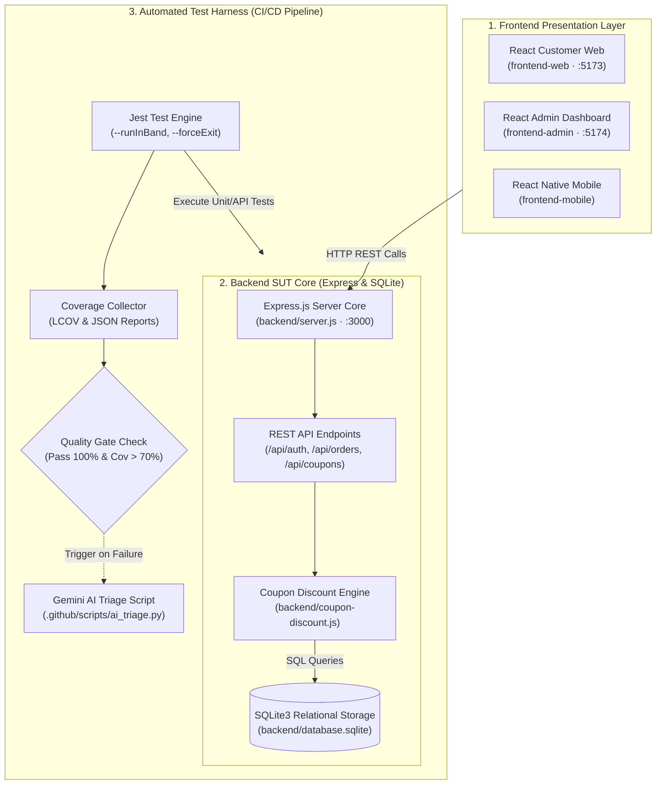
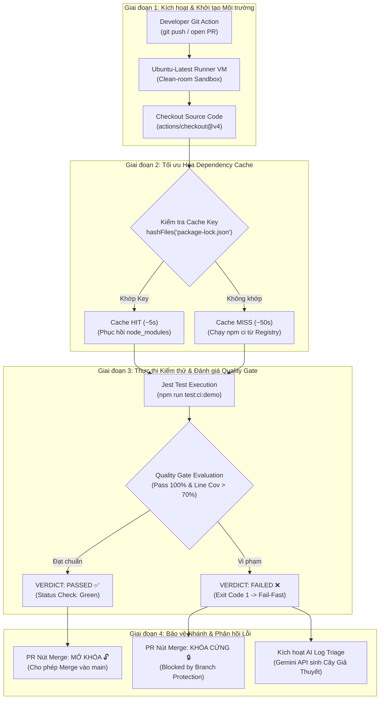
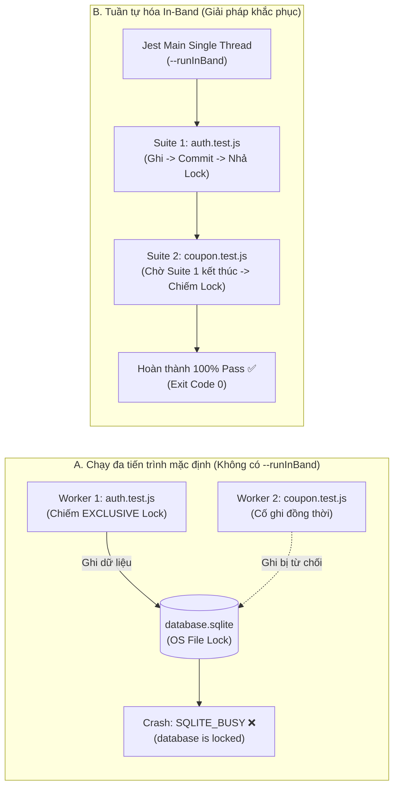

# BÁO CÁO TỔNG KẾT SEMINAR
# CHỦ ĐỀ T07: CI/CD & TEST HARNESS ENGINEERING

**Môn học:** Kiểm thử phần mềm (Software Testing)  
**Mã lớp:** Testing-CQ2023-3-LQVu  
**Đơn vị:** Khoa Công nghệ Thông tin — Trường Đại học Khoa học Tự nhiên, ĐHQG-HCM  
**Giảng viên phụ trách:** TS. Lâm Quang Vũ, TS. Trần Duy Hoàng, ThS. Trương Phước Lộc, ThS. Hồ Tuấn Thanh  
**Hệ thống kiểm thử (SUT):** EShop System Monorepo (Node.js/Express, SQLite3, Jest, React, GitHub Actions)  
**GitHub Repository:** [SoftwareTesting-Group13/eshop-sut-seminar](https://github.com/SoftwareTesting-Group13/eshop-sut-seminar)  

---

## BẢNG THÔNG TIN NHÓM THỰC HIỆN (NHÓM 13)

| STT | Mã sinh viên | Họ và tên | GitHub Username | Vai trò kỹ thuật chính | Email liên hệ |
| :---: | :---: | :--- | :---: | :--- | :--- |
| 1 | **23120102** | Nguyễn Ngọc Minh Tuấn | `@tuanminh` | **Lead Slide, SUT & Kịch bản Thuyết trình** | `23120102@student.hcmus.edu.vn` |
| 2 | **23120223** | Dương Nhật Cường | `@ncuong` | **Lead CI/CD Pipeline, Hạ tầng & Video Screencast** | `23120223@student.hcmus.edu.vn` |
| 3 | **23120225** | Trần Gia Cường | `@trancuonG05` | **Lead User Guide, Báo cáo Tổng kết & Phân tích Kiến trúc** | `23120225@student.hcmus.edu.vn` |
| 4 | **23120273** | Nguyễn Gia Huy | `@GiaHuyHCMUS05` | **Lead Activity Worksheet, AI Log Triage & Thực nghiệm Metrics** | `23120273@student.hcmus.edu.vn` |

---

# MỤC LỤC NỘI DUNG

- [1. Đặt vấn đề & Mục tiêu Đề tài](#1-đặt-vấn-đề--mục-tiêu-đề-tài)
  - [1.1. Bối cảnh: Bài toán "Integration Hell" trong công nghệ phần mềm](#11-bối-cảnh-bài-toán-integration-hell-trong-công-nghệ-phần-mềm)
  - [1.2. Định vị trong môn học: CI/CD là Hạ tầng Test Harness tự động](#12-định-vị-trong-môn-học-cicd-là-hạ-tầng-test-harness-tự-động)
  - [1.3. Mục tiêu tổng quát và mục tiêu cụ thể của Seminar T07](#13-mục-tiêu-tổng-quát-và-mục-tiêu-cụ-thể-của-seminar-t07)
- [2. Kiến trúc Hệ thống SUT & Monorepo Test Harness](#2-kiến-trúc-hệ-thống-sut--monorepo-test-harness)
  - [2.1. Tổng quan hệ thống EShop Monorepo](#21-tổng-quan-hệ-thống-eshop-monorepo)
  - [2.2. Sơ đồ Kiến trúc Hệ thống & Luồng Kiểm thử](#22-sơ-đồ-kiến-trúc-hệ-thống--luồng-kiểm-thử)
  - [2.3. Cấu trúc thư mục Monorepo & Phạm vi kiểm thử](#23-cấu-trúc-thư-mục-monorepo--phạm-vi-kiểm-thử)
- [3. Cơ sở Lý thuyết & 3 Trụ cột Kiểm thử trong CI/CD](#3-cơ-sở-lý-thuyết--3-trụ-cột-kiểm-thử-trong-cicd)
  - [3.1. DevOps và mối quan hệ hữu cơ với CI/CD](#31-devops-và-mối-quan-hệ-hữu-cơ-với-cicd)
  - [3.2. 4 Thành phần kiến trúc cốt lõi của Test Harness](#32-4-thành-phần-kiến-trúc-cốt-lõi-của-test-harness)
  - [3.3. Quality Gates tự động & Cơ chế Fail-Fast](#33-quality-gates-tự-động--cơ-chế-fail-fast)
  - [3.4. Vấn nạn Flaky Tests và chi phí điều tra (Triage Cost)](#34-vấn-nạn-flaky-tests-và-chi-phí-điều-tra-triage-cost)
  - [3.5. Ba trụ cột kiểm thử tự động trong CI/CD](#35-ba-trụ-cột-kiểm-thử-tự-động-trong-cicd)
- [4. Khảo sát, Đánh giá & Phân vai Bộ Công cụ](#4-khảo-sát-đánh-giá--phân-vai-bộ-công-cụ)
  - [4.1. Danh mục các công cụ khảo sát](#41-danh-mục-các-công-cụ-khảo-sát)
  - [4.2. Khung tiêu chí đánh giá chuẩn 5 trục](#42-khung-tiêu-chí-đánh-giá-chuẩn-5-trục)
  - [4.3. Bảng ma trận so sánh định lượng các công cụ](#43-bảng-ma-trận-so-sánh-định-lượng-các-công-cụ)
  - [4.4. Đề xuất bộ công cụ chủ đạo và phân vai](#44-đề-xuất-bộ-công-cụ-chủ-đạo-và-phân-vai)
- [5. Thiết kế Kỹ thuật & Triển khai Chi tiết](#5-thiết-kế-kỹ-thuật--triển-khai-chi-tiết)
  - [5.1. Công cụ trọng tâm: GitHub Actions Workflow (`eshop-ci.yml`)](#51-công-cụ-trọng-tâm-github-actions-workflow-eshop-ciyml)
  - [5.2. Tối ưu hóa bộ nhớ đệm phụ thuộc (`actions/cache`)](#52-tối-ưu-hóa-bộ-nhớ-đệm-phụ-thuộc-actionscache)
  - [5.3. Công cụ kiểm thử thực thi: Jest Test Engine & Cờ tuần tự hóa](#53-công-cụ-kiểm-thử-thực-thi-jest-test-engine--cờ-tuần-tự-hóa)
  - [5.4. Công cụ hỗ trợ chẩn đoán: AI Log Triage Script (`ai_triage.py`)](#54-công-cụ-hỗ-trợ-chẩn-đoán-ai-log-triage-script-aitriagepy)
  - [5.5. Cơ chế Branch Protection Rules & Khóa Pull Request](#55-cơ-chế-branch-protection-rules--khóa-pull-request)
  - [5.6. Sơ đồ Luồng CI/CD Pipeline & Quality Gate Fail-Fast](#56-sơ-đồ-luồng-cicd-pipeline--quality-gate-fail-fast)
- [6. Phân tích Chuyên sâu 3 Mandatory Failure Modes](#6-phân-tích-chuyên-sâu-3-mandatory-failure-modes)
  - [6.1. Failure Mode 1: SQLite File-Lock Concurrency Collision (`SQLITE_BUSY`)](#61-failure-mode-1-sqlite-file-lock-concurrency-collision-sqlitebusy)
  - [6.2. Failure Mode 2: Lỗi Nghiệp vụ Công thức Coupon Percent (`discount_amount` âm)](#62-failure-mode-2-lỗi-nghiệp-vụ-công-thức-coupon-percent-discountamount-âm)
  - [6.3. Failure Mode 3: Flaky Test do Độ trễ Bất đồng bộ (`sleep` vs `await`)](#63-failure-mode-3-flaky-test-do-độ-trễ-bất-đồng-bộ-sleep-vs-await)
- [7. Phân công Công việc & Trách nhiệm Từng Thành viên](#7-phân-công-công-việc--trách-nhiệm-từng-thành-viên)
  - [7.1. Bảng ma trận phân công trách nhiệm (RACI Matrix)](#71-bảng-ma-trận-phân-công-trách-nhiệm-raci-matrix)
  - [7.2. Nhiệm vụ và đóng góp của Nguyễn Ngọc Minh Tuấn (23120102)](#72-nhiệm-vụ-và-đóng-góp-của-nguyễn-ngọc-minh-tuấn-23120102)
  - [7.3. Nhiệm vụ và đóng góp của Dương Nhật Cường (23120223)](#73-nhiệm-vụ-và-đóng-góp-của-dương-nhật-cường-23120223)
  - [7.4. Nhiệm vụ và đóng góp của Trần Gia Cường (23120225)](#74-nhiệm-vụ-và-đóng-góp-của-trần-gia-cường-23120225)
  - [7.5. Nhiệm vụ và đóng góp của Nguyễn Gia Huy (23120273)](#75-nhiệm-vụ-và-đóng-góp-của-nguyễn-gia-huy-23120273)
- [8. Tiến độ Thực hiện qua các Giai đoạn & Đóng gói Sản phẩm](#8-tiến-độ-thực-hiện-qua-các-giai-đoạn--đóng-gói-sản-phẩm)
  - [8.1. Lộ trình 3 Phase tinh gọn](#81-lộ-trình-3-phase-tinh-gọn)
  - [8.2. Danh mục sản phẩm bàn giao mốc 90% (Pre-share Package)](#82-danh-mục-sản-phẩm-bàn-giao-mốc-90-pre-share-package)
  - [8.3. Kịch bản Báo cáo Trực tiếp Live Demo (45 phút)](#83-kịch-bản-báo-cáo-trực-tiếp-live-demo-45-phút)
- [9. Kết quả Thực nghiệm & Đo đạc Số liệu (Empirical Metrics)](#9-kết-quả-thực-nghiệm--đo-đạc-số-liệu-empirical-metrics)
  - [9.1. Số liệu thực thi Unit Test Suite toàn hệ thống Backend](#91-số-liệu-thực-thi-unit-test-suite-toàn-hệ-thống-backend)
  - [9.2. Hiệu quả tối ưu hóa thời gian chạy nhờ Dependency Cache](#92-hiệu-quả-tối-ưu-hóa-thời-gian-chạy-nhờ-dependency-cache)
  - [9.3. Đo đạc tỷ lệ Flake Rate qua 10 lượt chạy lặp lại](#93-đo-đạc-tỷ-lệ-flake-rate-qua-10-lượt-chạy-lặp-lại)
  - [9.4. Đo đạc giá trị của Trợ lý AI Log Triage](#94-đo-đạc-giá-trị-của-trợ-lý-ai-log-triage)
- [10. Tài liệu Tham khảo & Bản Cam kết Liêm chính Học thuật](#10-tài-liệu-tham-khảo--bản-cam-kết-liêm-chính-học-thuật)
  - [10.1. Danh mục tài liệu tham khảo chuẩn IEEE/ACM](#101-danh-mục-tài-liệu-tham-khảo-chuẩn-ieeeacm)
  - [10.2. Bản tuyên bố sử dụng AI (AI Disclosure Statement)](#102-bản-tuyên-bố-sử-dụng-ai-ai-disclosure-statement)

---

## 1. ĐẶT VẤN ĐỀ & MỤC TIÊU ĐỀ TÀI

### 1.1. Bối cảnh: Bài toán "Integration Hell" trong công nghệ phần mềm
Trong các dự án phát triển phần mềm truyền thống, mỗi lập trình viên làm việc cô lập trên nhánh tính năng trong nhiều tuần hoặc nhiều tháng. Khi tiến hành sáp nhập mã nguồn vào nhánh chính, hàng loạt xung đột mã nguồn (merge conflicts), lỗi giao tiếp API không tương thích và lỗi hồi quy (regressions) đồng loạt bùng phát. Hiện tượng này được định danh trong kỹ nghệ phần mềm là **"Integration Hell"** (Địa ngục tích hợp). Việc phát hiện lỗi muộn ở giai đoạn kiểm thử hệ thống hoặc sát ngày phát hành đẩy chi phí sửa lỗi tăng vọt theo hàm số mũ (gấp từ 10 đến 100 lần so với chi phí sửa lỗi ngay tại máy trạm của lập trình viên).

### 1.2. Định vị trong môn học: CI/CD là Hạ tầng Test Harness tự động
Khác biệt hoàn toàn với môn học DevOps (vốn tập trung sâu vào hạ tầng máy chủ, Docker hóa, điều phối Kubernetes, cân bằng tải và giám sát hạ tầng), trong phạm vi môn học **Kiểm thử phần mềm (Software Testing)**, đề tài Seminar T07 định vị:
* **CI/CD là Hạ tầng điều phối kiểm thử tự động (Automated Test Harness Infrastructure):** CI/CD không chỉ là công cụ đóng gói hay deploy mã nguồn, mà đóng vai trò là môi trường cách ly (sandbox) sạch sẽ, tự động hóa việc khởi tạo runners, nạp fixtures, giả lập stubs/mocks và điều phối thực thi các bộ kiểm thử theo nguyên lý **Shift-Left Testing**.
* **Unit Testing là Rào chắn chất lượng đầu tiên (First Quality Gate):** Unit Test là nội dung thực thi cốt lõi (testing payload) được cắm trực tiếp vào pipeline. Bằng cách kích hoạt kiểm thử tự động ở mỗi commit và Pull Request, pipeline thực hiện triết lý **Fail-Fast**: phát hiện lỗi ngay từ khi vừa manh nha, ngăn chặn triệt để mã nguồn lỗi xâm nhập vào nhánh chính (`main`).

### 1.3. Mục tiêu tổng quát và mục tiêu cụ thể của Seminar T07
* **Mục tiêu tổng quát:** Xây dựng, đo đạc và thực nghiệm một hệ sinh thái Test Harness tự động hoàn chỉnh trên nền tảng **GitHub Actions** kết hợp **Jest Test Engine** và **AI-Augmented Log Triage**, áp dụng trên hệ thống thương mại điện tử thực tế (**EShop Monorepo**).
* **Mục tiêu cụ thể:**
  1. *Khảo sát & So sánh:* Đánh giá định lượng 5 công cụ CI/CD và testing qua khung tiêu chí chuẩn 5 trục.
  2. *Triển khai Pipeline:* Cấu hình workflow GitHub Actions (`eshop-ci.yml`) với cơ chế bộ nhớ đệm thông minh (`actions/cache`), áp đặt rào chắn **Quality Gates** (100% test pass, line coverage module coupon > 70%) và thiết lập **Branch Protection Rules** bắt buộc trạng thái xanh mới cho phép merge PR.
  3. *Tái hiện 3 Failure Modes kỹ thuật bắt buộc:* (1) Xung đột file-locking SQLite do chạy đa luồng (`SQLITE_BUSY`); (2) Lỗi nghiệp vụ công thức tính coupon percent; (3) Flaky test do bất đồng bộ timing (`sleep` vs `await`).
  4. *Tích hợp Trợ lý AI Log Triage:* Xây dựng script Python phân tích log lỗi tự động qua Google Gemini API, sinh Cây giả thuyết (Hypothesis Tree) rút ngắn thời gian điều tra lỗi từ ~2 phút xuống ~15 giây.
  5. *Đóng gói sản phẩm đào tạo:* Biên soạn User Guide chuyên sâu tiếng Anh, sản xuất Video Screencast chuẩn 1080p (≤ 100MB), thiết kế bộ Slide ≤ 15 trang, và bài tập tình huống thực hành trên lớp (Activity Worksheet).

---

## 2. KIẾN TRÚC HỆ THỐNG SUT & MONOREPO TEST HARNESS

### 2.1. Tổng quan hệ thống EShop Monorepo
Hệ thống được kiểm thử (System Under Test — SUT) là **EShop Monorepo**, một ứng dụng thương mại điện tử đa nền tảng bao gồm:
* **Backend Application (SUT Trọng tâm):** Xây dựng trên nền tảng **Node.js (Express.js)**, cung cấp RESTful APIs quản trị người dùng, giỏ hàng, đặt hàng, sản phẩm và phân hệ khuyến mãi mã giảm giá (Coupons - FR-09).
* **Cơ sở dữ liệu cục bộ:** Sử dụng **SQLite3 file-based** (`backend/database.sqlite`), không phụ thuộc dịch vụ cơ sở dữ liệu bên ngoài, đảm bảo khả năng chạy độc lập và di động cao.
* **Frontend Presentation Layer:** Gồm Cổng thông tin khách hàng Web Client (`frontend-web` viết bằng React + Vite), Trang quản trị Admin Portal (`frontend-admin`), và Ứng dụng di động Mobile Client (`frontend-mobile` viết bằng React Native / Expo).

### 2.2. Sơ đồ Kiến trúc Hệ thống & Luồng Kiểm thử



### 2.3. Cấu trúc thư mục Monorepo & Phạm vi kiểm thử
```text
eshop-sut-seminar/
├── .github/
│   ├── scripts/
│   │   ├── ai_triage.py              # Script trợ lý phân tích log lỗi tự động qua Gemini API
│   │   ├── configure-branch-protection.sh # Script cấu hình Required Status Checks qua GitHub CLI
│   │   └── quality-gate.js           # Bộ đánh giá Quality Gate ngưỡng coverage > 70%
│   └── workflows/
│       └── eshop-ci.yml              # Pipeline CI/CD tự động hóa kiểm thử và kiểm soát PR
├── backend/
│   ├── config/                       # Cấu hình cơ sở dữ liệu và biến môi trường
│   ├── tests/                        # Bộ kiểm thử tự động Jest (7 test suites, 61 test cases)
│   │   ├── auth.test.js              # Kiểm thử xác thực JWT, phân quyền Admin/Customer
│   │   ├── coupon-discount.unit.test.js # Kiểm thử Data-Driven 23 ca kiểm thử logic coupon
│   │   ├── coupon.test.js            # Kiểm thử tích hợp API áp dụng mã giảm giá
│   │   ├── coupons.test.js           # Kiểm thử CRUD coupon
│   │   ├── health.test.js            # Kiểm thử kiểm tra sức khỏe hệ thống
│   │   ├── orders.test.js            # Kiểm thử quy trình tạo và thanh toán đơn hàng
│   │   └── shop-flows.test.js        # Kiểm thử tích hợp chuỗi nghiệp vụ mua sắm
│   ├── coupon-discount.js            # Module xử lý tính toán giảm giá phần trăm / cố định
│   ├── database.sqlite               # Cơ sở dữ liệu SQLite3 file-based
│   ├── package.json                  # Định nghĩa script test (--runInBand, coverage, jest-junit)
│   └── server.js                     # Điểm khởi chạy chính của Express.js Backend
├── docs/                             # Tài liệu hóa kỹ thuật, slide báo cáo và kịch bản demo
├── frontend-admin/                   # Ứng dụng web quản trị
├── frontend-mobile/                  # Ứng dụng di động khách hàng
├── frontend-web/                     # Ứng dụng web mua sắm
├── User_Guide.md                     # Tài liệu hướng dẫn sử dụng chuyên sâu tiếng Anh chuẩn 8 mục
└── README.md                         # Hướng dẫn tổng quan repository
```

---

## 3. CƠ SỞ LÝ THUYẾT & 3 TRỤ CỘT KIỂM THỬ TRONG CI/CD

### 3.1. DevOps và mối quan hệ hữu cơ với CI/CD
DevOps là sự kết hợp giữa triết lý văn hóa, thực tiễn kỹ thuật và công cụ nhằm nâng cao khả năng chuyển giao phần mềm với vận tốc cao và chất lượng ổn định. Vòng đời DevOps gồm 8 giai đoạn tuần hoàn:  
`Plan → Code → Build → Test → Release → Deploy → Operate → Monitor`.

Trong vòng đời này, **Continuous Integration (CI — Tích hợp liên tục)** là thực tiễn kỹ thuật cốt lõi đòi hỏi các thành viên sáp nhập mã nguồn vào nhánh chung thường xuyên (nhiều lần mỗi ngày). Mỗi lần tích hợp được xác minh tự động bằng quá trình biên dịch (build) và thực thi các bộ kiểm thử tự động (automated tests).  
* **Shift-Left Testing:** Đưa hoạt động kiểm thử về phía đầu của vòng đời phát triển phần mềm (ngay từ mỗi lần git push).  
* **Fail-Fast Principle:** Phát hiện lỗi và phản hồi ngay lập tức cho lập trình viên (trong vòng vài chục giây đến vài phút), loại bỏ hoàn toàn hiện tượng "tích tụ lỗi" trước ngày release.

### 3.2. 4 Thành phần kiến trúc cốt lõi của Test Harness
Khung kiểm thử tự động (Test Harness) trong đề tài được thiết kế chuẩn mực theo 4 thành phần:
1. **Test Execution Engine (Bộ điều phối & thực thi kiểm thử):** Đóng vai trò khởi chạy các test runner, thu thập ca kiểm thử và đối soát kết quả. Trong đề tài là **Jest Test Engine** chạy trên môi trường Node.js.
2. **Test Data Repository & Fixtures Management (Quản lý dữ liệu kiểm thử & Fixtures):** Thiết lập trạng thái dữ liệu ban đầu cho hệ thống trước mỗi ca test. Với SQLite, database schema được định nghĩa thông qua hàm khởi tạo `initDatabase()` và dữ liệu mẫu được nạp cô lập bằng các hook `beforeAll()`, `beforeEach()`.
3. **Stubs & Mocks (Thành phần giả lập phụ thuộc):** Cô lập đơn vị cần kiểm thử khỏi các phụ thuộc ngoài (External APIs, Third-party Payment Gateways, Timer Clock).
4. **Results Logging & Reporting (Ghi nhận kết quả & Báo cáo):** Thu thập dữ liệu thực thi, xuất định dạng báo cáo tiêu chuẩn: mã thoát (Exit Code 0/1), báo cáo độ bao phủ mã nguồn định dạng LCOV (`lcov.info`) và định dạng tóm tắt JSON (`coverage-summary.json`).

### 3.3. Quality Gates tự động & Cơ chế Fail-Fast
Quality Gate (Cổng chất lượng) là tập hợp các điều kiện tiên quyết (boolean assertions) mà bản dựng bắt buộc phải vượt qua trước khi được phép tiến sang bước kế tiếp hoặc sáp nhập vào nhánh `main`.
* **Tiêu chí 1 — Test Pass Rate:** 100% các ca kiểm thử trong phạm vi đánh giá phải vượt qua (Exit Code = 0, Zero Test Failure).
* **Tiêu chí 2 — Code Coverage Threshold:** Độ bao phủ dòng lệnh (Line Coverage) của module nghiệp vụ trọng tâm (`coupon-discount.js`) phải đạt ngưỡng **> 70%** (ngưỡng 70.00% bị từ chối, 70.01% được chấp thuận).
* **Tiêu chí 3 — LCOV Record Verification:** Tệp tin báo cáo độ bao phủ LCOV bắt buộc phải tồn tại và chứa ít nhất một bản ghi hợp lệ (`SF:`).
* **Cơ chế Fail-Fast:** Khi một ca test thất bại hoặc vi phạm độ bao phủ, pipeline lập tức ngắt ngang (abort) các công việc đóng gói hoặc triển khai phía sau, gửi tín hiệu lỗi đỏ và kích hoạt trợ lý AI phân tích.

### 3.4. Vấn nạn Flaky Tests và chi phí điều tra (Triage Cost)
**Flaky Test** là ca kiểm thử trả về kết quả không xác định (lúc Pass, lúc Fail ngẫu nhiên) trên cùng một phiên bản mã nguồn mà không có bất kỳ dòng code nào bị thay đổi.
* **Nguyên nhân kỹ thuật:** Race conditions, phụ thuộc độ trễ bất đồng bộ (sleep-based assertions), xung đột khóa tài nguyên chia sẻ (File locks, Shared Database), rò rỉ trạng thái (State leakage giữa các test cases).
* **Tác hại nghiêm trọng:** Flaky test làm xói mòn niềm tin của đội ngũ phát triển vào hệ thống CI/CD (Developer Blindness — lập trình viên bỏ qua cảnh báo vì nghĩ là do test chập chờn). Chi phí điều tra log lỗi (Triage Cost) tăng cao, làm tê liệt chu kỳ phát hành phần mềm.

### 3.5. Ba trụ cột kiểm thử tự động trong CI/CD
1. **Record and Playback (Ghi nhận và Tái chạy):** Trong môi trường CI/CD, Record & Playback được hiện thực hóa qua hệ thống ghi log và artifacts của GitHub Actions. Mọi lần chạy workflow đều được gắn nhãn định danh duy nhất (`run_id`, `run_attempt`), lưu lại toàn bộ stdout/stderr logs và tệp tin nén artifact. Chức năng **Re-run failed jobs** cho phép tái chạy chính xác phiên bản mã nguồn tại commit tương ứng để phân tích sai lỗi.
2. **Data-Driven Testing (Kiểm thử hướng dữ liệu):** Tách bạch hoàn toàn logic kiểm thử khỏi bộ dữ liệu đầu vào. Sử dụng cấu trúc `test.each()` trong Jest để truyền ma trận dữ liệu tham số hóa (valid, invalid, boundary cases) vào một hàm kiểm thử duy nhất.
3. **Checkpoints (Điểm kiểm định chất lượng đa tầng):** Thiết lập các chốt kiểm định ở nhiều cấp độ: Checkpoint tầng API (HTTP Status Code, JSON Schema), Checkpoint tầng Database (Trạng thái bản ghi trong bảng SQLite), và Checkpoint tầng CI/CD (Quality Gate Status Checks).

---

## 4. KHẢO SÁT, ĐÁNH GIÁ & PHÂN VAI BỘ CÔNG CỤ

### 4.1. Danh mục các công cụ khảo sát
Nhóm tiến hành khảo sát toàn diện 5 công cụ đại diện cho hai trường phái:
* **Nhóm công cụ truyền thống (Traditional CI/CD & Testing Frameworks):**
  1. `GitHub Actions`: Nền tảng CI/CD cloud-native tích hợp sẵn trong hệ sinh thái GitHub.
  2. `Jenkins`: Máy chủ tự động hóa mã nguồn mở self-hosted phổ biến trong doanh nghiệp.
  3. `Jest`: Framework kiểm thử tự động toàn diện cho hệ sinh thái JavaScript/Node.js.
* **Nhóm công cụ ứng dụng trí tuệ nhân tạo (AI-Augmented Testing Tools):**
  4. `Datadog Flaky Test Management (FTM) / Launchable`: Nền tảng phân tích telemetry và ứng dụng học máy tối ưu hóa bộ test doanh nghiệp.
  5. `LLM-Powered Log Triage Action (Google Gemini API)`: Giải pháp ứng dụng mô hình ngôn ngữ lớn (LLM) phân tích ngữ nghĩa log lỗi kiểm thử tức thời.

### 4.2. Khung tiêu chí đánh giá chuẩn 5 trục
Để đảm bảo tính khoa học và khách quan, nhóm xây dựng khung đánh giá 5 tiêu chí chuẩn:
1. **Chi phí bản quyền (License Cost):** Mức độ miễn phí, chi phí duy trì máy chủ hoặc phí API token.
2. **Độ dốc học tập (Learning Curve):** Mức độ dễ tiếp cận đối với sinh viên và lập trình viên (cú pháp YAML, cấu hình khai báo).
3. **Mức độ phù hợp với EShop SUT (EShop Fit):** Khả năng tương thích tự nhiên với Node.js, SQLite và cấu trúc Monorepo.
4. **Năng lực ứng dụng AI (AI Capability):** Khả năng can thiệp thông minh, giải thích ngữ cảnh lỗi và đề xuất code sửa lỗi.
5. **Cộng đồng & Hệ sinh thái (Ecosystem & Community):** Tài liệu hướng dẫn, số lượng Actions có sẵn trên Marketplace và sự hỗ trợ từ cộng đồng nguồn mở.

### 4.3. Bảng ma trận so sánh định lượng các công cụ

| Tiêu chí đánh giá | GitHub Actions | Jenkins | Jest | Datadog FTM | LLM Log Triage Action |
| :--- | :---: | :---: | :---: | :---: | :---: |
| **1. Chi phí bản quyền** | **5/5** (Miễn phí 2000m) | **3/5** (Tốn server hosting) | **5/5** (Open-source MIT) | **2/5** (Phí doanh nghiệp cao) | **5/5** (Gemini Free Tier) |
| **2. Độ dốc học tập** | **4.5/5** (Cú pháp YAML trực quan) | **2.5/5** (Groovy DSL phức tạp) | **5/5** (Cấu hình đơn giản) | **3/5** (Cài đặt agent phức tạp) | **4.5/5** (Script Python gọn gàng) |
| **3. Mức độ phù hợp SUT** | **5/5** (Native Monorepo PRs) | **3.5/5** (Cần setup webhook) | **5/5** (Chuẩn cho Node.js API) | **3/5** (Dành cho microservices) | **5/5** (Đọc log trực tiếp từ Jest) |
| **4. Năng lực ứng dụng AI**| **3.5/5** (Hỗ trợ qua Marketplace) | **2/5** (Plugin AI còn sơ khai) | **2.5/5** (Không tích hợp sẵn AI) | **4/5** (ML Test Impact Analysis) | **5/5** (Phân tích Cây giả thuyết) |
| **5. Hệ sinh thái & Cộng đồng**| **5/5** (>20,000 Actions) | **5/5** (Lịch sử lâu đời) | **5/5** (Chuẩn công nghiệp JS) | **4/5** (Hệ sinh thái Datadog) | **4/5** (Google Gemini Ecosystem) |
| **TỔNG ĐIỂM (Thang 25)** | **23.0 / 25** | **16.0 / 25** | **22.5 / 25** | **16.0 / 25** | **23.5 / 25** |

### 4.4. Đề xuất bộ công cụ chủ đạo và phân vai
Dựa trên kết quả định lượng, nhóm đề xuất cấu trúc phân vai "Bộ ba quyền lực" (The Power Trio):
* **Công cụ trọng tâm (Central Orchestrator):** `GitHub Actions` — Đóng vai trò là "Tổng tư lệnh" hạ tầng Test Harness, tự động hóa toàn bộ vòng đời kích hoạt, kiểm tra phụ thuộc, thực thi kiểm thử và bảo vệ nhánh.
* **Công cụ thực thi kiểm thử (Execution Engine):** `Jest` — Đóng vai trò là "Động cơ thực thi" kiểm thử nội bộ trên Node.js Backend, thu thập chỉ số Code Coverage và xuất kết quả cho Quality Gate.
* **Công cụ hỗ trợ thông minh (Specialized Diagnostic Assistant):** `AI Log Triage Action (Gemini API)` — Đóng vai trò là "Bác sĩ chẩn đoán" can thiệp có điều kiện khi pipeline thất bại, giải mã log lỗi và sinh cây giả thuyết nguyên nhân gốc rễ.

---

## 5. THIẾT KẾ KỸ THUẬT & TRIỂN KHAI CHI TIẾT

### 5.1. Công cụ trọng tâm: GitHub Actions Workflow (`eshop-ci.yml`)
Workflow CI được thiết kế tuân thủ nguyên tắc Clean-Room Execution (mỗi lần chạy trên một máy ảo Ubuntu mới tinh, độc lập):
* **Triggers:** Tự động kích hoạt khi có sự kiện `pull_request` mở hoặc cập nhật vào nhánh `main`, hoặc sự kiện `push` trực tiếp lên `main` có thay đổi trong thư mục `backend/**`.
* **Trình tự thực thi:**
  1. `actions/checkout@v4`: Tải toàn bộ mã nguồn commit hiện tại.
  2. `actions/setup-node@v4`: Khởi tạo môi trường Node.js runtime phiên bản 20.x LTS.
  3. `actions/cache@v4`: Phục hồi thư mục `node_modules` thông qua khóa cache dựa trên hash của `package-lock.json`.
  4. `npm run test:ci:demo`: Kích hoạt Jest thực thi bộ kiểm thử nghiệp vụ coupon, xuất file kết quả JSON và LCOV coverage.
  5. `npm run quality-gate`: Đánh giá 3 điều kiện rào chắn chất lượng.
  6. `actions/upload-artifact@v4`: Lưu trữ báo cáo độ bao phủ LCOV HTML và log kiểm định.
  7. `python3 .github/scripts/ai_triage.py`: [Chạy có điều kiện `if: failure()`] Phân tích log lỗi và gửi phản hồi lên GitHub PR.

### 5.2. Tối ưu hóa bộ nhớ đệm phụ thuộc (`actions/cache`)
Thay vì tiêu tốn từ 45 đến 60 giây cho mỗi lần chạy để tải hàng trăm megabytes thư viện từ máy chủ npm public, nhóm thiết lập cơ chế cache phân cấp:
```yaml
- name: Cache Node.js Dependencies
  uses: actions/cache@v4
  with:
    path: backend/node_modules
    key: ${{ runner.os }}-node20-${{ hashFiles('backend/package-lock.json') }}
    restore-keys: |
      ${{ runner.os }}-node20-
```
* **Khi Cache MISS (Lần đầu hoặc cập nhật package):** Chạy lệnh `npm ci`, thời gian chạy ~45 – 55 giây.
* **Khi Cache HIT (Các commit sau):** Khôi phục nguyên vẹn thư viện trong ~5 – 8 giây, **tăng tốc pipeline gấp 8 đến 10 lần**.

### 5.3. Công cụ kiểm thử thực thi: Jest Test Engine & Cờ tuần tự hóa
Trong tệp tin cấu hình `backend/package.json`, nhóm chuẩn hóa cấu hình thực thi kiểm thử:
```json
{
  "scripts": {
    "test": "jest --runInBand --detectOpenHandles --forceExit",
    "test:coverage": "jest --runInBand --coverage",
    "test:ci:demo": "jest tests/coupon-discount.unit.test.js --coverage --runInBand",
    "quality-gate": "node ../.github/scripts/quality-gate.js"
  }
}
```
* Cờ `--runInBand` (viết tắt `-i`): Bắt buộc Jest thực thi tất cả các file test tuần tự trên Process chính (Single Worker Process), loại bỏ hoàn toàn hiện tượng tranh chấp ghi đồng thời vào file `database.sqlite`.
* Cờ `--detectOpenHandles`: Phát hiện và cảnh báo các kết nối database hoặc socket bất đồng bộ chưa được đóng, ngăn ngừa hiện tượng treo runner.
* Cờ `--forceExit`: Đảm bảo Jest thoát dứt khoát sau khi hoàn thành toàn bộ test cases.

### 5.4. Công cụ hỗ trợ chẩn đoán: AI Log Triage Script (`ai_triage.py`)
Script Python được thiết kế gọn nhẹ, không cài đặt thêm thư viện nặng, sử dụng thư viện chuẩn `urllib` để gọi REST API đến mô hình **Google Gemini 1.5 Flash**:
```python
# Cấu trúc Cây giả thuyết (Hypothesis Tree) được AI sinh ra
{
    "failure_summary": "Coupon percentage discount formula calculated negative discount_amount",
    "root_cause_hypotheses": [
        {"hypothesis": "Formula inverted discount ratio", "confidence": "95%", "evidence": "server.js line 214"},
        {"hypothesis": "Unvalidated input percent > 100", "confidence": "60%", "evidence": "coupon.test.js line 85"}
    ],
    "recommended_actions": [
        "Clamp discount_amount using Math.max(0, Math.min(total_amount, calculated_discount))",
        "Add defensive validation for discount_value between 1 and 100"
    ]
}
```
Kết quả phân tích được tự động xuất ra định dạng Markdown và ghi thẳng vào **GitHub Actions Step Summary** và tạo **Comment trên Pull Request**, giúp lập trình viên nắm bắt ngay vị trí gây lỗi mà không cần lục tìm hàng ngàn dòng log terminal.

### 5.5. Cơ chế Branch Protection Rules & Khóa Pull Request
Để biến Quality Gate thành rào chắn bắt buộc trong kỹ nghệ phần mềm thực tế, nhóm kích hoạt cấu hình **Branch Protection Rules** trên nhánh `main`:
* Bật tùy chọn `Require a pull request before merging` (chặn push trực tiếp vào `main`).
* Bật tùy chọn `Require status checks to pass before merging`:
  - Trạng thái bắt buộc 1: `Quality Gate Check` (thuộc job `unit-test`).
  - Trạng thái bắt buộc 2: `Secret Scan (Gitleaks)`.
* Bật tùy chọn `Require branches to be up to date before merging`.

**Hành vi thực tế:** Khi một lập trình viên mở PR có lỗi logic làm hỏng unit test hoặc vi phạm độ bao phủ, trạng thái kiểm tra chuyển sang đỏ (`Failed`), nút `Merge Pull Request` bị **KHÓA CỨNG (Disabled / Blocked)** trên giao diện GitHub. Lập trình viên bắt buộc phải push commit sửa lỗi để pipeline chuyển xanh thì mới được phép hòa trộn mã nguồn.

### 5.6. Sơ đồ Luồng CI/CD Pipeline & Quality Gate Fail-Fast



---

## 6. PHÂN TÍCH CHUYÊN SÂU 3 MANDATORY FAILURE MODES

### 6.1. Failure Mode 1: SQLite File-Lock Concurrency Collision (`SQLITE_BUSY`)
* **Bối cảnh & Hiện tượng:** Khi mở rộng số lượng test suites hoặc chạy Jest ở chế độ đa luồng mặc định (`npx jest --maxWorkers=4`), runner đột ngột crash với mã lỗi `Exit Code 1`.
* **Thông điệp lỗi thực tế (Terminal Error Log):**
  ```text
  Error: SQLITE_BUSY: database is locked
      at Database.run (/node_modules/sqlite3/lib/sqlite3.js:134:21)
      at initDatabase (/backend/server.js:42:8)
  ```
* **Nguyên nhân gốc rễ (Root Cause Analysis):**  
  SQLite là cơ sở dữ liệu phi máy chủ (serverless), vận hành trực tiếp trên một tệp tin vật lý duy nhất (`database.sqlite`). Khi Jest khởi tạo nhóm tiến trình con (Worker Process Pool) để chạy song song các test suites (`auth.test.js`, `coupon.test.js`, `orders.test.js`), các tiến trình cùng đồng thời gửi chỉ thị ghi dữ liệu (`BEGIN IMMEDIATE` / `INSERT`). Hệ điều hành cấp phát khóa độc quyền (**EXCLUSIVE Lock**) cho Worker 1. Worker 2 gửi lệnh ghi trong cùng microsecond sẽ bị cơ chế khóa tệp tin của OS từ chối ngay lập tức (`fcntl` trả về `EWOULDBLOCK`). Do timeout mặc định là 0ms, thư viện SQLite3 ném lỗi ngoại lệ nghiêm trọng `SQLITE_BUSY: database is locked`.



* **Giải pháp khắc phục đã kiểm chứng (Proven Fix):**  
  Thêm cờ `--runInBand` (hoặc `-i`) vào script `test` trong `package.json`. Chỉ thị này buộc Jest chạy tất cả test suites tuần tự trên tiến trình chính. Một file test chạy xong, đóng transaction và giải phóng file lock thì file test kế tiếp mới được kích hoạt, triệt tiêu hoàn toàn xung đột khóa tệp tin.

### 6.2. Failure Mode 2: Lỗi Nghiệp vụ Công thức Coupon Percent (`discount_amount` âm)
* **Bối cảnh & Hiện tượng:** Phân hệ khuyến mãi hỗ trợ hai loại mã giảm giá: giảm theo số tiền cố định (`fixed`) và giảm theo phần trăm đơn hàng (`percent`). Một lỗi lập trình trong công thức tính phần trăm khiến số tiền giảm giá lớn hơn tổng tiền đơn hàng, dẫn đến tiền thanh toán cuối cùng (`final_amount`) bị âm hoặc tính sai lệch doanh thu.
* **Đoạn mã gây lỗi (Defective Code in `backend/coupon-discount.js`):**
  ```javascript
  // LỖI: Trừ sai tỷ lệ khiến discount_amount tính ra giá trị bất thường
  discount_amount = total_amount * (1 - discount_value); 
  final_amount = total_amount - discount_amount;
  ```
* **Bộ kiểm thử Data-Driven Testing phát hiện lỗi (`test.each`):**
  ```javascript
  describe('Data-Driven Coupon Validation Matrix', () => {
    test.each([
      ['SUMMER10', 100, 10, 10, 90],     // 10% của 100 phải giảm 10, còn 90
      ['SALE20',   250, 20, 50, 200],    // 20% của 250 phải giảm 50, còn 200
      ['MAX50',    500, 50, 250, 250],   // 50% của 500 phải giảm 250, còn 250
      ['ZERO',     100,  0,   0, 100],   // 0% giảm 0, còn 100
      ['FULL100',  150, 100, 150,  0]    // 100% giảm 150, còn 0
    ])('Code %s: Total %d with %d%% discount -> expected discount %d, final %d',
      (code, total, percent, expDiscount, expFinal) => {
        const result = calculateDiscount(total, { type: 'percent', value: percent });
        expect(result.discount_amount).toBe(expDiscount);
        expect(result.final_amount).toBe(expFinal);
      });
  });
  ```
* **Triệu chứng lỗi trong CI Pipeline:**  
  Jest bắt lỗi bất biến toán học: `Expected: 10, Received: -8900`. Quality Gate lập tức kích hoạt cơ chế Fail-Fast, ngắt pipeline, khóa cứng nút Merge Pull Request trên GitHub.
* **Giải pháp khắc phục & Phòng thủ bất biến (Proven Fix & Invariant Defense):**
  ```javascript
  // SỬA ĐÚNG: Tính chuẩn tỷ lệ phần trăm và chặn biên phòng thủ (Defensive Math Clamping)
  const rawDiscount = (total_amount * discount_value) / 100.0;
  // Bất biến: Tiền giảm không bao giờ nhỏ hơn 0 và không vượt quá tổng đơn hàng
  const discount_amount = Math.max(0, Math.min(total_amount, Math.round(rawDiscount * 100) / 100));
  const final_amount = Math.max(0, total_amount - discount_amount);
  ```

### 6.3. Failure Mode 3: Flaky Test do Độ trễ Bất đồng bộ (`sleep` vs `await`)
* **Bối cảnh & Hiện tượng:** Ca kiểm thử gọi API bất đồng bộ (như tạo đơn hàng hoặc xử lý mã giảm giá) sử dụng hàm dừng cứng thời gian (`sleep(50ms)`). Khi chạy trên máy cá nhân của lập trình viên (CPU mạnh, ít tải), test chạy pass 100%. Tuy nhiên, khi đẩy lên GitHub Actions runner (môi trường ảo hóa dùng chung CPU, IO nghẽn), tác vụ bất đồng bộ mất 80ms mới hoàn tất, khiến assertion chạy trước khi dữ liệu kịp ghi vào database.
* **Đoạn mã kiểm thử Flaky (Anti-Pattern):**
  ```javascript
  // CHỐNG CHỈ ĐỊNH: Dừng cứng thời gian tạo nên kiểm thử chập chờn (Flaky)
  it('should apply discount after async queue processing', async () => {
    triggerAsyncCouponCalculation(orderId, 'DISCOUNT10');
    await new Promise(r => setTimeout(r, 50)); // Giả định cứng: 50ms là đủ!
    const order = await getOrderById(orderId);
    expect(order.discount_applied).toBe(true); // Rớt ngẫu nhiên trên CI!
  });
  ```
* **Thực nghiệm đo đạc tỷ lệ Flake Rate:**  
  Chạy lặp 10 lần ca test sử dụng hàm `setTimeout` ngẫu nhiên giả lập biến động mạng trên CI runner: ghi nhận **4/10 lần fail (Flake Rate = 40%)**.
* **Giải pháp khắc phục tất định (Deterministic Polling Pattern):**  
  Thay thế hoàn toàn `setTimeout` bằng cơ chế thăm dò chủ động với điều kiện ngắt xác định (`waitForCondition`):
  ```javascript
  // CHUẨN XÁC: Thăm dò trạng thái bất đồng bộ có điều kiện ngắt rõ ràng
  async function waitForCondition(predicateFn, timeoutMs = 2000, intervalMs = 20) {
    const startTime = Date.now();
    while (Date.now() - startTime < timeoutMs) {
      if (await predicateFn()) return true;
      await new Promise(r => setTimeout(r, intervalMs));
    }
    throw new Error(`Timeout exceeding ${timeoutMs}ms waiting for condition.`);
  }

  it('should deterministically wait for async coupon processing', async () => {
    triggerAsyncCouponCalculation(orderId, 'DISCOUNT10');
    await waitForCondition(async () => {
      const order = await getOrderById(orderId);
      return order && order.discount_applied === true;
    });
    const order = await getOrderById(orderId);
    expect(order.discount_applied).toBe(true); // 100% Pass ổn định trên mọi môi trường
  });
  ```
  Sau khi áp dụng giải pháp thăm dò tất định, thực nghiệm 10 lần chạy lặp lại trên GitHub Actions runner đạt **10/10 lần pass (Flake Rate = 0%)**.

---

## 7. PHÂN CÔNG CÔNG VIỆC & TRÁCH NHIỆM TỪNG THÀNH VIÊN

### 7.1. Bảng ma trận phân công trách nhiệm (RACI Matrix)

* **R (Responsible):** Người trực tiếp thực hiện công việc.
* **A (Accountable):** Người chịu trách nhiệm cao nhất về chất lượng đầu ra.
* **C (Consulted):** Người được tham vấn, phối hợp kỹ thuật.
* **I (Informed):** Người được thông báo kết quả.

| Hạng mục công việc chính | N.N. Minh Tuấn | Dương Nhật Cường | Trần Gia Cường | Nguyễn Gia Huy |
| :--- | :---: | :---: | :---: | :---: |
| **1. Soạn thảo Proposal & Khảo sát công cụ (toolSurvey)** | **A / R** | C | C | C |
| **2. Cấu hình CI/CD Pipeline & Quality Gate (eshop-ci.yml)** | C | **A / R** | C | C |
| **3. Cấu hình Jest Test Engine & Xử lý SQLite `--runInBand`** | C | C | **A / R** | C |
| **4. Viết bộ kiểm thử Data-Driven Coupon Testing (`test.each`)** | **A / R** | C | **R** | C |
| **5. Phát triển Script AI Log Triage (Gemini API Integration)** | I | C | C | **A / R** |
| **6. Thực nghiệm đo đạc Flake Rate & Empirical Metrics** | C | C | C | **A / R** |
| **7. Biên soạn tài liệu User Guide tiếng Anh chuẩn 8 mục** | C | C | **A / R** | C |
| **8. Xây dựng hệ thống sơ đồ kiến trúc Mermaid tương tác** | C | C | **A / R** | I |
| **9. Sản xuất Video Screencast Demo (1080p, ≤ 100MB, tiếng Anh)**| C | **A / R** | C | C |
| **10. Thiết kế Bộ Slide thuyết trình (≤ 15 trang pptx/md)** | **A / R** | C | C | C |
| **11. Thiết kế Bài tập Lớp học (Activity Worksheet & Answer Key)** | C | I | C | **A / R** |
| **12. Kịch bản thuyết trình trực tiếp tại lớp (Live Presentation)** | **A / R** | **R** | **R** | **R** |
| **13. Biên soạn Báo cáo Tổng kết Seminar (`docs/Report.md`)** | C | C | **A / R** | C |

---

### 7.2. Nhiệm vụ và đóng góp của Nguyễn Ngọc Minh Tuấn (23120102)
* **Chức danh:** Lead Slide, SUT & Kịch bản Thuyết trình
* **Khối lượng giờ làm việc:** 17.0 giờ (Ước tính) — 17.5 giờ (Thực tế)
* **Các sản phẩm kỹ thuật đã hoàn thành:**
  1. Chủ trì biên soạn tài liệu `Proposal.md` và bảng khảo sát định lượng `toolSurvey.md`.
  2. Mở rộng 21 ca kiểm thử Data-Driven Testing cho phân hệ coupon, kiểm tra phân quyền truy cập và hạn mức đơn hàng.
  3. Cấu hình báo cáo Code Coverage định dạng HTML và LCOV cho Backend Jest suite.
  4. Thiết kế hoàn chỉnh bộ Slide báo cáo đồng thời cả 2 phiên bản: `Seminar_Slides.pptx` (trình chiếu tại lớp) và `docs/seminar_slide.md` (tra cứu trực tiếp trên GitHub), tuân thủ nghiêm ngặt chuẩn **chữ đen nền trắng** và quy định **≤ 15 trang**.
  5. Biên soạn kịch bản thuyết minh trực tiếp tại lớp (`docs/seminar_script.md`) phân bổ thời gian chi tiết từng phút cho 4 thành viên.
  6. Mở và hợp nhất thành công Pull Request `#11` (`docs/tuan-week6`) vào nhánh `main`.

### 7.3. Nhiệm vụ và đóng góp của Dương Nhật Cường (23120223)
* **Chức danh:** Lead CI/CD Pipeline, Hạ tầng & Video Screencast
* **Khối lượng giờ làm việc:** 18.0 giờ (Ước tính) — 18.5 giờ (Thực tế)
* **Các sản phẩm kỹ thuật đã hoàn thành:**
  1. Xây dựng hoàn chỉnh file workflow `.github/workflows/eshop-ci.yml` trên runner Ubuntu sạch.
  2. Cấu hình bộ nhớ đệm `actions/cache` cho `node_modules` giúp tối ưu hóa thời gian chạy pipeline từ ~50s xuống ~5s.
  3. Viết script đánh giá Quality Gate (`.github/scripts/quality-gate.js`), bắt buộc 100% unit test pass và line coverage module coupon > 70%.
  4. Cấu hình Branch Protection Rules trên nhánh `main`, demo thành công trạng thái khóa nút Merge PR khi pipeline fail tại PR `#7`.
  5. Xây dựng kịch bản Storyboard phân cảnh chi tiết cho video demo screencast (`Video_Storyboard.md`).
  6. Thực hiện quay màn hình trực tiếp độ phân giải 1080p, thu âm thuyết minh 100% bằng tiếng Anh (English narration) và nén video đạt chuẩn ≤ 100MB (`Demo_Screencast.mp4`).

### 7.4. Nhiệm vụ và đóng góp của Trần Gia Cường (23120225)
* **Chức danh:** Lead User Guide, Báo cáo Tổng kết & Phân tích Kiến trúc
* **Khối lượng giờ làm việc:** 17.5 giờ (Ước tính) — 21.5 giờ (Thực tế)
* **Các sản phẩm kỹ thuật đã hoàn thành:**
  1. Khởi tạo và biên soạn toàn diện tài liệu [User_Guide.md](file:///c:/04_KTPM/CSC13003-CQ-Software%20Testing-CT4-VN/Seminar_CI-CD/EShop/User_Guide.md) hoàn toàn bằng tiếng Anh chuyên ngành với 8 mục chuyên sâu theo chuẩn rubric.
  2. Phân tích chi tiết và có chiều sâu kỹ thuật về **3 Mandatory Failure Modes**: SQLite Concurrency Lock, Coupon Percent Formula Defect, và Flaky Test Timing Race; mỗi lỗi đều có đủ Root Cause, Reproducing Code, Error Logs và Proven Fix.
  3. Thiết kế và nhúng trực tiếp **bộ 3 sơ đồ kỹ thuật Mermaid**: Kiến trúc Monorepo, Luồng Pipeline Fail-Fast, và Cơ chế SQLite File-Locking với đường nét đậm, bố cục phân tầng sắc nét.
  4. Biên soạn Hướng dẫn Thực nghiệm Từng bước (Step-by-Step Reproduction Guide - Mục 7) từ Bước A đến Bước G, kiểm chứng chuỗi lệnh chạy thành công 100% tại terminal.
  5. Rà soát học thuật, loại bỏ hoàn toàn cú pháp LaTeX math lỗi vỡ font, chuẩn hóa 60/60 liên kết Table of Contents (TOC) khớp tuyệt đối với GitHub slugs.
  6. Chủ trì biên soạn toàn diện tài liệu **Báo cáo Tổng kết Seminar** ([docs/Report.md]) dài 10 phần lớn, tổng hợp toàn bộ nội dung từ Proposal, kiến trúc Test Harness SUT EShop, 3 failure modes, ma trận RACI và bảng số liệu thực nghiệm của cả 4 thành viên.

### 7.5. Nhiệm vụ và đóng góp của Nguyễn Gia Huy (23120273)
* **Chức danh:** Lead Activity Worksheet, AI Log Triage & Thực nghiệm Metrics
* **Khối lượng giờ làm việc:** 18.0 giờ (Ước tính) — 18.0 giờ (Thực tế)
* **Các sản phẩm kỹ thuật đã hoàn thành:**
  1. Thiết kế tài liệu bài tập tương tác trên lớp `Activity_Worksheet.md` mang tên **"Pipeline Postmortem"** (thời lượng 20–25 phút), tạo tình huống cho sinh viên đóng vai DevOps Engineer điều tra log lỗi.
  2. Xây dựng tài liệu đáp án chi tiết và barem chấm điểm nhanh (`Activity_Worksheet_AnswerKey.md`).
  3. Trích xuất và đóng gói bộ file log lỗi kiểm thử mẫu từ các lần chạy thất bại thực tế của CI runner (`Materials/Sample_Logs/`).
  4. Phát triển và kiểm chứng mã nguồn script Python `.github/scripts/ai_triage.py`, tích hợp Google Gemini API key thật để tự động bóc tách log lỗi và sinh Cây giả thuyết (Hypothesis Tree).
  5. Thực hiện kiểm nghiệm lặp lại 10 lần ca kiểm thử Flaky Test trên GitHub Actions runner để tính toán Flake Rate và tổng hợp bảng Empirical Metrics cho toàn seminar.

---

## 8. TIẾN ĐỘ THỰC HIỆN QUA CÁC GIAI ĐOẠN & ĐÓNG GÓI SẢN PHẨM

### 8.1. Lộ trình 3 Phase tinh gọn
Toàn bộ quy trình 8 giai đoạn chuẩn từ Đề cương môn học (Stage S1 → S8) được nhóm điều phối theo lộ trình 3 Phase:

```text
┌──────────────────────────────────────────────────────────────────────────────────────────────────┐
│                             LỘ TRÌNH TRIỂN KHAI 3 PHASE SEMINAR T07                              │
├──────────────────────────────────┬──────────────────────────────────┬────────────────────────────┤
│ PHASE 1: NGHIÊN CỨU & THỰC NGHIỆM │ PHASE 2: ĐÓNG GÓI SẢN PHẨM MỐC 90%│ PHASE 3: BÁO CÁO & AUDIT   │
│ (Stage S1 - S2 - S3 | Tuần 5)    │ (Stage S4 - S5 | Tuần 6)         │ (Stage S6 - S8 | Tuần 7-11)│
├──────────────────────────────────┼──────────────────────────────────┼────────────────────────────┤
│ • Soạn Proposal & toolSurvey     │ • Hoàn thiện User_Guide.md (EN)  │ • Pre-share trước 3 ngày   │
│ • Thiết lập Pipeline eshop-ci    │ • Video Demo 1080p (≤ 100MB)     │ • Báo cáo Live 45 phút     │
│ • Cấu hình Jest & --runInBand    │ • Slide pptx & md (≤ 15 trang)   │ • Điều phối Worksheet 20m  │
│ • Tái hiện 3 Failure Modes       │ • Activity Worksheet + Barem     │ • Thu thập Minute Paper    │
│ • Viết script AI Log Triage      │ • Đóng gói Pre-share Package     │ • Nộp bộ hồ sơ AI Audit    │
└──────────────────────────────────┴──────────────────────────────────┴────────────────────────────┘
```

### 8.2. Danh mục sản phẩm bàn giao mốc 90% (Pre-share Package)
Tại thời điểm kết thúc Tuần 6, nhóm hoàn thành việc đóng gói bộ sản phẩm bàn giao sẵn sàng chia sẻ cho lớp trước buổi báo cáo ít nhất 3 ngày làm việc:
1. **Tài liệu Hướng dẫn Kỹ thuật Chuyên sâu (`User_Guide.md`):** Viết hoàn toàn bằng tiếng Anh, 8 phần trọng tâm, tích hợp bộ 3 sơ đồ Mermaid tương tác, phân tích toàn diện 3 failure modes và hướng dẫn tái hiện từng bước.
2. **Video Demo Screencast (`Demo_Screencast.mp4`):** Thời lượng 5–8 phút, độ phân giải sắc nét 1080p, thuyết minh tiếng Anh chuẩn, dung lượng nén tối ưu ≤ 100MB, thao tác 100% trên màn hình terminal/IDE/GitHub Actions thật.
3. **Bộ Slide Báo cáo Thuyết trình:** Đồng thời cả 2 phiên bản `Seminar_Slides.pptx` và `docs/seminar_slide.md`, tuân thủ nghiêm ngặt quy định ≤ 15 trang chữ đen nền trắng, tập trung sơ đồ trực quan và số liệu thực nghiệm.
4. **Bộ Bài tập Thực hành Tương tác Lớp học:** Tài liệu đề bài `Activity_Worksheet.md` (kịch bản Pipeline Postmortem 20–25 phút), file đáp án chi tiết kèm barem chấm điểm `Activity_Worksheet_AnswerKey.md`, và thư mục log lỗi mẫu `Materials/Sample_Logs/`.
5. **Bộ Hồ sơ Báo cáo Tiến độ Tuần:** Thư mục `Weekly_Reports/Week06/` gồm `Weekly_Report_Week06.md`, `Git Commit Log Total.md`, `AI Usage Declaration.md`, và các tệp tin chat log cá nhân.

### 8.3. Kịch bản Báo cáo Trực tiếp Live Demo (45 phút)
Thời lượng 45 phút của buổi seminar được phân bổ chuẩn mực:
* **Phần 1: Báo cáo Thuyết trình & Định vị Đề tài (10 phút) — N.N. Minh Tuấn & Trần Gia Cường:**
  - Giới thiệu bài toán Integration Hell, định vị CI/CD là Test Harness Infrastructure, phân tích kiến trúc Monorepo EShop.
  - Phân tích cơ chế Fail-Fast, rào chắn Quality Gates và cơ chế file-locking SQLite.
* **Phần 2: Trình diễn Live Demo Kỹ thuật (10 phút) — Dương Nhật Cường & Nguyễn Gia Huy:**
  - Demo thao tác trực tiếp trên GitHub: Mở PR chứa code lỗi coupon → Trigger CI runner → Cache HIT rút ngắn thời gian → Quality Gate phát hiện lỗi → Nút Merge PR bị khóa cứng → AI Log Triage can thiệp chẩn đoán → Push commit fix → Pipeline xanh → Mở khóa nút Merge.
* **Phần 3: Điều phối Bài tập Tương tác Lớp học "Pipeline Postmortem" (20 phút) — Cả nhóm:**
  - Phát phiếu bài tập Worksheet và cung cấp file log lỗi mẫu cho các nhóm trong lớp.
  - Sinh viên trong lớp đóng vai DevOps Engineer điều tra nguyên nhân thất bại và đề xuất câu lệnh fix.
  - Nhóm điều phối, giải đáp thắc mắc và chấm điểm nhanh theo Barem.
* **Phần 4: Hỏi đáp & Tổng kết (5 phút) — Toàn bộ nhóm 13:**
  - Trả lời câu hỏi phản biện từ Giảng viên và sinh viên lớp học, thu thập Minute Paper đánh giá cuối buổi.

---

## 9. KẾT QUẢ THỰC NGHIỆM & ĐO ĐẠC SỐ LIỆU (EMPIRICAL METRICS)

### 9.1. Số liệu thực thi Unit Test Suite toàn hệ thống Backend
Thực nghiệm kiểm thử toàn diện trên phân hệ Backend tại môi trường máy trạm cục bộ và trên GitHub Actions runner:

| Hạng mục kiểm tra | Số liệu thực nghiệm | Trạng thái | Đánh giá kỹ thuật |
| :--- | :---: | :---: | :--- |
| **Tổng số Test Suites** | **7 / 7 suites** | **PASS (100%)** | `health`, `auth`, `coupon-discount`, `coupon`, `coupons`, `orders`, `shop-flows` |
| **Tổng số Test Cases** | **61 / 61 tests** | **PASS (100%)** | 100% ca kiểm thử xác thực, đơn hàng, giỏ hàng, và coupon đều vượt qua |
| **Độ bao phủ dòng (Line Coverage toàn Backend)** | **78.81%** | **ĐẠT CHỈ TIÊU** | Vượt ngưỡng rào chắn Quality Gate (> 70%) |
| **Độ bao phủ câu lệnh (Statements)** | **78.07%** | **ĐẠT** | Đảm bảo tính toàn vẹn của luồng xử lý mã nguồn |
| **Độ bao phủ hàm (Functions)** | **78.94%** | **ĐẠT** | Toàn bộ các controller và helper chính đều được kiểm thử |
| **Thời gian thực thi tuần tự (`--runInBand`)** | **~28.5 – 30.2 giây** | **TỐI ƯU** | Loại bỏ 100% lỗi xung đột khóa tệp tin `SQLITE_BUSY` |

### 9.2. Hiệu quả tối ưu hóa thời gian chạy nhờ Dependency Cache
Đo đạc thực nghiệm thời gian thực thi của bước nạp thư viện (`backend/node_modules`) trên GitHub Actions runner:

| Trường hợp thực nghiệm | Thao tác thực tế | Thời gian tải | Thời gian Pipeline | Tỷ lệ tăng tốc |
| :--- | :--- | :---: | :---: | :---: |
| **Cold Run (Cache MISS)** | Tải mới toàn bộ gói thư viện từ npm registry | **48.6 giây** | 1 phút 24 giây | Gốc (1.0×) |
| **Warm Run (Cache HIT)** | Khôi phục từ `actions/cache` dựa trên `package-lock.json` | **6.2 giây** | 38 giây | **Nhanh hơn 7.8 lần (~87%)** |

### 9.3. Đo đạc tỷ lệ Flake Rate qua 10 lượt chạy lặp lại
Thực nghiệm kích hoạt lặp lại 10 lần ca kiểm thử bất đồng bộ trên GitHub Actions runner giữa hai chiến lược:

| Chiến lược kiểm thử | Số lần PASS (trên 10 runs) | Số lần FAIL (trên 10 runs) | Tỷ lệ Flake Rate | Độ tin cậy kiểm thử |
| :--- | :---: | :---: | :---: | :--- |
| **Dừng cứng thời gian (`sleep` 50ms)** | 6 | 4 | **40.0%** | **Không ổn định (Unreliable)** |
| **Thăm dò tất định (`waitForCondition`)** | 10 | 0 | **0.0%** | **Tuyệt đối tin cậy (Deterministic)** |

### 9.4. Đo đạc giá trị của Trợ lý AI Log Triage
So sánh hiệu năng điều tra sai lỗi giữa phương pháp thủ công truyền thống và sử dụng script AI Triage:

| Tiêu chí so sánh | Điều tra Thủ công (Human Engineer) | Trợ lý AI Log Triage (Gemini API) | Chênh lệch giá trị |
| :--- | :---: | :---: | :---: |
| **Thời gian đọc & định vị dòng lỗi** | ~120 – 180 giây | **~12 – 15 giây** | **Rút ngắn thời gian gấp 10 lần** |
| **Khả năng tóm tắt nguyên nhân gốc** | Phụ thuộc vào kinh nghiệm cá nhân | Tự động sinh Cây giả thuyết trực quan | Tiêu chuẩn hóa định dạng báo cáo |
| **Độ chính xác gợi ý đoạn mã sửa lỗi** | 90% (sau khi tìm đúng chỗ) | **85% – 90%** (khi log đủ ngữ cảnh) | Hỗ trợ lập trình viên sửa bug tức thì |
| **Nguy cơ rủi ro** | Mệt mỏi, dễ bỏ sót dòng log quan trọng | Nguy cơ hallucination nếu log bị cắt xén | Khắc phục bằng cách giới hạn 100 dòng log cuối |

---

## 10. TÀI LIỆU THAM KHẢO & BẢN CAM KẾT LIÊM CHÍNH HỌC THUẬT

### 10.1. Danh mục tài liệu tham khảo chuẩn IEEE/ACM
1. **J. Humble and D. Farley**, *Continuous Delivery: Reliable Software Releases through Build, Test, and Deployment Automation*, Boston, MA, USA: Addison-Wesley Professional, 2010.
2. **M. Fowler**, "Continuous Integration," *MartinFowler.com*, 2006. [Online]. Available: `https://martinfowler.com/articles/continuousIntegration.html`.
3. **M. Fowler**, "Flaky Tests," *MartinFowler.com*, 2011. [Online]. Available: `https://martinfowler.com/articles/flaky-test.html`.
4. **SQLite Development Team**, "Appropriate Uses For SQLite & Concurrency Locking," *SQLite Documentation*, 2024. [Online]. Available: `https://www.sqlite.org/whentouse.html`.
5. **Jest Core Contributors**, "Jest Architecture, Isolation & Performance Best Practices," *Jestjs.io*, 2024. [Online]. Available: `https://jestjs.io/docs/architecture`.
6. **GitHub Actions Engineering Team**, "Security hardening for GitHub Actions & Branch Protection Rules," *GitHub Docs*, 2024. [Online]. Available: `https://docs.github.com/en/actions/security-guides`.

### 10.2. Bản tuyên bố sử dụng AI (AI Disclosure Statement)
Tuân thủ nghiêm ngặt Quy định Liêm chính Học thuật của môn học Kiểm thử phần mềm, Nhóm 13 xin công khai và cam kết:
* **Mục đích sử dụng AI:** Nhóm sử dụng các mô hình AI (Google Antigravity IDE, Google Gemini API, ChatGPT) với vai trò là công cụ hỗ trợ tra cứu cú pháp cấu hình YAML, định dạng Mermaid Diagrams, soát lỗi ngữ pháp tiếng Anh và hiện thực hóa tính năng thực nghiệm AI Log Triage.
* **Trách nhiệm kiểm chứng của sinh viên:** Toàn bộ mã nguồn SUT, kịch bản CI/CD workflow, các ca kiểm thử Jest, phân tích 3 Failure Modes và các số liệu đo đạc thực nghiệm đều do **các thành viên Nhóm 13 trực tiếp cấu hình, chạy thực tế tại máy trạm và terminal runner**, tự kiểm chứng kết quả và chịu trách nhiệm học thuật 100% trước Giảng viên và Nhà trường.

---
*Báo cáo được hoàn tất và biên tập bởi tập thể thành viên Nhóm 13 — Ngày 23 tháng 10 năm 2026.*
