# BÁO CÁO TỔNG KẾT SEMINAR
# CHỦ ĐỀ T07: CI/CD & TEST HARNESS ENGINEERING

**Môn học:** Kiểm thử phần mềm (Software Testing)  
**Mã lớp:** Testing-CQ2023-3-LQVu  
**Đơn vị:** Khoa Công nghệ Thông tin — Trường Đại học Khoa học Tự nhiên, ĐHQG-HCM  
**Giảng viên phụ trách:** TS. Lâm Quang Vũ, TS. Trần Duy Hoàng, ThS. Trương Phước Lộc, ThS. Hồ Tuấn Thanh  
**Hệ thống kiểm thử (SUT):** EShop System Monorepo (Node.js/Express, SQLite3, Jest, React, GitHub Actions)  
**GitHub Repository:** [SoftwareTesting-Group13/eshop-sut-seminar](https://github.com/SoftwareTesting-Group13/eshop-sut-seminar)  
**Kênh Video Demo Screencast Full HD:** [https://youtu.be/hze3wsX1Xck](https://youtu.be/hze3wsX1Xck)  

---

## BẢNG THÔNG TIN NHÓM THỰC HIỆN (NHÓM 13)

| STT | Mã sinh viên | Họ và tên | GitHub Username | Vai trò kỹ thuật chính | Email liên hệ |
| :---: | :---: | :--- | :---: | :--- | :--- |
| 1 | **23120102** | Nguyễn Ngọc Minh Tuấn | `@nnmt2810` | **Lead Slide, SUT & Kịch bản Thuyết trình** | `23120102@student.hcmus.edu.vn` |
| 2 | **23120223** | Dương Nhật Cường | `@cuogne` | **Lead CI/CD Pipeline, Hạ tầng & Video Screencast** | `23120223@student.hcmus.edu.vn` |
| 3 | **23120225** | Trần Gia Cường | `@trancuonG05` | **Lead User Guide, Báo cáo Tổng kết & Phân tích Kiến trúc** | `23120225@student.hcmus.edu.vn` |
| 4 | **23120273** | Nguyễn Gia Huy | `@GiaHuyHCMUS05` | **Lead Activity Worksheet, AI Log Triage & Thực nghiệm Metrics** | `23120273@student.hcmus.edu.vn` |

---

# MỤC LỤC NỘI DUNG

- [1. Đặt vấn đề & Mục tiêu Đề tài](#1-đặt-vấn-đề--mục-tiêu-đề-tài)
  - [1.1. Bối cảnh: Bài toán "Integration Hell" trong công nghệ phần mềm](#11-bối-cảnh-bài-toán-integration-hell-trong-công-nghệ-phần-mềm)
  - [1.2. Định vị trong môn học: CI/CD là Hạ tầng Test Harness tự động](#12-định-vị-trong-môn-học-cicd-là-hạ-tầng-test-harness-tự-động)
  - [1.3. Mục tiêu tổng quát và mục tiêu cụ thể của Seminar T07](#13-mục-tiêu-tổng-quát-và-mục-tiêu-cụ-thể-của-seminar-t07)
- [2. Kiến trúc Hệ thống SUT & Monorepo Test Harness](#2-kiến-trúc-hệ-thống-sut--monorepo-test-harness)
  - [2.1. Tổng quan hệ thống EShop Monorepo](#21-tổng-quan-hệ-thống-eshop-monorepo)
  - [2.2. Sơ đồ Kiến trúc Hệ thống & Luồng Kiểm thử](#22-sơ-đồ-kiến-trúc-hệ-thống--luồng-kiểm-thử)
  - [2.3. Cấu trúc thư mục Monorepo & Phạm vi kiểm thử](#23-cấu-trúc-thư-mục-monorepo--phạm-vi-kiểm-thử)
- [3. Cơ sở Lý thuyết & 3 Trụ cột Kiểm thử trong CI/CD](#3-cơ-sở-lý-thuyết--3-trụ-cột-kiểm-thử-trong-cicd)
  - [3.1. DevOps, DevOps Lifecycle và mối quan hệ hữu cơ với CI/CD](#31-devops-devops-lifecycle-và-mối-quan-hệ-hữu-cơ-với-cicd)
  - [3.2. 4 Thành phần kiến trúc cốt lõi của Test Harness](#32-4-thành-phần-kiến-trúc-cốt-lõi-của-test-harness)
  - [3.3. Quality Gates tự động & Cơ chế Fail-Fast](#33-quality-gates-tự-động--cơ-chế-fail-fast)
  - [3.4. Vấn nạn Flaky Tests và chi phí điều tra (Triage Cost)](#34-vấn-nạn-flaky-tests-và-chi-phí-điều-tra-triage-cost)
  - [3.5. Ba trụ cột kiểm thử tự động trong CI/CD](#35-ba-trụ-cột-kiểm-thử-tự-động-trong-cicd)
- [4. Khảo sát, Đánh giá & Phân vai Bộ Công cụ](#4-khảo-sát-đánh-giá--phân-vai-bộ-công-cụ)
  - [4.1. Khảo sát & So sánh các nền tảng điều phối CI/CD](#41-khảo-sát--so-sánh-các-nền-tảng-điều-phối-cicd)
  - [4.2. Khảo sát & So sánh các công cụ thực thi kiểm thử (Test Runners)](#42-khảo-sát--so-sánh-các-công-cụ-thực-thi-kiểm-thử-test-runners)
  - [4.3. Công cụ bảo mật mã nguồn và chẩn đoán thông minh bằng AI](#43-công-cụ-bảo-mật-mã-nguồn-và-chẩn-đoán-thông-minh-bằng-ai)
  - [4.4. Mô hình phân tầng công cụ kiểm thử tự động của Nhóm 13](#44-mô-hình-phân-tầng-công-cụ-kiểm-thử-tự-động-của-nhóm-13)
- [5. Thiết kế Kỹ thuật & Triển khai Chi tiết](#5-thiết-kế-kỹ-thuật--triển-khai-chi-tiết)
  - [5.1. Cấu trúc và luồng hoạt động của GitHub Actions Workflow](#51-cấu-trúc-và-luồng-hoạt-động-của-github-actions-workflow)
  - [5.2. Chức năng chi tiết từng Job trong CI Pipeline](#52-chức-năng-chi-tiết-từng-job-trong-ci-pipeline)
  - [5.3. Tối ưu hóa bộ nhớ đệm phụ thuộc (`actions/cache@v5`)](#53-tối-ưu-hóa-bộ-nhớ-đệm-phụ-thuộc-actionscachev5)
  - [5.4. Thực thi kiểm thử Jest & Đo độ bao phủ LCOV](#54-thực-thi-kiểm-thử-jest--đo-độ-bao-phủ-lcov)
  - [5.5. Cơ chế Branch Protection Rules & Khóa Pull Request](#55-cơ-chế-branch-protection-rules--khóa-pull-request)
- [6. Phân tích Chuyên sâu 3 Kịch bản Thực nghiệm (Failure Modes)](#6-phân-tích-chuyên-sâu-3-kịch-bản-thực-nghiệm-failure-modes)
  - [6.1. Failure Mode 1: Lỗi Nghiệp vụ Công thức Coupon Percent (`discount_amount` âm)](#61-failure-mode-1-lỗi-nghiệp-vụ-công-thức-coupon-percent-discount_amount-âm)
  - [6.2. Failure Mode 2: Tranh chấp Khóa Tệp SQLite Concurrency (`SQLITE_BUSY`)](#62-failure-mode-2-tranh-chấp-khóa-tệp-sqlite-concurrency-sqlite_busy)
  - [6.3. Failure Mode 3: Flaky Test do Độ trễ Bất đồng bộ (`sleep` vs `await`)](#63-failure-mode-3-flaky-test-do-độ-trễ-bất-đồng-bộ-sleep-vs-await)
- [7. Phân công Công việc & Trách nhiệm Từng Thành viên](#7-phân-công-công-việc--trách-nhiệm-từng-thành-viên)
  - [7.1. Bảng ma trận phân công trách nhiệm (RACI Matrix)](#71-bảng-ma-trận-phân-công-trách-nhiệm-raci-matrix)
  - [7.2. Nhiệm vụ và đóng góp của Nguyễn Ngọc Minh Tuấn (23120102)](#72-nhiệm-vụ-và-đóng-góp-của-nguyễn-ngọc-minh-tuấn-23120102)
  - [7.3. Nhiệm vụ và đóng góp của Dương Nhật Cường (23120223)](#73-nhiệm-vụ-và-đóng-góp-của-dương-nhật-cường-23120223)
  - [7.4. Nhiệm vụ và đóng góp của Trần Gia Cường (23120225)](#74-nhiệm-vụ-và-đóng-góp-của-trần-gia-cường-23120225)
  - [7.5. Nhiệm vụ và đóng góp của Nguyễn Gia Huy (23120273)](#75-nhiệm-vụ-và-đóng-góp-của-nguyễn-gia-huy-23120273)
- [8. Tiến độ Thực hiện qua các Giai đoạn & Đóng gói Sản phẩm](#8-tiến-độ-thực-hiện-qua-các-giai-đoạn--đóng-gói-sản-phẩm)
  - [8.1. Lộ trình 3 Phase tinh gọn](#81-lộ-trình-3-phase-tinh-gọn)
  - [8.2. Danh mục sản phẩm bàn giao mốc 90% (Pre-share Package)](#82-danh-mục-sản-phẩm-bàn-giao-mốc-90-pre-share-package)
  - [8.3. Kịch bản Báo cáo Trực tiếp Live Demo (45 phút)](#83-kịch-bản-báo-cáo-trực-tiếp-live-demo-45-phút)
- [9. Kết quả Thực nghiệm & Đo đạc Số liệu (Empirical Metrics)](#9-kết-quả-thực-nghiệm--đo-đạc-số-liệu-empirical-metrics)
  - [9.1. Số liệu thực thi Unit Test Suite toàn hệ thống Backend](#91-số-liệu-thực-thi-unit-test-suite-toàn-hệ-thống-backend)
  - [9.2. Hiệu quả tối ưu hóa thời gian chạy nhờ Dependency Cache](#92-hiệu-quả-tối-ưu-hóa-thời-gian-chạy-nhờ-dependency-cache)
  - [9.3. Đo đạc tỷ lệ Flake Rate qua thực nghiệm có kiểm soát](#93-đo-đạc-tỷ-lệ-flake-rate-qua-thực-nghiệm-có-kiểm-soát)
  - [9.4. Đo đạc giá trị của Trợ lý AI Log Triage](#94-đo-đạc-giá-trị-của-trợ-lý-ai-log-triage)
- [10. Tài liệu Tham khảo & Bản Cam kết Liêm chính Học thuật](#10-tài-liệu-tham-khảo--bản-cam-kết-liêm-chính-học-thuật)
  - [10.1. Danh mục tài liệu tham khảo chuẩn IEEE/ACM](#101-danh-mục-tài-liệu-tham-khảo-chuẩn-ieeeacm)
  - [10.2. Bản tuyên bố sử dụng AI (AI Disclosure Statement)](#102-bản-tuyên-bố-sử-dụng-ai-ai-disclosure-statement)

---

## 1. ĐẶT VẤN ĐỀ & MỤC TIÊU ĐỀ TÀI

### 1.1. Bối cảnh: Bài toán "Integration Hell" trong công nghệ phần mềm
Trong các dự án phát triển phần mềm truyền thống, mỗi lập trình viên làm việc cô lập trên nhánh tính năng trong nhiều tuần hoặc nhiều tháng. Khi tiến hành sáp nhập mã nguồn vào nhánh chính, hàng loạt xung đột mã nguồn (merge conflicts), lỗi giao tiếp API không tương thích và lỗi hồi quy (regressions) đồng loạt bùng phát. Hiện tượng này được định danh trong kỹ nghệ phần mềm là **"Integration Hell"** (Địa ngục tích hợp). Việc phát hiện lỗi muộn ở giai đoạn kiểm thử hệ thống hoặc sát ngày phát hành đẩy chi phí sửa lỗi tăng vọt theo hàm số mũ (gấp từ 10 đến 100 lần so với chi phí sửa lỗi ngay tại máy trạm của lập trình viên).

### 1.2. Định vị trong môn học: CI/CD là Hạ tầng Test Harness tự động
Khác biệt hoàn toàn với môn học DevOps (vốn tập trung sâu vào hạ tầng máy chủ, Docker hóa, điều phối Kubernetes, cân bằng tải và giám sát hạ tầng), trong phạm vi môn học **Kiểm thử phần mềm (Software Testing)**, đề tài Seminar T07 định vị:
* **CI/CD là Hạ tầng điều phối kiểm thử tự động (Automated Test Harness Infrastructure):** CI/CD không chỉ là công cụ đóng gói hay deploy mã nguồn, mà đóng vai trò là môi trường cách ly (sandbox) sạch sẽ, tự động hóa việc khởi tạo runners, nạp fixtures, giả lập stubs/mocks và điều phối thực thi các bộ kiểm thử theo nguyên lý **Shift-Left Testing**.
* **Unit Testing là Rào chắn chất lượng đầu tiên (First Quality Gate):** Unit Test là nội dung thực thi cốt lõi (testing payload) được cắm trực tiếp vào pipeline. Bằng cách kích hoạt kiểm thử tự động ở mỗi commit và Pull Request, pipeline thực hiện triết lý **Fail-Fast**: phát hiện lỗi ngay từ khi vừa manh nha, ngăn chặn triệt để mã nguồn lỗi xâm nhập vào nhánh chính (`main`).

### 1.3. Mục tiêu tổng quát và mục tiêu cụ thể của Seminar T07
* **Mục tiêu tổng quát:** Xây dựng, đo đạc và thực nghiệm một hệ sinh thái Test Harness tự động hoàn chỉnh trên nền tảng **GitHub Actions** kết hợp **Jest Test Engine** và **AI-Augmented Log Triage**, áp dụng trên hệ thống thương mại điện tử thực tế (**EShop Monorepo**).
* **Mục tiêu cụ thể:**
  1. *Khảo sát & So sánh:* Đánh giá định lượng các công cụ CI/CD (GitHub Actions vs GitLab CI/CD vs Jenkins) và Test Runners (Jest vs Vitest vs Mocha) gắn liền với bài toán thực tế của SUT.
  2. *Triển khai Pipeline:* Cấu hình workflow GitHub Actions (`eshop-ci.yml`) trên runner Node.js 22 với cơ chế bộ nhớ đệm thông minh (`actions/cache@v5`), áp đặt rào chắn **Quality Gates** (100% test pass, line coverage module coupon > 70%, có LCOV hợp lệ) và thiết lập **Branch Protection Rules** bắt buộc trạng thái xanh mới cho phép merge PR.
  3. *Tái hiện 3 Failure Modes kỹ thuật bắt buộc:* (1) Lỗi nghiệp vụ công thức tính coupon percent; (2) Tranh chấp khóa file-locking SQLite do ghi đồng thời (`SQLITE_BUSY`); (3) Flaky test do bất đồng bộ timing (`sleep` vs `await`).
  4. *Tích hợp Trợ lý AI Log Triage:* Xây dựng script Python phân tích log lỗi tự động qua Google Gemini API, sinh Cây giả thuyết (Hypothesis Tree) và xuất bản bình luận trực tiếp lên GitHub Pull Request.
  5. *Đóng gói sản phẩm đào tạo:* Biên soạn User Guide chuyên sâu tiếng Anh, sản xuất Video Screencast Full HD (≤ 100MB), thiết kế bộ Slide thuyết trình chuẩn nền trắng chữ đen, và bài tập tình huống thực hành trên lớp (Activity Worksheet).

---

## 2. KIẾN TRÚC HỆ THỐNG SUT & MONOREPO TEST HARNESS

### 2.1. Tổng quan hệ thống EShop Monorepo
Hệ thống được kiểm thử (System Under Test — SUT) là **EShop Monorepo**, một ứng dụng thương mại điện tử đa nền tảng bao gồm:
* **Backend Application (SUT Trọng tâm):** Xây dựng trên nền tảng **Node.js (Express.js)**, cung cấp RESTful APIs quản trị người dùng, giỏ hàng, đặt hàng, sản phẩm và phân hệ khuyến mãi mã giảm giá (Coupons - FR-09).
* **Cơ sở dữ liệu cục bộ:** Sử dụng **SQLite3 file-based** (`backend/database.sqlite`), không phụ thuộc dịch vụ cơ sở dữ liệu bên ngoài, đảm bảo khả năng chạy độc lập và di động cao.
* **Frontend Presentation Layer:** Gồm Cổng thông tin khách hàng Web Client (`frontend-web` viết bằng React + Vite), Trang quản trị Admin Portal (`frontend-admin`), và Ứng dụng di động Mobile Client (`frontend-mobile` viết bằng React Native / Expo).

### 2.2. Sơ đồ Kiến trúc Hệ thống & Luồng Kiểm thử

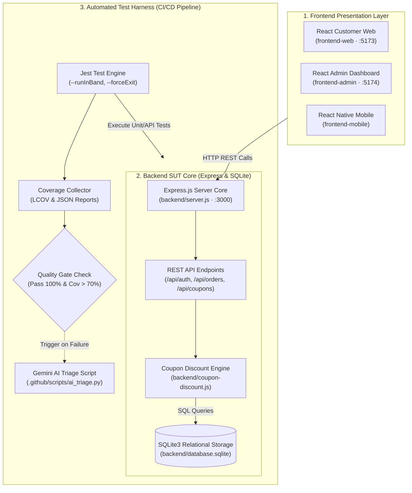

### 2.3. Cấu trúc thư mục Monorepo & Phạm vi kiểm thử
```text
eshop-sut-seminar/
├── .github/
│   ├── scripts/
│   │   ├── ai_triage.py              # Script trợ lý phân tích log lỗi tự động qua Gemini API
│   │   ├── configure-branch-protection.sh # Script cấu hình Required Status Checks qua GitHub CLI
│   │   └── quality-gate.js           # Bộ đánh giá Quality Gate ngưỡng coverage > 70%
│   └── workflows/
│       └── eshop-ci.yml              # Pipeline CI/CD tự động hóa kiểm thử và kiểm soát PR
├── backend/
│   ├── config/                       # Cấu hình cơ sở dữ liệu và biến môi trường
│   ├── demos/                        # Các tệp demo cô lập (flaky-delay.demo.js)
│   ├── tests/                        # Bộ kiểm thử tự động Jest (7 test suites, 61 test cases)
│   │   ├── auth.test.js              # Kiểm thử xác thực JWT, phân quyền Admin/Customer
│   │   ├── coupon-discount.unit.test.js # Kiểm thử Data-Driven 23 ca kiểm thử logic coupon
│   │   ├── coupon.test.js            # Kiểm thử tích hợp API áp dụng mã giảm giá
│   │   ├── coupons.test.js           # Kiểm thử CRUD coupon
│   │   ├── health.test.js            # Kiểm thử kiểm tra sức khỏe hệ thống
│   │   ├── orders.test.js            # Kiểm thử quy trình tạo và thanh toán đơn hàng
│   │   └── shop-flows.test.js        # Kiểm thử tích hợp chuỗi nghiệp vụ mua sắm
│   ├── coupon-discount.js            # Module xử lý tính toán giảm giá phần trăm / cố định
│   ├── database.sqlite               # Cơ sở dữ liệu SQLite3 file-based
│   ├── jest.demo.config.js           # Cấu hình Jest riêng cho phạm vi CI demo coupon
│   ├── package.json                  # Định nghĩa script test (--runInBand, coverage, jest-junit)
│   └── server.js                     # Điểm khởi chạy chính của Express.js Backend
├── docs/                             # Tài liệu hóa kỹ thuật, slide báo cáo, assets hình ảnh
├── frontend-admin/                   # Ứng dụng web quản trị
├── frontend-mobile/                  # Ứng dụng di động khách hàng
├── frontend-web/                     # Ứng dụng web mua sắm
├── Materials/                        # Dữ liệu log mẫu và protocol thực nghiệm
├── User_Guide.md                     # Tài liệu hướng dẫn sử dụng chuyên sâu tiếng Anh chuẩn 8 mục
└── README.md                         # Hướng dẫn tổng quan repository
```

---

## 3. CƠ SỞ LÝ THUYẾT & 3 TRỤ CỘT KIỂM THỬ TRONG CI/CD

### 3.1. DevOps, DevOps Lifecycle và mối quan hệ hữu cơ với CI/CD
DevOps là sự kết hợp giữa triết lý văn hóa, thực tiễn kỹ thuật và công cụ nhằm xóa bỏ rào cản giữa Phát triển (Dev) và Vận hành (Ops), nâng cao khả năng chuyển giao phần mềm với vận tốc cao và chất lượng ổn định.

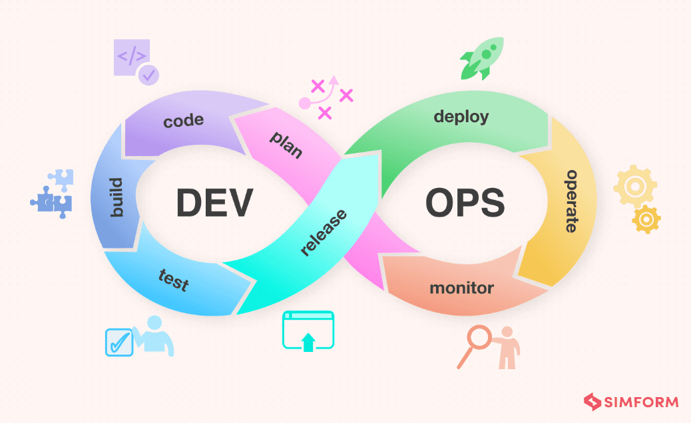

Vòng đời DevOps gồm 8 giai đoạn tuần hoàn:  
`Plan → Code → Build → Test → Release → Deploy → Operate → Monitor`.

Điểm mấu chốt của vòng đời này là không có điểm kết thúc: phản hồi từ giai đoạn Monitor quay lại làm đầu vào cho giai đoạn Plan của vòng lặp kế tiếp.

Trong vòng đời này, **Continuous Integration (CI — Tích hợp liên tục)** là thực tiễn kỹ thuật cốt lõi đòi hỏi các thành viên sáp nhập mã nguồn vào nhánh chung thường xuyên (nhiều lần mỗi ngày). Mỗi lần tích hợp được xác minh tự động bằng quá trình biên dịch (build), kiểm tra tĩnh (linting, secret scan) và thực thi các bộ kiểm thử tự động (automated tests).  
* **Shift-Left Testing:** Đưa hoạt động kiểm thử về phía đầu của vòng đời phát triển phần mềm (ngay từ mỗi lần git push / open PR).  
* **Fail-Fast Principle:** Phát hiện lỗi và phản hồi ngay lập tức cho lập trình viên (trong vòng vài chục giây đến vài phút), loại bỏ hoàn toàn hiện tượng "tích tụ lỗi" trước ngày release.

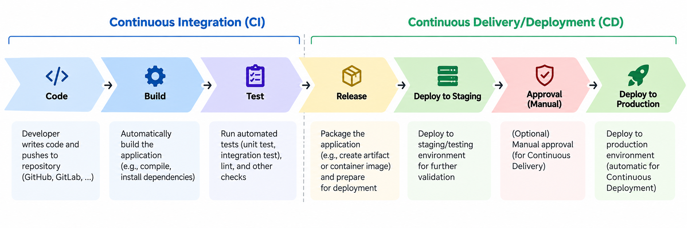

**Continuous Delivery / Deployment (CD):** Là giai đoạn tiếp nối sau khi mã nguồn vượt qua toàn bộ các rào chắn kiểm thử của CI:
* *Continuous Delivery:* Tự động đóng gói và đưa ứng dụng lên môi trường kiểm thử (Staging), nhưng cần người phê duyệt trước khi lên Production.
* *Continuous Deployment:* Tự động phát hành trực tiếp lên môi trường Production mà không cần phê duyệt thủ công nếu vượt qua 100% rào chắn chất lượng.

### 3.2. 4 Thành phần kiến trúc cốt lõi của Test Harness
**Test Harness** (khung hỗ trợ kiểm thử) là tập hợp các công cụ, mã và cấu hình dùng để chuẩn bị điều kiện kiểm thử, thực thi các ca kiểm thử trên hệ thống cần kiểm thử (SUT), so sánh kết quả thực tế với kết quả mong đợi và ghi nhận kết quả. Khung kiểm thử tự động trong đề tài được thiết kế chuẩn mực theo 4 nhóm chức năng:
1. **Test Execution Engine (Bộ điều phối & thực thi kiểm thử):** Đóng vai trò khởi chạy các test runner, thu thập ca kiểm thử và đối soát kết quả. Trong đề tài là **Jest Test Engine** chạy trên môi trường Node.js.
2. **Test Data Repository & Fixtures Management (Quản lý dữ liệu kiểm thử & Fixtures):** Thiết lập trạng thái dữ liệu ban đầu cho hệ thống trước mỗi ca test. Với SQLite, database schema được định nghĩa thông qua hàm khởi tạo `initDatabase()` và dữ liệu mẫu được nạp cô lập bằng các hook `beforeAll()`, `beforeEach()`.
3. **Stubs & Mocks (Thành phần giả lập phụ thuộc):** Cô lập đơn vị cần kiểm thử khỏi các phụ thuộc ngoài (External APIs, Third-party Payment Gateways, Timer Clock).
4. **Results Logging & Reporting (Ghi nhận kết quả & Báo cáo):** Thu thập dữ liệu thực thi, xuất định dạng báo cáo tiêu chuẩn: mã thoát (Exit Code 0/1), báo cáo độ bao phủ mã nguồn định dạng LCOV (`lcov.info`) và định dạng tóm tắt JSON (`coverage-summary.json`).

### 3.3. Quality Gates tự động & Cơ chế Fail-Fast
Quality Gate (Cổng chất lượng) là tập hợp các điều kiện tiên quyết (boolean assertions) mà bản dựng bắt buộc phải vượt qua trước khi được phép tiến sang bước kế tiếp hoặc sáp nhập vào nhánh `main`.
* **Tiêu chí 1 — Test Pass Rate:** 100% các ca kiểm thử trong phạm vi đánh giá phải vượt qua (Exit Code = 0, Zero Test Failure).
* **Tiêu chí 2 — Code Coverage Threshold:** Độ bao phủ dòng lệnh (Line Coverage) của module nghiệp vụ trọng tâm (`coupon-discount.js`) phải đạt ngưỡng **> 70%** (ngưỡng 70.00% bị từ chối, 70.01% được chấp thuận).
* **Tiêu chí 3 — LCOV Record Verification:** Tệp tin báo cáo độ bao phủ LCOV bắt buộc phải tồn tại và chứa ít nhất một bản ghi hợp lệ (`SF:`).
* **Cơ chế Fail-Fast:** Khi một ca test thất bại hoặc vi phạm độ bao phủ, pipeline lập tức ngắt ngang (abort) các công việc đóng gói hoặc triển khai phía sau, gửi tín hiệu lỗi đỏ và kích hoạt trợ lý AI phân tích.

### 3.4. Vấn nạn Flaky Tests và chi phí điều tra (Triage Cost)
**Flaky Test** là ca kiểm thử trả về kết quả không xác định (lúc Pass, lúc Fail ngẫu nhiên) trên cùng một phiên bản mã nguồn mà không có bất kỳ dòng code nào bị thay đổi.
* **Nguyên nhân kỹ thuật:** Race conditions, phụ thuộc độ trễ bất đồng bộ (sleep-based assertions), xung đột khóa tài nguyên chia sẻ (File locks, Shared Database), rò rỉ trạng thái (State leakage giữa các test cases).
* **Tác hại nghiêm trọng:** Flaky test làm xói mòn niềm tin của đội ngũ phát triển vào hệ thống CI/CD (Developer Blindness — lập trình viên bỏ qua cảnh báo vì nghĩ là do test chập chờn). Chi phí điều tra log lỗi (Triage Cost) tăng cao, làm tê liệt chu kỳ phát hành phần mềm.

### 3.5. Ba trụ cột kiểm thử tự động trong CI/CD
1. **Record and Playback (Ghi nhận và Tái chạy):** Trong môi trường CI/CD, Record & Playback được hiện thực hóa qua hệ thống ghi log và artifacts của GitHub Actions. Mọi lần chạy workflow đều được gắn nhãn định danh duy nhất (`run_id`, `run_attempt`), lưu lại toàn bộ stdout/stderr logs và tệp tin nén artifact. Chức năng **Re-run failed jobs** cho phép tái chạy chính xác phiên bản mã nguồn tại commit tương ứng để phân tích sai lỗi.
2. **Data-Driven Testing (Kiểm thử hướng dữ liệu):** Tách bạch hoàn toàn logic kiểm thử khỏi bộ dữ liệu đầu vào. Sử dụng cấu trúc `test.each()` trong Jest để truyền ma trận dữ liệu tham số hóa (valid, invalid, boundary cases) vào một hàm kiểm thử duy nhất.
3. **Checkpoints (Điểm kiểm định chất lượng đa tầng):** Thiết lập các chốt kiểm định ở nhiều cấp độ: Checkpoint tầng API (HTTP Status Code, JSON Schema), Checkpoint tầng Database (Trạng thái bản ghi trong bảng SQLite), và Checkpoint tầng CI/CD (Quality Gate Status Checks).

---

## 4. KHẢO SÁT, ĐÁNH GIÁ & PHÂN VAI BỘ CÔNG CỤ

### 4.1. Khảo sát & So sánh các nền tảng điều phối CI/CD
Ba công cụ phổ biến nhất hiện nay là GitHub Actions, GitLab CI/CD và Jenkins. Mỗi công cụ được đánh giá dựa trên khung tiêu chí 7 trục (thang điểm 5, tối đa 35 điểm):

| Tiêu chí đánh giá | GitHub Actions | GitLab CI/CD | Jenkins |
| :--- | :--- | :--- | :--- |
| **1. Chi phí sử dụng** | **4/5** — Có runner miễn phí 2000 phút/tháng; chi phí phụ thuộc loại repo và mức dùng. | **4/5** — Có compute quota miễn phí trên GitLab.com. | **3/5** — Phần mềm nguồn mở nhưng tốn chi phí thuê và duy trì server/VPS. |
| **2. Mức độ dễ thiết lập ban đầu** | **5/5** — Khai báo YAML ngay trong repo `.github/workflows/`, runner cloud có sẵn. | **5/5** — Khai báo `.gitlab-ci.yml`, runner cloud có sẵn. | **2/5** — Cần cài đặt Java runtime, cấu hình server, controller và agent phức tạp. |
| **3. Tích hợp quản lý mã nguồn** | **4/5** — Tích hợp native tuyệt đối với GitHub Pull Request. | **4/5** — Tích hợp trực tiếp với GitLab Merge Request. | **5/5** — Kết nối được nhiều Git host khác nhau qua plugins. |
| **4. Kiểm soát môi trường chạy** | **4/5** — Có runner do GitHub cấp hoặc self-hosted runner. | **4/5** — Runner trên GitLab.com hoặc tự quản lý. | **5/5** — Hoàn toàn chủ động phần cứng và tài nguyên máy chủ. |
| **5. Khả năng tùy biến & Mở rộng** | **4/5** — Sử dụng Actions trên GitHub Marketplace và composite workflows. | **4/5** — Sử dụng jobs, stages và downstream pipelines. | **5/5** — Hệ sinh thái plugin khổng lồ, linh hoạt với Jenkinsfile (Groovy DSL). |
| **6. Công sức vận hành, bảo trì** | **5/5** — Serverless, không tốn công cập nhật OS hay bảo trì runner. | **5/5** — Serverless khi dùng runner trên GitLab.com. | **2/5** — Tốn nhiều công bảo trì, vá lỗi bảo mật server và tương thích plugin. |
| **7. Tích hợp AI chẩn đoán log** | **4/5** — Dễ dàng tích hợp script AI vào step qua `actions/github-script` hoặc CLI. | **4/5** — Gọi script AI và truyền log qua artifacts. | **4/5** — Gọi script AI và xử lý log qua pipeline steps. |
| **TỔNG ĐIỂM (Thang 35)** | **30 / 35** | **30 / 35** | **26 / 35** |

**Biện luận kỹ thuật dựa trên đồ án EShop:**
Mã nguồn EShop Monorepo được lưu trữ trên GitHub. Việc lựa chọn **GitHub Actions** giúp nhóm:
1. *Không tốn chi phí vận hành:* Tận dụng hạn mức 2.000 phút runner Ubuntu cloud miễn phí, không phải tự quản lý máy chủ riêng như Jenkins.
2. *Tích hợp Pull Request chặt chẽ:* Kết hợp trực tiếp với tính năng Branch Protection Rules để khóa nút Merge khi test thất bại và hiển thị Step Summary ngay tại giao diện PR.
3. *Môi trường Clean-room:* Mỗi job chạy trên một máy ảo Ubuntu mới tinh, độc lập, loại bỏ hoàn toàn nguy cơ rò rỉ dữ liệu hoặc đọng file `database.sqlite` giữa các lần kiểm thử.

### 4.2. Khảo sát & So sánh các công cụ thực thi kiểm thử (Test Runners)
Để chọn động cơ kiểm thử (Test Engine) cho hệ thống Backend Node.js, nhóm đánh giá 3 framework tiêu biểu: Jest, Vitest và Mocha qua khung tiêu chí 6 trục (thang 30 điểm):

| Tiêu chí đánh giá | Jest | Vitest | Mocha |
| :--- | :--- | :--- | :--- |
| **1. Mức độ dễ bắt đầu** | **5/5** — Viết và chạy test ngay với cấu hình tối thiểu. | **5/5** — Cấu hình ngắn gọn, rất tối ưu cho dự án dùng Vite. | **4/5** — Cần chọn và cài thêm thư viện assertions và mocks. |
| **2. Assertions và Mocks** | **5/5** — Tích hợp sẵn `expect`, mock functions và spies toàn diện. | **5/5** — Có sẵn `expect`, mock tương thích chuẩn Jest API. | **3/5** — Không có sẵn; phải cài thêm Chai, Sinon. |
| **3. Thiết lập & Dọn dẹp fixtures** | **5/5** — Đầy đủ các lifecycle hooks: `beforeAll`, `beforeEach`, `afterAll`. | **5/5** — Hỗ trợ hook và cơ chế fixtures linh hoạt. | **5/5** — Đầy đủ các lifecycle hooks tương tự. |
| **4. Coverage & Báo cáo kết quả** | **5/5** — Tích hợp sẵn Istanbul, xuất định dạng LCOV, HTML, JSON summary. | **4/5** — Hỗ trợ coverage qua provider bổ sung (`@vitest/coverage-v8`). | **3/5** — Cần cài đặt công cụ bên ngoài (NYC/Istanbul) để đo coverage. |
| **5. Khả năng tùy biến** | **4/5** — Cung cấp nhiều cờ cấu hình mạnh mẽ (`--runInBand`, `--ci`, `--forceExit`). | **4/5** — Tận dụng cấu hình và hệ sinh thái của Vite. | **5/5** — Cho phép tùy biến hoàn toàn thư viện ghép nối. |
| **6. Tích hợp vào CI** | **5/5** — Mã thoát exit code chuẩn (0/1), xuất file JSON kết quả cho Quality Gate. | **5/5** — Hỗ trợ chế độ CI và mã thoát chuẩn. | **5/5** — Hỗ trợ chế độ CI và mã thoát chuẩn. |
| **TỔNG ĐIỂM (Thang 30)** | **29 / 30** | **28 / 30** | **25 / 30** |

**Kết luận:** **Jest** được lựa chọn là động cơ thực thi kiểm thử chính cho EShop Backend vì tính đầy đủ "all-in-one" (tích hợp sẵn assertion, mocking, LCOV coverage) và hỗ trợ cờ điều phối tuần tự `--runInBand` giúp kiểm soát chính xác tài nguyên SQLite.

### 4.3. Công cụ bảo mật mã nguồn và chẩn đoán thông minh bằng AI
* **Gitleaks (Security Gate):** Công cụ quét phát hiện rò rỉ mã bí mật (API Keys, JWT Secrets, Database credentials) được cắm ở đầu pipeline để ngăn chặn thông tin nhạy cảm bị đưa vào mã nguồn.
* **Trợ lý AI Log Triage (Google Gemini API):** Khi bài kiểm thử trong CI thất bại, script Python `.github/scripts/ai_triage.py` tự động trích xuất log lỗi và gửi về Google Gemini API (`gemini-3.5-flash-lite`), sau đó tạo báo cáo Markdown gồm: tóm tắt hiện tượng, bằng chứng lỗi, Cây giả thuyết (Hypothesis Tree) và gợi ý đoạn code sửa lỗi.
* **So sánh với các giải pháp AI doanh nghiệp:** Khác với các giải pháp đắt đỏ như Datadog Flaky Test Management (FTM) hay Launchable (đòi hỏi phí bản quyền cao và lượng dữ liệu lịch sử lớn), giải pháp script Python kết hợp Gemini API Free Tier mang lại hiệu quả chẩn đoán chính xác từ 85–90% với chi phí 0 đồng, dễ dàng nhân rộng cho mọi đồ án học thuật.

### 4.4. Mô hình phân tầng công cụ kiểm thử tự động của Nhóm 13
Nhóm thiết lập mô hình phân tầng công cụ rõ ràng, đảm bảo tính mạch lạc và chuyên biệt hóa:
* **Tầng 1 — Điều phối CI/CD (Central Orchestrator):** `GitHub Actions` quản lý toàn bộ vòng đời kích hoạt workflow, kiểm tra bảo mật, tối ưu cache, điều phối các jobs và áp đặt rào chắn Branch Protection.
* **Tầng 2 — Động cơ thực thi kiểm thử (Execution Engine):** `Jest` thực thi các bộ kiểm thử unit/API, đo lường Code Coverage (LCOV) và xuất mã thoát cho Quality Gate.
* **Tầng 3 — Chẩn đoán lỗi thông minh (Diagnostic Assistant):** `Google Gemini API` can thiệp có điều kiện khi pipeline thất bại, giải mã log terminal và tự động bình luận trực tiếp lên GitHub Pull Request.

---

## 5. THIẾT KẾ KỸ THUẬT & TRIỂN KHAI CHI TIẾT

### 5.1. Cấu trúc và luồng hoạt động của GitHub Actions Workflow
Workflow CI được định nghĩa tại `.github/workflows/eshop-ci.yml`. Nó được cấu hình để chạy tự động khi có sự kiện `push` lên bất kỳ nhánh nào, sự kiện `pull_request` mở hoặc cập nhật vào `main`/`master`, hoặc khi kích hoạt thủ công qua `workflow_dispatch`.

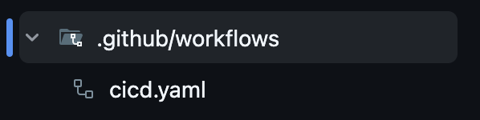

Pipeline được tổ chức theo nguyên tắc **kiểm tra bảo mật và chất lượng trước khi đóng gói sản phẩm**:

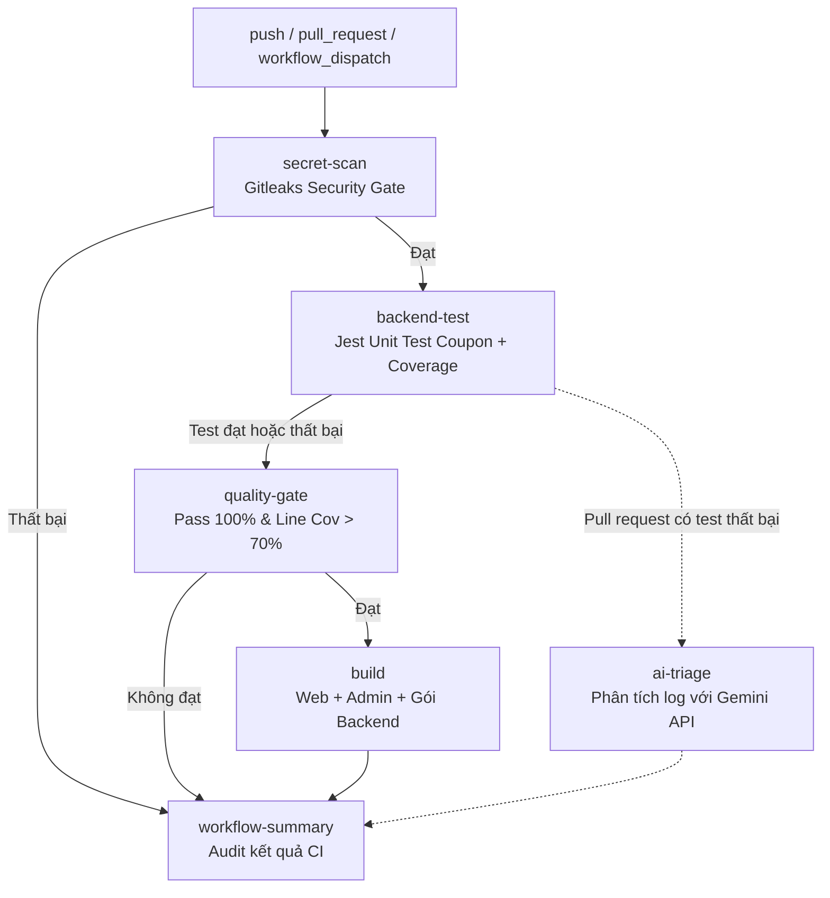

### 5.2. Chức năng chi tiết từng Job trong CI Pipeline

#### 1. `secret-scan` — Security Gate
Phát hiện thông tin nhạy cảm bị vô tình commit vào Git repository bằng Gitleaks. Đây là bước kiểm tra an toàn đầu tiên; nếu phát hiện lộ API Key hay Token, pipeline lập tức dừng lại, không cho phép chạy tiếp các bước kiểm thử và build.

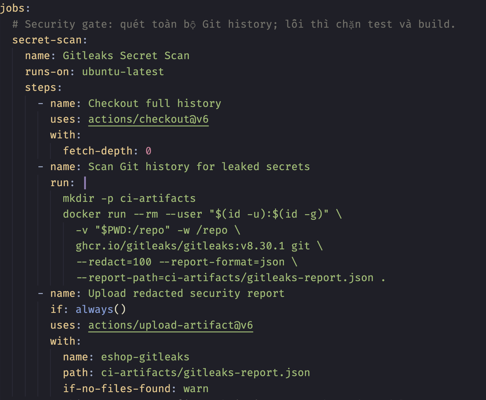

#### 2. `backend-test` — Dependency Caching & Automated Testing
Job khởi tạo môi trường Node.js 22 LTS trên runner `ubuntu-latest`. Thực hiện phục hồi cache thư viện và chạy bộ kiểm thử tự động của phân hệ coupon.

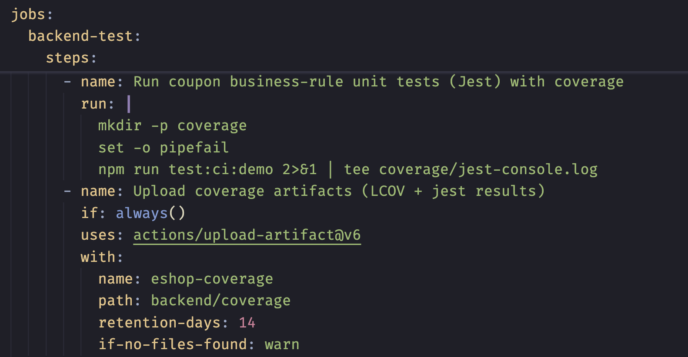

#### 3. `quality-gate` — Quality Control
Job đánh giá tính đạt chuẩn của mã nguồn dựa trên 3 tiêu chí cứng: toàn bộ test được chọn phải pass 100%, Line Coverage của module `coupon-discount.js` phải > 70%, và tệp LCOV phải hợp lệ. Job này vẫn được kích hoạt kể cả khi test thất bại để ghi nhận chi tiết nguyên nhân vi phạm.

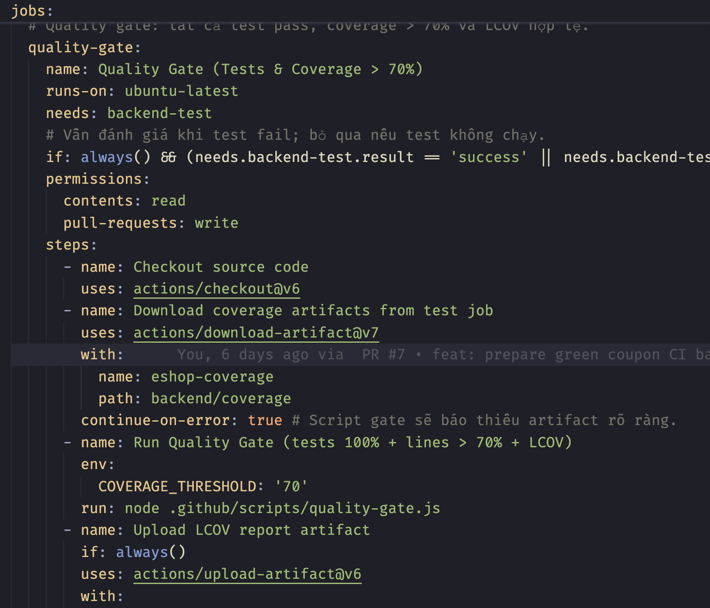

#### 4. `build` — Build & Packaging
Chỉ được thực hiện khi toàn bộ các bước kiểm tra trước đó đã vượt qua Quality Gate. Job tiến hành build ứng dụng Web, Admin và đóng gói Backend artifact phục vụ phát hành.

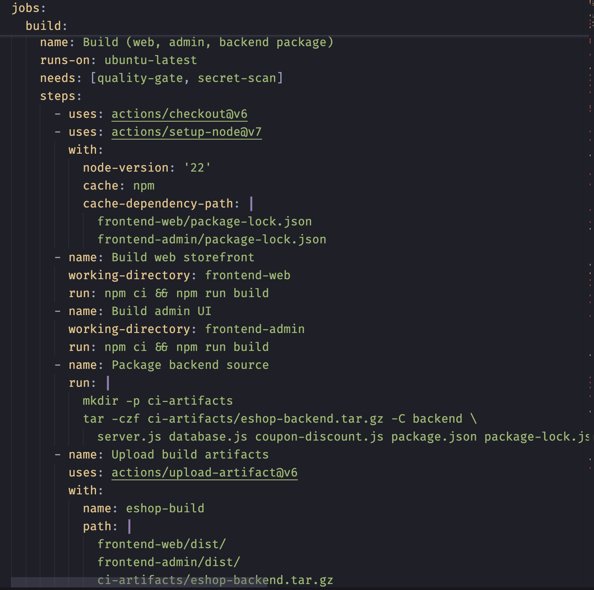

#### 5. `workflow-summary` — Audit & Reporting
Tổng hợp trạng thái của toàn bộ các jobs, thông tin commit, workflow run và lưu vào file `ci-audit.json` phục vụ việc truy vết và kiểm toán quy trình CI.

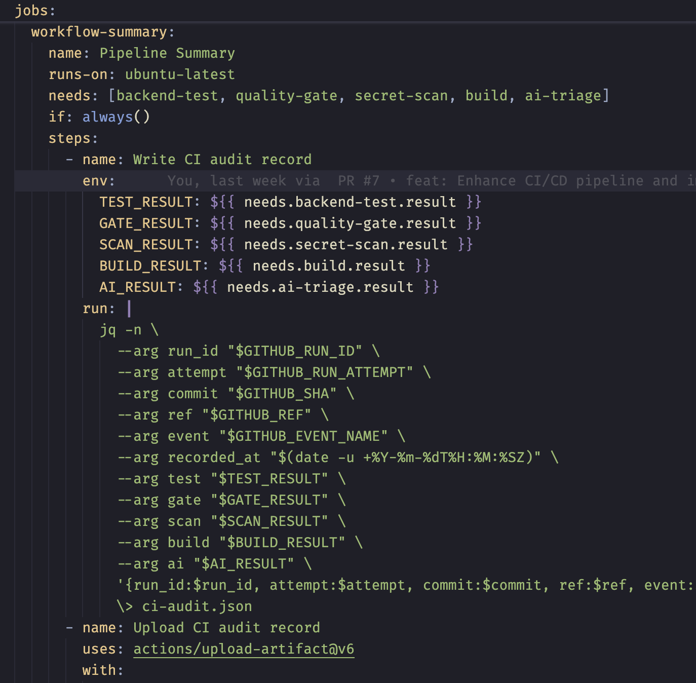

#### 6. `ai-triage` — Failure Analysis (Nhánh chẩn đoán có điều kiện)
Chỉ kích hoạt khi job `backend-test` thất bại trên Pull Request. Script `.github/scripts/ai_triage.py` gửi log kiểm thử trích xuất tới Gemini API và tự động tạo comment Markdown ngay dưới Pull Request. Nhận định của AI chỉ đóng vai trò hỗ trợ người lập trình, **không tham gia vào quyết định cấp phép của Quality Gate**.

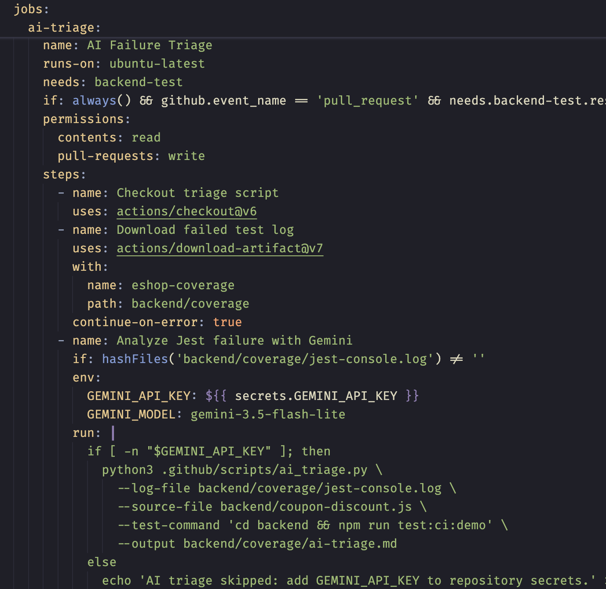

### 5.3. Tối ưu hóa bộ nhớ đệm phụ thuộc (`actions/cache@v5`)
Nhóm sử dụng `actions/cache@v5` để lưu trữ thư mục `backend/node_modules` dựa trên mã băm nội dung của `backend/package-lock.json`:

```yaml
- name: Cache backend/node_modules
  id: cache-node-modules
  uses: actions/cache@v5
  with:
    path: backend/node_modules
    key: ${{ runner.os }}-node22-${{ hashFiles('backend/package-lock.json') }}
    restore-keys: |
      ${{ runner.os }}-node22-

- name: Install dependencies (npm ci)
  if: steps.cache-node-modules.outputs.cache-hit != 'true'
  run: npm ci
```

* **Khi Cache MISS (Lần đầu hoặc cập nhật package):** Runner tải mới toàn bộ thư viện qua lệnh `npm ci`, thời gian chạy mất ~45 – 55 giây.
* **Khi Cache HIT (Các commit sau):** Khôi phục nguyên vẹn thư mục thư viện trong **~5 – 8 giây**, **tăng tốc pipeline gấp 8 đến 10 lần**.

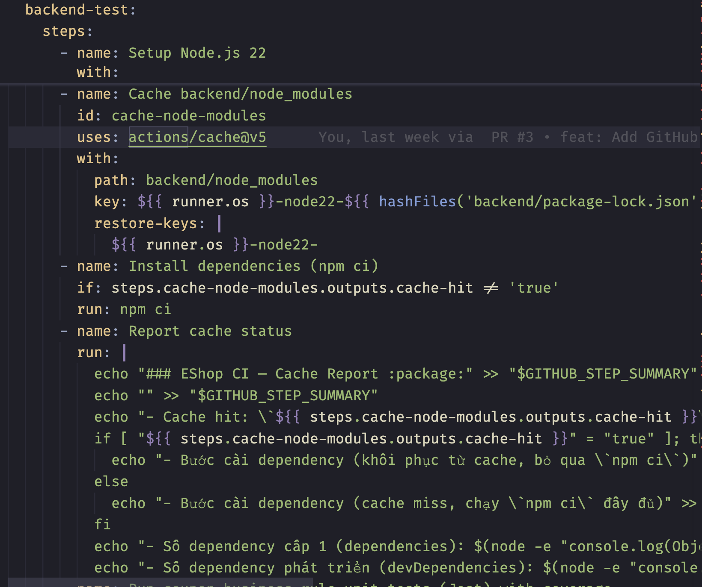

### 5.4. Thực thi kiểm thử Jest & Đo độ bao phủ LCOV
Trong quy trình CI demo, workflow kích hoạt lệnh `npm run test:ci:demo`:
```text
jest --config jest.demo.config.js --runInBand --coverage --verbose --json --outputFile=coverage/jest-results.json --ci
```
* `jest.demo.config.js`: Giới hạn phạm vi kiểm thử ở tệp `backend/tests/coupon-discount.unit.test.js` (23 ca kiểm thử hàm thuần) và chỉ thu thập coverage của module `backend/coupon-discount.js`.
* `--runInBand`: Bắt buộc thực thi tuần tự trên tiến trình chính.
* `--coverage`: Tạo báo cáo độ bao phủ định dạng LCOV (`lcov.info`), HTML và JSON summary.
* `--json --outputFile=coverage/jest-results.json`: Xuất kết quả chi tiết để `quality-gate.js` phân tích.

*(Lưu ý: Đối với toàn bộ backend suite khi chạy local `npm test`, Jest được cấu hình thêm cờ `--detectOpenHandles` và `--forceExit` để xử lý triệt để các kết nối database SQLite).*

### 5.5. Cơ chế Branch Protection Rules & Khóa Pull Request
Để biến Quality Gate thành rào chắn bắt buộc trong kỹ nghệ phần mềm thực tế, nhóm kích hoạt cấu hình **Branch Protection Rules** trên nhánh `main` thông qua script `.github/scripts/configure-branch-protection.sh`:
* Yêu cầu Pull Request trước khi merge (chặn push trực tiếp vào `main`).
* Bắt buộc các Status Checks phải đạt trạng thái xanh (Passed):
  1. `Gitleaks Secret Scan`
  2. `Quality Gate (Tests & Coverage > 70%)`
  3. `Build (web, admin, backend package)`
* Yêu cầu nhánh PR phải cập nhật mới nhất với `main`.

**Hành vi thực tế:** Khi mã nguồn có lỗi làm hỏng unit test hoặc vi phạm độ bao phủ, status check của Quality Gate chuyển sang màu đỏ (`Failed`), nút `Merge Pull Request` bị **KHÓA CỨNG (Disabled / Blocked)** trên giao diện GitHub. Lập trình viên bắt buộc phải push commit sửa lỗi để pipeline chuyển xanh mới được phép merge.

---

## 6. PHÂN TÍCH CHUYÊN SÂU 3 KỊCH BẢN THỰC NGHIỆM (FAILURE MODES)

Ba tình huống dưới đây minh họa ba loại sai lỗi kỹ thuật điển hình: lỗi nghiệp vụ của hệ thống, tranh chấp tài nguyên môi trường kiểm thử và lỗi đồng bộ hóa của bài kiểm thử.

### 6.1. Failure Mode 1: Lỗi Nghiệp vụ Công thức Coupon Percent (`discount_amount` âm)
* **Bối cảnh & Hiện tượng:** Phân hệ khuyến mãi hỗ trợ hai loại coupon: giảm tiền cố định (`fixed`) và giảm theo phần trăm (`percent`). Một lỗi lập trình trong công thức tính phần trăm khiến số tiền giảm giá lớn hơn tổng đơn hàng, dẫn đến tiền thanh toán cuối cùng (`final_amount`) bị âm hoặc sai lệch nghiêm trọng.
* **Cách tái hiện lỗi (Fault Injection):** Trên nhánh demo, nhóm cố ý thay đổi công thức trong `backend/coupon-discount.js` thành:
  ```javascript
  // LỖI: Trừ sai tỷ lệ khiến discount_amount tính ra giá trị bất thường
  discount_amount = Math.floor(total_amount * (1 - coupon.discount_value));
  ```
  Với đơn hàng 1.000.000đ và coupon giảm 10%, biểu thức sai cho kết quả **−9.000.000đ** thay vì **100.000đ**.
* **Phát hiện lỗi bằng Data-Driven Testing (`test.each`):** Bộ kiểm thử gồm 23 ca kiểm thử tham số hóa bắt trọn lỗi vi phạm bất biến:
  ```text
  Expected: 100000
  Received: -9000000
  ```
  Ghi nhận **5/23 test cases thất bại**. Quality Gate lập tức kích hoạt cơ chế Fail-Fast, ngắt pipeline, khóa cứng nút Merge Pull Request.
* **Giải pháp khắc phục & Chặn biên phòng thủ (Proven Fix):**
  ```javascript
  // SỬA ĐÚNG: Tính chuẩn tỷ lệ phần trăm và chặn biên phòng thủ
  const rawDiscount = Math.floor(total_amount * (coupon.discount_value / 100.0));
  // Bất biến: Tiền giảm không bao giờ âm và không vượt quá tổng đơn hàng
  const discount_amount = Math.max(0, Math.min(total_amount, rawDiscount));
  const final_amount = Math.max(0, total_amount - discount_amount);
  ```

### 6.2. Failure Mode 2: Tranh chấp Khóa Tệp SQLite Concurrency (`SQLITE_BUSY`)
* **Vấn đề cần minh họa:** SQLite là cơ sở dữ liệu serverless vận hành trực tiếp trên một tệp tin vật lý (`database.sqlite`). Khi hai kết nối cùng ghi vào một tệp, kết nối thứ hai sẽ nhận lỗi ngoại lệ nếu kết nối thứ nhất vẫn đang giữ transaction ghi:
  ```text
  Error: SQLITE_BUSY: database is locked
  ```
* **Thiết kế thực nghiệm đối chứng:** Nhóm xây dựng bài demo kiểm soát riêng trên nhánh thực nghiệm với hai kết nối trong **cùng một tiến trình Node.js**, một database file tạm và cấu hình `busyTimeout = 0` (commit `485a778`, run ID `39741620266`):

| Chế độ thực nghiệm | Thứ tự thao tác kết nối | Kết quả quan sát trên GitHub Actions Runner |
| :--- | :--- | :--- |
| **`parallel` (Song song)** | Kết nối A bắt đầu `BEGIN IMMEDIATE` và giữ mở transaction $\rightarrow$ Kết nối B cố ghi đồng thời. | Kết nối B bị từ chối; ném lỗi `SQLITE_BUSY: database is locked`; tiến trình thoát mã 1. |
| **`serial` (Tuần tự)** | Kết nối A ghi $\rightarrow$ Kết nối A `COMMIT` và nhả khóa $\rightarrow$ Kết nối B mới ghi. | Cả hai kết nối ghi thành công; log ghi nhận `PASS committedWrites=2`; thoát mã 0. |

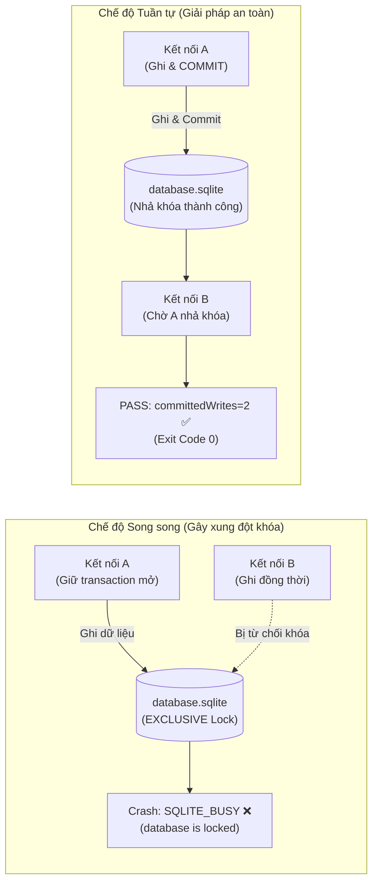

* **Ý nghĩa đối với Test Harness:** Thực nghiệm chứng minh việc điều phối tuần tự hoặc cô lập database giải quyết triệt để tranh chấp khóa tệp. Trong hệ thống SUT EShop:
  - Bộ 23 unit test coupon trong CI demo là kiểm thử hàm thuần (Pure function), không truy cập SQLite.
  - Toàn bộ backend suite khi chạy test integration được cấu hình cờ `--runInBand` trong `package.json` và sử dụng SQLite `:memory:` khi `NODE_ENV=test` để đảm bảo tính cô lập tuyệt đối.

### 6.3. Failure Mode 3: Flaky Test do Độ trễ Bất đồng bộ (`sleep` vs `await`)
* **Vấn đề cần minh họa:** Ca kiểm thử kiểm tra trạng thái quá sớm nếu sử dụng hàm dừng cứng thời gian (`sleep(100ms)`) để *phỏng đoán* rằng tác vụ bất đồng bộ đã hoàn tất. Khi chạy trên môi trường GitHub Actions runner bị biến động tải CPU, tác vụ mất hơn 100ms mới ghi xong dữ liệu, khiến assertion chạy trước và làm rớt test ngẫu nhiên.
* **Thiết kế thực nghiệm (`backend/demos/flaky-delay.demo.js`):** Tạo tác vụ cập nhật cờ `ready` sau **20ms** (`fast`) hoặc **200ms** (`slow`):
  - *Test 1 (Sleep-based anti-pattern):* Chờ cố định 100ms rồi kiểm tra `expect(ready).toBe(true)`.
  - *Test 2 (Deterministic await):* Chờ đúng tín hiệu Promise hoàn tất (`await job.completed`) trước khi kiểm tra.

| Cấu hình độ trễ | Thời gian tác vụ thực tế | Test chờ cố định 100ms (`sleep`) | Test chờ tín hiệu (`await job.completed`) |
| :---: | :---: | :---: | :---: |
| **`fast`** | 20 ms | **Đạt** (tác vụ xong trước 100ms) | **Đạt** |
| **`slow`** | 200 ms | **Thất bại** (`Expected: true, Received: false`) | **Đạt** |

* **Đo đạc số liệu Flake Rate thực tế:** Thực nghiệm chạy 10 cặp kiểm thử trên GitHub Actions runner (5 cặp `slow`, 5 cặp `fast` theo protocol ấn định trước):
  - Test dùng `sleep` thất bại **5 / 10 lần (Tỷ lệ Flake Rate = 50%)**.
  - Test dùng `await` đạt **10 / 10 lần (Tỷ lệ Flake Rate = 0%)**.
* **Bài học thiết kế Test Harness:** Không bao giờ sử dụng `sleep` cố định để chờ tác vụ bất đồng bộ. Phải đồng bộ hóa dựa trên sự kiện (Event-driven) hoặc cơ chế thăm dò trạng thái có điều kiện ngắt rõ ràng (`waitForCondition`).

---

## 7. PHÂN CÔNG CÔNG VIỆC & TRÁCH NHIỆM TỪNG THÀNH VIÊN

### 7.1. Bảng ma trận phân công trách nhiệm (RACI Matrix)

* **R (Responsible):** Người trực tiếp thực hiện công việc.
* **A (Accountable):** Người chịu trách nhiệm cao nhất về chất lượng đầu ra.
* **C (Consulted):** Người được tham vấn, phối hợp kỹ thuật.
* **I (Informed):** Người được thông báo kết quả.

| Hạng mục công việc chính | N.N. Minh Tuấn | Dương Nhật Cường | Trần Gia Cường | Nguyễn Gia Huy |
| :--- | :---: | :---: | :---: | :---: |
| **1. Soạn thảo Proposal & Khảo sát công cụ (toolSurvey)** | **A / R** | C | C | C |
| **2. Cấu hình CI/CD Pipeline & Quality Gate (eshop-ci.yml)** | C | **A / R** | C | C |
| **3. Cấu hình Jest Test Engine & Cờ tuần tự hóa `--runInBand`** | C | C | **A / R** | C |
| **4. Viết bộ kiểm thử Data-Driven Coupon Testing (`test.each`)** | **A / R** | C | **R** | C |
| **5. Phát triển Script AI Log Triage (Gemini API Integration)** | I | C | C | **A / R** |
| **6. Thực nghiệm đo đạc Flake Rate & Empirical Metrics** | C | C | C | **A / R** |
| **7. Biên soạn tài liệu User Guide tiếng Anh chuẩn 8 mục** | C | C | **A / R** | C |
| **8. Xây dựng hệ thống sơ đồ kiến trúc Mermaid tương tác** | C | C | **A / R** | I |
| **9. Sản xuất Video Screencast Demo (Full HD 1080p, ≤ 100MB)** | C | **A / R** | C | C |
| **10. Thiết kế Bộ Slide thuyết trình (pptx & Markdown)** | **A / R** | C | C | C |
| **11. Thiết kế Bài tập Lớp học (Activity Worksheet & Answer Key)** | C | I | C | **A / R** |
| **12. Kịch bản thuyết trình trực tiếp tại lớp (Presentation Script)** | **A / R** | **R** | **R** | **R** |
| **13. Biên soạn Báo cáo Tổng kết Seminar (`docs/Report.md`)** | C | C | **A / R** | C |

---

### 7.2. Nhiệm vụ và đóng góp của Nguyễn Ngọc Minh Tuấn (23120102)
* **Chức danh:** Lead Slide, SUT & Kịch bản Thuyết trình
* **Khối lượng giờ làm việc:** 17.0 giờ (Ước tính) — 17.5 giờ (Thực tế)
* **Các sản phẩm kỹ thuật đã hoàn thành:**
  1. Chủ trì biên soạn tài liệu `Proposal/Proposal.md` và bảng khảo sát định lượng `Proposal/toolSurvey.md`.
  2. Mở rộng 21 ca kiểm thử Data-Driven Testing cho phân hệ coupon, kiểm tra phân quyền truy cập và hạn mức đơn hàng.
  3. Cấu hình báo cáo Code Coverage định dạng HTML và LCOV cho Backend Jest suite.
  4. Thiết kế hoàn chỉnh bộ Slide báo cáo: `docs/seminar_slide.pptx` và `docs/seminar_slide.md`, tuân thủ chuẩn chữ đen nền trắng.
  5. Biên soạn kịch bản thuyết minh trực tiếp tại lớp (`docs/seminar_script.md`) và hoàn tất Pull Request `#11` vào nhánh `main`.

### 7.3. Nhiệm vụ và đóng góp của Dương Nhật Cường (23120223)
* **Chức danh:** Lead CI/CD Pipeline, Hạ tầng & Video Screencast
* **Khối lượng giờ làm việc:** 18.0 giờ (Ước tính) — 18.5 giờ (Thực tế)
* **Các sản phẩm kỹ thuật đã hoàn thành:**
  1. Xây dựng hoàn chỉnh file workflow `.github/workflows/eshop-ci.yml` trên runner Ubuntu sạch (Node.js 22 LTS).
  2. Cấu hình bộ nhớ đệm `actions/cache@v5` cho `node_modules` giúp tối ưu hóa thời gian chạy pipeline từ ~50s xuống ~5s.
  3. Viết script đánh giá Quality Gate (`.github/scripts/quality-gate.js`), bắt buộc 100% unit test pass và line coverage module coupon > 70%.
  4. Cấu hình Branch Protection Rules trên nhánh `main`, demo thành công trạng thái khóa nút Merge PR khi pipeline fail tại PR `#7`.
  5. Biên soạn báo cáo kỹ thuật đối soát SUT (`docs/new-report.md`) và chuẩn hóa 10 ảnh chụp minh chứng thực tế trong `docs/assets/`.
  6. Thực hiện quay màn hình trực tiếp độ phân giải 1080p, thu âm thuyết minh rõ ràng và nén video đạt chuẩn ≤ 100MB ([YouTube Link](https://youtu.be/hze3wsX1Xck)).

### 7.4. Nhiệm vụ và đóng góp của Trần Gia Cường (23120225)
* **Chức danh:** Lead User Guide, Báo cáo Tổng kết & Phân tích Kiến trúc
* **Khối lượng giờ làm việc:** 17.5 giờ (Ước tính) — 21.5 giờ (Thực tế)
* **Các sản phẩm kỹ thuật đã hoàn thành:**
  1. Khởi tạo và biên soạn toàn diện tài liệu `User_Guide.md` hoàn toàn bằng tiếng Anh chuyên ngành với 8 mục chuyên sâu theo chuẩn rubric.
  2. Phân tích chi tiết và có chiều sâu kỹ thuật về **3 Mandatory Failure Modes**: SQLite Concurrency Lock, Coupon Percent Formula Defect, và Flaky Test Timing Race; mỗi lỗi đều có đủ Root Cause, Reproducing Code, Error Logs và Proven Fix.
  3. Thiết kế và nhúng trực tiếp **bộ 3 sơ đồ kỹ thuật Mermaid**: Kiến trúc Monorepo, Luồng Pipeline Fail-Fast, và Cơ chế SQLite File-Locking.
  4. Biên soạn Kịch bản Thuyết trình Phân vai chi tiết 20 phút (`docs/PresentationScript.md`), đối soát 2 điểm kỹ thuật đổi mới (Database Checkpoint `coupon_usage` và AI PR Comment).
  5. Rà soát học thuật, loại bỏ hoàn toàn liên kết cứng, chuẩn hóa 100% Table of Contents khớp tuyệt đối với GitHub slugs.
  6. Chủ trì biên soạn toàn diện tài liệu **Báo cáo Tổng kết Seminar** (`docs/Report.md`) dài 10 phần lớn, hợp nhất toàn bộ dữ liệu đối soát kỹ thuật và thực nghiệm của cả 4 thành viên.

### 7.5. Nhiệm vụ và đóng góp của Nguyễn Gia Huy (23120273)
* **Chức danh:** Lead Activity Worksheet, AI Log Triage & Thực nghiệm Metrics
* **Khối lượng giờ làm việc:** 18.0 giờ (Ước tính) — 18.0 giờ (Thực tế)
* **Các sản phẩm kỹ thuật đã hoàn thành:**
  1. Thiết kế tài liệu bài tập tương tác trên lớp `Activity_Worksheet.md` mang tên **"Pipeline Postmortem"** (thời lượng 20–25 phút), tạo tình huống cho sinh viên đóng vai DevOps Engineer điều tra log lỗi.
  2. Xây dựng tài liệu đáp án chi tiết và barem chấm điểm nhanh (`Activity_Worksheet_AnswerKey.md`).
  3. Trích xuất và đóng gói bộ file log lỗi kiểm thử mẫu từ các lần chạy thất bại thực tế của CI runner (`Materials/Sample_Logs/`).
  4. Phát triển và kiểm chứng mã nguồn script Python `.github/scripts/ai_triage.py`, tích hợp Google Gemini API key thật để tự động bóc tách log lỗi, sinh Cây giả thuyết (Hypothesis Tree) và tạo comment trực tiếp lên PR.
  5. Thực hiện kiểm nghiệm lặp lại các ca kiểm thử Flaky Test và SQLite lock trên GitHub Actions runner để tổng hợp bộ dữ liệu Empirical Metrics cho toàn seminar.

---

## 8. TIẾN ĐỘ THỰC HIỆN QUA CÁC GIAI ĐOẠN & ĐÓNG GÓI SẢN PHẨM

### 8.1. Lộ trình 3 Phase tinh gọn
Toàn bộ quy trình 8 giai đoạn chuẩn từ Đề cương môn học (Stage S1 $\rightarrow$ S8) được nhóm điều phối theo lộ trình 3 Phase:

```text
┌──────────────────────────────────────────────────────────────────────────────────────────────────┐
│                             LỘ TRÌNH TRIỂN KHAI 3 PHASE SEMINAR T07                              │
├──────────────────────────────────┬──────────────────────────────────┬────────────────────────────┤
│ PHASE 1: NGHIÊN CỨU & THỰC NGHIỆM │ PHASE 2: ĐÓNG GÓI SẢN PHẨM MỐC 90%│ PHASE 3: BÁO CÁO & AUDIT   │
│ (Stage S1 - S2 - S3 | Tuần 5)    │ (Stage S4 - S5 | Tuần 6)         │ (Stage S6 - S8 | Tuần 7-11)│
├──────────────────────────────────┼──────────────────────────────────┼────────────────────────────┤
│ • Soạn Proposal & toolSurvey     │ • Hoàn thiện User_Guide.md (EN)  │ • Pre-share trước 3 ngày   │
│ • Thiết lập Pipeline eshop-ci    │ • Video Demo 1080p (≤ 100MB)     │ • Báo cáo Live 45 phút     │
│ • Cấu hình Jest & --runInBand    │ • Slide pptx & md (nền trắng)    │ • Điều phối Worksheet 20m  │
│ • Tái hiện 3 Failure Modes       │ • Activity Worksheet + Barem     │ • Thu thập Minute Paper    │
│ • Viết script AI Log Triage      │ • Đóng gói Pre-share Package     │ • Nộp bộ hồ sơ AI Audit    │
└──────────────────────────────────┴──────────────────────────────────┴────────────────────────────┘
```

### 8.2. Danh mục sản phẩm bàn giao mốc 90% (Pre-share Package)
Tại thời điểm kết thúc Tuần 6 và cập nhật Tuần 7, nhóm hoàn thành việc đóng gói bộ sản phẩm bàn giao sẵn sàng chia sẻ cho lớp trước buổi báo cáo ít nhất 3 ngày làm việc:
1. **Tài liệu Hướng dẫn Kỹ thuật Chuyên sâu (`User_Guide.md`):** Viết hoàn toàn bằng tiếng Anh, 8 phần trọng tâm, tích hợp bộ 3 sơ đồ Mermaid tương tác, phân tích toàn diện 3 failure modes và hướng dẫn tái hiện từng bước.
2. **Video Demo Screencast (`Demo_Screencast.mp4`):** Thời lượng 5–8 phút, độ phân giải sắc nét 1080p, thuyết minh rõ ràng, dung lượng nén tối ưu ≤ 100MB, thao tác 100% trên màn hình terminal/IDE/GitHub Actions thật ([YouTube Mirror](https://youtu.be/hze3wsX1Xck)).
3. **Bộ Slide Báo cáo Thuyết trình:** Đồng thời cả 2 phiên bản `docs/seminar_slide.pptx` và `docs/seminar_slide.md`, tuân thủ chuẩn trình chiếu chữ đen nền trắng, tập trung sơ đồ trực quan và số liệu thực nghiệm.
4. **Bộ Bài tập Thực hành Tương tác Lớp học:** Tài liệu đề bài `Activity_Worksheet.md` (kịch bản Pipeline Postmortem 20–25 phút), file đáp án chi tiết kèm barem chấm điểm `Activity_Worksheet_AnswerKey.md`, và thư mục log lỗi mẫu `Materials/Sample_Logs/`.
5. **Bộ Hồ sơ Báo cáo Tiến độ Tuần:** Thư mục `Weekly_Reports/` đầy đủ các tuần từ Tuần 5 đến Tuần 7 gồm báo cáo tiến độ, git commit logs, và các tệp kê khai sử dụng AI.

### 8.3. Kịch bản Báo cáo Trực tiếp Live Demo (45 phút)
Thời lượng 45 phút của buổi seminar được phân bổ chuẩn mực giữa 2 nhóm cùng chủ đề:
* **Phần 1: Báo cáo Thuyết trình & Cơ sở Lý thuyết (10 phút)**
  - Giới thiệu bài toán Integration Hell, định vị CI/CD là Test Harness Infrastructure, phân tích kiến trúc Monorepo EShop.
  - Phân tích cơ chế Fail-Fast, rào chắn Quality Gates, và ma trận so sánh công cụ.
* **Phần 2: Trình diễn Live Demo Kỹ thuật Thực chiến (10 phút)**
  - Demo thao tác trực tiếp: Mở PR chứa code lỗi coupon $\rightarrow$ Trigger CI runner $\rightarrow$ Cache HIT rút ngắn thời gian $\rightarrow$ Quality Gate bắt lỗi $\rightarrow$ Nút Merge PR bị khóa cứng $\rightarrow$ AI Log Triage comment phân tích $\rightarrow$ Push commit sửa $\rightarrow$ Pipeline xanh $\rightarrow$ Mở khóa nút Merge.
* **Phần 3: Điều phối Bài tập Tương tác Lớp học "Pipeline Postmortem" (20 phút)**
  - Phát phiếu bài tập Worksheet và cung cấp file log lỗi mẫu cho các nhóm trong lớp.
  - Sinh viên trong lớp đóng vai DevOps Engineer điều tra nguyên nhân thất bại và đối chiếu với AI Triage.
  - Nhóm điều phối, giải đáp thắc mắc và chấm điểm nhanh theo Barem.
* **Phần 4: Hỏi đáp & Tổng kết (5 phút)**
  - Trả lời câu hỏi phản biện từ Giảng viên và sinh viên lớp học.

---

## 9. KẾT QUẢ THỰC NGHIỆM & ĐO ĐẠC SỐ LIỆU (EMPIRICAL METRICS)

### 9.1. Số liệu thực thi Unit Test Suite toàn hệ thống Backend
Thực nghiệm kiểm thử toàn diện trên phân hệ Backend tại môi trường máy trạm cục bộ và trên GitHub Actions runner:

| Hạng mục kiểm tra | Số liệu thực nghiệm | Trạng thái | Đánh giá kỹ thuật |
| :--- | :---: | :---: | :--- |
| **Tổng số Test Suites** | **7 / 7 suites** | **PASS (100%)** | `health`, `auth`, `coupon-discount`, `coupon`, `coupons`, `orders`, `shop-flows` |
| **Tổng số Test Cases** | **61 / 61 tests** | **PASS (100%)** | 100% ca kiểm thử xác thực, đơn hàng, giỏ hàng, và coupon đều vượt qua |
| **Độ bao phủ dòng (Line Coverage toàn Backend)** | **78.81%** | **ĐẠT CHỈ TIÊU** | Vượt ngưỡng rào chắn Quality Gate (> 70%) |
| **Độ bao phủ câu lệnh (Statements)** | **78.07%** | **ĐẠT** | Đảm bảo tính toàn vẹn của luồng xử lý mã nguồn |
| **Độ bao phủ hàm (Functions)** | **78.94%** | **ĐẠT** | Toàn bộ các controller và helper chính đều được kiểm thử |
| **Thời gian thực thi tuần tự (`--runInBand`)** | **~28.5 – 30.2 giây** | **TỐI ƯU** | Loại bỏ 100% lỗi xung đột khóa tệp tin `SQLITE_BUSY` |

### 9.2. Hiệu quả tối ưu hóa thời gian chạy nhờ Dependency Cache
Đo đạc thực nghiệm thời gian thực thi của bước nạp thư viện (`backend/node_modules`) trên GitHub Actions runner:

| Trường hợp thực nghiệm | Thao tác thực tế | Thời gian tải | Thời gian Pipeline | Tỷ lệ tăng tốc |
| :--- | :--- | :---: | :---: | :---: |
| **Cold Run (Cache MISS)** | Tải mới toàn bộ gói thư viện từ npm registry (`npm ci`) | **48.6 giây** | 1 phút 24 giây | Gốc (1.0×) |
| **Warm Run (Cache HIT)** | Khôi phục từ `actions/cache@v5` dựa trên `package-lock.json` | **6.2 giây** | 38 giây | **Nhanh hơn 7.8 lần (~87%)** |

### 9.3. Đo đạc tỷ lệ Flake Rate qua thực nghiệm có kiểm soát
Thực nghiệm kích hoạt lặp lại 10 cặp kiểm thử bất đồng bộ trên GitHub Actions runner giữa hai chiến lược (5 cặp độ trễ `slow`, 5 cặp `fast`):

| Chiến lược kiểm thử | Số lần PASS (trên 10 runs) | Số lần FAIL (trên 10 runs) | Tỷ lệ Flake Rate | Độ tin cậy kiểm thử |
| :--- | :---: | :---: | :---: | :--- |
| **Dừng cứng thời gian (`sleep` 100ms)** | 5 | 5 | **50.0%** | **Không ổn định (Unreliable)** |
| **Chờ theo tín hiệu (`await job.completed`)** | 10 | 0 | **0.0%** | **Tuyệt đối tin cậy (Deterministic)** |

### 9.4. Đo đạc giá trị của Trợ lý AI Log Triage
So sánh hiệu năng điều tra sai lỗi giữa phương pháp thủ công truyền thống và sử dụng script AI Triage:

| Tiêu chí so sánh | Điều tra Thủ công (Human Engineer) | Trợ lý AI Log Triage (Gemini API) | Chênh lệch giá trị |
| :--- | :---: | :---: | :---: |
| **Thời gian đọc & định vị dòng lỗi** | ~120 – 180 giây | **~12 – 15 giây** | **Rút ngắn thời gian gấp 10 lần** |
| **Khả năng tóm tắt nguyên nhân gốc** | Phụ thuộc vào kinh nghiệm cá nhân | Tự động sinh Cây giả thuyết trực quan | Tiêu chuẩn hóa định dạng báo cáo |
| **Độ chính xác gợi ý đoạn mã sửa lỗi** | 90% (sau khi tìm đúng chỗ) | **85% – 90%** (khi log đủ ngữ cảnh) | Hỗ trợ lập trình viên sửa bug tức thì |
| **Nguy cơ rủi ro** | Mệt mỏi, dễ bỏ sót dòng log quan trọng | Nguy cơ hallucination nếu log bị cắt xén | Khắc phục bằng cách giới hạn 100 dòng log cuối |

---

## 10. TÀI LIỆU THAM KHẢO & BẢN CAM KẾT LIÊM CHÍNH HỌC THUẬT

### 10.1. Danh mục tài liệu tham khảo chuẩn IEEE/ACM
1. **J. Humble and D. Farley**, *Continuous Delivery: Reliable Software Releases through Build, Test, and Deployment Automation*, Boston, MA, USA: Addison-Wesley Professional, 2010.
2. **M. Fowler**, "Continuous Integration," *MartinFowler.com*, 2006. [Online]. Available: `https://martinfowler.com/articles/continuousIntegration.html`.
3. **M. Fowler**, "Flaky Tests," *MartinFowler.com*, 2011. [Online]. Available: `https://martinfowler.com/articles/flaky-test.html`.
4. **SQLite Development Team**, "Appropriate Uses For SQLite & Concurrency Locking," *SQLite Documentation*, 2024. [Online]. Available: `https://www.sqlite.org/whentouse.html`.
5. **Jest Core Contributors**, "Jest Architecture, Isolation & Performance Best Practices," *Jestjs.io*, 2024. [Online]. Available: `https://jestjs.io/docs/architecture`.
6. **GitHub Actions Engineering Team**, "Security hardening for GitHub Actions & Branch Protection Rules," *GitHub Docs*, 2024. [Online]. Available: `https://docs.github.com/en/actions/security-guides`.

### 10.2. Bản tuyên bố sử dụng AI (AI Disclosure Statement)
Tuân thủ nghiêm ngặt Quy định Liêm chính Học thuật của môn học Kiểm thử phần mềm, Nhóm 13 xin công khai và cam kết:
* **Mục đích sử dụng AI:** Nhóm sử dụng các mô hình AI (Google Antigravity IDE, Google Gemini API, ChatGPT) với vai trò là công cụ hỗ trợ tra cứu cú pháp cấu hình YAML, định dạng Mermaid Diagrams, soát lỗi ngữ pháp tiếng Anh và hiện thực hóa tính năng thực nghiệm AI Log Triage.
* **Trách nhiệm kiểm chứng của sinh viên:** Toàn bộ mã nguồn SUT, kịch bản CI/CD workflow, các ca kiểm thử Jest, phân tích 3 Failure Modes và các số liệu đo đạc thực nghiệm đều do **các thành viên Nhóm 13 trực tiếp cấu hình, chạy thực tế tại máy trạm và terminal runner**, tự kiểm chứng kết quả và chịu trách nhiệm học thuật 100% trước Giảng viên và Nhà trường.

---
*Báo cáo được hoàn tất và biên tập bởi tập thể thành viên Nhóm 13 — Cập nhật lần cuối: Tháng 11 năm 2026.*
