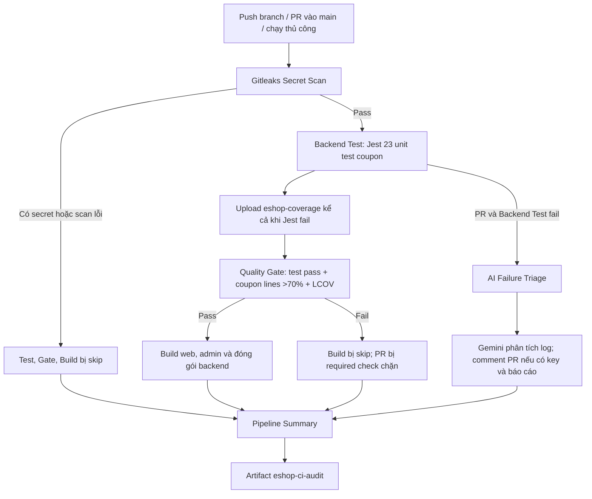

# EShop CI/CD: cách pipeline hoạt động và kịch bản thuyết trình

> **Phạm vi hiện tại:** GitHub Actions tự quét secret, chạy 23 unit test nghiệp vụ coupon, chấm Quality Gate và build ứng dụng. Pipeline xuất artifact để kiểm tra và bàn giao; **chưa có bước deploy** lên server. Trong buổi trình bày, gọi chính xác là **CI và build trong quy trình CI/CD**. Các thay đổi mới trên `ncuong` chưa commit/push nên chưa có run GitHub xác nhận.

## 1. Mục tiêu của phần demo

Chứng minh một vòng phản hồi dành cho developer:

1. Code đúng được kiểm tra và build thành công trên một PR baseline.
2. Developer tạo branch mới, cố ý đưa vào **một lỗi tính coupon percent** rồi mở PR.
3. CI tự phát hiện test fail, Quality Gate chặn merge, log và báo cáo nằm trong Actions/PR.
4. AI đọc log của **PR thất bại**, comment giả thuyết và hướng kiểm chứng trực tiếp trên PR.
5. Developer tự xem source, sửa công thức, push commit mới; CI chạy lại và chuyển xanh.

Đây là demo về **cách CI bắt lỗi và hỗ trợ sửa nhanh**. AI không tự sửa source, không tự commit, và kết luận của AI cần được đối chiếu với test và code.

## 2. Các thành phần và phạm vi kiểm thử

| Thành phần | Vai trò trong hệ thống |
| :--- | :--- |
| [`.github/workflows/eshop-ci.yml`](../.github/workflows/eshop-ci.yml) | Khai báo trigger, thứ tự và điều kiện chạy các job GitHub Actions. |
| [`backend/coupon-discount.js`](../backend/coupon-discount.js) | Logic kiểm điều kiện, tính discount và `final_amount` mà API coupon gọi; công thức percent là điểm cố ý sửa sai trong demo. |
| [`backend/tests/coupon-discount.unit.test.js`](../backend/tests/coupon-discount.unit.test.js) | 23 unit test độc lập với database cho logic đang được API sử dụng. |
| [`backend/jest.demo.config.js`](../backend/jest.demo.config.js) | Chọn file unit test trên và chỉ tính coverage cho `coupon-discount.js`. |
| [`backend/jest.config.js`](../backend/jest.config.js) | Cấu hình Jest chung và các định dạng coverage: text, LCOV, JSON summary. |
| [`.github/scripts/quality-gate.js`](../.github/scripts/quality-gate.js) | Đọc Jest JSON, coverage JSON và LCOV để quyết định pass/fail; viết báo cáo cho PR. |
| [`.github/scripts/ai_triage.py`](../.github/scripts/ai_triage.py) | Đọc log Jest thất bại, gọi Gemini và viết báo cáo Markdown bằng tiếng Việt. |
| [`.github/scripts/configure-branch-protection.sh`](../.github/scripts/configure-branch-protection.sh) | Cấu hình required checks trên `main` khi người có quyền admin chạy script. |

CI dùng `npm run test:ci:demo`, tức **chạy 23 unit test của module nghiệp vụ coupon**. `npm run test:ci` vẫn chạy full backend suite riêng; không gộp số liệu của hai phạm vi này. Lần kiểm tra local ngày 22/10/2026 đạt **58/58 test pass, 78.81% line coverage toàn backend** ở full suite. CI demo đạt **23/23 pass, 100% line và branch coverage của riêng module coupon** trên baseline đúng.

Các nhóm ca kiểm thử của demo:

| Case | Input | Kết quả mong đợi | Ý nghĩa |
| :--- | :--- | ---: | :--- |
| Percent | Đơn 1.000.000, coupon giảm 10% | Giảm **100.000** | Bắt lỗi công thức tính phần trăm; có thêm ca làm tròn. |
| Fixed | Đơn 600.000, coupon giảm cố định 50.000 | Giảm **50.000** | Kiểm tra nhánh còn lại vẫn hoạt động. |
| Điều kiện áp mã | Mã thiếu/vô hiệu hóa, hết hạn, đơn dưới/đúng ngưỡng | Trạng thái và lý do tương ứng | Kiểm tra rule trước khi tính discount. |
| Lượt dùng và kết quả | User đạt/chưa đạt giới hạn; coupon percent/fixed | `discount_amount`, `final_amount` | Kiểm tra kết quả trả về từ logic nghiệp vụ. |

Các unit test kiểm logic đang có trong backend. [FR-09](../README.md#fr-09-mã-giảm-giá-coupon) còn yêu cầu JWT khi áp mã, nhưng endpoint hiện chưa xác thực JWT; **100% coverage của module không chứng minh yêu cầu đó đã được thực hiện**.

## 3. Khi nào CI chạy?

- `push` lên **mọi branch**, kể cả branch `demo/...`.
- `pull_request` hướng vào `main` hoặc `master`. Chỉ loại run này mới có nhánh **AI Failure Triage** và comment trên PR.
- `workflow_dispatch` để chạy thủ công từ GitHub Actions.

Một lần push trên branch đang có PR có thể tạo **hai run**: một run `push` và một run `pull_request`. Khi trình bày comment AI, mở **run của PR**. Commit mới trên cùng ref có thể hủy run cũ còn dở nhờ `concurrency.cancel-in-progress`.

## 4. Luồng thực tế của pipeline



### 4.1. Gitleaks chạy đầu

Job `Gitleaks Secret Scan` checkout toàn bộ Git history (`fetch-depth: 0`), dùng Gitleaks CLI trong Docker để tìm **secret/token bị lộ trong lịch sử commit**, và bật `--redact=100` cho báo cáo JSON. Nếu job fail, các job Test, Quality Gate và Build không chạy. `Pipeline Summary` vẫn ghi kết quả `failure`/`skipped` để giải thích pipeline dừng ở đâu.

Gitleaks **không phải** công cụ quét toàn bộ lỗ hổng ứng dụng hoặc dependency. Nếu thật sự lộ key, cần thu hồi/đổi key và xử lý lịch sử Git; chỉ xóa dòng key trong commit mới chưa đủ.

### 4.2. Backend Test tạo bằng chứng

Sau Gitleaks pass, job dùng Ubuntu và Node.js 22, khôi phục cache `backend/node_modules` theo hash `package-lock.json`; cache miss thì chạy `npm ci`. Jest chạy `npm run test:ci:demo` tuần tự (`--runInBand`), tạo:

- `jest-results.json`: số suite/case pass/fail và thông tin test.
- `coverage-summary.json`: các tỉ lệ coverage.
- `lcov.info`: báo cáo coverage theo định dạng LCOV.
- `jest-console.log`: log chạy test, gồm `Expected` và `Received` khi fail.

Lệnh dùng `set -o pipefail` nên `tee` ghi log **không che exit code lỗi của Jest**. Bước upload `eshop-coverage` dùng `if: always()`; khi test fail, developer và các job phía sau vẫn có dữ liệu để đọc.

### 4.3. Quality Gate quyết định pass/fail

Job `Quality Gate (Tests & Coverage > 70%)` đọc artifact của Test và kiểm tra **ba điều kiện cùng lúc**:

| Điều kiện | Cách kiểm tra | Kết quả của demo |
| :--- | :--- | :--- |
| Test | Có kết quả Jest, mọi suite/case đều pass, không skip | **23/23** unit test được workflow chọn phải pass. |
| Coverage | Line coverage tính từ `coverage-summary.json` phải **> 70%** | Chỉ đo `backend/coupon-discount.js`; **70.00% fail**, cao hơn 70% mới pass. |
| LCOV | `lcov.info` tồn tại, có ít nhất một record `SF:` | Báo cáo coverage phải được tạo thật. |

Statements, branches và functions vẫn có trong báo cáo để quan sát, nhưng **không phải ngưỡng chặn merge**. Gate chạy cả khi Backend Test fail để tạo báo cáo rõ lý do; kết quả được ghi vào `quality-gate-report.md`, upload trong `eshop-lcov-report`, và trên PR có comment Quality Gate. Nếu fail, GitHub annotation cũng xuất hiện trong tab Checks.

**Coverage cao không đồng nghĩa test pass:** với công thức percent sai, Jest vẫn thực thi các dòng của module nên coverage có thể là 100%, nhưng test percent fail và Gate phải đỏ.

### 4.4. AI Failure Triage là nhánh hỗ trợ trên PR

Job này chỉ chạy khi `event == pull_request` **và** Backend Test fail. Nó tải log Jest từ `eshop-coverage`; nếu repo có secret `GEMINI_API_KEY`, script gọi model cấu hình `gemini-3.5-flash-lite`, đọc tối đa 100 dòng cuối/20.000 ký tự, và sinh báo cáo Markdown theo cấu trúc **hiện tượng → giả thuyết → bằng chứng → cách kiểm chứng → hướng khắc phục**.

Báo cáo có thể xem ở Step Summary và artifact `eshop-ai-triage`; workflow còn đăng/cập nhật **một comment AI** trên PR, có gắn commit để biết phân tích thuộc lần chạy nào. Nếu không có key, Gemini lỗi, hoặc PR từ fork thiếu quyền/secrets, comment AI có thể không xuất hiện; log Jest và kết quả Quality Gate vẫn dùng được. AI **không phải required check** và không làm cho PR đỏ/xanh thay Quality Gate.

### 4.5. Build và Pipeline Summary

Build chỉ bắt đầu sau **Gitleaks và Quality Gate pass**. Nó chạy `npm ci && npm run build` cho `frontend-web` và `frontend-admin`, rồi đóng gói các file backend cần thiết thành `eshop-backend.tar.gz`. Artifact `eshop-build` chứa hai thư mục `dist/` và gói backend. Đây là **đầu ra build**, chưa phải triển khai ứng dụng.

`Pipeline Summary` dùng `if: always()` để tạo `ci-audit.json` với `run_id`, `attempt`, commit, ref, event, thời gian và kết quả của Gitleaks/Test/Gate/Build/AI; artifact tên `eshop-ci-audit`. Đây là dấu vết **tự động của từng CI run**, khác với chat log làm việc của nhóm.

## 5. Các artifact và nơi mở trên GitHub

Vào **PR → Checks → run GitHub Actions**, hoặc **Actions → EShop CI → run tương ứng → Artifacts**.

| Artifact / hiển thị | Xem gì? | Khi nào có? |
| :--- | :--- | :--- |
| `eshop-gitleaks` | JSON finding đã che secret | Nếu Gitleaks tạo file report; bước upload luôn thử chạy. |
| `eshop-coverage` | Jest JSON, coverage JSON/LCOV, console log | Sau Test, kể cả Test fail nếu các file đã sinh. |
| `eshop-lcov-report` | Báo cáo Gate và coverage | Sau Quality Gate, kể cả Gate fail nếu file đã sinh. |
| Comment Quality Gate trên PR | Pass/fail, số test, coverage, lý do lỗi | Run `pull_request` khi bước comment có quyền ghi. |
| Comment AI và `eshop-ai-triage` | Giả thuyết và gợi ý từ Gemini | PR có Test fail, key hợp lệ và AI tạo báo cáo. |
| `eshop-build` | `dist/` của web/admin và backend tarball | Chỉ khi Build pass. |
| `eshop-ci-audit` | `ci-audit.json` đối chiếu run/commit/trạng thái | Mỗi run khi Summary hoàn tất. |

## 6. Branch Protection và cách đọc trạng thái đỏ/xanh

Trên `main`, ba required status checks dùng đúng tên job:

1. `Gitleaks Secret Scan`
2. `Quality Gate (Tests & Coverage > 70%)`
3. `Build (web, admin, backend package)`

Cấu hình của nhóm còn yêu cầu branch cập nhật với `main` và **một review approve**. Vì vậy ba check xanh cho thấy **điều kiện CI đã đạt**; thao tác merge vẫn cần đáp ứng review và các quy tắc bảo vệ khác. Script cấu hình có lệnh xem trước `bash .github/scripts/configure-branch-protection.sh --dry-run`; việc áp dụng đòi quyền admin repo.

| Tình huống | Gitleaks | Backend Test | Quality Gate | AI trên PR | Build |
| :--- | :---: | :---: | :---: | :---: | :---: |
| Baseline đúng | Pass | 23/23 pass | Pass | Skip | Pass |
| Coupon percent sai trên push branch | Pass | 18/23 pass | Fail | Skip | Skip |
| Coupon percent sai trên PR | Pass | 18/23 pass | Fail | Chạy nếu có điều kiện | Skip |
| Có secret trong Git history | Fail | Skip | Skip | Skip | Skip |
| Test pass nhưng coverage ≤70% | Pass | Pass | Fail | Skip | Skip |

Các hàng trên là **kỳ vọng cho workflow mới**, chưa phải GitHub run đã xác nhận.
`Pipeline Summary` vẫn xuất audit artifact trong tất cả các hàng trên. **Chạy xong một job không có nghĩa pipeline pass**: xem kết luận toàn run và ba required checks.

## 7. Chuẩn bị demo đỏ → xanh

### Trước giờ trình bày

1. Review, commit và push thay đổi hiện tại trên `ncuong`; đợi run mới của **23 test** và các required checks xanh trên GitHub, rồi merge baseline vào `main`. Các run 2-test cũ không chứng minh cấu hình mới đã pass. Lấy `main` sau merge làm gốc của branch demo.
2. Đảm bảo `GEMINI_API_KEY` đã được lưu ở **Repository Settings → Secrets and variables → Actions → Repository secrets** nếu muốn hiện comment AI. Không đưa key vào source, ảnh demo hoặc artifact. Workflow đã đặt model, không cần repository variable `GEMINI_MODEL`.
3. Mở sẵn các tab: source `coupon-discount.js`, bảng 23 unit test, workflow, PR demo, Actions. Kiểm tra internet/quota Gemini và chuẩn bị ảnh/video run dự phòng nếu runner chậm.
4. **Không sửa file test hoặc hạ ngưỡng** để tạo lỗi; chỉ sửa một dòng source của nhánh demo. Không chạy thử đoạn code sai trên `main`.

### Thao tác trên máy

```bash
git switch main
git pull --ff-only origin main
git switch -c demo/ci-coupon-failure

# Mở backend/coupon-discount.js và tạm sửa nhánh percent thành:
# return Math.floor(totalAmount * (1 - coupon.discount_value));
git add backend/coupon-discount.js
git commit -m "demo: reproduce percent coupon bug"
git push -u origin demo/ci-coupon-failure
# Mở PR demo/ci-coupon-failure → main trên GitHub.
```

**Lần chạy đỏ:** test percent mong đợi `100000`, nhưng công thức cố ý sai trả `-9000000`; các test fixed và điều kiện áp mã vẫn pass. Bản sao local cho **5 fail, 18 pass trên 23 test**. Trên run PR, xem Gitleaks xanh → Backend Test đỏ → Quality Gate đỏ → Build skip. Mở comment Quality Gate, comment AI nếu có, và `jest-console.log`. Giải thích rằng coverage coupon vẫn có thể 100% vì dòng code đã được chạy; **assertion về giá trị mới bắt được lỗi**. AI nêu giả thuyết; developer kiểm chứng công thức với đầu vào `1_000_000` và `10`.

```bash
# Sửa lại trong backend/coupon-discount.js:
# return Math.floor(totalAmount * coupon.discount_value / 100);
git add backend/coupon-discount.js
git commit -m "fix: calculate percent coupon discount"
git push
```

**Lần chạy xanh:** mở run PR mới theo commit sửa. Kỳ vọng 23/23 test pass, coupon line coverage 100%, Quality Gate/Gitleaks/Build pass, có `eshop-build`, AI skip vì Test đã xanh. So sánh `run_id`, commit và các trạng thái trong `eshop-ci-audit` của hai run. Chỉ nói "đã xanh" sau khi Actions thật sự kết thúc.

### Kiểm tra local nếu cần

Từ gốc repo:

```bash
cd backend
npm ci
npm run test:ci:demo
npm run quality-gate
```

Lệnh demo sẽ fail đúng ở các test percent khi code sai; sau khi sửa, cả test và Gate phải pass. Muốn kiểm tra phạm vi rộng hơn, chạy `NODE_ENV=test npm run test:ci` **riêng**, rồi giải thích rõ coverage của lệnh này là toàn backend. Bộ unit test demo không truy cập SQLite; full suite dùng SQLite `:memory:` khi `NODE_ENV=test`.

## 8. Lời dẫn ngắn cho buổi thuyết trình

| Mốc gợi ý | Thao tác | Ý chính cần nói |
| :--- | :--- | :--- |
| 0:00–1:00 | Giới thiệu EShop và PR baseline xanh | “Code đúng đã qua quét secret, test, Quality Gate và build.” |
| 1:00–2:00 | Mở sơ đồ/workflow và unit test | “Gitleaks chạy đầu; Jest kiểm 23 ca nghiệp vụ coupon. Gate yêu cầu toàn bộ pass và line coverage module coupon >70%.” |
| 2:00–3:30 | Push code sai, mở PR, xem Actions | “Percent sai ra -9.000.000, fixed còn đúng. Test đỏ kéo Gate đỏ; Build không chạy.” |
| 3:30–4:30 | Mở log, comment Gate và AI | “Artifact giữ bằng chứng. AI đọc log và gợi ý trên PR; người phát triển kiểm tra lại công thức.” |
| 4:30–5:30 | Sửa đúng một dòng source | “Sửa công thức về `totalAmount × discount_value / 100`; giữ nguyên test.” |
| 5:30–7:30 | Push và xem run mới | “23/23 test pass, Gate >70% và LCOV đạt; Build tạo artifact.” |
| 7:30–9:00 | So sánh hai run và Branch Protection | “Run gắn với commit; required checks ngăn PR lỗi vào `main`. Workflow chưa deploy.” |

Đây là khung **thuyết trình trực tiếp 7–9 phút**. Nếu nhóm quay screencast theo giới hạn **≤8 phút** trong kế hoạch seminar, rút ngắn phần giới thiệu và chuẩn bị sẵn tab/run để kết thúc trước 8 phút. Thời gian GitHub runner hoàn tất có thể thay đổi; không khẳng định trạng thái dự kiến là kết quả đã xảy ra.

## 9. Câu hỏi dễ gặp khi bảo vệ

**Vì sao CI không chạy toàn bộ backend suite?** Demo chọn 23 unit test của module nghiệp vụ coupon để có vòng đỏ → xanh ngắn, dễ giải thích. Full backend suite vẫn có lệnh riêng, không bị xóa.

**Record and Playback trong GitHub Actions là gì?** Workflow giữ log, test
result, coverage và audit artifact của mỗi lần chạy. `Re-run jobs` tái chạy
cùng commit để đối chiếu `run_id`/`attempt`; đây không phải ghi và phát lại
thao tác giao diện như công cụ kiểm thử UI.

**Đã phủ đủ mọi điều kiện FR-09 chưa?** Chưa. Unit test đo logic đang dùng trong
backend; endpoint hiện chưa bắt buộc JWT khi áp coupon. Coverage 100% của module
không bao gồm việc xác thực đó.

**100% coverage có nghĩa không còn bug?** Không. 100% ở đây chỉ là line coverage của `coupon-discount.js`. Công thức sai vẫn được thực thi nên coverage cao, nhưng assertion của test percent phát hiện kết quả sai.

**Tại sao >70%, không phải ≥70%?** Quality Gate so sánh `actual > 70`; đúng 70.00% fail. Ngưỡng hiện hành chỉ áp dụng cho line coverage module coupon trong CI demo.

**AI làm gì khi CI fail?** Chỉ với PR có Backend Test fail, AI dùng log Jest để viết giả thuyết và comment gợi ý. Nó không tự sửa code và không thay thế quyết định của developer. Thiếu key/quyền thì CI vẫn phát hiện lỗi qua Jest và Gate.

**Gitleaks bảo vệ phần nào?** Nó phát hiện secret trong Git history và chặn các job sau nếu scan fail. Nó không chứng minh ứng dụng không có lỗ hổng khác.

**Có CD/deploy chưa?** Chưa. Sau Quality Gate, job Build tạo artifact cho web, admin và backend. Chưa có job triển khai lên môi trường chạy thật.
