# Báo cáo Seminar nhóm 13 - T07: CI/CD & Test-Harness Engineering

**Môn học:** Kiểm thử phần mềm (Software Testing)  
**Mã lớp:** Testing-CQ2023-3-LQVu  
**Đơn vị:** Khoa Công nghệ Thông tin — Trường Đại học Khoa học Tự nhiên, ĐHQG-HCM  
**Giảng viên phụ trách:** TS. Lâm Quang Vũ, TS. Trần Duy Hoàng, ThS. Trương Phước Lộc, ThS. Hồ Tuấn Thanh  
**Hệ thống kiểm thử (SUT):** EShop System Monorepo (Node.js/Express, SQLite3, Jest, React, GitHub Actions)  
**GitHub Repository:** [SoftwareTesting-Group13/eshop-sut-seminar](https://github.com/SoftwareTesting-Group13/eshop-sut-seminar)  

## Thông tin nhóm 13

| STT | Mã sinh viên | Họ và tên | 
| :---: | :---: | :--- |
| 1 | **23120102** | Nguyễn Ngọc Minh Tuấn |
| 2 | **23120223** | Dương Nhật Cường |
| 3 | **23120225** | Trần Gia Cường |
| 4 | **23120273** | Nguyễn Gia Huy |

## 1. Tổng quan về DevOps và CI/CD

### 1.1 Khái niệm DevOps, DevOps LifeCycle và mối liên hệ với CI/CD

**Khái niệm DevOps:** DevOps là sự kết hợp giữa văn hóa và kỹ thuật nhằm xóa bỏ rào cản và tạo cầu nối giữa Phát triển (Dev) và Vận hành (Ops), giúp rút ngắn chu kỳ phát hành và nâng cao chất lượng, độ ổn định của phần mềm.

#### DevOps LifeCycle

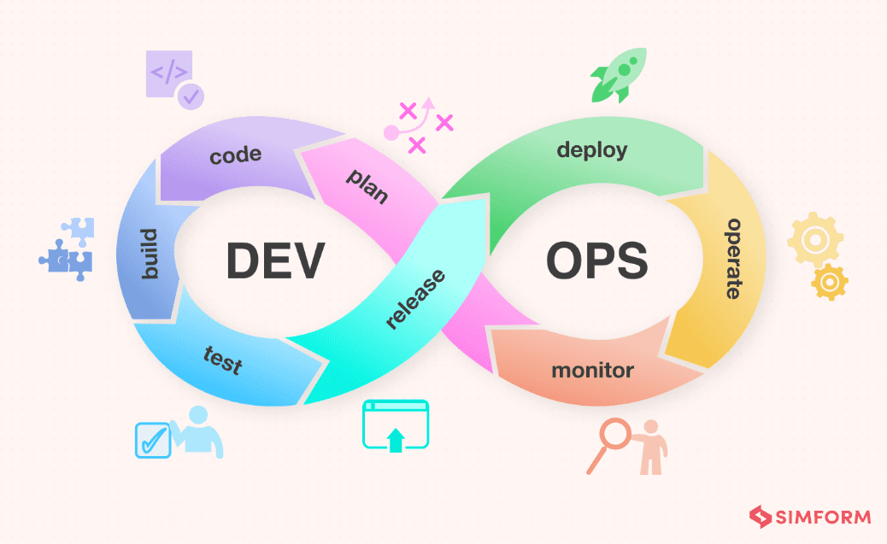

Gồm 8 giai đoạn: Plan → Code → Build → Test → Release → Deploy → Operate → Monitor.

Điểm mấu chốt của LifeCycle này là không có điểm kết thúc. Dữ liệu và phản hồi từ giai đoạn Monitor sẽ quay lại làm đầu vào cho giai đoạn Plan của vòng tiếp theo → Tạo nên 1 vòng đời khép kín và liên tục triển khai.

- **Plan:** Lên kế hoạch, xác định mục tiêu và yêu cầu cho dự án.
- **Code:** Viết code để triển khai các features cho ứng dụng.
- **Build:** Build ứng dụng để đảm bảo chúng hoạt động được.
- **Test:** Test ứng dụng để đảm bảo các feature hoạt động đúng với yêu cầu ban đầu.
- **Release:** Chuẩn bị các công đoạn cuối như là đóng gói ứng dụng (build docker image), release tag, notes và lưu artifact.
- **Deploy:** Đưa ứng dụng lên môi trường chạy thực tế.
- **Operate:** Quản lý hạ tầng, đảm bảo hệ thống chạy ổn định.
- **Monitor:** Theo dõi hiệu năng, check log và phản hồi từ user.

### 1.2 CI/CD Pipeline

**Vấn đề:** Integration Hell - Trong phát triển phần mềm, nhiều dev thường làm việc song song trên các branch riêng biệt. Khi các nhánh này không được merge thường xuyên, sự khác biệt giữa các phiên bản mã nguồn ngày càng lớn, dễ dẫn đến merge conflicts, lỗi tích hợp (integration errors) và khó khăn trong quá trình build, testing. Hiện tượng này được gọi là Integration Hell.

CI/CD ra đời để giúp tự động hóa các quy trình trên.

CI/CD là một phần quan trọng trong DevOps Lifecycle, chủ yếu tập trung vào các giai đoạn Code → Build → Test → Release → Deploy, nhằm tự động hóa quá trình tích hợp, kiểm thử và triển khai phần mềm.

**Continuous Integration (CI — Tích hợp liên tục):** Dev thường xuyên commit code vào nhánh chung; mỗi commit/PR tự động kích hoạt Build, Lint và chạy kiểm thử tự động để phát hiện lỗi sớm (Fail Fast, Fix Early).

> Ở đây, Unit test đóng vai trò là 1 First Quality Gate (FQG) trong CI Pipeline. Nếu Unit test fail, pipeline sẽ fail (shift left) và dev phải fix lỗi trước khi merge code vào nhánh chính. Tránh được việc lỗi trên nhánh main.

**Continuous Delivery/Deployment (CD — Phân phối/Triển khai liên tục):** Là giai đoạn tiếp nối CI, tự động hóa quá trình Release và Deploy sau khi code vượt qua các bước kiểm tra.
  - **Continuous Delivery:** Tự động chuẩn bị và đưa ứng dụng lên môi trường Staging để kiểm thử, nhưng cần con người phê duyệt thủ công trước khi Deploy lên Production.
  - **Continuous Deployment:** Cấp độ tự động hóa cao hơn của Delivery. Tự động Deploy lên Production sau khi vượt qua toàn bộ các bước kiểm tra mà không cần phê duyệt thủ công.

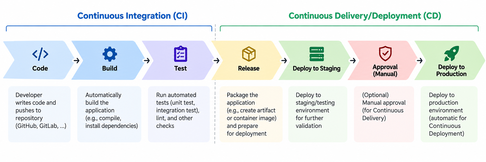

## 2. Tổng quan về Test Harness Engineering

### 2.1 Khái niệm Test Harness

**Test Harness** (khung hỗ trợ kiểm thử) là tập hợp các công cụ, mã và cấu hình dùng để chuẩn bị điều kiện kiểm thử, thực thi các ca kiểm thử trên hệ thống cần kiểm thử (System Under Test — SUT), so sánh kết quả thực tế với kết quả mong đợi và ghi nhận kết quả. Trong đó, *test case* mô tả một tình huống cần kiểm tra; *test suite* tập hợp nhiều test case; còn test harness cung cấp môi trường và cơ chế để thực thi chúng.

**Test Harness Engineering** là việc thiết kế, xây dựng và duy trì khung hỗ trợ đó sao cho các bài kiểm thử có thể chạy tự động, ổn định và lặp lại được. Chất lượng của test harness ảnh hưởng trực tiếp đến độ tin cậy của kết quả kiểm thử: cùng một đầu vào và cùng một trạng thái ban đầu cần cho kết quả nhất quán.

### 2.2 Vai trò của Test Harness trong kiểm thử tự động

Test harness giúp giảm các thao tác thủ công như khởi tạo môi trường, nạp dữ liệu và tổng hợp kết quả. Nó cũng giúp cô lập những yếu tố có thể làm bài kiểm thử thay đổi kết quả giữa các lần chạy, chẳng hạn trạng thái dữ liệu còn sót lại hoặc phản hồi từ dịch vụ bên ngoài. Khi được tích hợp vào CI/CD, test harness cho phép chạy kiểm thử sau mỗi lần thay đổi mã nguồn và cung cấp kết quả để pipeline đánh giá chất lượng bản dựng.

### 2.3 Kiến trúc tổng quát của Test Harness

Một test harness thường có các nhóm chức năng sau; cách tổ chức cụ thể phụ thuộc vào loại hệ thống và mức kiểm thử:

1. **Điều phối và thực thi:** Chọn các ca kiểm thử cần chạy, thiết lập thứ tự hoặc chế độ chạy, gọi SUT và xử lý các bước chuẩn bị, dọn dẹp.
2. **Quản lý cấu hình, dữ liệu và môi trường:** Xác định tham số chạy, môi trường đích và dữ liệu đầu vào; thiết lập trạng thái ban đầu (*fixtures*) rồi đưa môi trường về trạng thái phù hợp cho lần chạy tiếp theo.
3. **Giả lập phụ thuộc khi cần:** Sử dụng *stub* để cung cấp phản hồi định trước hoặc *mock* để kiểm tra tương tác với một thành phần phụ thuộc. Thành phần này đặc biệt hữu ích khi cần kiểm thử một đơn vị độc lập với dịch vụ bên ngoài.
4. **Đánh giá và báo cáo:** So sánh kết quả thực tế với kết quả mong đợi bằng các phép kiểm tra (*assertions*), ghi log, thống kê số ca đạt hoặc không đạt và tạo báo cáo cho người kiểm thử hoặc hệ thống CI/CD.

Về luồng hoạt động, test harness chuẩn bị môi trường và dữ liệu → thực thi test case trên SUT → đánh giá kết quả → ghi nhận, báo cáo và dọn dẹp. Luồng này tạo nền tảng cho việc chạy lại cùng một bộ kiểm thử một cách có kiểm soát.

### 2.4 Nguyên tắc thiết kế để kết quả kiểm thử đáng tin cậy

Để kết quả kiểm thử có thể lặp lại và dễ phân tích, cần chú ý đến cách quản lý dữ liệu, cấu hình và thông tin của mỗi lần chạy:

- **Cô lập dữ liệu kiểm thử:** Mỗi lần chạy cần có trạng thái ban đầu xác định. Dữ liệu do một test tạo ra nên được dọn dẹp hoặc tách riêng để không ảnh hưởng đến test khác, đặc biệt khi chạy song song.
- **Quản lý cấu hình rõ ràng:** Ghi lại môi trường, tham số và phiên bản cấu hình được dùng cho mỗi lần chạy để có thể tái hiện điều kiện kiểm thử. Thông tin nhạy cảm cần được quản lý riêng.
- **Báo cáo kết quả đầy đủ:** Ngoài trạng thái đạt hoặc không đạt, báo cáo cần cho biết ca nào thất bại, kết quả mong đợi và kết quả thực tế. Khi tích hợp CI/CD, kết quả này có thể được dùng làm điều kiện để pipeline tiếp tục hoặc dừng.

## 3. Các công cụ CI/CD

### 3.1 So sánh GitHub Actions, GitLab CI/CD và Jenkins

Ba công cụ đều hỗ trợ xây dựng pipeline để tự động hóa build, test và deploy. Bảng dưới đây so sánh các đặc điểm chung của từng công cụ. Mỗi tiêu chí có tối đa 5 điểm và trọng số như nhau; điểm số mang tính tham khảo vì mức phù hợp thực tế còn phụ thuộc vào yêu cầu và hạ tầng của từng dự án.

| Tiêu chí đánh giá | GitHub Actions | GitLab CI/CD | Jenkins |
| :--- | :--- | :--- | :--- |
| **1. Chi phí sử dụng** | **4/5** — Có runner do GitHub cung cấp; chi phí phụ thuộc loại repository, gói tài khoản và mức sử dụng. | **4/5** — Có runner trên GitLab.com; chi phí phụ thuộc hạn mức compute và gói sử dụng. | **3/5** — Phần mềm mã nguồn mở nhưng cần tài nguyên để vận hành controller và agent. |
| **2. Mức độ dễ thiết lập ban đầu** | **5/5** — Khai báo workflow YAML trong repository GitHub, có runner do nền tảng cung cấp. | **5/5** — Khai báo `.gitlab-ci.yml` trong repository GitLab, có runner do nền tảng cung cấp. | **2/5** — Cần cài đặt server và cấu hình agent trước khi chạy pipeline. |
| **3. Tích hợp với hệ thống quản lý mã nguồn** | **4/5** — Tích hợp trực tiếp với GitHub; kết nối nguồn mã ở nền tảng khác cần cấu hình thêm. | **4/5** — Tích hợp trực tiếp với GitLab; có cách kết nối repository ngoài GitLab. | **5/5** — Có thể kết nối nhiều hệ thống quản lý mã nguồn thông qua cấu hình và plugin. |
| **4. Kiểm soát môi trường chạy** | **4/5** — Có runner do GitHub cung cấp hoặc runner tự quản lý. | **4/5** — Có runner do GitLab cung cấp hoặc runner tự quản lý. | **5/5** — Chủ động bố trí controller, agent và tài nguyên thực thi. |
| **5. Khả năng tùy biến, mở rộng pipeline** | **4/5** — Dùng action, script và workflow tái sử dụng. | **4/5** — Dùng job, stage và pipeline con. | **5/5** — Hệ sinh thái plugin lớn, linh hoạt trong cách tổ chức pipeline. |
| **6. Công sức vận hành, bảo trì** | **5/5** — Ít phải quản lý hạ tầng khi dùng runner do GitHub cung cấp. | **5/5** — Ít phải quản lý hạ tầng khi dùng runner trên GitLab.com. | **2/5** — Cần cập nhật, giám sát server, plugin và agent. |
| **7. Tích hợp AI để phân tích log lỗi** | **4/5** — Có thể thêm bước gọi script hoặc API AI và lưu kết quả trong workflow. | **4/5** — Có thể thêm job gọi script hoặc API AI và truyền log qua artifact. | **4/5** — Có thể gọi script hoặc API AI và xử lý log trong pipeline. |
| **Tổng điểm (thang 35)** | **30/35** | **30/35** | **26/35** |

Điểm ở tiêu chí AI đánh giá **khả năng tích hợp công cụ bên ngoài**, không hàm ý nền tảng có sẵn chức năng chẩn đoán lỗi bằng AI. Các công cụ có ưu thế khác nhau: GitHub Actions và GitLab CI/CD giảm công vận hành khi dùng runner do nền tảng cung cấp; Jenkins cho phép tự kiểm soát hạ tầng và tùy biến sâu hơn.

### 3.2 Nhận xét

Việc lựa chọn công cụ CI/CD cần dựa trên nơi lưu mã nguồn, yêu cầu kiểm soát môi trường chạy, mức độ tùy biến và nguồn lực vận hành. Điểm số trong bảng chỉ giúp đối chiếu các tiêu chí; khi áp dụng vào một dự án cụ thể, cần đánh giá lại theo bối cảnh của dự án đó.

## 4. Các công cụ Test Harness

### 4.1 So sánh công cụ thực thi kiểm thử

Jest, Vitest và Mocha đều có thể làm công cụ thực thi kiểm thử JavaScript trong một test harness. Bảng dưới so sánh các chức năng thường cần khi xây dựng bộ kiểm thử tự động. Mỗi tiêu chí tối đa 5 điểm, có trọng số như nhau; điểm số chỉ mang tính tham khảo vì lựa chọn công cụ còn phụ thuộc vào loại dự án.

| Tiêu chí đánh giá | Jest | Vitest | Mocha |
| :--- | :--- | :--- | :--- |
| **1. Mức độ dễ bắt đầu** | **5/5** — Có thể viết và chạy test với cấu hình cơ bản. | **5/5** — Cấu hình ngắn gọn, đặc biệt thuận tiện với dự án dùng Vite. | **4/5** — Dễ chạy test, nhưng thường cần chọn thêm thư viện hỗ trợ. |
| **2. Assertions và mocks** | **5/5** — Có sẵn `expect`, mock và spy. | **5/5** — Có sẵn `expect`, mock và spy. | **3/5** — Linh hoạt chọn thư viện, nhưng thường phải kết hợp thêm thư viện assertions và mocks. |
| **3. Thiết lập và dọn dẹp dữ liệu test** | **5/5** — Có các hook như `beforeAll`, `beforeEach`, `afterAll`. | **5/5** — Có hook và cơ chế fixtures cho test. | **5/5** — Có các hook thiết lập và dọn dẹp. |
| **4. Coverage và báo cáo kết quả** | **5/5** — Hỗ trợ đo coverage và xuất kết quả ở nhiều định dạng. | **4/5** — Hỗ trợ coverage qua provider bổ sung và nhiều dạng báo cáo. | **3/5** — Có reporter; thường kết hợp thêm công cụ khác để đo coverage. |
| **5. Khả năng tùy biến** | **4/5** — Có nhiều tùy chọn cấu hình và phần mở rộng. | **4/5** — Tận dụng cấu hình và hệ sinh thái Vite. | **5/5** — Cho phép tự chọn thư viện assertions, mocks và coverage. |
| **6. Tích hợp vào CI** | **5/5** — Có lệnh chạy test và xuất mã thoát để pipeline đánh giá. | **5/5** — Có lệnh chạy test và xuất mã thoát để pipeline đánh giá. | **5/5** — Có lệnh chạy test và xuất mã thoát để pipeline đánh giá. |
| **Tổng điểm (thang 30)** | **29/30** | **28/30** | **25/30** |

### 4.2 Nhận xét

Jest và Vitest cung cấp sẵn nhiều chức năng để viết, thực thi và báo cáo kết quả kiểm thử. Mocha thiên về cách tiếp cận linh hoạt: người dùng có thể tự chọn các thư viện đi kèm theo nhu cầu. Công cụ thực thi chỉ là một phần của test harness; dữ liệu kiểm thử, cấu hình môi trường và cách đưa kết quả vào CI/CD cũng cần được thiết kế phù hợp.

### 4.3 Công cụ hỗ trợ chẩn đoán: AI Log Triage

**AI Log Triage (Gemini API)** hỗ trợ phân tích khi bài kiểm thử trong CI thất bại. Công cụ nhận log lỗi và ngữ cảnh liên quan, sau đó tạo bản tóm tắt hiện tượng, chỉ ra bằng chứng, đề xuất nguyên nhân có khả năng nhất và gợi ý cách kiểm tra hoặc sửa lỗi. Kết quả giúp người phát triển thu hẹp phạm vi điều tra; các nhận định của AI vẫn cần được đối chiếu với mã nguồn và chạy lại test để kiểm chứng.

Luồng xử lý tổng quát: **test thất bại → thu thập log → gửi ngữ cảnh cho Gemini API → tạo báo cáo chẩn đoán → người phát triển kiểm chứng**. Đây là công cụ hỗ trợ ở bước phân tích kết quả, còn trạng thái đạt hoặc không đạt của bài kiểm thử vẫn do test runner và các điều kiện chất lượng trong pipeline xác định.


## 5. GitHub Actions

### 5.1 GitHub Actions là gì?

**GitHub Actions** là nền tảng tự động hóa tích hợp trong GitHub. Nền tảng này cho phép định nghĩa các quy trình (*workflows*) để chạy những công việc như kiểm tra mã nguồn, build, test và deploy khi có sự kiện phù hợp. Ví dụ, một workflow có thể được kích hoạt khi có `push`, khi mở hoặc cập nhật pull request, theo lịch, hoặc bằng thao tác thủ công.

Trong CI/CD, GitHub Actions đóng vai trò điều phối: nhận sự kiện, xác định workflow cần chạy, phân công các công việc cho môi trường thực thi và ghi lại trạng thái, log, kết quả của lần chạy. Các lệnh kiểm thử hay triển khai được khai báo trong workflow; GitHub Actions chịu trách nhiệm kích hoạt và tổ chức việc thực thi chúng.

### 5.2 Cấu trúc của GitHub Actions

Để có thể sử dụng Github Actions, đầu tiên chúng ta cần tạo một workflow. Workflow được định nghĩa trong một tệp YAML nằm trong thư mục `.github/workflows/` của repository. Một workflow có thể chứa nhiều job, mỗi job có thể chứa nhiều step. Các step có thể là lệnh shell hoặc sử dụng các action tái sử dụng.

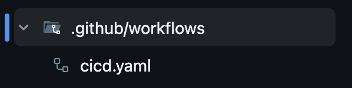

Một workflow được tổ chức theo các thành phần sau:

- **Event (sự kiện):** Điều kiện khởi chạy workflow, chẳng hạn `push`, `pull_request`, lịch chạy hoặc thao tác thủ công. Được khai báo bằng khóa `on`.
- **Workflow (quy trình):** Toàn bộ quy trình tự động hóa, được định nghĩa trong một tệp YAML thuộc thư mục `.github/workflows/`. Một repository có thể có nhiều workflow.
- **Job (công việc):** Nhóm các bước thực hiện một nhiệm vụ như build hoặc test. Mỗi job chạy trên một runner; các job không có quan hệ phụ thuộc có thể chạy song song.
- **Runner (môi trường thực thi):** Máy thực hiện job. Có thể dùng runner do GitHub cung cấp hoặc runner tự quản lý; thuộc tính `runs-on` xác định loại runner cho job.
- **Step (bước):** Đơn vị nhỏ trong job, thực hiện một lệnh bằng `run` hoặc sử dụng một action bằng `uses`. Các step thông thường trong cùng job chạy theo thứ tự và chia sẻ môi trường của runner.
- **Action (thao tác tái sử dụng):** Đoạn chức năng được đóng gói để dùng trong step, ví dụ lấy mã nguồn hoặc cài đặt môi trường chạy.

Ví dụ [tệp workflow mẫu](./examples/example-workflow.yml) dưới đây minh họa hai job `build` và `test`; job `test` chờ `build` hoàn thành nhờ `needs`:

```yaml
name: Example Workflow

on:
  push:
  pull_request:

jobs:
  build:
    runs-on: ubuntu-latest
    steps:
      - name: Checkout source
        uses: actions/checkout@v6
      - name: Example build step
        run: echo "Build the application here"

  test:
    needs: build
    runs-on: ubuntu-latest
    steps:
      - name: Checkout source
        uses: actions/checkout@v6
      - name: Example test step
        run: echo "Run tests here"
```

Quan hệ giữa các thành phần có thể tóm tắt như sau:

```text
Event → Workflow
          ├─ Job A → Runner A → Step 1 → Step 2 → ...
          └─ Job B → Runner B → Step 1 → Step 2 → ...
```

Một workflow có thể chứa nhiều job. Theo mặc định, các job độc lập có thể chạy song song; dùng `needs` để yêu cầu một job chờ job khác hoàn thành. Trong mỗi job, các step thông thường chạy theo thứ tự đã khai báo. Cách tổ chức này cho phép chia pipeline thành các nhiệm vụ riêng và kiểm soát luồng thực thi giữa chúng.

### 5.3 GitHub Actions trong EShop System Monorepo

Workflow `EShop CI` được định nghĩa trong `.github/workflows/eshop-ci.yml`. Nó chạy khi có `push` lên bất kỳ nhánh nào, khi có pull request vào `main` hoặc `master`, hoặc khi được kích hoạt thủ công bằng `workflow_dispatch`.

Các job dùng `ubuntu-latest` và chạy trên runner riêng do GitHub cung cấp. Môi trường của mỗi job được tạo mới; dữ liệu cần chuyển giữa các job, như log kiểm thử và báo cáo coverage, được lưu rồi tải lại qua artifact. Workflow sử dụng `actions/checkout@v6`, `actions/setup-node@v7`, `actions/cache@v5` và `actions/upload-artifact@v6` ở các bước tương ứng.

#### Sơ đồ luồng CI

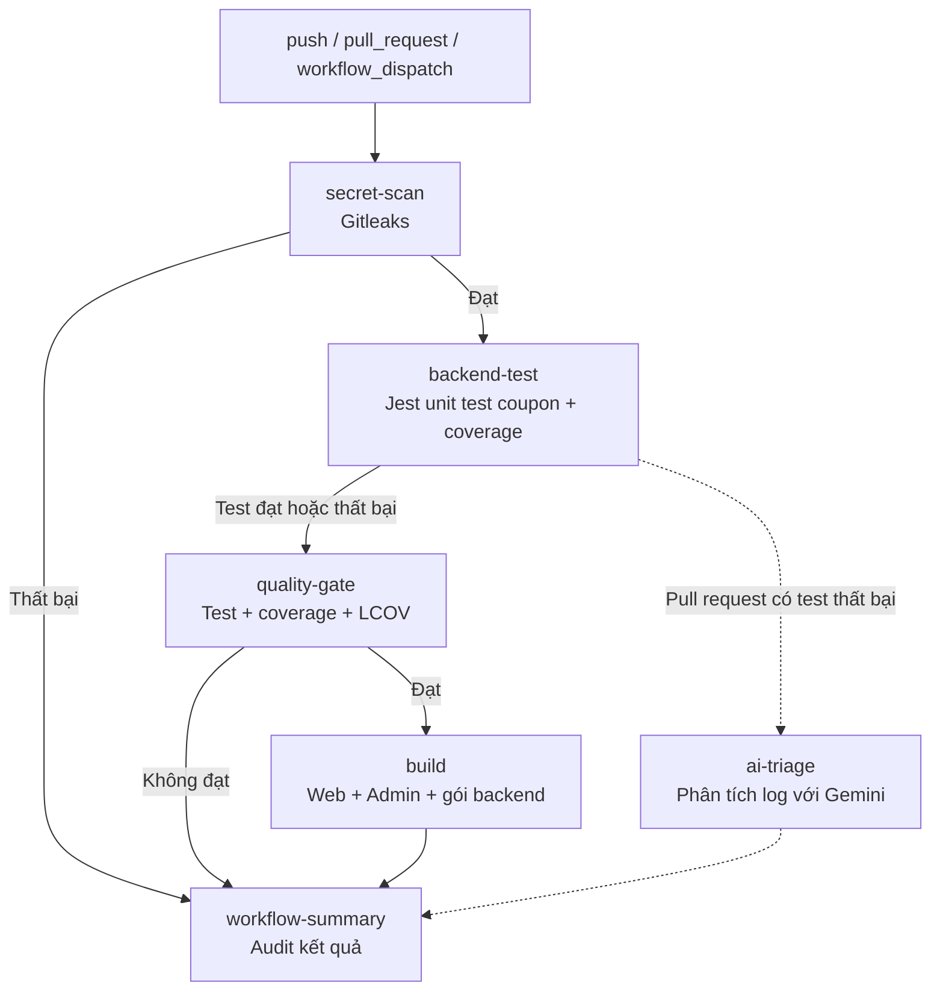

#### Luồng hoạt động của CI Pipeline

**Luồng chính:** Secret Scan → Backend Test → Quality Gate → Build Artifact → Workflow Summary.

Pipeline được thiết kế theo nguyên tắc **kiểm tra bảo mật và chất lượng trước khi đóng gói sản phẩm**. Mỗi job đảm nhận một trách nhiệm riêng, kết quả của các job kiểm tra sẽ quyết định liệu pipeline có được tiếp tục đến bước build hay không.

Ngoài luồng chính, **AI Triage** hoạt động như một nhánh hỗ trợ phân tích lỗi khi unit test thất bại trên Pull Request.

#### Chức năng của từng job

**1. `secret-scan` — Security Gate**

Chịu trách nhiệm phát hiện thông tin nhạy cảm (API Key, Token, Password...) bị commit vào Git repository bằng Gitleaks. Đây là bước kiểm tra bảo mật đầu tiên, nếu thất bại, pipeline không tiếp tục sang các bước kiểm thử và build.

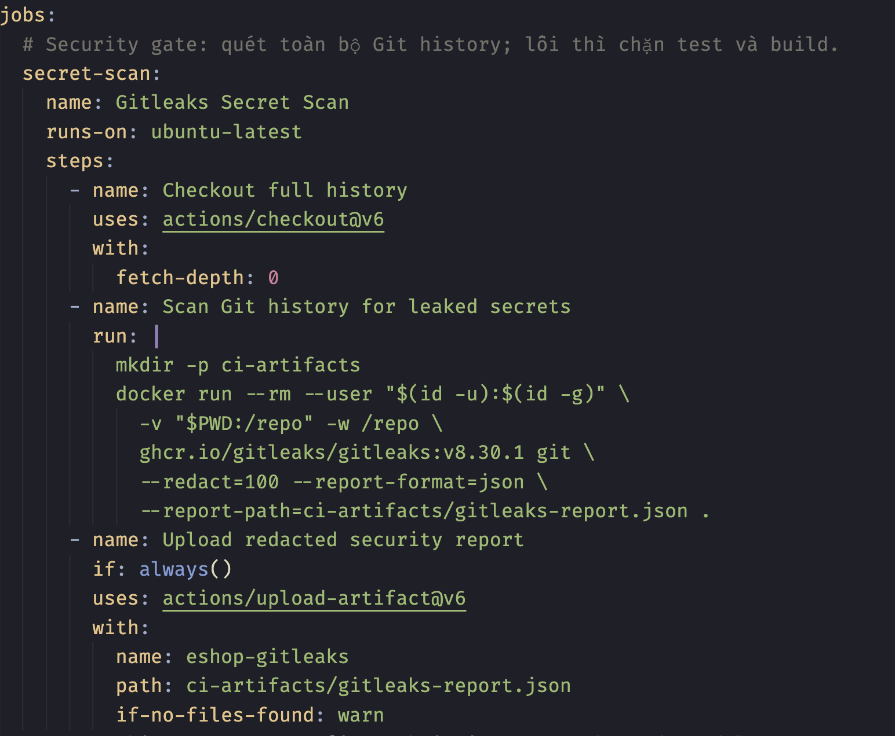

**2. `backend-test` — Dependency Caching & Automated Testing**

Job bắt đầu sau khi `secret-scan` đạt. Nó thiết lập Node.js 22, chuẩn bị dependency rồi chạy bộ unit test nghiệp vụ coupon.

**Dependency Caching:** `actions/cache@v5` lưu `backend/node_modules` bằng khóa gồm hệ điều hành runner, Node.js 22 và hash của `backend/package-lock.json`. Cache khớp hoàn toàn thì workflow bỏ qua `npm ci`; nếu không, workflow cài lại dependency theo lockfile. `restore-keys` có thể tìm cache gần nhất, nhưng trường hợp đó vẫn chạy `npm ci` vì chưa phải cache hit hoàn toàn.

```yaml
- name: Cache backend/node_modules
  id: cache-node-modules
  uses: actions/cache@v5
  with:
    path: backend/node_modules
    key: ${{ runner.os }}-node22-${{ hashFiles('backend/package-lock.json') }}
    restore-keys: |
      ${{ runner.os }}-node22-

- name: Install dependencies (npm ci)
  if: steps.cache-node-modules.outputs.cache-hit != 'true'
  run: npm ci
```

Hiệu quả cache cần được đối chiếu bằng trạng thái cache và thời gian cài đặt của từng workflow run; không có một mức tăng tốc cố định.

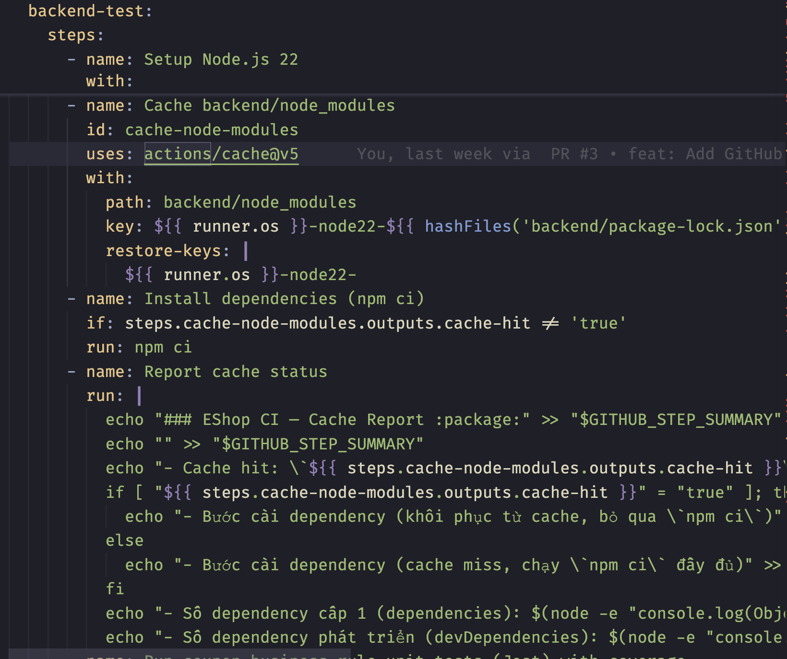

**Automated Testing:** Workflow chạy `npm run test:ci:demo`. Lệnh này dùng `jest.demo.config.js` để chọn `tests/coupon-discount.unit.test.js` và chỉ đo coverage của `coupon-discount.js`:

```text
jest --config jest.demo.config.js --runInBand --coverage --verbose --json --outputFile=coverage/jest-results.json --ci
```

`--runInBand` chạy test tuần tự trong tiến trình chính; `--coverage` tạo báo cáo LCOV, HTML và JSON summary; `--json --outputFile=...` lưu kết quả test cho Quality Gate. `--ci` đặt Jest ở chế độ CI, còn `--verbose` in chi tiết từng test. Log và báo cáo được lưu thành artifact để Quality Gate và AI Triage đọc, kể cả khi test thất bại.

Lệnh chạy toàn bộ backend suite (`npm test`, `npm run test:ci`) còn dùng `--detectOpenHandles` và `--forceExit`; hai cờ này **không có trong lệnh CI demo**. Unit test coupon của demo kiểm tra hàm nghiệp vụ, không thao tác với tệp SQLite.

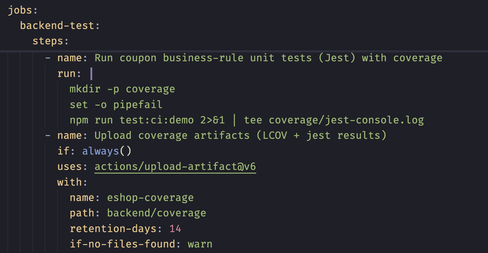

**3. `quality-gate` — Quality Control**

Chịu trách nhiệm **quyết định code có đủ điều kiện để build hay không**, dựa trên ba tiêu chí: toàn bộ test được chọn phải pass, Line Coverage > 70% và báo cáo LCOV hợp lệ.

Job vẫn đánh giá khi test thất bại để ghi nhận nguyên nhân không đạt, thay vì chỉ bỏ qua bước kiểm tra.

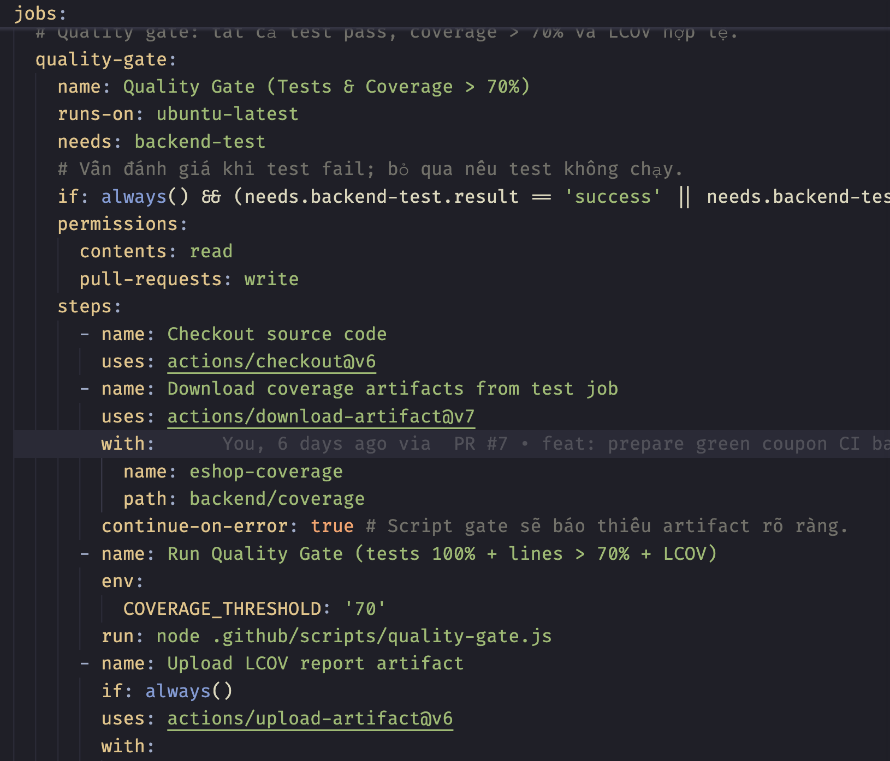

**4. `build` — Build & Packaging**

Chỉ được thực hiện khi các bước kiểm tra bắt buộc đạt yêu cầu. Job chịu trách nhiệm build giao diện Web/Admin và đóng gói Backend thành artifact để lưu trữ, phục vụ các bước phát hành hoặc triển khai sau này.

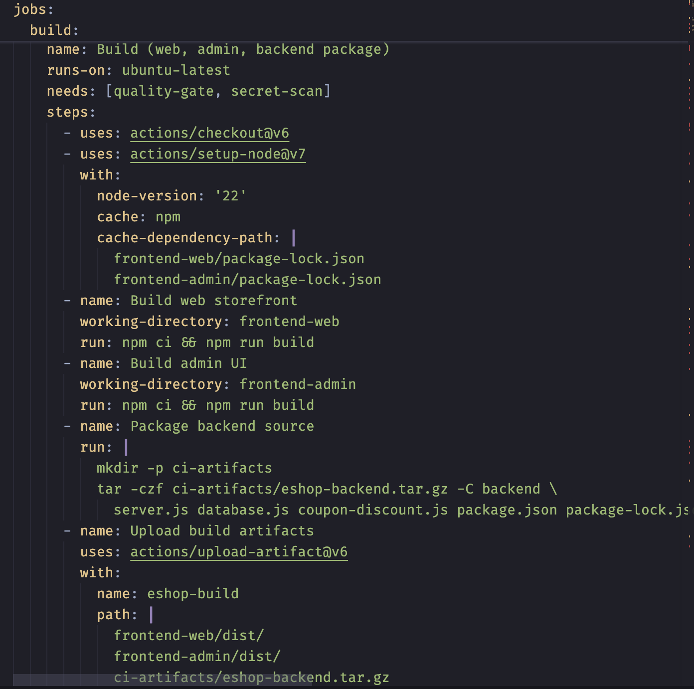

**5. `workflow-summary` — Audit & Reporting**

Chịu trách nhiệm tổng hợp trạng thái các job, thông tin commit, workflow run và sự kiện kích hoạt. Kết quả được lưu trong `ci-audit.json` nhằm phục vụ việc theo dõi và truy vết CI Pipeline, kể cả khi có job thất bại hoặc bị bỏ qua.

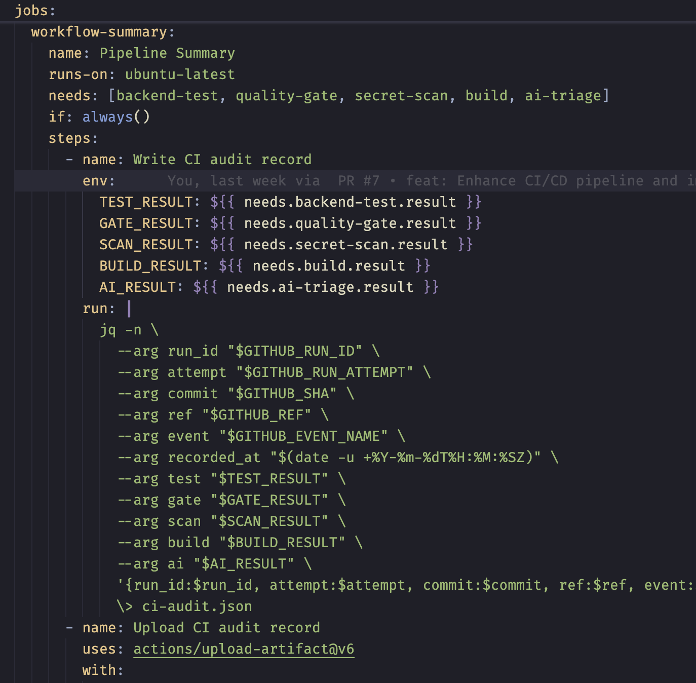

**6. `ai-triage` — Failure Analysis (Nhánh hỗ trợ)**

Job chỉ được kích hoạt khi `backend-test` thất bại trên pull request. Nó tải artifact chứa log Jest; nếu có `GEMINI_API_KEY`, script Python `.github/scripts/ai_triage.py` gửi log và mã nguồn liên quan tới Gemini API. Workflow hiện đặt model `gemini-3.5-flash-lite`.

Script tạo báo cáo **Markdown** với tóm tắt lỗi, bằng chứng, nguyên nhân có khả năng nhất và hướng kiểm chứng. Báo cáo được lưu thành `ai-triage.md`, đưa vào artifact và GitHub Actions Step Summary; workflow còn thử cập nhật comment trên pull request. Phân tích AI là thông tin hỗ trợ người phát triển, **không tham gia quyết định Quality Gate hay Build**.

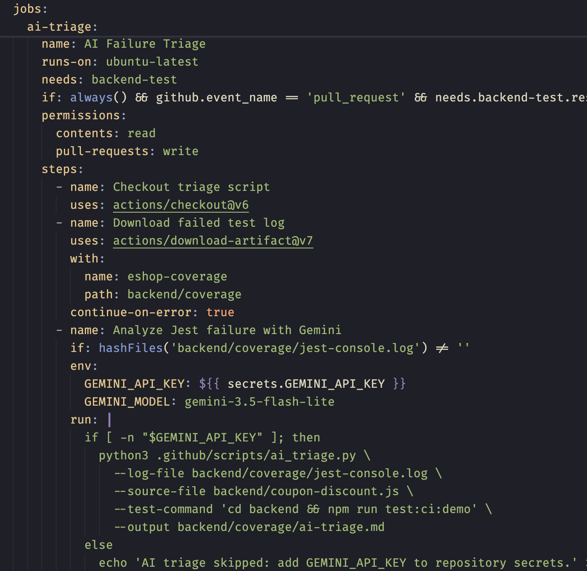

### 5.4 Branch Protection và điều kiện merge pull request

Khi bật Branch Protection, GitHub có thể yêu cầu các status check đạt trước khi cho phép merge vào nhánh được bảo vệ. Repository có script `.github/scripts/configure-branch-protection.sh` để chuẩn bị cấu hình cho nhánh `main` với ba check bắt buộc:

1. `Gitleaks Secret Scan`.
2. `Quality Gate (Tests & Coverage > 70%)`.
3. `Build (web, admin, backend package)`.

Script còn cấu hình yêu cầu một lượt review chấp thuận, nhánh pull request phải cập nhật với `main` và các cuộc thảo luận phải được giải quyết. Nếu cấu hình này đã được áp dụng trên GitHub, pull request có check không đạt hoặc chưa đủ điều kiện review sẽ chưa thể merge. Branch Protection là cấu hình phía GitHub; cần kiểm tra phần cài đặt repository hoặc API để xác nhận rule đang có hiệu lực.

## 6. Demo trên Đồ án EShop

Ba tình huống dưới đây minh họa ba loại sai lỗi khác nhau: lỗi nghiệp vụ của hệ thống được kiểm thử, tranh chấp tài nguyên trong môi trường kiểm thử và lỗi đồng bộ hóa của chính bài kiểm thử. Mỗi tình huống có phạm vi thực nghiệm riêng. Trong workflow `EShop CI` hiện tại, Quality Gate trực tiếp đánh giá **23 unit test của module coupon**; hai tình huống còn lại được thực hiện bằng các demo riêng, không phải các job của workflow này.

### 6.1 Unit test cho tính năng Coupon Percent: phát hiện `discount_amount` âm

**Mục tiêu và điều kiện đúng.** Với đơn hàng 1.000.000 đồng và coupon giảm 10%, hệ thống phải trả `discount_amount = 100.000` đồng và `final_amount = 900.000` đồng. Module [`backend/coupon-discount.js`](../backend/coupon-discount.js) hiện tính mức giảm phần trăm bằng `Math.floor(totalAmount * (coupon.discount_value / 100))`. Bộ kiểm thử [`backend/tests/coupon-discount.unit.test.js`](../backend/tests/coupon-discount.unit.test.js) dùng các ca dữ liệu cho coupon phần trăm, coupon giảm số tiền cố định, điều kiện áp mã và số tiền cuối cùng. Cấu hình [`backend/jest.demo.config.js`](../backend/jest.demo.config.js) giới hạn phạm vi CI demo ở file test này và chỉ thu thập coverage của `coupon-discount.js`; bộ test này không truy cập SQLite.

**Cách tái hiện lỗi.** Trên nhánh demo, nhóm cố ý thay riêng công thức tính coupon phần trăm thành `Math.floor(totalAmount * (1 - coupon.discount_value))`, giữ nguyên các test. Khi `totalAmount = 1_000_000` và `discount_value = 10`, biểu thức sai cho kết quả **−9.000.000** thay vì **100.000**. Jest so sánh kết quả thực tế với giá trị mong đợi nên các ca percent thất bại; các ca fixed và kiểm tra điều kiện áp mã không phụ thuộc công thức này vẫn có thể đạt. Đây là *fault injection* để chứng minh khả năng phát hiện lỗi, không phải công thức đang được sử dụng trong mã nguồn hiện tại.

**Tác động trong CI.** `backend-test` chạy `npm run test:ci:demo`, lưu Jest JSON, log và coverage thành artifact `eshop-coverage`. Nếu assertion thất bại, `quality-gate` vẫn đọc các kết quả đã lưu và trả trạng thái không đạt; job `build` không chạy. Trên pull request có `backend-test` thất bại, `ai-triage` có thể phân tích log khi repository có `GEMINI_API_KEY`; nhận định của AI phải được kiểm tra lại bằng test và mã nguồn. Với baseline đúng, kết quả kiểm tra local được ghi nhận là **23/23 test đạt** và **100% line coverage của riêng module coupon**. Bản sao local chứa công thức sai cho **5/23 test thất bại**. Đây là kết quả local và kịch bản dự kiến cho workflow hiện tại; không đồng nhất chúng với một GitHub Actions run đã hoàn tất. Hơn nữa, coverage cao chỉ cho biết dòng mã đã được thực thi: công thức sai vẫn có thể đạt coverage cao nhưng bị assertion phát hiện.

**Minh chứng và cách sửa.** [Hồ sơ log coupon](../Materials/Sample_Logs/README.md#3-cách-phát-hồ-sơ-b--coupon) lưu một run CI lịch sử có giá trị `Expected: 100000`, `Received: -9000000` cùng snapshot mã nguồn ở đúng commit lỗi. Run lịch sử dùng cấu hình test khác với bộ 23 unit test hiện tại, nên không dùng số test của run đó để mô tả Quality Gate hiện hành. Khôi phục công thức `Math.floor(totalAmount * coupon.discount_value / 100)`, chạy lại test và đối chiếu cả `discount_amount` lẫn `final_amount` để xác nhận lỗi nghiệp vụ đã được sửa. [Kịch bản demo đỏ → xanh](./ci-cd-flow-and-demo.md#7-chuẩn-bị-demo-đỏ--xanh) ghi rõ các bước tạo nhánh, mở pull request và kiểm tra kết quả.

### 6.2 SQLite File-Lock Concurrency Collision

**Vấn đề cần minh họa.** Khi hai kết nối cùng ghi vào một tệp SQLite, kết nối thứ hai có thể nhận `SQLITE_BUSY: database is locked` nếu kết nối thứ nhất vẫn giữ transaction ghi. Nhóm đã tạo [demo SQLite có kiểm soát](../Materials/Sample_Logs/README.md#6-cách-phát-hồ-sơ-a--sqlite-demo-và-giới-hạn-bằng-chứng) trên nhánh riêng để quan sát cơ chế này. Demo dùng hai kết nối trong **một tiến trình Node.js**, một tệp database tạm và cấu hình `busyTimeout = 0`; nó không truy cập `backend/database.sqlite` hay sửa logic nghiệp vụ EShop.

**Thiết kế đối chứng.** Cả hai chế độ đều cho kết nối A bắt đầu `BEGIN IMMEDIATE` và ghi một dòng. Ở chế độ `parallel`, A giữ transaction mở khi kết nối B cố ghi vào cùng tệp. Ở chế độ `serial`, A `COMMIT` trước rồi B mới ghi. Nhờ giữ nguyên mã, database tạm và môi trường chạy, sự khác biệt cần quan sát nằm ở **thứ tự hai lần ghi**.

| Chế độ | Thứ tự thao tác | Kết quả quan sát trên GitHub Actions |
| :--- | :--- | :--- |
| `parallel` | A ghi và giữ transaction → B ghi | B nhận `SQLITE_BUSY`; bước demo thoát với mã 1. |
| `serial` | A ghi → A `COMMIT` → B ghi | Hai lần ghi hoàn tất; log ghi `PASS committedWrites=2`. |

Hai job trên thuộc cùng [run `39741620266`](https://github.com/SoftwareTesting-Group13/eshop-sut-seminar/actions/runs/39741620266), cùng commit `485a778`; [log chế độ `parallel`](../Materials/Sample_Logs/excerpts/ghuy_sqlite_parallel_39741620266.txt) và [log chế độ `serial`](../Materials/Sample_Logs/excerpts/ghuy_sqlite_serial_39741620266.txt) ghi lại kết quả đối chứng. Bản [source tại commit thực nghiệm](../Materials/Sample_Logs/source/ghuy_sqlite_demo_485a778.txt) cho thấy cách mở hai kết nối, đặt timeout, đóng kết nối và xóa database tạm sau khi chạy.

**Ý nghĩa đối với test harness.** Thực nghiệm chứng minh việc điều phối thứ tự ghi hoặc cô lập database có thể tránh tranh chấp trong tình huống đã tạo. Nó **không chứng minh** full test suite EShop từng gặp lỗi này do nhiều Jest worker, cũng không chứng minh riêng cờ `--runInBand` giải quyết mọi tranh chấp SQLite. Full suite hiện chạy Jest tuần tự bằng `--runInBand`; khi `NODE_ENV=test`, [`backend/database.js`](../backend/database.js) chọn SQLite `:memory:` thay cho tệp development. Ngược lại, bộ 23 unit test coupon trong CI demo không mở database. Vì vậy, kết quả SQLite cần được trình bày là **demo riêng về cơ chế khóa tài nguyên**, không phải failure của workflow coupon hiện hành.

### 6.3 Flaky test do độ trễ bất đồng bộ

**Vấn đề cần minh họa.** Một test có thể kiểm tra trạng thái quá sớm nếu dùng `sleep` trong một khoảng cố định để *đoán* rằng tác vụ bất đồng bộ đã hoàn tất. [`backend/demos/flaky-delay.demo.js`](../backend/demos/flaky-delay.demo.js) tạo một tác vụ cập nhật `ready` sau **20 ms** (`fast`) hoặc **200 ms** (`slow`). Test thứ nhất đợi cố định **100 ms** rồi assert `ready === true`; test đối chứng `await job.completed` trước khi assert. Hai test dùng cùng điều kiện kiểm tra, chỉ khác cách chờ.

| Profile | Thời gian tác vụ được cấu hình | Test chờ cố định 100 ms | Test `await job.completed` |
| :--- | :---: | :--- | :--- |
| `fast` | 20 ms | Đạt: tác vụ đã hoàn tất khi kiểm tra. | Đạt. |
| `slow` | 200 ms | Thất bại: `Expected: true`, `Received: false`. | Đạt. |

Có thể chạy riêng demo bằng `FLAKY_PROFILE=fast npm --prefix backend run test:flaky` và thay `fast` bằng `slow` hoặc `random`. Ở profile `random`, mỗi lượt chọn một trong hai độ trễ nên test dùng `sleep` có thể cho kết quả khác nhau giữa các lượt chạy. Test đối chứng chờ đúng Promise hoàn tất, thay vì tăng tùy ý thời gian `sleep`. Demo này không gọi API EShop và không truy cập SQLite; `--runInBand` cũng không sửa được việc chờ sai bên trong một test. [Hướng dẫn demo](../backend/demos/README.md) mô tả các profile và kết quả mong đợi.

**Đo đạc và giới hạn kết luận.** Nhóm chạy [10 cặp thực nghiệm trên GitHub Actions](../Materials/Empirical_Metrics/ghuy-20261022-110838/summary.json): mỗi cặp gồm một lần chạy test dùng `sleep` và một lần chạy test dùng `await`, tổng cộng **20 lần gọi test hợp lệ**. Lịch độ trễ được ấn định trước: 5 cặp `slow`, 5 cặp `fast`; hai cách chờ trong mỗi cặp dùng cùng profile. Test `sleep` thất bại **5/10** lần, còn test `await` thất bại **0/10** lần. Đây là **tỷ lệ thất bại trong mẫu độ trễ mô phỏng có kiểm soát**, không phải flake rate tự nhiên của API EShop; 0/10 lần lỗi quan sát được cũng không bảo đảm test sẽ luôn đạt trong mọi môi trường. [Protocol thực nghiệm](../Materials/Empirical_Metrics/ghuy_protocol.md) và bộ artifact theo từng run cho phép đối chiếu cách chọn mẫu, log và kết quả.

**Bài học thiết kế.** Test harness đáng tin cậy phải đồng bộ theo tín hiệu hoàn thành hoặc điều kiện có thể kiểm tra, đồng thời dọn tác vụ còn chạy sau khi assertion thất bại. Việc chỉ tăng thời gian `sleep` có thể làm giảm xác suất lỗi trong một môi trường, nhưng vẫn giữ nguyên giả định về thời gian hoàn tất và làm test chạy chậm hơn.
