# Báo cáo Seminar nhóm 13 - T07: CI/CD & Test-Harness Engineering

**Môn học:** Kiểm thử phần mềm (Software Testing)  
**Mã lớp:** Testing-CQ2023-3-LQVu  
**Đơn vị:** Khoa Công nghệ Thông tin — Trường Đại học Khoa học Tự nhiên, ĐHQG-HCM  
**Giảng viên phụ trách:** TS. Lâm Quang Vũ, TS. Trần Duy Hoàng, ThS. Trương Phước Lộc, ThS. Hồ Tuấn Thanh  
**Hệ thống kiểm thử (SUT):** EShop System Monorepo (Node.js/Express, SQLite3, Jest, React, GitHub Actions)  
**GitHub Repository:** [SoftwareTesting-Group13/eshop-sut-seminar](https://github.com/SoftwareTesting-Group13/eshop-sut-seminar)  

## Thông tin nhóm 13

| STT | Mã sinh viên | Họ và tên | 
| :---: | :---: | :--- |
| 1 | **23120102** | Nguyễn Ngọc Minh Tuấn |
| 2 | **23120223** | Dương Nhật Cường |
| 3 | **23120225** | Trần Gia Cường |
| 4 | **23120273** | Nguyễn Gia Huy |

## 1. Tổng quan về DevOps và CI/CD

### 1.1 Khái niệm DevOps, DevOps LifeCycle và mối liên hệ với CI/CD

**Khái niệm DevOps:** DevOps là sự kết hợp giữa văn hóa và kỹ thuật nhằm xóa bỏ rào cản và tạo cầu nối giữa Phát triển (Dev) và Vận hành (Ops), giúp rút ngắn chu kỳ phát hành và nâng cao chất lượng, độ ổn định của phần mềm.

#### DevOps LifeCycle

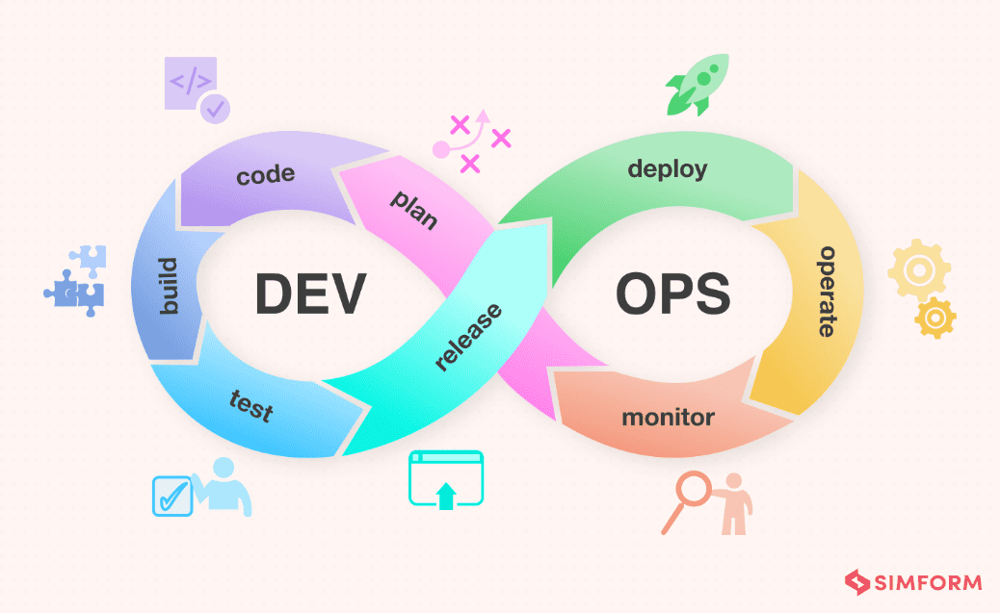

Gồm 8 giai đoạn: Plan → Code → Build → Test → Release → Deploy → Operate → Monitor.

Điểm mấu chốt của LifeCycle này là không có điểm kết thúc. Dữ liệu và phản hồi từ giai đoạn Monitor sẽ quay lại làm đầu vào cho giai đoạn Plan của vòng tiếp theo → Tạo nên 1 vòng đời khép kín và liên tục triển khai.

- **Plan:** Lên kế hoạch, xác định mục tiêu và yêu cầu cho dự án.
- **Code:** Viết code để triển khai các features cho ứng dụng.
- **Build:** Build ứng dụng để đảm bảo chúng hoạt động được.
- **Test:** Test ứng dụng để đảm bảo các feature hoạt động đúng với yêu cầu ban đầu.
- **Release:** Chuẩn bị các công đoạn cuối như là đóng gói ứng dụng (build docker image), release tag, notes và lưu artifact.
- **Deploy:** Đưa ứng dụng lên môi trường chạy thực tế.
- **Operate:** Quản lý hạ tầng, đảm bảo hệ thống chạy ổn định.
- **Monitor:** Theo dõi hiệu năng, check log và phản hồi từ user.

### 1.2 CI/CD Pipeline

**Vấn đề:** Integration Hell - Trong phát triển phần mềm, nhiều dev thường làm việc song song trên các branch riêng biệt. Khi các nhánh này không được merge thường xuyên, sự khác biệt giữa các phiên bản mã nguồn ngày càng lớn, dễ dẫn đến merge conflicts, lỗi tích hợp (integration errors) và khó khăn trong quá trình build, testing. Hiện tượng này được gọi là Integration Hell.

CI/CD ra đời để giúp tự động hóa các quy trình trên.

CI/CD là một phần quan trọng trong DevOps Lifecycle, chủ yếu tập trung vào các giai đoạn Code → Build → Test → Release → Deploy, nhằm tự động hóa quá trình tích hợp, kiểm thử và triển khai phần mềm.

**Continuous Integration (CI — Tích hợp liên tục):** Dev thường xuyên commit code vào nhánh chung; mỗi commit/PR tự động kích hoạt Build, Lint và chạy kiểm thử tự động để phát hiện lỗi sớm (Fail Fast, Fix Early).

> Ở đây, Unit test đóng vai trò là 1 First Quality Gate (FQG) trong CI Pipeline. Nếu Unit test fail, pipeline sẽ fail (shift left) và dev phải fix lỗi trước khi merge code vào nhánh chính. Tránh được việc lỗi trên nhánh main.

**Continuous Delivery/Deployment (CD — Phân phối/Triển khai liên tục):** Là giai đoạn tiếp nối CI, tự động hóa quá trình Release và Deploy sau khi code vượt qua các bước kiểm tra.
  - **Continuous Delivery:** Tự động chuẩn bị và đưa ứng dụng lên môi trường Staging để kiểm thử, nhưng cần con người phê duyệt thủ công trước khi Deploy lên Production.
  - **Continuous Deployment:** Cấp độ tự động hóa cao hơn của Delivery. Tự động Deploy lên Production sau khi vượt qua toàn bộ các bước kiểm tra mà không cần phê duyệt thủ công.

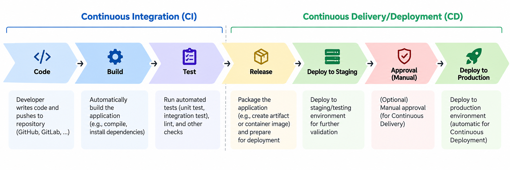

## 2. Các công cụ CI/CD

### 2.1 So sánh GitHub Actions, GitLab CI/CD và Jenkins

Ba công cụ đều hỗ trợ xây dựng pipeline để tự động hóa build, test và deploy. Bảng dưới đây so sánh các đặc điểm chung của từng công cụ. Mỗi tiêu chí có tối đa 5 điểm và trọng số như nhau; điểm số mang tính tham khảo vì mức phù hợp thực tế còn phụ thuộc vào yêu cầu và hạ tầng của từng dự án.

| Tiêu chí đánh giá | GitHub Actions | GitLab CI/CD | Jenkins |
| :--- | :--- | :--- | :--- |
| **1. Chi phí sử dụng** | **4/5** — Có runner do GitHub cung cấp; chi phí phụ thuộc loại repository, gói tài khoản và mức sử dụng. | **4/5** — Có runner trên GitLab.com; chi phí phụ thuộc hạn mức compute và gói sử dụng. | **3/5** — Phần mềm mã nguồn mở nhưng cần tài nguyên để vận hành controller và agent. |
| **2. Mức độ dễ thiết lập ban đầu** | **5/5** — Khai báo workflow YAML trong repository GitHub, có runner do nền tảng cung cấp. | **5/5** — Khai báo `.gitlab-ci.yml` trong repository GitLab, có runner do nền tảng cung cấp. | **2/5** — Cần cài đặt server và cấu hình agent trước khi chạy pipeline. |
| **3. Tích hợp với hệ thống quản lý mã nguồn** | **4/5** — Tích hợp trực tiếp với GitHub; kết nối nguồn mã ở nền tảng khác cần cấu hình thêm. | **4/5** — Tích hợp trực tiếp với GitLab; có cách kết nối repository ngoài GitLab. | **5/5** — Có thể kết nối nhiều hệ thống quản lý mã nguồn thông qua cấu hình và plugin. |
| **4. Kiểm soát môi trường chạy** | **4/5** — Có runner do GitHub cung cấp hoặc runner tự quản lý. | **4/5** — Có runner do GitLab cung cấp hoặc runner tự quản lý. | **5/5** — Chủ động bố trí controller, agent và tài nguyên thực thi. |
| **5. Khả năng tùy biến, mở rộng pipeline** | **4/5** — Dùng action, script và workflow tái sử dụng. | **4/5** — Dùng job, stage và pipeline con. | **5/5** — Hệ sinh thái plugin lớn, linh hoạt trong cách tổ chức pipeline. |
| **6. Công sức vận hành, bảo trì** | **5/5** — Ít phải quản lý hạ tầng khi dùng runner do GitHub cung cấp. | **5/5** — Ít phải quản lý hạ tầng khi dùng runner trên GitLab.com. | **2/5** — Cần cập nhật, giám sát server, plugin và agent. |
| **7. Tích hợp AI để phân tích log lỗi** | **4/5** — Có thể thêm bước gọi script hoặc API AI và lưu kết quả trong workflow. | **4/5** — Có thể thêm job gọi script hoặc API AI và truyền log qua artifact. | **4/5** — Có thể gọi script hoặc API AI và xử lý log trong pipeline. |
| **Tổng điểm (thang 35)** | **30/35** | **30/35** | **26/35** |

Điểm ở tiêu chí AI đánh giá **khả năng tích hợp công cụ bên ngoài**, không hàm ý nền tảng có sẵn chức năng chẩn đoán lỗi bằng AI. Các công cụ có ưu thế khác nhau: GitHub Actions và GitLab CI/CD giảm công vận hành khi dùng runner do nền tảng cung cấp; Jenkins cho phép tự kiểm soát hạ tầng và tùy biến sâu hơn.

### 2.2 Nhận xét

Việc lựa chọn công cụ CI/CD cần dựa trên nơi lưu mã nguồn, yêu cầu kiểm soát môi trường chạy, mức độ tùy biến và nguồn lực vận hành. Điểm số trong bảng chỉ giúp đối chiếu các tiêu chí; khi áp dụng vào một dự án cụ thể, cần đánh giá lại theo bối cảnh của dự án đó.

## 3. GitHub Actions

### 3.1 GitHub Actions là gì?

**GitHub Actions** là nền tảng tự động hóa tích hợp trong GitHub. Nền tảng này cho phép định nghĩa các quy trình (*workflows*) để chạy những công việc như kiểm tra mã nguồn, build, test và deploy khi có sự kiện phù hợp. Ví dụ, một workflow có thể được kích hoạt khi có `push`, khi mở hoặc cập nhật pull request, theo lịch, hoặc bằng thao tác thủ công.

Trong CI/CD, GitHub Actions đóng vai trò điều phối: nhận sự kiện, xác định workflow cần chạy, phân công các công việc cho môi trường thực thi và ghi lại trạng thái, log, kết quả của lần chạy. Các lệnh kiểm thử hay triển khai được khai báo trong workflow; GitHub Actions chịu trách nhiệm kích hoạt và tổ chức việc thực thi chúng.

### 3.2 Cấu trúc của GitHub Actions

Để có thể sử dụng Github Actions, đầu tiên chúng ta cần tạo một workflow. Workflow được định nghĩa trong một tệp YAML nằm trong thư mục `.github/workflows/` của repository. Một workflow có thể chứa nhiều job, mỗi job có thể chứa nhiều step. Các step có thể là lệnh shell hoặc sử dụng các action tái sử dụng.

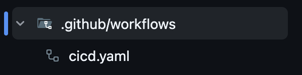

Một workflow được tổ chức theo các thành phần sau:

- **Event (sự kiện):** Điều kiện khởi chạy workflow, chẳng hạn `push`, `pull_request`, lịch chạy hoặc thao tác thủ công. Được khai báo bằng khóa `on`.
- **Workflow (quy trình):** Toàn bộ quy trình tự động hóa, được định nghĩa trong một tệp YAML thuộc thư mục `.github/workflows/`. Một repository có thể có nhiều workflow.
- **Job (công việc):** Nhóm các bước thực hiện một nhiệm vụ như build hoặc test. Mỗi job chạy trên một runner; các job không có quan hệ phụ thuộc có thể chạy song song.
- **Runner (môi trường thực thi):** Máy thực hiện job. Có thể dùng runner do GitHub cung cấp hoặc runner tự quản lý; thuộc tính `runs-on` xác định loại runner cho job.
- **Step (bước):** Đơn vị nhỏ trong job, thực hiện một lệnh bằng `run` hoặc sử dụng một action bằng `uses`. Các step thông thường trong cùng job chạy theo thứ tự và chia sẻ môi trường của runner.
- **Action (thao tác tái sử dụng):** Đoạn chức năng được đóng gói để dùng trong step, ví dụ lấy mã nguồn hoặc cài đặt môi trường chạy.

Ví dụ [tệp workflow mẫu](./examples/example-workflow.yml) dưới đây minh họa hai job `build` và `test`; job `test` chờ `build` hoàn thành nhờ `needs`:

```yaml
name: Example Workflow

on:
  push:
  pull_request:

jobs:
  build:
    runs-on: ubuntu-latest
    steps:
      - name: Checkout source
        uses: actions/checkout@v6
      - name: Example build step
        run: echo "Build the application here"

  test:
    needs: build
    runs-on: ubuntu-latest
    steps:
      - name: Checkout source
        uses: actions/checkout@v6
      - name: Example test step
        run: echo "Run tests here"
```

Quan hệ giữa các thành phần có thể tóm tắt như sau:

```text
Event → Workflow
          ├─ Job A → Runner A → Step 1 → Step 2 → ...
          └─ Job B → Runner B → Step 1 → Step 2 → ...
```

Một workflow có thể chứa nhiều job. Theo mặc định, các job độc lập có thể chạy song song; dùng `needs` để yêu cầu một job chờ job khác hoàn thành. Trong mỗi job, các step thông thường chạy theo thứ tự đã khai báo. Cách tổ chức này cho phép chia pipeline thành các nhiệm vụ riêng và kiểm soát luồng thực thi giữa chúng.

### 3.3 GitHub Actions trong EShop System Monorepo

Workflow `EShop CI` được định nghĩa trong `.github/workflows/eshop-ci.yml`. Nó chạy khi có `push` lên bất kỳ nhánh nào, khi có pull request vào `main` hoặc `master`, hoặc khi được kích hoạt thủ công bằng `workflow_dispatch`.

Các job dùng `ubuntu-latest` và chạy trên runner riêng do GitHub cung cấp. Môi trường của mỗi job được tạo mới; dữ liệu cần chuyển giữa các job, như log kiểm thử và báo cáo coverage, được lưu rồi tải lại qua artifact. Workflow sử dụng `actions/checkout@v6`, `actions/setup-node@v7`, `actions/cache@v5` và `actions/upload-artifact@v6` ở các bước tương ứng.

#### Sơ đồ luồng CI

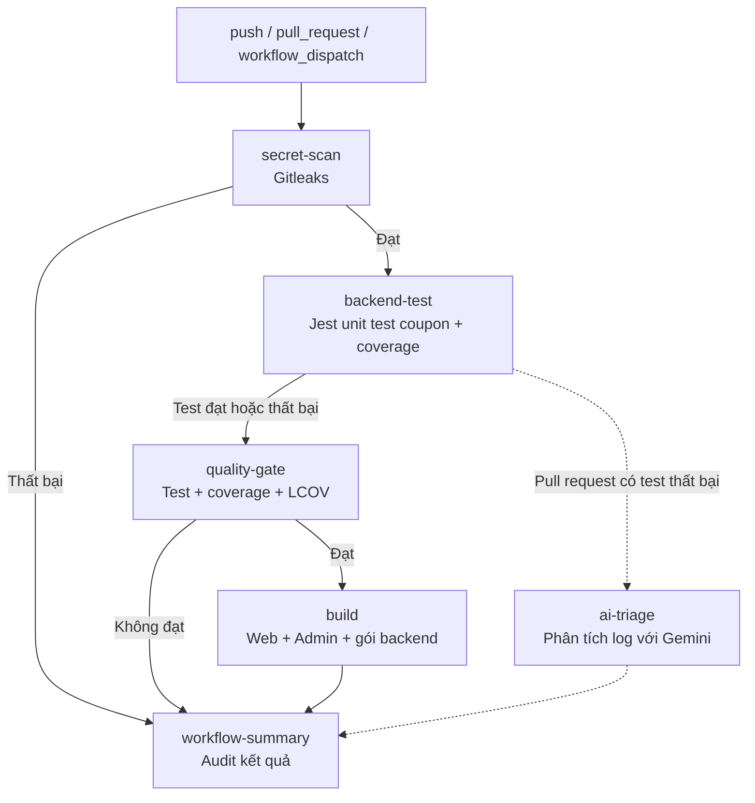

#### Luồng hoạt động của CI Pipeline

**Luồng chính:** Secret Scan → Backend Test → Quality Gate → Build Artifact → Workflow Summary.

Pipeline được thiết kế theo nguyên tắc **kiểm tra bảo mật và chất lượng trước khi đóng gói sản phẩm**. Mỗi job đảm nhận một trách nhiệm riêng, kết quả của các job kiểm tra sẽ quyết định liệu pipeline có được tiếp tục đến bước build hay không.

Ngoài luồng chính, **AI Triage** hoạt động như một nhánh hỗ trợ phân tích lỗi khi unit test thất bại trên Pull Request.

#### Chức năng của từng job

**1. `secret-scan` — Security Gate**

Chịu trách nhiệm phát hiện thông tin nhạy cảm (API Key, Token, Password...) bị commit vào Git repository bằng Gitleaks. Đây là bước kiểm tra bảo mật đầu tiên, nếu thất bại, pipeline không tiếp tục sang các bước kiểm thử và build.

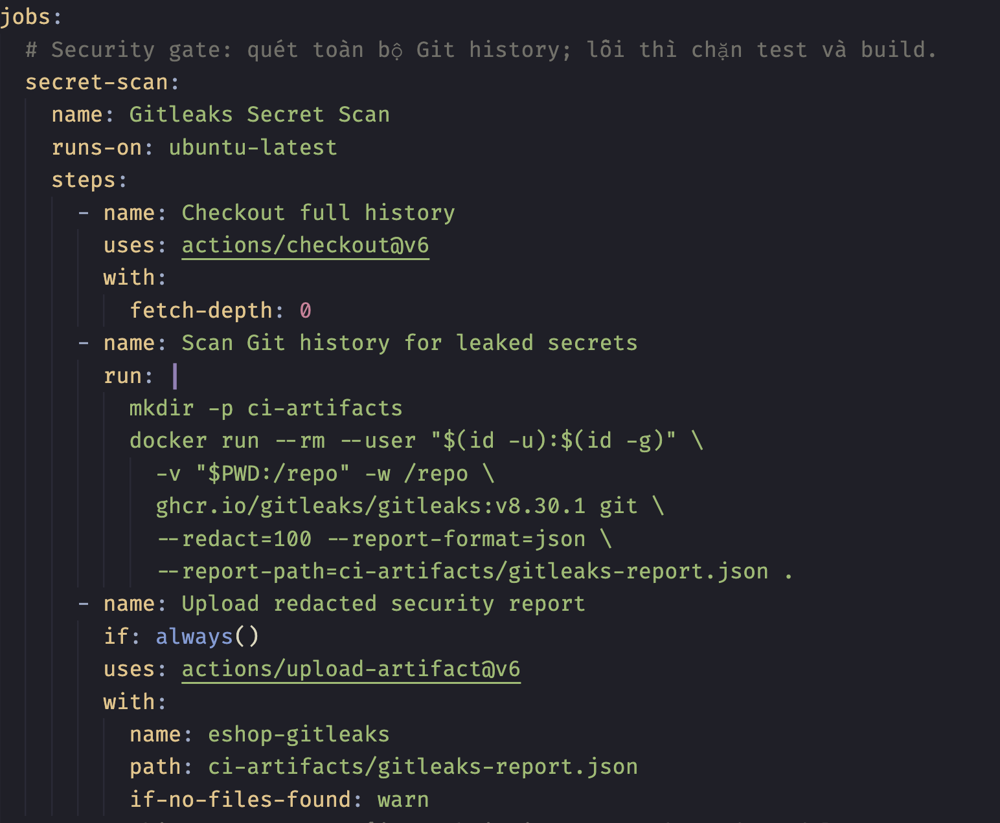

**2. `backend-test` — Dependency Caching & Automated Testing**

Job bắt đầu sau khi `secret-scan` đạt. Nó thiết lập Node.js 22, chuẩn bị dependency rồi chạy bộ unit test nghiệp vụ coupon.

**Dependency Caching:** `actions/cache@v5` lưu `backend/node_modules` bằng khóa gồm hệ điều hành runner, Node.js 22 và hash của `backend/package-lock.json`. Cache khớp hoàn toàn thì workflow bỏ qua `npm ci`; nếu không, workflow cài lại dependency theo lockfile. `restore-keys` có thể tìm cache gần nhất, nhưng trường hợp đó vẫn chạy `npm ci` vì chưa phải cache hit hoàn toàn.

```yaml
- name: Cache backend/node_modules
  id: cache-node-modules
  uses: actions/cache@v5
  with:
    path: backend/node_modules
    key: ${{ runner.os }}-node22-${{ hashFiles('backend/package-lock.json') }}
    restore-keys: |
      ${{ runner.os }}-node22-

- name: Install dependencies (npm ci)
  if: steps.cache-node-modules.outputs.cache-hit != 'true'
  run: npm ci
```

Hiệu quả cache cần được đối chiếu bằng trạng thái cache và thời gian cài đặt của từng workflow run; không có một mức tăng tốc cố định.

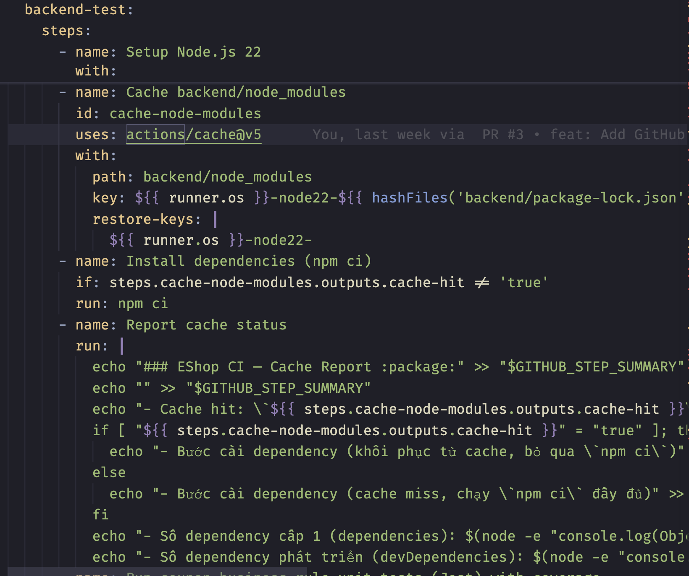

**Automated Testing:** Workflow chạy `npm run test:ci:demo`. Lệnh này dùng `jest.demo.config.js` để chọn `tests/coupon-discount.unit.test.js` và chỉ đo coverage của `coupon-discount.js`:

```text
jest --config jest.demo.config.js --runInBand --coverage --verbose --json --outputFile=coverage/jest-results.json --ci
```

`--runInBand` chạy test tuần tự trong tiến trình chính; `--coverage` tạo báo cáo LCOV, HTML và JSON summary; `--json --outputFile=...` lưu kết quả test cho Quality Gate. `--ci` đặt Jest ở chế độ CI, còn `--verbose` in chi tiết từng test. Log và báo cáo được lưu thành artifact để Quality Gate và AI Triage đọc, kể cả khi test thất bại.

Lệnh chạy toàn bộ backend suite (`npm test`, `npm run test:ci`) còn dùng `--detectOpenHandles` và `--forceExit`; hai cờ này **không có trong lệnh CI demo**. Unit test coupon của demo kiểm tra hàm nghiệp vụ, không thao tác với tệp SQLite.

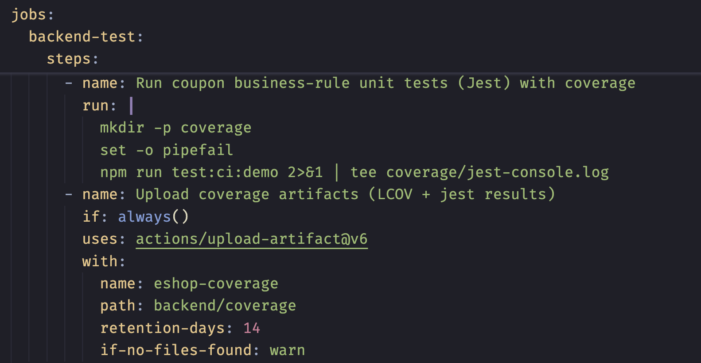

**3. `quality-gate` — Quality Control**

Chịu trách nhiệm **quyết định code có đủ điều kiện để build hay không**, dựa trên ba tiêu chí: toàn bộ test được chọn phải pass, Line Coverage > 70% và báo cáo LCOV hợp lệ.

Job vẫn đánh giá khi test thất bại để ghi nhận nguyên nhân không đạt, thay vì chỉ bỏ qua bước kiểm tra.

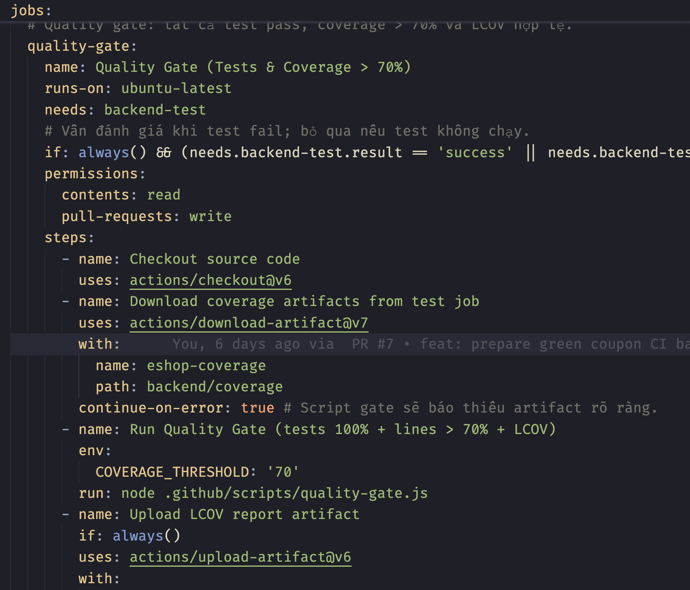

**4. `build` — Build & Packaging**

Chỉ được thực hiện khi các bước kiểm tra bắt buộc đạt yêu cầu. Job chịu trách nhiệm build giao diện Web/Admin và đóng gói Backend thành artifact để lưu trữ, phục vụ các bước phát hành hoặc triển khai sau này.

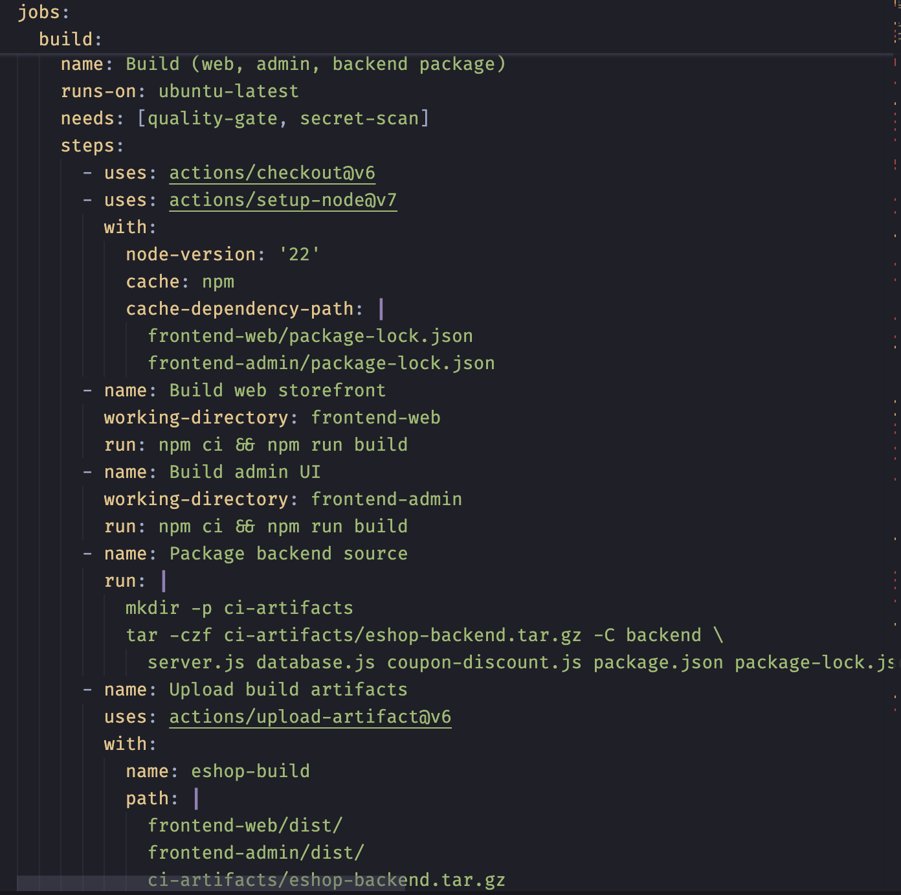

**5. `workflow-summary` — Audit & Reporting**

Chịu trách nhiệm tổng hợp trạng thái các job, thông tin commit, workflow run và sự kiện kích hoạt. Kết quả được lưu trong `ci-audit.json` nhằm phục vụ việc theo dõi và truy vết CI Pipeline, kể cả khi có job thất bại hoặc bị bỏ qua.

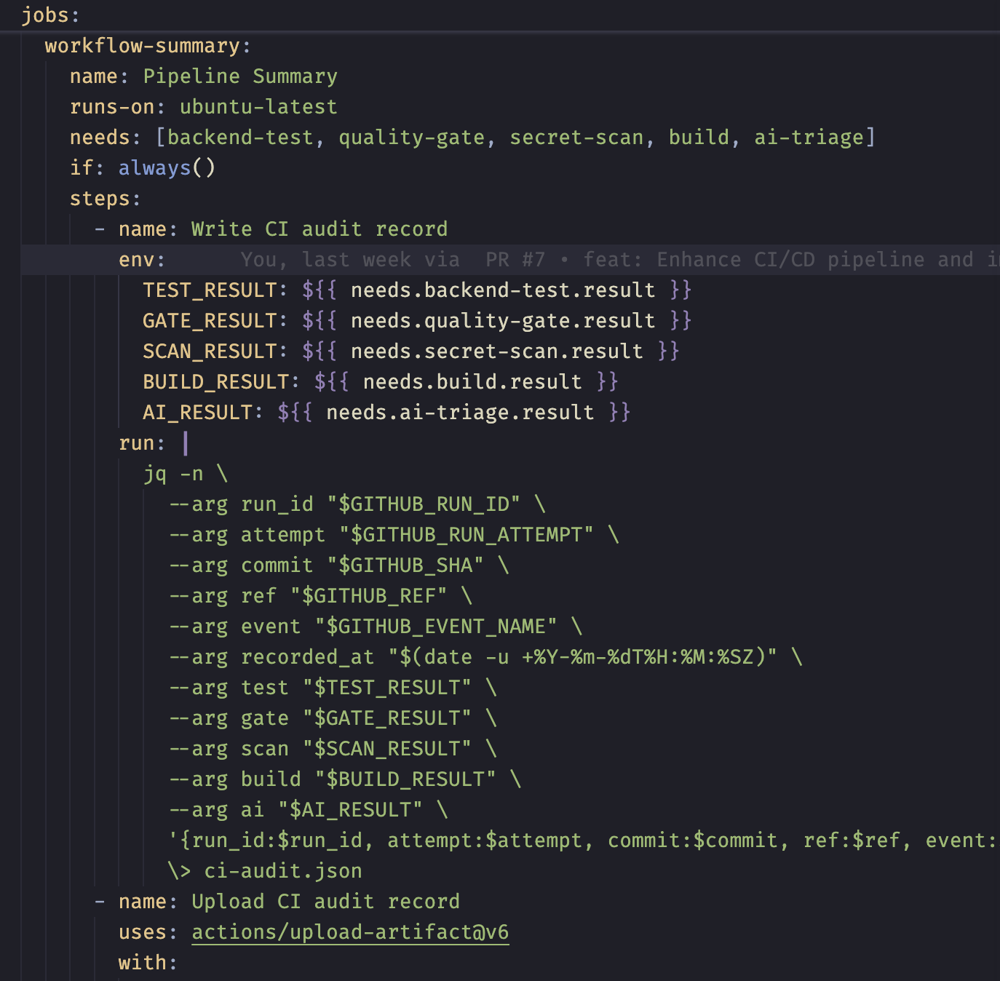

**6. `ai-triage` — Failure Analysis (Nhánh hỗ trợ)**

Job chỉ được kích hoạt khi `backend-test` thất bại trên pull request. Nó tải artifact chứa log Jest; nếu có `GEMINI_API_KEY`, script Python `.github/scripts/ai_triage.py` gửi log và mã nguồn liên quan tới Gemini API. Workflow hiện đặt model `gemini-3.5-flash-lite`.

Script tạo báo cáo **Markdown** với tóm tắt lỗi, bằng chứng, nguyên nhân có khả năng nhất và hướng kiểm chứng. Báo cáo được lưu thành `ai-triage.md`, đưa vào artifact và GitHub Actions Step Summary; workflow còn thử cập nhật comment trên pull request. Phân tích AI là thông tin hỗ trợ người phát triển, **không tham gia quyết định Quality Gate hay Build**.

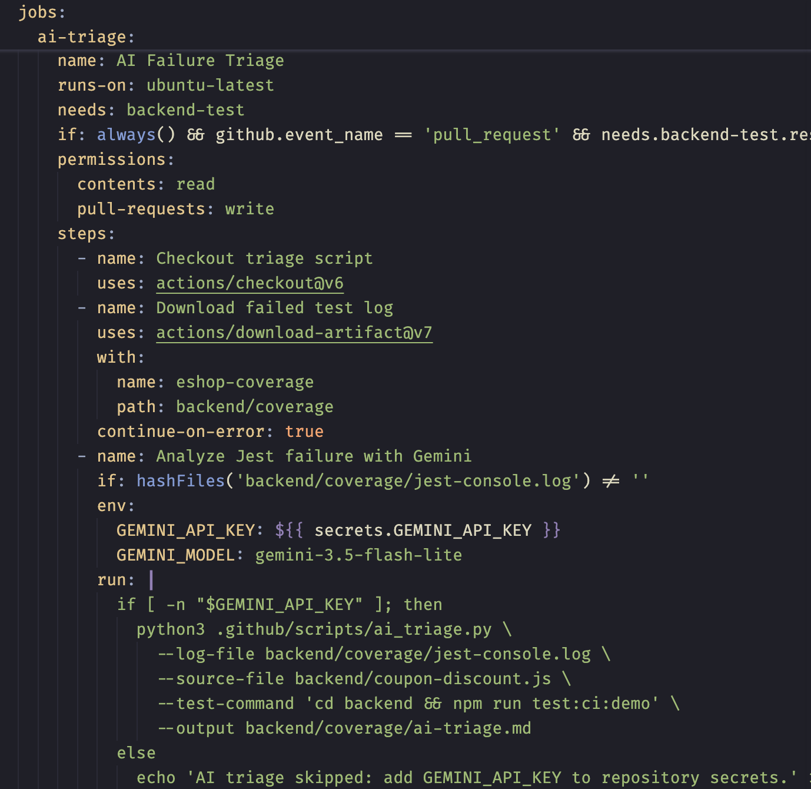

### 3.4 Branch Protection và điều kiện merge pull request

Khi bật Branch Protection, GitHub có thể yêu cầu các status check đạt trước khi cho phép merge vào nhánh được bảo vệ. Repository có script `.github/scripts/configure-branch-protection.sh` để chuẩn bị cấu hình cho nhánh `main` với ba check bắt buộc:

1. `Gitleaks Secret Scan`.
2. `Quality Gate (Tests & Coverage > 70%)`.
3. `Build (web, admin, backend package)`.

Script còn cấu hình yêu cầu một lượt review chấp thuận, nhánh pull request phải cập nhật với `main` và các cuộc thảo luận phải được giải quyết. Nếu cấu hình này đã được áp dụng trên GitHub, pull request có check không đạt hoặc chưa đủ điều kiện review sẽ chưa thể merge. Branch Protection là cấu hình phía GitHub; cần kiểm tra phần cài đặt repository hoặc API để xác nhận rule đang có hiệu lực.

## 4. Mở đầu: vì sao cần Test Harness

Test Harness là phần hạ tầng giúp việc kiểm thử chạy tự động, lặp lại được và cho kết quả đáng tin. Thiếu nó, test chỉ là những đoạn code rời rạc mà không ai dám tin.

### 4.1. Vấn đề khi không có Test Harness

Phần mềm hiện đại hiếm khi là một chương trình đơn lẻ. Một dịch vụ thường phụ thuộc vào database, cache, API bên thứ ba, hàng đợi thông điệp và xử lý bất đồng bộ. Nếu viết test cho hệ thống như vậy mà không có hạ tầng hỗ trợ, các vấn đề sau gần như chắc chắn xuất hiện:

- **Test phụ thuộc môi trường**: chạy được trên máy này nhưng đỏ trên CI (hội chứng 'works on my machine').
- **Test phụ thuộc dữ liệu dùng chung**: hai test cùng ghi vào một database, kết quả tùy thuộc test nào chạy trước.
- **Test phụ thuộc dịch vụ bên ngoài**: API đối tác chậm, sập hoặc trả dữ liệu khác đi thì test đổi kết quả dù code không đổi.
- **Không tái hiện được lỗi hiếm**: timeout, lỗi HTTP 500, tranh chấp tài nguyên rất khó tạo ra theo ý muốn.
- **Kết quả không thống nhất**: mỗi người chạy một cách, báo cáo một kiểu, không ai biết test nào đang hỏng thật.
- **Test chậm và chạy tuần tự**: pipeline CI kéo dài, lập trình viên dần bỏ qua test.

Hệ quả cuối cùng là mất niềm tin. Khi test đỏ, cả nhóm nghĩ 'chắc lại flaky' rồi bấm chạy lại thay vì điều tra. Lúc đó test không còn bảo vệ chất lượng nữa, trong khi vẫn tốn chi phí duy trì.

### 4.2. Test Harness là gì

**Định nghĩa cổ điển.** Thuật ngữ chuẩn (ISTQB) mô tả test harness là tập hợp stub và driver cần có để thực thi test. Hai khái niệm này vẫn là nền tảng:

- **Driver**: đoạn code gọi và điều khiển SUT, cấp đầu vào cho nó.
- **Stub**: đoạn code thay thế một thành phần mà SUT phải gọi tới, trả về dữ liệu giả có kiểm soát.

**Định nghĩa mở rộng dùng trong báo cáo này.** Test Harness là tập hợp phần mềm, cấu hình, dữ liệu và công cụ tạo ra một môi trường được kiểm soát để thực thi test trên System Under Test (SUT), đồng thời quan sát kết quả và báo cáo một cách tự động.

Nhìn theo chức năng, một harness làm bốn việc, và đó cũng là bốn khối trong kiến trúc ở phần 7:

1. Điều phối và thực thi test (chạy gì, khi nào, song song ra sao).
2. Dựng, nạp dữ liệu và dọn dẹp môi trường.
3. Thay thế các dependency bằng bản giả có kiểm soát.
4. Đánh giá kết quả (assertion), thu log và xuất báo cáo.

### 4.3. Test Harness Engineering là gì

Test Harness Engineering là hoạt động kỹ thuật thiết kế, xây dựng, vận hành và cải tiến test harness như một sản phẩm phần mềm thực thụ, thay vì một mớ script chắp vá. Trọng tâm chuyển từ 'viết thêm test' sang 'xây hệ thống để test luôn đáng tin'.

Các công việc chính của Test Harness Engineering:

- **Thiết kế kiến trúc**: quyết định harness gồm những khối nào, ranh giới với SUT ở đâu, môi trường chạy ra sao.
- **Chọn và tích hợp công cụ**: container, mock server, test runner, công cụ báo cáo, CI/CD.
- **Coi harness là code**: lưu trong version control, có code review, có test riêng và có pipeline riêng.
- **Đo sức khỏe harness**: thời gian chạy, tỉ lệ flaky, tỉ lệ pass, độ ổn định giữa các lần chạy.
- **Chống flaky và tối ưu tốc độ**: tìm nguyên nhân gốc, cô lập dữ liệu, song song hóa an toàn.
- **Chuẩn hóa để tái sử dụng**: cung cấp thư viện, template, quy ước cho nhiều nhóm cùng dùng.

Vai trò này thường gắn với Software Engineer in Test (SDET) hoặc nhóm Test Infrastructure / Developer Productivity trong các tổ chức lớn.

## 5. Ba từ khóa trụ cột: Automated, Repeatable, Deterministic

Một test harness tốt phải đạt đủ ba tính chất: tự động, lặp lại được và tất định. Thiếu một trong ba, kết quả test không còn đủ tin cậy để làm cổng chất lượng (quality gate) chặn merge hay chặn release.

### 5.1. Automated (Tự động)

**Định nghĩa.** Toàn bộ chu trình từ kích hoạt, dựng môi trường, chạy test, chấm kết quả đến báo cáo diễn ra mà không cần người can thiệp.

- **Không có bước thủ công**: không ai phải tự bật database, nạp dữ liệu hay nhìn màn hình để biết đúng hay sai.
- **Tự kiểm tra (self-checking)**: pass hay fail do assertion quyết định, không dựa vào mắt người.
- **Tự kích hoạt**: chạy theo sự kiện như push, pull request, lịch chạy hằng đêm trong CI/CD.

**Lợi ích.** Phản hồi nhanh, chạy được hàng nghìn lần mà không tốn người, loại bỏ lỗi do thao tác thủ công, đủ điều kiện làm cổng chặn merge.

**Cách đạt được.** Pipeline CI (GitHub Actions, GitLab CI, Jenkins), một lệnh duy nhất để chạy test (ví dụ `make test`), assertion tự động thay cho kiểm tra bằng mắt.

**Dấu hiệu vi phạm.** Tài liệu hướng dẫn chạy test dài nhiều bước, hoặc phải 'bật cái này lên trước rồi mới chạy'.

### 5.2. Repeatable (Lặp lại được)

**Định nghĩa.** Cùng một quy trình chạy được ở bất kỳ máy nào, vào bất kỳ thời điểm nào, do bất kỳ ai kích hoạt, với môi trường và cách chạy giống hệt nhau.

- **Môi trường là code**: định nghĩa bằng Docker, docker-compose, Testcontainers hoặc IaC, không dựa vào phần mềm cài tay.
- **Phiên bản được ghim (pin)**: image tag, lockfile của thư viện, phiên bản runtime cố định.
- **Luôn bắt đầu từ trạng thái sạch đã biết** (clean slate) và kết thúc bằng dọn dẹp.
- **Một lệnh cho cả local lẫn CI**, tránh hai cách chạy khác nhau.

**Lợi ích.** Lỗi trên CI tái hiện được trên máy lập trình viên, người mới vào nhóm chạy test ngay, so sánh kết quả giữa các lần chạy mới có ý nghĩa.

**Dấu hiệu vi phạm.** Test chỉ chạy được với database cài sẵn trên máy của một người; dữ liệu tồn dư từ lần chạy trước làm test lần sau đổi kết quả.

### 5.3. Deterministic (Tất định)

**Định nghĩa.** Với cùng mã nguồn, cùng đầu vào và cùng trạng thái ban đầu, test luôn cho cùng một kết quả.

Đây là trụ khó nhất, vì kết quả dao động đến từ nhiều nguồn không tất định (nondeterminism). Harness phải nhận diện và kiểm soát từng nguồn:

| Nguồn không tất định | Ví dụ | Cách harness kiểm soát |
| --- | --- | --- |
| Thời gian | Hết hạn coupon, timeout, `now()` | Tiêm đồng hồ giả (fake clock), không phụ thuộc giờ thật |
| Ngẫu nhiên | ID ngẫu nhiên, thứ tự shuffle | Cố định seed hoặc tiêm bộ sinh ID |
| Bất đồng bộ, đa luồng | Goroutine, thread, callback hoàn thành lúc nào không rõ | Đồng bộ theo sự kiện hoặc polling có timeout thay cho sleep cố định |
| Dịch vụ bên ngoài | API đối tác, mạng | Mock hoặc stub trả phản hồi cố định |
| Dữ liệu dùng chung | Database chung, thứ tự chạy test | Cô lập dữ liệu theo test hoặc theo worker, fixture riêng |
| Tài nguyên hệ thống | Cổng mạng, file lock, thư mục tạm | Cổng ngẫu nhiên, thư mục tạm riêng, quản lý lock rõ ràng |

**Hệ quả khi vi phạm.** Xuất hiện flaky test: lúc xanh lúc đỏ trong khi code không đổi. Flaky test chính là biểu hiện trực tiếp của một harness thiếu tính tất định.

### 5.4. Mối quan hệ giữa ba trụ cột

| Trụ cột | Trả lời câu hỏi | Mang lại | Thiếu thì |
| --- | --- | --- | --- |
| Automated | Ai hoặc cái gì chạy test? | Tốc độ, quy mô | Test chạy tùy hứng, tốn nhân lực |
| Repeatable | Chạy ở đâu cũng giống nhau không? | Môi trường nhất quán | 'Works on my machine' |
| Deterministic | Cùng điều kiện thì có cùng kết quả không? | Độ tin cậy | Flaky test, mất niềm tin |

Repeatable không đồng nghĩa với Deterministic. Ta có thể lặp lại đúng quy trình trong cùng một môi trường mà vẫn nhận kết quả khác nhau do race condition hoặc phụ thuộc thời gian. Có thể hiểu: Automated và Repeatable cho phép chạy test nhiều lần, còn Deterministic làm cho mỗi lần chạy có giá trị.

## 6. Phân biệt Test Case, Test Suite, Test Framework, Test Harness, Test Harness Engineering

Năm thuật ngữ này nằm ở năm tầng khác nhau, từ một phép kiểm tra đơn lẻ đến hoạt động kỹ thuật xây dựng cả hạ tầng chạy test. Cách nhớ nhanh: Test Case thuộc Test Suite; Framework cung cấp cách viết và chạy test; Harness là cả môi trường chạy test; Harness Engineering là công việc tạo ra và nuôi Harness.

### 6.1. Định nghĩa từng thuật ngữ

| Thuật ngữ | Bản chất | Câu hỏi nó trả lời | Ví dụ |
| --- | --- | --- | --- |
| Test Case | Một kịch bản kiểm tra đơn lẻ gồm điều kiện đầu vào, thao tác và kết quả mong đợi | Kiểm tra cái gì? | Coupon giảm 10% cho đơn 200.000đ phải ra 180.000đ |
| Test Suite | Tập hợp các test case được nhóm theo mục tiêu để chạy cùng nhau | Chạy nhóm nào? | Suite Coupon, suite Smoke, suite Integration |
| Test Framework | Thư viện và bộ quy ước cung cấp cú pháp viết test, assertion, runner, setup/teardown | Viết và chạy test bằng cú pháp nào? | JUnit, pytest, Jest, Go testing kèm testify |
| Test Harness | Môi trường chạy test hoàn chỉnh quanh SUT gồm điều phối, môi trường, mock, assertion và báo cáo; dùng framework bên trong | Test chạy trong điều kiện nào, kết quả đi đâu? | Testcontainers + WireMock + công cụ chạy song song + Allure trong pipeline CI |
| Test Harness Engineering | Hoạt động thiết kế, xây dựng, vận hành và cải tiến harness | Làm thế nào để harness luôn tin cậy và nhanh? | Thiết kế cơ chế cô lập dữ liệu, dựng dashboard theo dõi flaky, tối ưu thời gian chạy |

### 6.2. Quan hệ bao hàm giữa các tầng

1. **Test Case**: đơn vị nhỏ nhất, kiểm tra đúng một hành vi.
2. **Test Suite**: gom nhiều Test Case thành một nhóm có chủ đích.
3. **Test Framework**: cho phép viết và chạy Test Case, Test Suite (đóng vai trò công cụ nền, chủ yếu thuộc khối Assertion và Runner).
4. **Test Harness**: dùng Framework, rồi bổ sung môi trường được kiểm soát, mock, điều phối song song và báo cáo để chạy Suite trên SUT một cách tự động, lặp lại được và tất định.
5. **Test Harness Engineering**: kỷ luật kỹ thuật bao quanh Harness, gồm thiết kế, xây dựng, đo lường và cải tiến liên tục.

### 6.3. Ví dụ so sánh: trạm đăng kiểm xe

- **Test Case** là một hạng mục kiểm tra, ví dụ đo nồng độ khí thải.
- **Test Suite** là danh mục kiểm tra cho một loại xe, ví dụ xe tải hoặc xe con.
- **Test Framework** là bộ dụng cụ chuẩn và mẫu biên bản dùng chung cho mọi hạng mục.
- **Test Harness** là cả trạm đăng kiểm: dây chuyền, bệ nâng, thiết bị mô phỏng tải, hệ thống in kết quả.
- **Test Harness Engineering** là việc thiết kế, xây dựng, hiệu chuẩn và nâng cấp trạm để mọi chiếc xe được kiểm tra công bằng và nhất quán.

### 6.4. Những nhầm lẫn thường gặp

- **'JUnit hay pytest là test harness.'** Chưa chính xác. Đó là framework, chỉ là một phần của harness.
- **'Có test suite là có harness.'** Không. Suite chỉ là danh sách test; nếu không có môi trường được kiểm soát thì chạy ở đâu cũng cho kết quả khác nhau.
- **'Thư viện mock là harness.'** Mock chỉ là một khối, tức Mocking and Stubbing Layer.
- **'Harness Engineering là viết test.'** Viết test là tạo test case; Harness Engineering là xây nền để các test đó chạy tin cậy.

Lưu ý về cách dùng trong thực tế: ở các tài liệu và công ty khác nhau, 'harness' và 'framework' đôi khi bị dùng lẫn. Báo cáo này dùng cách phân biệt ở trên để làm rõ vai trò của từng tầng.

## 7. Kiến trúc Test Harness: các khối chức năng và công cụ

Test Harness gồm bốn khối bao quanh SUT: hai khối chuẩn bị và điều khiển (Orchestration, Environment) và hai khối kiểm soát và quan sát (Mocking, Assertion and Reporting). Mỗi khối phục vụ một hoặc nhiều trụ cột ở phần 5.

### 7.0. Cách đọc sơ đồ kiến trúc

- **SUT nằm ở giữa.** Phạm vi SUT thay đổi theo cấp độ test: một hàm, một module, một service hoặc cả hệ thống.
- **Khối 1 và khối 2 tác động vào SUT.** Khối 2 dựng môi trường và dữ liệu; khối 1 điều phối việc chạy test lên SUT.
- **Khối 3 nằm ở phía SUT gọi ra ngoài.** Nó thay các dependency bên ngoài bằng bản giả, nên SUT gọi mock thay vì dịch vụ thật.
- **Khối 4 nhận đầu ra từ SUT.** Nó kiểm tra kết quả, thu log và tạo báo cáo.
- **Số thứ tự 1 đến 4 là thứ tự trình bày, không phải thứ tự chạy.** Thứ tự chạy thực tế nằm ở phần 8.

### 7.1. Bảng tóm tắt bốn khối

| Khối | Thành phần | Công cụ tiêu biểu | Trụ cột phục vụ chính |
| --- | --- | --- | --- |
| 1. Orchestration and Execution Engine | Test Suite Scheduler, Parallel Worker Pools | pytest-xdist, JUnit 5 và Surefire, Gradle, Jest, `go test`, CI matrix | Automated |
| 2. Environment and Fixtures Manager | Testcontainers, DB Seeder và Schema Migration | Testcontainers, Docker Compose, Flyway, Liquibase, Alembic, golang-migrate | Repeatable |
| 3. Mocking and Stubbing Layer | HTTP Mocks, Interface Mocks | WireMock, Mockery, Mockito, unittest.mock | Deterministic |
| 4. Assertion and Reporting Engine | Assertion, Log Collector và Stacktrace, Report Generator | testify, AssertJ, JUnit XML, Allure | Automated, chẩn đoán lỗi |

### 7.2. Khối 1: Orchestration and Execution Engine

**Vai trò.** Đây là bộ điều khiển: quyết định chạy test nào, theo thứ tự nào, bằng bao nhiêu luồng, và xử lý ra sao khi test lỗi hoặc treo.

**Thành phần.**

- **Test Suite Scheduler**: phát hiện test (discovery), lọc theo tag, nhóm hoặc file thay đổi, sắp thứ tự (test nhanh và test hay hỏng chạy trước để phát hiện lỗi sớm), chia shard cho nhiều máy. Scheduler cũng quản lý phụ thuộc giữa các suite, ví dụ suite integration chỉ chạy khi database đã sẵn sàng.
- **Parallel Worker Pools**: nhóm worker (process, thread hoặc container) chạy test đồng thời để rút ngắn tổng thời gian. Mỗi worker nên có tài nguyên riêng như database riêng và cổng riêng.

**Các chức năng đi kèm.** Timeout cho từng test, giới hạn tài nguyên, chính sách retry có kiểm soát, dừng sớm khi lỗi nghiêm trọng (fail-fast), hủy toàn bộ khi pipeline bị hủy.

**Công cụ.** pytest-xdist (Python), JUnit 5 parallel execution và Maven Surefire (Java), `maxParallelForks` của Gradle, worker của Jest (JavaScript), cờ `-parallel` và `-p` của `go test` (Go). Ở tầng pipeline có GitHub Actions matrix, GitLab CI parallel, Jenkins hoặc Bazel.

**Lưu ý thiết kế.**

- Song song hóa chỉ an toàn khi test đã cô lập. Tăng số worker mà không cô lập dữ liệu chỉ làm flaky test tăng thêm.
- Retry nên là lưới an toàn có ghi nhận lại, không phải cách chữa flaky, vì nó che giấu nguyên nhân gốc.

### 7.3. Khối 2: Environment and Fixtures Manager

**Vai trò.** Bảo đảm mỗi lần chạy bắt đầu từ môi trường và dữ liệu đã biết rõ, rồi kết thúc sạch sẽ. Khối này phục vụ trực tiếp trụ Repeatable.

**Thành phần.**

- **Testcontainers (PostgreSQL, Redis)**: thư viện cho phép khởi động container Docker dùng một lần ngay từ code test. Test chạy trên chính phiên bản dịch vụ thật, giống production. Cổng được ánh xạ ngẫu nhiên để tránh xung đột, và container được dọn khi test kết thúc. Thư viện có bản cho Java, Go, Python, Node.js, .NET và nhiều ngôn ngữ khác.
- **DB Seeder and Schema Migration**: áp dụng migration để schema giống production (Flyway, Liquibase, Alembic, golang-migrate), sau đó nạp dữ liệu mẫu (seed) bằng script SQL, factory hoặc builder.

**Chiến lược cô lập dữ liệu.** Đây là quyết định thiết kế quan trọng nhất của khối này:

| Chiến lược | Cách làm | Ưu điểm | Nhược điểm |
| --- | --- | --- | --- |
| Container riêng cho mỗi suite | Khởi động container mới cho từng suite | Cô lập tuyệt đối | Chậm, tốn tài nguyên |
| Database hoặc schema riêng cho mỗi worker | Tạo database từ template theo từng worker | Cân bằng giữa tốc độ và cô lập | Phải quản lý nhiều database |
| Rollback transaction sau mỗi test | Mở transaction ở bước setup, rollback ở cuối | Rất nhanh | Không dùng được khi SUT tự commit hoặc test dùng nhiều kết nối |
| Xóa bảng (truncate) sau mỗi test | Dọn dữ liệu các bảng liên quan | Đơn giản | Chậm hơn, dễ sót bảng |

**Fixture.** Là dữ liệu và trạng thái được chuẩn bị sẵn cho test, có phạm vi theo từng test, từng suite hoặc cả phiên chạy. Fixture nên nhỏ, tường minh và được tạo bằng builder hoặc factory, không nên là một file dữ liệu khổng lồ dùng chung cho mọi test.

**Lưu ý thiết kế.** Dữ liệu seed chính là 'trạng thái ban đầu' trong định nghĩa tính tất định, nên phải cố định. Tránh dữ liệu ngẫu nhiên không có seed.

### 7.4. Khối 3: Mocking and Stubbing Layer

**Vai trò.** Thay các phụ thuộc bên ngoài (API bên thứ ba, dịch vụ nội bộ khác, cổng thanh toán, hệ thống chưa hoàn thành) bằng bản giả do harness kiểm soát. Khối này phục vụ trụ Deterministic và cho phép tạo ra những tình huống lỗi khó gặp ngoài đời thật.

**Phân loại test double** (theo cách phân loại của Meszaros và Fowler):

| Loại | Mục đích |
| --- | --- |
| Dummy | Chỉ để lấp tham số bắt buộc, không được dùng thật |
| Stub | Trả về dữ liệu định sẵn |
| Spy | Ghi lại cách nó được gọi để kiểm tra sau |
| Mock | Stub kèm kỳ vọng lập trình sẵn về lời gọi; test fail nếu lời gọi không đúng kỳ vọng |
| Fake | Bản cài đặt đơn giản nhưng chạy thật, ví dụ database in-memory |

**Thành phần.**

- **HTTP Mocks (WireMock)**: chạy một HTTP server giả. Ta định nghĩa 'gặp request này thì trả response kia', mô phỏng độ trễ, timeout, lỗi 5xx hay dữ liệu sai định dạng, và xác minh SUT đã gửi đúng request. Thường dùng ở mức integration vì không cần sửa code của SUT.
- **Interface Mocks (Mockery)**: sinh tự động mock từ interface trong Go (thường dùng cùng testify/mock), phù hợp cho unit test. Ở ngôn ngữ khác có công cụ tương đương: Mockito (Java), `unittest.mock` (Python), mock của Jest (JavaScript). Điều kiện là SUT nhận dependency qua interface (dependency injection) để test dễ thay bản thật bằng mock.

**Khi nào dùng mock, khi nào dùng bản thật.**

- Dependency do mình không kiểm soát, chậm, tốn tiền hoặc hay lỗi: dùng mock.
- Dependency rẻ và chạy được trong container (PostgreSQL, Redis): ưu tiên dùng bản thật qua Testcontainers, vì mock database rất dễ sai khác hành vi so với database thật.

**Rủi ro.**

- **Over-mocking**: test gắn chặt vào cài đặt nội bộ, refactor là vỡ test.
- **Mock lệch hợp đồng thật (contract drift)**: mock vẫn xanh trong khi dịch vụ thật đã đổi. Cách giảm rủi ro là bổ sung contract testing (ví dụ Pact) hoặc chạy test tích hợp định kỳ với dịch vụ thật.

### 7.5. Khối 4: Assertion and Reporting Engine

**Vai trò.** Biến việc 'SUT đã chạy xong' thành thông tin để ra quyết định: pass hay fail, vì sao fail, xu hướng theo thời gian. Khối này phục vụ trụ Automated (tự chấm điểm) và khả năng chẩn đoán lỗi.

**Thành phần.**

- **Assertion**: so sánh kết quả thực tế với kết quả mong đợi (testify assert và require, AssertJ, `assert` của pytest, `expect` của Jest). Thông báo lỗi cần rõ ràng, nêu cả giá trị mong đợi và giá trị thực tế.
- **Log Collector and Stacktrace**: gom stdout, stderr, log ứng dụng, log container và stack trace khi lỗi. Chúng được đính kèm vào kết quả của test thất bại và gắn với tên test cùng thời điểm để truy ngược. Thiếu khối này, một test đỏ trên CI là cái hộp đen.
- **Report Generator (Allure, JUnit XML)**: JUnit XML là định dạng trung gian phổ biến mà hầu hết hệ thống CI/CD đọc được để hiển thị kết quả, thống kê và xu hướng. Allure là bộ tạo báo cáo HTML trực quan, chia theo suite và từng bước (step), có file đính kèm như log, lưu lịch sử các lần chạy và đánh dấu test flaky.

**Chỉ số nên xuất ra.** Tổng số test, số pass, fail, skip, thời gian chạy, các test chậm nhất, tỉ lệ flaky và độ phủ code (coverage).

**Giá trị.** Đầu ra có cấu trúc (XML, log) là đầu vào cho các công cụ phân tích tự động, kể cả công cụ hỗ trợ phân loại lỗi bằng AI sẽ thể hiện ở mục 13.

### 7.6. Bốn khối phối hợp với nhau như thế nào

Scheduler quyết định test nào được chạy. Environment Manager cấp môi trường và dữ liệu sạch cho worker nhận test đó. Mocking Layer giả lập các phụ thuộc bên ngoài. SUT thực thi. Assertion and Reporting thu kết quả và log, rồi xuất báo cáo. Bốn khối cùng phục vụ một mục tiêu: SUT được kiểm tra trong điều kiện biết rõ và kết quả luôn quan sát được.

## 8. Luồng hoạt động: Test Lifecycle Workflow

Một lần chạy test đi qua sáu giai đoạn: Trigger, Provisioning, Seeding, Execution, Reporting, Cleanup. Mỗi giai đoạn có một khối chịu trách nhiệm chính, và Cleanup phải chạy kể cả khi các giai đoạn trước thất bại.

### 8.1. Tổng quan sáu giai đoạn

| Bước | Giai đoạn | Việc chính | Khối chịu trách nhiệm | Đầu ra |
| --- | --- | --- | --- | --- |
| 1 | Trigger | Kích hoạt chạy test theo sự kiện, chọn phạm vi test | Orchestration (cùng CI/CD) | Danh sách suite cần chạy |
| 2 | Provisioning | Dựng hạ tầng: container, mạng, cấu hình, build SUT | Environment and Fixtures Manager | Môi trường sẵn sàng, địa chỉ kết nối |
| 3 | Seeding | Áp migration, nạp dữ liệu nền, đưa môi trường về trạng thái biết rõ | Environment and Fixtures Manager | Database ở trạng thái ban đầu xác định |
| 4 | Execution | Chạy test; mock hoạt động; assertion đánh giá | Orchestration, Mocking, Assertion | Kết quả từng test, log |
| 5 | Reporting | Tổng hợp kết quả, tạo báo cáo, gửi thông báo | Assertion and Reporting | JUnit XML, báo cáo Allure, trạng thái CI |
| 6 | Cleanup | Dừng container, xóa dữ liệu tạm, giải phóng cổng và lock | Environment and Fixtures Manager | Môi trường sạch, không rò rỉ tài nguyên |

### 8.2. Chi tiết từng giai đoạn

**Bước 1. Trigger (kích hoạt).**

- Sự kiện kích hoạt: push code, mở hoặc cập nhật pull request, lịch chạy hằng đêm, hoặc chạy thủ công.
- Phạm vi chạy phụ thuộc ngữ cảnh: pull request chạy unit test và smoke test cho nhanh, bản chạy đêm chạy toàn bộ integration, bản release chạy thêm end-to-end.
- Có thể chọn test theo file thay đổi (test impact analysis) để rút ngắn thời gian.
- Lỗi hay gặp: chạy toàn bộ test cho mọi thay đổi nhỏ làm pipeline chậm, lập trình viên mất kiên nhẫn.

**Bước 2. Provisioning (cấp phát môi trường).**

- Khởi động container (PostgreSQL, Redis), thiết lập mạng, biến môi trường, secret dùng cho test; build hoặc khởi động SUT.
- Chờ dịch vụ sẵn sàng bằng health check hoặc wait strategy, không dùng sleep cố định.
- Mỗi worker nhận tài nguyên riêng.
- Lỗi hay gặp: dịch vụ chưa sẵn sàng mà test đã chạy, sinh ra lỗi giả khó phân biệt với lỗi thật.

**Bước 3. Seeding (nạp dữ liệu).**

- Áp migration lên database trống để schema giống production, rồi nạp dữ liệu nền; hoặc để từng test tự tạo dữ liệu bằng factory.
- Mục tiêu: trạng thái ban đầu giống hệt nhau ở mọi lần chạy.
- Lỗi hay gặp: dữ liệu tồn dư từ lần chạy trước, seed phụ thuộc thứ tự, seed quá lớn làm chậm toàn bộ suite.

**Bước 4. Execution (thực thi).**

- Scheduler phân phối test cho các worker. Với mỗi test: chuẩn bị fixture, gọi SUT, assertion đánh giá, dọn fixture.
- Mocking Layer hoạt động trong suốt giai đoạn này: SUT gọi mock thay vì dịch vụ ngoài thật.
- Mỗi test có timeout. Nếu có retry thì mỗi lần retry phải được ghi nhận, không được âm thầm.
- Lỗi hay gặp: test treo vô thời hạn, test phụ thuộc thứ tự chạy.

**Bước 5. Reporting (báo cáo).**

- Gom kết quả từ mọi worker, hợp nhất thành JUnit XML và báo cáo Allure; đính kèm log và stack trace cho test thất bại.
- Đưa kết quả đến nơi cả nhóm nhìn thấy: trạng thái check trên pull request, dashboard, thông báo.
- Ra quyết định cổng chất lượng: pass thì cho phép merge, fail thì chặn.
- Lưu artifact (báo cáo, log) để tra cứu sau.

**Bước 6. Cleanup (dọn dẹp).**

- Dừng và xóa container, xóa file tạm, giải phóng cổng mạng, lock và kết nối.
- Phải chạy cả khi test thất bại hoặc pipeline bị hủy, ví dụ bằng `finally`, `defer`, `t.Cleanup` (Go), teardown của fixture hoặc `if: always()` trong GitHub Actions.
- Lưu lại artifact và log trước khi xóa môi trường.
- Nên có cơ chế dọn cả tài nguyên mồ côi do lần chạy trước bị ngắt giữa chừng.

### 8.3. Ghi chú khi dùng luồng này

- **Hai cấp vòng đời.** Sáu bước trên là vòng đời cấp pipeline. Bên trong bước Execution, từng test lại có vòng đời nhỏ riêng: setup, chạy, assertion, teardown.
- **Cleanup không phụ thuộc kết quả.** Bỏ sót cleanup khi test fail là nguồn gây rò rỉ tài nguyên và gây lỗi cho lần chạy sau.
- **Các bước chờ theo điều kiện, không theo thời gian.** Provisioning và Seeding nên chờ trạng thái sẵn sàng thật thay vì sleep, nếu không sẽ vừa chậm vừa dễ flaky.

## 9. Vai trò của Test Harness trong Software Testing

Test Harness là nền móng giúp test có giá trị: nó biến kiểm thử từ hoạt động thủ công, rời rạc thành cơ chế bảo đảm chất lượng liên tục, đáng tin và mở rộng được.

### 9.1. Sáu vai trò chính

1. **Tạo độ tin cậy cho kết quả test.** Nhờ cô lập dữ liệu, mock dependency và môi trường cố định, một test đỏ nghĩa là có lỗi thật. Đây là điều kiện để nhóm còn tin vào test.
2. **Cho phép phản hồi nhanh trong CI/CD (shift-left).** Lỗi được phát hiện ngay trong pull request, khi chi phí sửa còn thấp. Kết quả test trở thành cổng chất lượng trước khi merge hoặc release.
3. **Cô lập SUT và tái hiện tình huống khó.** Timeout, lỗi 500, dữ liệu hỏng, tranh chấp tài nguyên gần như không thể tạo ra theo ý muốn với dịch vụ thật, nhưng harness làm được nhờ mock và môi trường kiểm soát.
4. **Làm lưới an toàn cho regression và refactor.** Nhóm dám sửa code và nâng cấp thư viện vì có bộ test tin cậy báo ngay khi hành vi bị phá vỡ.
5. **Chuẩn hóa và tái sử dụng.** Một harness dùng chung giúp nhiều nhóm có cùng cách chạy test và cùng định dạng báo cáo, giảm chi phí dựng hạ tầng lặp lại, người mới vào nhóm làm quen nhanh hơn.
6. **Hỗ trợ chẩn đoán và đo lường.** Log, stack trace, báo cáo và lịch sử chạy rút ngắn thời gian tìm nguyên nhân lỗi. Các số liệu như tỉ lệ flaky và thời gian chạy giúp quản lý chất lượng dựa trên dữ liệu.

### 9.2. Vai trò ở từng cấp độ kiểm thử

Harness xuất hiện ở mọi cấp độ của kim tự tháp kiểm thử, nhưng độ phức tạp tăng dần khi đi lên:

| Cấp độ | Mức dùng harness | Khối nổi bật | Đặc điểm |
| --- | --- | --- | --- |
| Unit test | Nhẹ | Interface Mocks, Assertion, chạy song song | Rất nhanh, không cần môi trường bên ngoài |
| Integration test | Trung bình đến nặng | Testcontainers, seeding, HTTP Mocks | Chạy với database hoặc cache thật, chậm hơn, cần cô lập dữ liệu |
| End-to-end test | Nặng nhất, dùng đủ bốn khối | Environment và Reporting là chủ đạo | Chậm nhất, dễ flaky nhất, nên ít và tập trung vào luồng quan trọng |

Kim tự tháp kiểm thử khuyến nghị nhiều unit test ở đáy và ít end-to-end test ở đỉnh. Lý do chính là càng lên cao, harness càng phức tạp và chi phí bảo trì càng lớn.

### 9.3. Chi phí và giá trị

Harness là một khoản đầu tư: tốn công xây dựng và bảo trì. Nhưng nếu không có nó, nhóm vẫn phải trả chi phí ẩn lớn hơn: thời gian điều tra lỗi giả, chạy lại test nhiều lần, kiểm thử thủ công và lỗi lọt ra production.

Khoản đầu tư này xứng đáng khi có nhiều người cùng sửa code, hệ thống có nhiều dependency, hoặc release thường xuyên. Với dự án nhỏ, nên bắt đầu tối giản (một lệnh chạy test, một container database, báo cáo JUnit XML) rồi mở rộng dần theo nhu cầu.

## 10. Các thách thức và nguyên tắc thiết kế

Thách thức lớn nhất của harness là giữ cho kết quả luôn tất định khi hệ thống ngày càng phức tạp. Phần lớn nguyên tắc thiết kế sinh ra để đối phó với flaky test, dữ liệu dùng chung và tranh chấp tài nguyên.

### 10.1. Flaky Test: thách thức trung tâm

**Định nghĩa.** Flaky test là test cho kết quả khác nhau (lúc pass, lúc fail) trên cùng một mã nguồn và cùng một cấu hình.

**Tác hại.**

- Mất niềm tin: nhóm quen với việc bỏ qua test đỏ.
- Lãng phí thời gian chạy lại và điều tra.
- Làm chậm Pipeline, ảnh hưởng quá trình phát triển.
- Che lấp lỗi thật: lỗi thật dễ bị gán nhầm là 'lại flaky'.

**Nguyên nhân phổ biến và hướng xử lý.**

| Nguyên nhân | Cơ chế | Hướng xử lý |
| --- | --- | --- |
| Async/Timing | Test kiểm tra kết quả trước khi tác vụ nền hoàn thành; dùng `sleep` cố định để đoán thời gian hoàn thành nên lúc đúng lúc sai | Chờ theo sự kiện hoàn thành (callback, channel, Promise) hoặc polling có timeout rõ ràng thay cho `sleep` cố định |
| Lack of Isolation | Các test dùng chung database, file, cổng mạng hoặc phụ thuộc thứ tự chạy nên ghi đè lên dữ liệu của nhau | Mỗi test tự chuẩn bị và tự dọn dữ liệu; cô lập theo test hoặc theo worker (database riêng, thư mục tạm riêng, cổng ngẫu nhiên) |
| Randomness | Kết quả phụ thuộc giờ hệ thống (`now()`), ID ngẫu nhiên hoặc thứ tự ngẫu nhiên không cố định | Tiêm đồng hồ giả (fake clock), cố định seed cho bộ sinh ngẫu nhiên và bộ sinh ID để lần chạy nào cũng giống nhau |
| Race Conditions | Nhiều luồng hoặc tiến trình truy cập đồng thời vào tài nguyên chung mà không được đồng bộ đúng | Sửa đồng bộ trong SUT (lock, channel, atomic); dùng công cụ phát hiện race như cờ `-race` của Go; giảm chia sẻ trạng thái |
| External Services | API đối tác, mạng hoặc dịch vụ phụ thuộc có độ trễ, sự cố hoặc dữ liệu thay đổi khiến test đổi kết quả dù code không đổi | Dùng mock hoặc stub để trả phản hồi cố định; chỉ gọi dịch vụ thật trong bộ test tích hợp riêng |

**Quy trình xử lý flaky.**

1. **Phát hiện (Detection).** Chạy lại test nhiều lần mà không thay đổi mã nguồn để xác nhận đó là flaky chứ không phải lỗi thật. Theo dõi tỉ lệ pass theo lịch sử chạy trên CI: test cùng một commit nhưng lúc xanh lúc đỏ là dấu hiệu điển hình. Có thể chạy lặp cục bộ với số lần lớn hoặc chạy song song để tăng khả năng lộ lỗi.
2. **Cách ly (Quarantine).** Gắn tag và tách test flaky ra khỏi cổng chất lượng để nó không chặn merge hay release, nhưng vẫn tiếp tục chạy và theo dõi riêng. Ghi nhận người chịu trách nhiệm và thời hạn xử lý để test không bị bỏ quên trong khu cách ly.
3. **Tái hiện và tìm nguyên nhân gốc (Reproduce & Find Root Cause).** Chạy test trong vòng lặp hoặc chạy song song nhiều worker để tái hiện lỗi một cách chủ động. Kiểm tra log, stack trace, thời gian chờ, dữ liệu seed và môi trường chạy để xác định nguyên nhân thuộc về test, harness hay SUT.
4. **Sửa lỗi (Fix).** Xử lý đúng nguyên nhân gốc thay vì che giấu bằng retry: dùng chờ theo sự kiện thay cho `sleep`, cô lập dữ liệu và tài nguyên theo test, mock các phụ thuộc bên ngoài. Mọi retry nếu có đều phải được ghi nhận rõ ràng, không retry âm thầm.
5. **Xác minh và theo dõi (Verify & Monitor).** Chạy lại test đã sửa nhiều lần (ví dụ 50–100 lần) cả ở local và trên CI để chắc chắn lỗi đã hết. Sau đó đưa test trở lại bộ test chính và tiếp tục theo dõi tỉ lệ pass; nếu tái phát thì đưa trở lại quy trình từ bước phát hiện.

Retry tự động chỉ nên là biện pháp tạm thời có ghi nhận, vì nó che giấu nguyên nhân gốc thay vì xử lý.

### 10.2. Mười nguyên tắc thiết kế

1. **Cô lập mặc định (isolation by default).** Mỗi test hoặc worker có dữ liệu và tài nguyên riêng, không dùng trạng thái chung.
2. **Test tự chứa (hermetic).** Không phụ thuộc thứ tự chạy hay dịch vụ ngoài không kiểm soát được.
3. **Tất định bằng cách tiêm phụ thuộc.** Đồng hồ, bộ sinh số ngẫu nhiên, bộ sinh ID được tiêm vào để harness kiểm soát.
4. **Chờ theo điều kiện, không chờ theo thời gian.** Thay sleep bằng sự kiện, health check hoặc polling có timeout.
5. **Setup và cleanup có tính idempotent và luôn chạy.** Chạy lại nhiều lần vẫn an toàn; cleanup chạy cả khi test thất bại.
6. **An toàn khi chạy song song.** Giả định test sẽ chạy đồng thời; không dùng cổng, file hay tên tài nguyên cố định.
7. **Fail fast, fail loud, dễ chẩn đoán.** Lỗi nêu rõ giá trị mong đợi và thực tế, luôn kèm log và ngữ cảnh.
8. **Dùng bản thật khi rẻ, dùng mock khi cần.** Dependency chạy được trong container thì ưu tiên bản thật; mock cho thứ không kiểm soát được hoặc cần mô phỏng lỗi.
9. **Đo và theo dõi sức khỏe harness.** Theo dõi tỉ lệ flaky, thời gian chạy, tỉ lệ pass; có chính sách quarantine và người chịu trách nhiệm.
10. **Harness cũng là code.** Có version control, code review và test riêng cho các thành phần quan trọng của harness.

Hai thách thức concurrency và flaky do timing ở trên cũng là nội dung của hai trong ba demo ở mục 13.

## 11. Tổng kết

Test Harness không phải một công cụ đơn lẻ mà là một hệ thống gồm bốn khối chức năng, cùng làm cho test chạy tự động, lặp lại được và tất định.

- **Vì sao cần.** Test không có hạ tầng hỗ trợ sẽ phụ thuộc môi trường, dữ liệu chung và dịch vụ ngoài, dẫn đến kết quả thất thường và mất niềm tin.
- **Là gì.** Test Harness là môi trường được kiểm soát quanh SUT để thực thi test và thu kết quả. Test Harness Engineering là hoạt động xây dựng và vận hành môi trường đó như một sản phẩm phần mềm.
- **Ba trụ cột.** Automated cho tốc độ, Repeatable cho môi trường nhất quán, Deterministic cho độ tin cậy. Flaky test là dấu hiệu của việc thiếu tính tất định.
- **Kiến trúc.** Orchestration and Execution Engine, Environment and Fixtures Manager, Mocking and Stubbing Layer, Assertion and Reporting Engine, vận hành theo vòng đời sáu bước từ Trigger đến Cleanup.
- **Nguyên tắc.** Cô lập dữ liệu, chờ theo điều kiện thay vì theo thời gian, tiêm các nguồn không tất định, cleanup luôn chạy, và đo sức khỏe harness liên tục.

Thông điệp cuối: viết test giúp kiểm tra phần mềm, còn xây harness giúp kết quả kiểm tra đó đáng tin.

## 12. Các công cụ Test Harness

### 12.1 So sánh công cụ thực thi kiểm thử

Jest, Vitest và Mocha đều có thể làm công cụ thực thi kiểm thử JavaScript trong một test harness. Bảng dưới so sánh các chức năng thường cần khi xây dựng bộ kiểm thử tự động. Mỗi tiêu chí tối đa 5 điểm, có trọng số như nhau; điểm số chỉ mang tính tham khảo vì lựa chọn công cụ còn phụ thuộc vào loại dự án.

| Tiêu chí đánh giá | Jest | Vitest | Mocha |
| :--- | :--- | :--- | :--- |
| **1. Mức độ dễ bắt đầu** | **5/5** — Có thể viết và chạy test với cấu hình cơ bản. | **5/5** — Cấu hình ngắn gọn, đặc biệt thuận tiện với dự án dùng Vite. | **4/5** — Dễ chạy test, nhưng thường cần chọn thêm thư viện hỗ trợ. |
| **2. Assertions và mocks** | **5/5** — Có sẵn `expect`, mock và spy. | **5/5** — Có sẵn `expect`, mock và spy. | **3/5** — Linh hoạt chọn thư viện, nhưng thường phải kết hợp thêm thư viện assertions và mocks. |
| **3. Thiết lập và dọn dẹp dữ liệu test** | **5/5** — Có các hook như `beforeAll`, `beforeEach`, `afterAll`. | **5/5** — Có hook và cơ chế fixtures cho test. | **5/5** — Có các hook thiết lập và dọn dẹp. |
| **4. Coverage và báo cáo kết quả** | **5/5** — Hỗ trợ đo coverage và xuất kết quả ở nhiều định dạng. | **4/5** — Hỗ trợ coverage qua provider bổ sung và nhiều dạng báo cáo. | **3/5** — Có reporter; thường kết hợp thêm công cụ khác để đo coverage. |
| **5. Khả năng tùy biến** | **4/5** — Có nhiều tùy chọn cấu hình và phần mở rộng. | **4/5** — Tận dụng cấu hình và hệ sinh thái Vite. | **5/5** — Cho phép tự chọn thư viện assertions, mocks và coverage. |
| **6. Tích hợp vào CI** | **5/5** — Có lệnh chạy test và xuất mã thoát để pipeline đánh giá. | **5/5** — Có lệnh chạy test và xuất mã thoát để pipeline đánh giá. | **5/5** — Có lệnh chạy test và xuất mã thoát để pipeline đánh giá. |
| **Tổng điểm (thang 30)** | **29/30** | **28/30** | **25/30** |

### 12.2 Nhận xét

Jest và Vitest cung cấp sẵn nhiều chức năng để viết, thực thi và báo cáo kết quả kiểm thử. Mocha thiên về cách tiếp cận linh hoạt: người dùng có thể tự chọn các thư viện đi kèm theo nhu cầu. Công cụ thực thi chỉ là một phần của test harness; dữ liệu kiểm thử, cấu hình môi trường và cách đưa kết quả vào CI/CD cũng cần được thiết kế phù hợp.

### 12.3 Công cụ hỗ trợ chẩn đoán: AI Log Triage

**AI Log Triage (Gemini API)** hỗ trợ phân tích khi bài kiểm thử trong CI thất bại. Công cụ nhận log lỗi và ngữ cảnh liên quan, sau đó tạo bản tóm tắt hiện tượng, chỉ ra bằng chứng, đề xuất nguyên nhân có khả năng nhất và gợi ý cách kiểm tra hoặc sửa lỗi. Kết quả giúp người phát triển thu hẹp phạm vi điều tra; các nhận định của AI vẫn cần được đối chiếu với mã nguồn và chạy lại test để kiểm chứng.

Luồng xử lý tổng quát: **test thất bại → thu thập log → gửi ngữ cảnh cho Gemini API → tạo báo cáo chẩn đoán → người phát triển kiểm chứng**. Đây là công cụ hỗ trợ ở bước phân tích kết quả, còn trạng thái đạt hoặc không đạt của bài kiểm thử vẫn do test runner và các điều kiện chất lượng trong pipeline xác định.

## 13. Demo trên Đồ án EShop

Ba tình huống dưới đây minh họa ba loại sai lỗi khác nhau: lỗi nghiệp vụ của hệ thống được kiểm thử, tranh chấp tài nguyên trong môi trường kiểm thử và lỗi đồng bộ hóa của chính bài kiểm thử. Mỗi tình huống có phạm vi thực nghiệm riêng. Trong workflow `EShop CI` hiện tại, Quality Gate trực tiếp đánh giá **23 unit test của module coupon**; hai tình huống còn lại được thực hiện bằng các demo riêng, không phải các job của workflow này.

### 13.1 Unit test cho tính năng Coupon Percent: phát hiện `discount_amount` âm

**Mục tiêu và điều kiện đúng.** Với đơn hàng 1.000.000 đồng và coupon giảm 10%, hệ thống phải trả `discount_amount = 100.000` đồng và `final_amount = 900.000` đồng. Module [`backend/coupon-discount.js`](../backend/coupon-discount.js) hiện tính mức giảm phần trăm bằng `Math.floor(totalAmount * (coupon.discount_value / 100))`. Bộ kiểm thử [`backend/tests/coupon-discount.unit.test.js`](../backend/tests/coupon-discount.unit.test.js) dùng các ca dữ liệu cho coupon phần trăm, coupon giảm số tiền cố định, điều kiện áp mã và số tiền cuối cùng. Cấu hình [`backend/jest.demo.config.js`](../backend/jest.demo.config.js) giới hạn phạm vi CI demo ở file test này và chỉ thu thập coverage của `coupon-discount.js`; bộ test này không truy cập SQLite.

**Cách tái hiện lỗi.** Trên nhánh demo, nhóm cố ý thay riêng công thức tính coupon phần trăm thành `Math.floor(totalAmount * (1 - coupon.discount_value))`, giữ nguyên các test. Khi `totalAmount = 1_000_000` và `discount_value = 10`, biểu thức sai cho kết quả **−9.000.000** thay vì **100.000**. Jest so sánh kết quả thực tế với giá trị mong đợi nên các ca percent thất bại; các ca fixed và kiểm tra điều kiện áp mã không phụ thuộc công thức này vẫn có thể đạt. Đây là *fault injection* để chứng minh khả năng phát hiện lỗi, không phải công thức đang được sử dụng trong mã nguồn hiện tại.

**Tác động trong CI.** `backend-test` chạy `npm run test:ci:demo`, lưu Jest JSON, log và coverage thành artifact `eshop-coverage`. Nếu assertion thất bại, `quality-gate` vẫn đọc các kết quả đã lưu và trả trạng thái không đạt; job `build` không chạy. Trên pull request có `backend-test` thất bại, `ai-triage` có thể phân tích log khi repository có `GEMINI_API_KEY`; nhận định của AI phải được kiểm tra lại bằng test và mã nguồn. Với baseline đúng, kết quả kiểm tra local được ghi nhận là **23/23 test đạt** và **100% line coverage của riêng module coupon**. Bản sao local chứa công thức sai cho **5/23 test thất bại**. Đây là kết quả local và kịch bản dự kiến cho workflow hiện tại; không đồng nhất chúng với một GitHub Actions run đã hoàn tất. Hơn nữa, coverage cao chỉ cho biết dòng mã đã được thực thi: công thức sai vẫn có thể đạt coverage cao nhưng bị assertion phát hiện.

**Minh chứng và cách sửa.** [Hồ sơ log coupon](../Materials/Sample_Logs/README.md#3-cách-phát-hồ-sơ-b--coupon) lưu một run CI lịch sử có giá trị `Expected: 100000`, `Received: -9000000` cùng snapshot mã nguồn ở đúng commit lỗi. Run lịch sử dùng cấu hình test khác với bộ 23 unit test hiện tại, nên không dùng số test của run đó để mô tả Quality Gate hiện hành. Khôi phục công thức `Math.floor(totalAmount * coupon.discount_value / 100)`, chạy lại test và đối chiếu cả `discount_amount` lẫn `final_amount` để xác nhận lỗi nghiệp vụ đã được sửa. [Kịch bản demo đỏ → xanh](./ci-cd-flow-and-demo.md#7-chuẩn-bị-demo-đỏ--xanh) ghi rõ các bước tạo nhánh, mở pull request và kiểm tra kết quả.

### 13.2 SQLite File-Lock Concurrency Collision

**Vấn đề cần minh họa.** Khi hai kết nối cùng ghi vào một tệp SQLite, kết nối thứ hai có thể nhận `SQLITE_BUSY: database is locked` nếu kết nối thứ nhất vẫn giữ transaction ghi. Nhóm đã tạo [demo SQLite có kiểm soát](../Materials/Sample_Logs/README.md#6-cách-phát-hồ-sơ-a--sqlite-demo-và-giới-hạn-bằng-chứng) trên nhánh riêng để quan sát cơ chế này. Demo dùng hai kết nối trong **một tiến trình Node.js**, một tệp database tạm và cấu hình `busyTimeout = 0`; nó không truy cập `backend/database.sqlite` hay sửa logic nghiệp vụ EShop.

**Thiết kế đối chứng.** Cả hai chế độ đều cho kết nối A bắt đầu `BEGIN IMMEDIATE` và ghi một dòng. Ở chế độ `parallel`, A giữ transaction mở khi kết nối B cố ghi vào cùng tệp. Ở chế độ `serial`, A `COMMIT` trước rồi B mới ghi. Nhờ giữ nguyên mã, database tạm và môi trường chạy, sự khác biệt cần quan sát nằm ở **thứ tự hai lần ghi**.

| Chế độ | Thứ tự thao tác | Kết quả quan sát trên GitHub Actions |
| :--- | :--- | :--- |
| `parallel` | A ghi và giữ transaction → B ghi | B nhận `SQLITE_BUSY`; bước demo thoát với mã 1. |
| `serial` | A ghi → A `COMMIT` → B ghi | Hai lần ghi hoàn tất; log ghi `PASS committedWrites=2`. |

Hai job trên thuộc cùng [run `39741620266`](https://github.com/SoftwareTesting-Group13/eshop-sut-seminar/actions/runs/39741620266), cùng commit `485a778`; [log chế độ `parallel`](../Materials/Sample_Logs/excerpts/ghuy_sqlite_parallel_39741620266.txt) và [log chế độ `serial`](../Materials/Sample_Logs/excerpts/ghuy_sqlite_serial_39741620266.txt) ghi lại kết quả đối chứng. Bản [source tại commit thực nghiệm](../Materials/Sample_Logs/source/ghuy_sqlite_demo_485a778.txt) cho thấy cách mở hai kết nối, đặt timeout, đóng kết nối và xóa database tạm sau khi chạy.

**Ý nghĩa đối với test harness.** Thực nghiệm chứng minh việc điều phối thứ tự ghi hoặc cô lập database có thể tránh tranh chấp trong tình huống đã tạo. Nó **không chứng minh** full test suite EShop từng gặp lỗi này do nhiều Jest worker, cũng không chứng minh riêng cờ `--runInBand` giải quyết mọi tranh chấp SQLite. Full suite hiện chạy Jest tuần tự bằng `--runInBand`; khi `NODE_ENV=test`, [`backend/database.js`](../backend/database.js) chọn SQLite `:memory:` thay cho tệp development. Ngược lại, bộ 23 unit test coupon trong CI demo không mở database. Vì vậy, kết quả SQLite cần được trình bày là **demo riêng về cơ chế khóa tài nguyên**, không phải failure của workflow coupon hiện hành.

### 13.3 Flaky test do độ trễ bất đồng bộ

**Vấn đề cần minh họa.** Một test có thể kiểm tra trạng thái quá sớm nếu dùng `sleep` trong một khoảng cố định để *đoán* rằng tác vụ bất đồng bộ đã hoàn tất. [`backend/demos/flaky-delay.demo.js`](../backend/demos/flaky-delay.demo.js) tạo một tác vụ cập nhật `ready` sau **20 ms** (`fast`) hoặc **200 ms** (`slow`). Test thứ nhất đợi cố định **100 ms** rồi assert `ready === true`; test đối chứng `await job.completed` trước khi assert. Hai test dùng cùng điều kiện kiểm tra, chỉ khác cách chờ.

| Profile | Thời gian tác vụ được cấu hình | Test chờ cố định 100 ms | Test `await job.completed` |
| :--- | :---: | :--- | :--- |
| `fast` | 20 ms | Đạt: tác vụ đã hoàn tất khi kiểm tra. | Đạt. |
| `slow` | 200 ms | Thất bại: `Expected: true`, `Received: false`. | Đạt. |

Có thể chạy riêng demo bằng `FLAKY_PROFILE=fast npm --prefix backend run test:flaky` và thay `fast` bằng `slow` hoặc `random`. Ở profile `random`, mỗi lượt chọn một trong hai độ trễ nên test dùng `sleep` có thể cho kết quả khác nhau giữa các lượt chạy. Test đối chứng chờ đúng Promise hoàn tất, thay vì tăng tùy ý thời gian `sleep`. Demo này không gọi API EShop và không truy cập SQLite; `--runInBand` cũng không sửa được việc chờ sai bên trong một test. [Hướng dẫn demo](../backend/demos/README.md) mô tả các profile và kết quả mong đợi.

**Đo đạc và giới hạn kết luận.** Nhóm chạy [10 cặp thực nghiệm trên GitHub Actions](../Materials/Empirical_Metrics/ghuy-20261022-110838/summary.json): mỗi cặp gồm một lần chạy test dùng `sleep` và một lần chạy test dùng `await`, tổng cộng **20 lần gọi test hợp lệ**. Lịch độ trễ được ấn định trước: 5 cặp `slow`, 5 cặp `fast`; hai cách chờ trong mỗi cặp dùng cùng profile. Test `sleep` thất bại **5/10** lần, còn test `await` thất bại **0/10** lần. Đây là **tỷ lệ thất bại trong mẫu độ trễ mô phỏng có kiểm soát**, không phải flake rate tự nhiên của API EShop; 0/10 lần lỗi quan sát được cũng không bảo đảm test sẽ luôn đạt trong mọi môi trường. [Protocol thực nghiệm](../Materials/Empirical_Metrics/ghuy_protocol.md) và bộ artifact theo từng run cho phép đối chiếu cách chọn mẫu, log và kết quả.

**Bài học thiết kế.** Test harness đáng tin cậy phải đồng bộ theo tín hiệu hoàn thành hoặc điều kiện có thể kiểm tra, đồng thời dọn tác vụ còn chạy sau khi assertion thất bại. Việc chỉ tăng thời gian `sleep` có thể làm giảm xác suất lỗi trong một môi trường, nhưng vẫn giữ nguyên giả định về thời gian hoàn tất và làm test chạy chậm hơn.