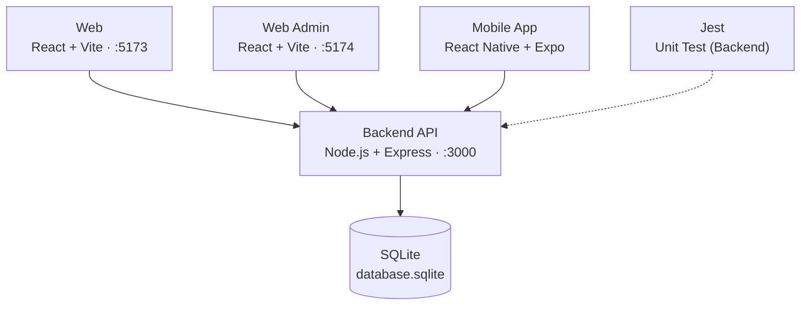
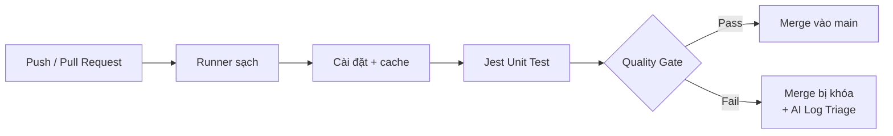
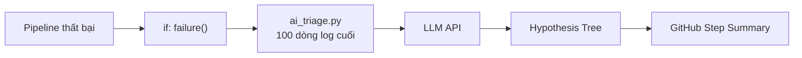

# CI/CD & Test Harness Engineering

**Seminar T07 – Kiểm thử tự động trên hệ thống EShop**

Môn Kiểm thử phần mềm – lớp Testing-CQ2023-3-LQVu

| MSSV | Họ và tên |
|---|---|
| 23120102 | Nguyễn Ngọc Minh Tuấn |
| 23120223 | Dương Nhật Cường |
| 23120225 | Trần Gia Cường |
| 23120273 | Nguyễn Gia Huy |

Giảng viên: TS. Lâm Quang Vũ, TS. Trần Duy Hoàng, ThS. Trương Phước Lộc, ThS. Hồ Tuấn Thanh

> Bộ slide gồm 15 slide, đồng bộ với `Seminar_Slides.pptx`.

---

## Slide 2 – Vì sao cần CI/CD trong kiểm thử

1. **Integration Hell:** tích hợp muộn khiến lỗi dồn về cuối dự án, khó truy vết và tốn chi phí sửa.
2. **Shift-Left Testing:** Unit Test chạy tự động ở mỗi commit và Pull Request, lỗi bị chặn sớm (Fail-Fast).
3. **CI/CD là hạ tầng Test Harness:** runner sạch, nạp fixtures, cô lập môi trường và điều phối việc chạy test.

> **Mục tiêu:** dựng pipeline GitHub Actions + Jest + AI Log Triage cho backend EShop và chứng minh bằng demo.

---

## Slide 3 – Kiến trúc hệ thống EShop (SUT)



**Phạm vi seminar:** Backend, module coupon (FR-09).

---

## Slide 4 – Test Harness: 4 thành phần cốt lõi

| Thành phần | Vai trò | Trong EShop |
|---|---|---|
| 1. Test Execution Engine | Điều phối và thực thi bộ test | Jest (`--runInBand`) |
| 2. Test Data & Fixtures | Dữ liệu và trạng thái ban đầu cho mỗi lần chạy | `initDatabase()`, `beforeAll` / `afterAll` |
| 3. Stubs & Mocks | Giả lập các phụ thuộc để test cô lập, lặp lại được | Giả lập thành phần bên ngoài backend |
| 4. Results Logging & Reporting | Ghi nhận kết quả và xuất báo cáo | Log CI, JUnit XML, coverage LCOV / HTML |

---

## Slide 5 – Pipeline CI/CD và Quality Gates



**Tiêu chí Quality Gate**

- 100% test pass
- Line coverage module coupon > 70%
- Branch Protection: status xanh mới được Merge
- Tiêu chí khác (lý thuyết): Lint, Security scan

---

## Slide 6 – Lựa chọn công cụ

| Công cụ | Vai trò | Lý do |
|---|---|---|
| **GitHub Actions** | Trọng tâm: điều phối pipeline, Quality Gates | Tích hợp sẵn repo EShop, không tốn hạ tầng, YAML trực quan, hỗ trợ matrix |
| **Jest** | Hỗ trợ: Test Engine cho backend Node.js | Chạy Unit Test, xuất Coverage Report cho Quality Gate |
| **LLM Log Triage** | Hỗ trợ: phân tích log lỗi bằng AI | Chi phí thấp, triển khai tức thì, gợi ý hướng sửa |
| Jenkins | Không chọn | Self-hosted, tốn công bảo trì máy chủ |
| Datadog FTM / Launchable | Không chọn | Đắt đỏ, cần dữ liệu lịch sử lớn |

5 tiêu chí: chi phí bản quyền · độ dốc học tập · phù hợp EShop · năng lực AI · cộng đồng và hệ sinh thái.

---

## Slide 7 – Kịch bản demo theo từng công cụ

| GitHub Actions (trọng tâm) | Jest (hỗ trợ) | AI Log Triage (hỗ trợ) |
|---|---|---|
| 1. Workflow `eshop-ci.yml`, tối ưu cache | 1. `--runInBand`, `beforeAll` / `afterAll` để cô lập test | 1. `if: failure()` và GitHub Secrets |
| 2. Commit lỗi: pipeline chặn merge, sửa lỗi, xanh lại | 2. `test.each` phát hiện lỗi coupon | 2. Tóm tắt lỗi coupon từ log |
| 3. Matrix Node 18 / 20 và Branch Protection | 3. Tái hiện flaky test `SQLITE_BUSY` | 3. Chẩn đoán `SQLITE_BUSY`, đánh giá độ chính xác |

---

## Slide 8 – Ba trụ cột kiểm thử tự động

| Trụ cột | Áp dụng trong EShop |
|---|---|
| **Record & Playback** | Log và artifacts của mỗi lần chạy CI, re-run với debug logging để tái hiện lỗi; Jest Snapshot (`.snap`) so khớp cấu trúc response API |
| **Data-Driven** | Tách logic test khỏi bộ dữ liệu tham số hóa; `test.each` cho `POST /api/apply-coupon`, lộ lỗi công thức `discount_amount` |
| **Checkpoints** | API: `expect(status)` và response body; Database: bảng `coupon_usage`, `orders`; CI/CD: Quality Gate chặn toàn bộ pipeline khi vi phạm |

---

## Slide 9 – Failure Mode 2: lỗi công thức coupon

**Trước khi sửa (`server.js`)**

```js
discount_amount =
  total_amount * (1 - discount_value);
```

**Sau khi sửa**

```js
discount_amount =
  total_amount * discount_value / 100;
```

| SAVE10 (10%), đơn 500,000 ₫ | discount_amount | final_amount |
|---|---:|---:|
| Trước khi sửa | -4,500,000 | 5,000,000 |
| **Sau khi sửa** | **50,000** | **450,000** |

**Nguyên nhân:** với `discount_value = 10` thì (1 − 10) = −9, nên tiền giảm âm và thành tiền lớn hơn tổng đơn.

---

## Slide 10 – Data-Driven Testing: 21 ca test.each

| Nhóm biên | Số ca | Giá trị kiểm thử | Kết quả mong đợi |
|---|---:|---|---|
| Ngưỡng tổng đơn (C3) | 6 | SAVE10: 299,999 / 300,000 / 300,001<br>BIGBUY: 499,999 / 500,000 / 500,001 | Dưới ngưỡng bị từ chối; từ ngưỡng trở lên áp được |
| Hạn dùng (C2) | 3 | hôm qua / hôm nay / ngày mai | Chỉ ngày mai áp được |
| Giá trị percent | 4 | 0 / 99 / 100 / 101 | Giảm = total × % / 100; 101%: từ chối hoặc final ≥ 0 |
| Fixed so với tổng đơn | 3 | 99,999 / 100,000 / 100,001 (mã fixed 100,000) | final không âm |
| Tổng đơn bất thường | 3 | -1 / 0 / 1 | -1 và 0 bị từ chối; 1 giảm theo công thức |
| Giới hạn int32 | 2 | 2,147,483,647 / 2,147,483,648 | Không lỗi 500, NaN hay số âm |
| **Tổng** | **21** | | |

Giá trị biên theo đặc tả FR-09 (C2, C3) và các trường hợp dị thường của tổng đơn, giá trị giảm.

---

## Slide 11 – AI Log Triage khi pipeline thất bại



| Cách điều tra | Thời gian (ước tính theo kế hoạch demo) |
|---|---|
| Đọc log thủ công | ~2 phút |
| AI Log Triage | ~15 giây |

- Hypothesis Tree: Hiện tượng → Nguyên nhân → Hướng khắc phục.
- Log bị cắt thiếu ngữ cảnh: AI có thể đoán sai (hallucination).
- Script: `.github/scripts/ai_triage.py`; API key lưu trong GitHub Secrets.

---

## Slide 12 – Kết quả thực nghiệm: tối ưu thời gian


- Cache rút bước cài đặt từ khoảng 60 giây xuống khoảng 5 giây.
- AI Log Triage rút thời gian điều tra từ khoảng 2 phút xuống khoảng 15 giây.
- *Số liệu ước tính theo kế hoạch demo, cập nhật bằng số đo thực tế.*

---

## Slide 13 – Độ bao phủ mã và phân quyền coupon

**Ngưỡng Quality Gate:** line coverage module coupon **> 70%**

**Kết quả thực tế:** [điền % coverage]

Báo cáo LCOV + HTML: `backend/coverage/lcov-report/index.html`

| Vai trò | Điều kiện | Kết quả mong đợi |
|---|---|---|
| **Guest** | Không có token | Từ chối (C4) |
| **Guest** | Token sai | Từ chối |
| **User** | JWT hợp lệ | Áp mã nếu đạt C1, C2, C3, C5 |

---

## Slide 14 – Demo video

1. Khởi tạo workflow `eshop-ci.yml` và tối ưu cache
2. Commit lỗi: Quality Gate chặn merge, sửa lỗi, pipeline xanh
3. Matrix Node 18 / 20 và Branch Protection
4. Jest `test.each` phát hiện lỗi coupon
5. AI Log Triage chẩn đoán lỗi pipeline

**Video:** `Demo_Screencast.mp4` – [dán link tại đây]

---

## Slide 15 – Kết luận và bài học

1. Pipeline xanh là rào chắn chất lượng đầu tiên: CI/CD là hạ tầng Test Harness.
2. Data-Driven Testing với `test.each` lộ lỗi coupon mà ca đơn lẻ dễ bỏ sót.
3. AI Log Triage tăng tốc điều tra nhưng cần kiểm chứng với log đủ ngữ cảnh.

**Hạn chế:** phụ thuộc hạ tầng GitHub; runner miễn phí 2 vCPU, 7GB RAM; log thiếu ngữ cảnh làm AI đoán sai.

**Mã nguồn:** [github.com/SoftwareTesting-Group13/eshop-sut-seminar](https://github.com/SoftwareTesting-Group13/eshop-sut-seminar)
