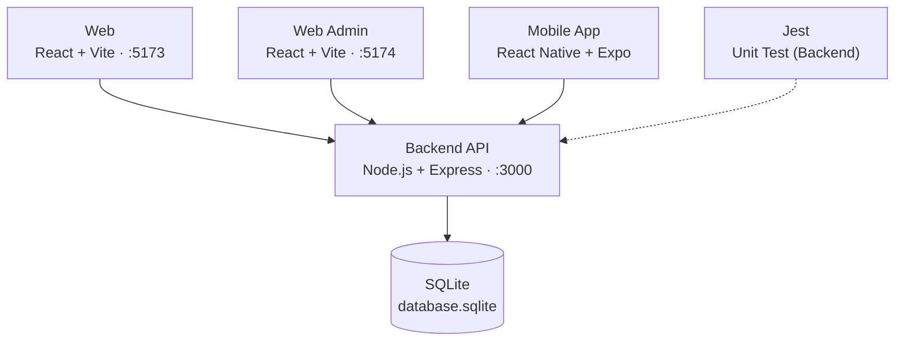
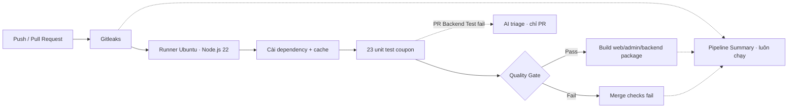
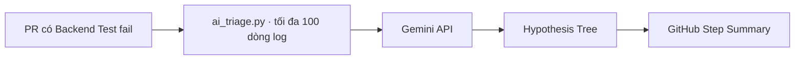

# CI/CD & Test Harness Engineering

**Seminar T07 – Kiểm thử tự động trên hệ thống EShop**

Môn Kiểm thử phần mềm – lớp Testing-CQ2023-3-LQVu

| MSSV | Họ và tên |
|---|---|
| 23120102 | Nguyễn Ngọc Minh Tuấn |
| 23120223 | Dương Nhật Cường |
| 23120225 | Trần Gia Cường |
| 23120273 | Nguyễn Gia Huy |

Giảng viên: TS. Lâm Quang Vũ, TS. Trần Duy Hoàng, ThS. Trương Phước Lộc, ThS. Hồ Tuấn Thanh

## Slide 1 – CI/CD & Test Harness Engineering

Seminar T07 – Kiểm thử tự động trên hệ thống EShop.

---

## Slide 2 – Vì sao cần CI/CD trong kiểm thử

1. **Integration Hell:** tích hợp muộn khiến lỗi dồn về cuối dự án, khó truy vết và tốn chi phí sửa.
2. **Shift-Left Testing:** Unit Test chạy tự động ở mỗi commit và Pull Request, lỗi bị chặn sớm (Fail-Fast).
3. **CI/CD là hạ tầng Test Harness:** runner sạch, nạp fixtures, cô lập môi trường và điều phối việc chạy test.

> **Mục tiêu:** dựng pipeline GitHub Actions + Jest + AI Log Triage cho backend EShop và chứng minh bằng demo.

---

## Slide 3 – Kiến trúc hệ thống EShop (SUT)



**Phạm vi seminar:** Backend, module coupon (FR-09).

---

## Slide 4 – Test Harness: 4 thành phần cốt lõi

| Thành phần | Vai trò | Trong EShop |
|---|---|---|
| 1. Test Execution Engine | Điều phối và thực thi bộ test | Jest (`--runInBand`) |
| 2. Test Data & Fixtures | Dữ liệu và trạng thái ban đầu | DB được khởi tạo khi load module; hooks dùng ở full suite |
| 3. Stubs & Mocks | Giả lập phụ thuộc khi cần test cô lập | Coupon CI: unit test hàm thuần, không dùng mock |
| 4. Results Logging & Reporting | Ghi nhận kết quả và báo cáo | Log CI, LCOV và JSON; không cấu hình JUnit XML/HTML |

## Slide 5 – Pipeline CI và Quality Gates



**Quality Gate:**

- 100% test của suite được chọn phải pass.
- Line coverage của `coupon-discount.js` phải > 70%; cần LCOV.
- Repo có script cấu hình required checks cho Branch Protection; trạng thái áp dụng trên GitHub cần kiểm tra tại repo.
- Workflow hiện chạy test và build, chưa deploy ứng dụng.

## Slide 6 – Lựa chọn công cụ

| Công cụ | Vai trò | Lý do |
|---|---|---|
| **GitHub Actions** | Trọng tâm: điều phối pipeline, Quality Gates | Tích hợp sẵn repo EShop, không tốn hạ tầng, YAML trực quan, hỗ trợ matrix |
| **Jest** | Hỗ trợ: Test Engine cho backend Node.js | Chạy Unit Test, xuất Coverage Report cho Quality Gate |
| **LLM Log Triage** | Hỗ trợ: phân tích log lỗi bằng AI | Chi phí thấp, triển khai tức thì, gợi ý hướng sửa |
| Jenkins | Không chọn | Self-hosted, tốn công bảo trì máy chủ |
| Datadog FTM / Launchable | Không chọn | Đắt đỏ, cần dữ liệu lịch sử lớn |

5 tiêu chí: chi phí bản quyền · độ dốc học tập · phù hợp EShop · năng lực AI · cộng đồng và hệ sinh thái.

---

## Slide 7 – Kịch bản demo theo từng công cụ

| GitHub Actions (trọng tâm) | Jest (hỗ trợ) | AI Log Triage (hỗ trợ) |
|---|---|---|
| 1. Workflow `eshop-ci.yml`, cache dependencies | 1. `--runInBand`; `beforeAll` / `afterAll` có ở full suite | 1. Chạy khi PR có Backend Test fail; dùng `GEMINI_API_KEY` trong Secrets |
| 2. Commit lỗi: Quality Gate fail; sửa lỗi rồi chạy lại | 2. `test.each` kiểm tra coupon | 2. Tóm tắt lỗi test coupon từ log |
| 3. Node.js 22; repo có script cấu hình Branch Protection | 3. Demo flaky async-delay (fast / slow / random), không phải SQLite_BUSY | 3. AI đưa giả thuyết để developer đối chiếu với test và source |

## Slide 8 – Ba trụ cột kiểm thử tự động

| Trụ cột | Áp dụng trong EShop |
|---|---|
| **Record & Playback** | CI lưu log/artifacts; có thể re-run để đối chiếu. SUT hiện không có Jest Snapshot (`.snap`). |
| **Data-Driven** | API test ở `backend/tests/coupon.test.js`; CI demo chọn unit test `backend/tests/coupon-discount.unit.test.js`. |
| **Checkpoints** | API: kiểm tra status/body; DB coupon: `coupon_usage` (orders thuộc suite khác); Gate fail làm Build dừng, Pipeline Summary vẫn chạy. |

## Slide 9 – Failure Mode 2: lỗi công thức coupon

**Fault injection mô phỏng trong comment test (`backend/tests/coupon.test.js`):**

```js
discount_amount =
  Math.floor(total_amount * (1 - coupon.discount_value));
```

**Implementation hiện tại (`backend/coupon-discount.js`):**

```js
discount_amount =
  Math.floor(totalAmount * (coupon.discount_value / 100));
```

| SAVE10 (10%), đơn 500,000 ₫ | discount_amount | final_amount |
|---|---:|---:|
| Fault injection | -4,500,000 | 5,000,000 |
| Implementation hiện tại | 50,000 | 450,000 |

Với `discount_value = 10`, công thức fault injection tạo mức giảm âm. Công thức hiện tại chia cho 100 và làm tròn xuống. Test kỳ vọng mức giảm 50,000 ₫; fault injection làm test fail và Quality Gate chặn merge.

## Slide 10 – Bộ test coupon: 21 ca API và 23 unit test CI

**API suite riêng:** `backend/tests/coupon.test.js` dùng Supertest, có 21 scenario. Bảng tóm tắt bộ ca hiện có:

| Nhóm | Số ca | Nội dung |
|---|---:|---|
| Coupon hợp lệ | 7 | SAVE10 ở 1,000,000 / 500,000 / 300,000; BIGBUY ở 600,000 / 500,000; VIP100 ở 400,000 / 300,000 |
| Coupon hết hạn | 2 | EXPIRED ở 200,000 và 5,000,000; mong đợi HTTP 400 |
| Dưới ngưỡng | 4 | SAVE10: 299,999 / 0; BIGBUY: 499,999; VIP100: 100,000 |
| Mã không hợp lệ | 5 | Thiếu code, code rỗng, NOPE, sai chữ hoa/thường, coupon inactive |
| Bất biến percent | 3 | Hai nhánh có/không `user_id`; discount trong `[0, total]`; `final_amount < total` |

**Suite CI khác:** `backend/jest.demo.config.js` chọn `backend/tests/coupon-discount.unit.test.js`, gồm 23 unit test và chỉ đo coverage `coupon-discount.js`. CI demo không chạy API suite 21 scenario ở trên. Endpoint `POST /api/apply-coupon` hiện không gắn `authenticateToken`.

## Slide 11 – AI Log Triage khi PR có Backend Test fail



| Cách điều tra | Thời gian |
|---|---:|
| Đọc log thủ công | ~2 phút (ước tính) |
| AI Log Triage | ~15 giây (ước tính) |

Script: `.github/scripts/ai_triage.py`; khóa `GEMINI_API_KEY` lưu trong GitHub Secrets. Workflow chỉ gọi triage khi PR có Backend Test fail và có API key. Các số thời gian là ước tính theo kế hoạch demo, chưa được xác nhận bằng phép đo trong source.

## Slide 12 – Ước tính thời gian cache và AI triage


- Cache: khoảng 60 giây xuống khoảng 5 giây.
- AI Log Triage: khoảng 2 phút xuống khoảng 15 giây.
- Đây là số liệu ước tính theo kế hoạch demo, không phải kết quả đo được xác nhận trong source SUT.

## Slide 13 – Coverage và hành vi endpoint coupon

- Quality Gate yêu cầu line coverage của module `coupon-discount.js` **> 70%**.
- Kết quả coverage thực tế: xem artifact CI của đúng commit.
- Báo cáo LCOV: `backend/coverage/lcov.info`.

| Vai trò/request | Hành vi hiện tại trong SUT |
|---|---|
| Guest, không token | Token không bắt buộc; coupon hợp lệ vẫn được áp dụng. |
| Guest, token sai | Token không được kiểm tra; coupon hợp lệ vẫn có thể áp dụng. |
| Request có JWT hợp lệ | JWT không được endpoint kiểm tra; C5 dùng `user_id` do client gửi trong body. |

`POST /api/apply-coupon` hiện không gắn `authenticateToken`; đây là mô tả hành vi thực tế của SUT, không phải hành vi bảo mật mong muốn.

## Slide 14 – Demo video

1. Workflow `eshop-ci.yml`: Gitleaks, cache, test, Quality Gate và build.
2. Commit lỗi: Quality Gate fail; sửa lỗi và chạy lại.
3. Node.js 22; repo có script cấu hình Branch Protection.
4. Jest `test.each` kiểm thử coupon; CI demo chạy unit suite riêng.
5. AI triage chỉ chạy khi PR có Backend Test fail.

**Video:** chưa có file demo trong repo; bổ sung URL khi có video.

## Slide 15 – Kết luận và bài học

1. CI chạy test và build; workflow hiện chưa deploy ứng dụng.
2. `test.each` giúp kiểm tra nhiều ca coupon; cần phân biệt API suite và unit suite mà CI chọn.
3. AI Log Triage đưa giả thuyết để developer kiểm chứng với log, test và source.

**Giới hạn:** phụ thuộc GitHub; workflow dùng runner `ubuntu-latest` do GitHub-hosted; thời gian cache/triage trong slide là ước tính; log thiếu ngữ cảnh có thể dẫn tới chẩn đoán sai.

**Mã nguồn:** [github.com/SoftwareTesting-Group13/eshop-sut-seminar](https://github.com/SoftwareTesting-Group13/eshop-sut-seminar)